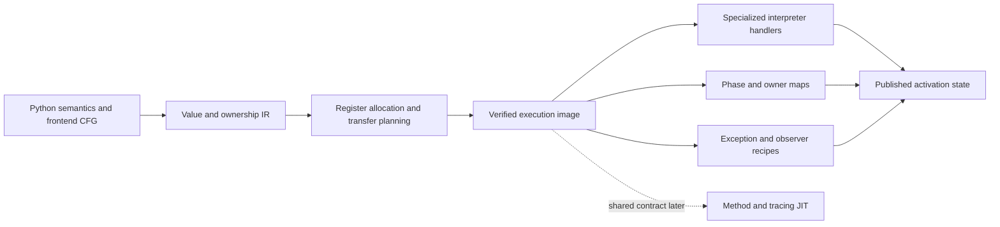
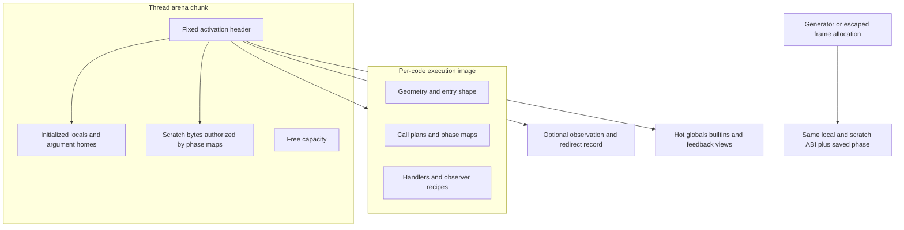
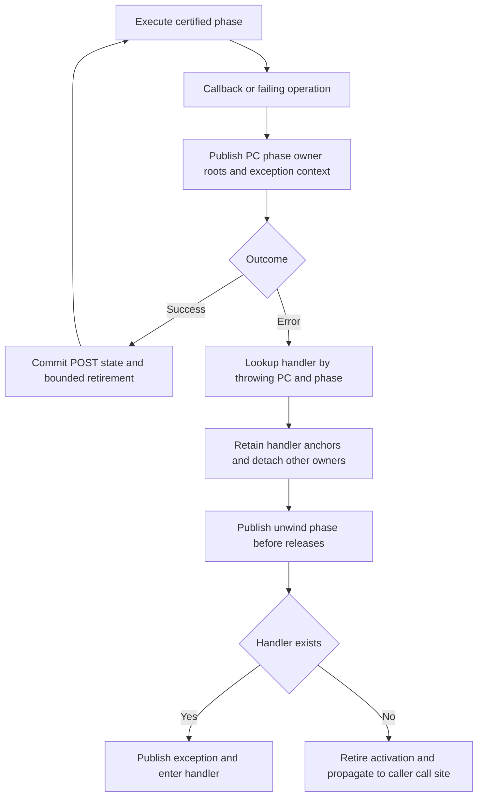
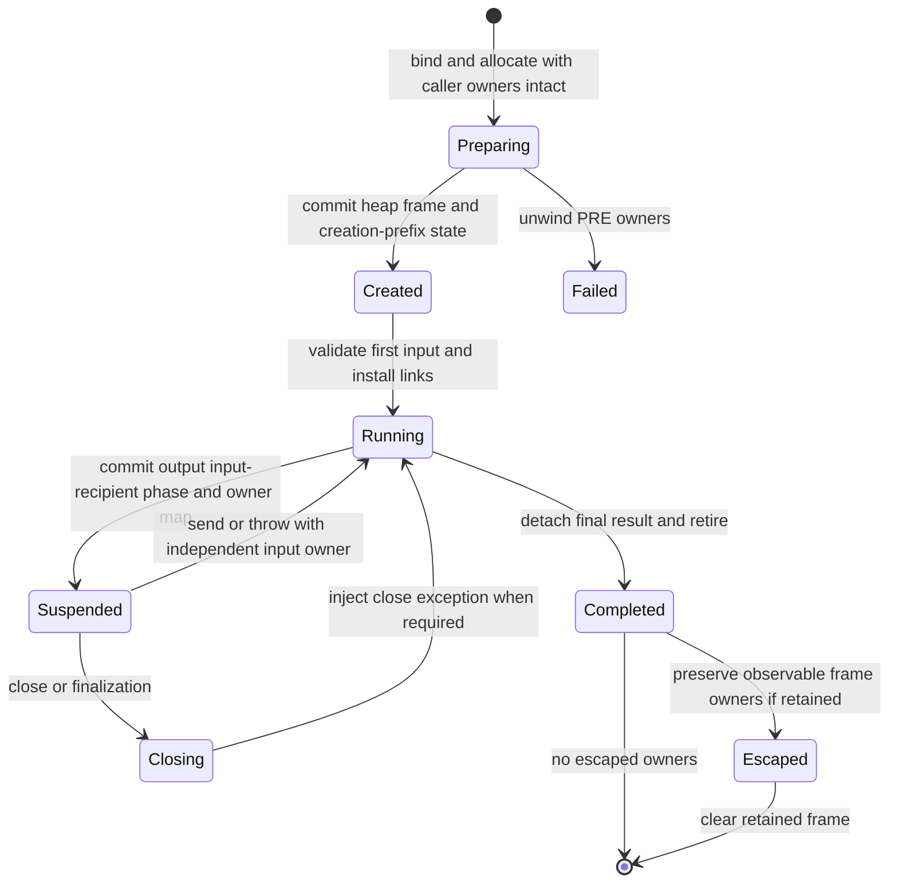

# Register execution and call ownership, model55

Frozen model55 design input. The active successor is the
[combined performance plan](../../issues/interpreter-performance56/plan.md).
This proposal is not the selected runtime; status records which source pieces
are implemented, measured or still awaiting qualification.

Status: reviewed target architecture; independent post-review accepts the design contract. Implementation is active; this target is not the selected runtime and has no complete-model performance claim. See the [review resolution](../../issues/call-model55/review-resolution.md) and [migration plan](../../issues/call-model55/plan.md).
Research date: 2026-11-12. Scope: the GIL interpreter first, with explicit requirements for later free-threaded support. Native JIT compilation is not a prerequisite or the proposed explanation for interpreter regressions.

## Decision

Build an interpreter whose compiler describes **values, owners, and observable execution phases**, rather than deriving those facts repeatedly from generic stack-operation templates. Retain the useful call ABI already present: one owning arena, overlapping argument homes, direct ordinary return, and heap-owned suspended activations. Change the authority for scratch storage from universally valid/NULL cells to verified execution-state descriptions. Keep named locals initialized and observable. Give internal execution metadata typed owners. Generate a small number of transfer and retirement handlers from these contracts, choosing their variants when constructing or specializing the execution image.

The recommended first complete ownership implementation is **static scratch owner maps plus initialized locals**. A physical mortal-owner bitmap is a serious alternative, to be compared over the same complete lifecycle before choosing the final representation. Neither option is a version of round54's empty-recipient flag. The deciding question is total executed work: stores, map maintenance, tag classification, dispatch, callback publication, and teardown together. There is no evidence of a globally optimal design or a promised speedup.

Keep hot environment and feedback caches unless the complete execution-image layout removes their dependent loads. Header size is a consequence, not the objective. The proposed work should remove repeated semantic reconstruction and owner traffic across ordinary execution as well as calls; a smaller header alone cannot address a 35–41% instruction excess.

## Evidence and limits

The canonical C checkout is not the measured runtime. Source inspection here used:

- Current control is selected54, `61015a9452d9069646fb5fede9ff963896833b89`, under `build/worktrees/frame54-cold-construction` in the sibling checkout. Selected51 `0e5e61f4c6bc820f2dd1a5f9ee6f7f1768834254` is a separate historical source/performance comparison, not the admission control.
- Cold constructor correction: `61015a9452d9069646fb5fede9ff963896833b89`; preserve its constructor publication/failure ordering in any migration. It is not evidence of a hot call redesign.
- Upstream comparison identity: `3a440b65695615e9fd9912342b79cdd54fced0d2`.

The [status](../../STATUS.md), [round54 report](../../issues/frame-state54/report.md), and [lifetime policy](../lifetimes-and-language-semantics.md) govern interpretation. Selected51's matched instruction ratios against upstream are 1.352487 for DeltaBlue, 1.414550 for generators and 1.388163 for coroutines. These ratios identify extra execution work, not an elapsed-time budget that a redesign can simply recover. The coordinator subsequently supplied the completed cold54 comparison: matched cycle/instruction ratios are approximately 1.2105/1.3531 (DeltaBlue), 1.4346/1.4139 (generators), and 1.2491/1.3863 (coroutines). Its flat profiles place substantial samples in exact calls/retirement, generator creation/completion, and SEND/YIELD respectively. These confirm the lifecycle focus, but flat samples are not exclusive removable budgets; retain the exact scopes and ranges in the coordinator's tables.

The five rejected round54 experiments, their revisions and compositions reject their actual implementations. They do not test an integrated map-based ownership architecture. Conversely, their failures are useful evidence against deleting hot cached state, adding generic recipient classification, or equating byte savings with performance.

### What the current runtime already does

The following source anchors are relative to selected51, not this checkout's C files:

| Path and symbol | Observed behavior | Consequence for this proposal |
| --- | --- | --- |
| `Include/internal/pycore_interpframe_structs.h`, `_PyInterpreterFrame` | 112-byte GIL fixed header; separate code/function PyValues, cached globals/builtins/feedback, base/saved top, semantic instruction and real return PC | Preserve independent lifetime anchors and useful caches; investigate representation and repeated classification |
| `Include/internal/pycore_interpframe.h`, `_PyStackChunk_EnsureFrameStorage`, `_PyFrame_ReserveForCall`, `_PyFrame_Initialize` | Initialized frontier; exact calls reserve final storage and initialize once; hidden constants initialized at frame creation | No claimed removal of repeated full warm-frame memset or resume-time constant initialization |
| `Python/generated_ir_cases.c.h`, `CALL_PY_EXACT_ARGS` | Hook/version/arity/capacity/recursion guards, overlapping homes for thread callers, copy from heap callers, direct evaluator entry | Keep overlap and enter-in-place; improve the generated contract, not invent overlap again |
| `Python/ceval.c`, `call_bind_known_python` | Cached positional/default and bounded keyword plans; all guards before transfer; defaults shape checked; child published before remaining close | Extend one binder ABI; retain these mutation and failure protections |
| `Python/generated_ir_cases.c.h`, `RETURN_VALUE` | Take result owner, leave recursion, unlink child, clear/pop, publish ordinary result inline | Already inline; savings must arise in ownership/retirement and metadata access |
| Same file, `SEND`, specialized send cases, `YIELD_VALUE` | Resume within evaluator; yield detaches output and restores exception/recursion links | Do not claim removal of a C evaluator call per resume |
| `Python/frame.c`, `_PyFrame_ClearExceptCode`, `_PyFrame_Traverse` | Normal thread exit clears locals after scratch is empty; heap/exposed ownership differs; generic value traversal for metadata | Normal exit does not currently scan every scratch cell; account for earlier scratch cleanup instead |
| Generated `error` / `exception_unwind` labels | Handler lookup on error, suffix cleanup and exception/lasti publication | Exceptions are already table-driven; target unnecessary normal-path preparation, not fictitious per-call handler allocation |

The independent [source cost audit](../../issues/frame-state54/call-model55-cost-audit.md) supplies further selected51 reader/producer details, including conservative retiring-frame roots. Source-generated repeated expressions may disappear in optimized C. The ledger must distinguish generated source, native instructions, dynamic counts, and elapsed measurements.

## Lessons from other engines

These are primary-source observations, followed by design inferences. V8 `main` resolved to `f3bb03f6069753635e41f07e9430a27033984f12`; LuaJIT `v2.1` resolved to `63c8f1a9b479ba5518cf6a170ff7729178bc3cfd` on the research date. Moving-branch pages were read alongside pinned files; implementation work should revalidate the pinned interfaces it borrows.

V8's Ignition bytecodes encode register inputs/outputs, register lists and counts, accumulator effects, call forms, and feedback operands. Its register optimizer tracks equivalence and materialization, eliminating transfers before execution. This supports carrying compiler facts into the interpreter rather than reconstructing a stack model in handlers. It does not establish that accumulator execution or V8's exact encoding suits Python. [Bytecodes](https://github.com/v8/v8/blob/f3bb03f6069753635e41f07e9430a27033984f12/src/interpreter/bytecodes.h), [register optimizer](https://github.com/v8/v8/blob/f3bb03f6069753635e41f07e9430a27033984f12/src/interpreter/bytecode-register-optimizer.cc).

V8 has explicit fixed-frame conventions and unoptimized frame metadata. Its x64 interpreter entry allocates and initializes register storage; it is not evidence that all interpreter cells can always be uninitialized. Compact frames still need code/bytecode, context, feedback and execution-position access. Keep our repeatedly used state where the native consumer can reach it cheaply. [Frame constants](https://github.com/v8/v8/blob/f3bb03f6069753635e41f07e9430a27033984f12/src/execution/frame-constants.h), [interpreter entry implementation](https://github.com/v8/v8/blob/f3bb03f6069753635e41f07e9430a27033984f12/src/builtins/x64/builtins-x64.cc).

V8 handler tables distinguish instruction ranges from return-address tables; the former require the throwing instruction's position. Its optimized-frame safepoint data describes tagged stack/register locations, while fixed frame portions have dedicated traversal. These are good precedents for separating execution/error position from continuation and separating typed metadata from value roots. They are **not** an RC retirement protocol: V8 root maps alone do not account for counted edges between stops. [Handler tables](https://github.com/v8/v8/blob/f3bb03f6069753635e41f07e9430a27033984f12/src/codegen/handler-table.h), [safepoints](https://github.com/v8/v8/blob/f3bb03f6069753635e41f07e9430a27033984f12/src/codegen/safepoint-table.h), [frame traversal and optimized frames](https://github.com/v8/v8/blob/f3bb03f6069753635e41f07e9430a27033984f12/src/execution/frames.cc).

LuaJIT places compact frame function/link information next to register storage, with separate continuation frame forms. Its collector scans the used thread stack and clears unused tail cells in the atomic phase; frame traversal also determines required stack extent. This is evidence for explicit frame kinds and contiguous call storage, not evidence for ignoring stale cells. LuaJIT's tracing collector does not incur our per-owner RC release obligations. [Frame definitions](https://github.com/LuaJIT/LuaJIT/blob/63c8f1a9b479ba5518cf6a170ff7729178bc3cfd/src/lj_frame.h), [GC stack traversal](https://github.com/LuaJIT/LuaJIT/blob/63c8f1a9b479ba5518cf6a170ff7729178bc3cfd/src/lj_gc.c).

The inference is to share **descriptions and conventions**, not copy another language's frame size or collector assumptions. Python mappings, mutable functions, observable locals, tracing, exception state and RC callbacks remain explicit requirements.

## Compare whole architectures

| Architecture | Normal execution | Boundary and teardown | Principal failure mode | Decision |
| --- | --- | --- | --- | --- |
| Current NULL-authoritative homes | Canonical store plus NULL on consumption; simple dynamic readers | Scan valid cells, local-only ordinary exit | Persistent owner/clearing traffic and generic handlers | Immutable control and safe migration reference |
| Dynamic mortal-owner map for all physical homes | Update only on mortal ownership transitions; inline values need no bit | Scan set bits, clear before decref, reconcile bindings separately | Read-modify-write traffic, cache dependencies, map transfer on heap moves | Complete alternative, not rejected by round54 |
| Static scratch maps, initialized locals | No scratch validity bit or NULL store per consume; generated release actions | Publish PC/phase, map authorized scratch, scan initialized locals | Too many phases, map decoding, callback invalidation, code size | Preferred starting target |
| Static maps plus dynamic map only for genuinely variable owner subsets | Static majority; bitmap for selected dynamic regions | Two representations selected by code/region descriptor | Representation crossings erase savings | Reserve for measured irregular regions, not initial universal machinery |
| Frame/region retains everything until exit | Few consumption releases | Large final sweep | Long-lived frames and loops retain large graphs/resources | Reject as default; bounded local batching only |
| Tracing GC or native JIT replaces RC interpreter | Different cost model | Different semantics/integration project | Evades current task and selected RC policy | Out of scope |

The static design wins the initial recommendation because scratch *existence* can be deterministic at each admitted phase even when its value type is dynamic. It avoids a map write for every mortal transfer. It still classifies mapped dynamic PyValues when retiring or traversing them. A mortal bitmap can win where sparse occupancy makes those reads expensive, or where the dynamic subset needs many static variants. Decide from complete work counts and measurements, not migration difficulty.

## Four different facts

| Fact | Authority | What it does not mean |
| --- | --- | --- |
| Definite assignment / safe read | Compiler proof at every edge and observation phase | A stale old bit pattern is not an initialized Python value |
| Named-local boundness | Initialized local is a canonical value or NULL; virtual kwargs is an explicit separate state | Dead by program dataflow does not mean invisible to `f_locals` |
| Mortal owner occupancy | Static authorized owner locations plus value tags, or a dynamic mortal map | Inline/immortal values require no counted edge, but may still be live values |
| Future-read liveness | Register dataflow plus observer/handler requirements | A no-longer-read owner still needs one release |

Scratch storage may contain stale bytes only when the execution descriptor forbids every semantic read, tag test, GC visit and owner release of those cells. Copying their representation as bytes is permitted by the storage contract; interpreting those bytes as a PyValue is not. Prefer selective copies of authorized initialized values. A bulk copy must use byte-copy semantics and transfer its maps atomically; it must never duplicate ownership merely because bytes were copied. Poisoning inactive cells in debug builds should expose unauthorized readers.

Locals remain initialized on entry and NULL on deletion. This preserves inexpensive unbound checks and observation without a second per-local validity bitmap. Ordinary local overwrite still takes the displaced owner and installs the replacement before release. A compiler may eliminate a local duplicate only while it can prove no call, trace hook, debugger write or other mutation breaks the borrowed lifetime. Borrowing across arbitrary Python callbacks is not the default.

## Target execution image and IR

Each strong code pin retains an immutable **SemanticDescriptor** and its mutable **ExecImage** for the code lifetime; the latter contains dispatch words and feedback. Frame image/descriptor views borrow under that existing pin, adding no second per-call image refcount. These are separate objects/contracts even if their allocations are later colocated. The initial authority uses PC plus a finite uint8 PhaseID, not a per-operation descriptor-pointer load. The canonical SiteId is a uint32 word index in the admitted canonical image. Physical words retain that one-to-one site geometry; the initial PC cache can remain the existing word pointer, with cold walkers deriving SiteId relative to the pinned image. Publication writes that PC and a literal PhaseID as one non-reentrant commit before exposure. It performs no site-table lookup. A direct PhaseDescriptor pointer is allowed only when lowering can emit its literal address directly and native review shows no added dependent load; it is not the initial default.

```text
SemanticDescriptor (immutable, retained by existing independent code pin):
  format_version; word_count; frame/local geometry; constant authority
  SiteId=uint32; PhaseId=uint8; RegIndex=uint16 (physical 12-bit domain)
  RootMapId/OwnerMapId=uint32 interned descriptor IDs
  site[SiteId] -> {phase_table_offset, transfer_form, successors, error_recipe}
  interned initialized-range sets; owner-range sets; observer recipes
  admitted specialization/instrumentation contracts; optional progress shapes
PhaseDescriptor (site-local finite PhaseID):
  initialized_scratch_set; authorized_owner_set; nullable_initialized_exceptions
  root_shape; normal/exception successor; observer recipe; transition kind
ExecImage (pinned generation, mutable dispatch only):
  SemanticDescriptor view under code pin; words[same word_count]; feedback
  instrumentation state
Published state key:
  pinned image + canonical SiteId (from PC) + uint8 PhaseID
```

Initial phase names are PRE, POST(normal-successor edge), STAGED variants selected by each admitted helper's fixed root shape, RETIRING and SUSPENDED. Numeric IDs are site-local table slots with a generated family-wide assignment: PRE=0, POST=1, ERROR=2, RETIRING=3, SUSPENDED=4, and fixed family-specific staged/successor roles from 5 upward. Thus the same generated handler emits literal IDs at every admitted site; a shared cold adapter receives that literal rather than looking up a per-site phase number. The verifier checks each site implements that family contract, including unused/invalid slots. A site must fit uint8 (at most 256 local phases); normalize/split the operation at compile time or reject the image rather than adding a hidden runtime map decoder. These are finite semantic alternatives, not one phase per consumed input, loop iteration or unpack prefix length. Initial map encoding is interned sorted half-open ranges of uint16 slot indices plus small explicit exceptions (nullable initialized slots and locations with a distinct role). A direct site array yields the phase-table offset; walkers perform that cold lookup. Each mapped home must contain initialized canonical value bits even when NULL, inline or immortal. An owner map authorizes PyValues, not a promise that each holds a mortal edge. Named locals remain initialized separately. The verifier rejects overlapping contradictory ranges, out-of-frame entries and unbound/undefined reads.

Conditional method output initially normalizes to two initialized homes: callable and self-or-NULL. Both have a defined value on every outgoing route; the absent self stores real NULL. No stale cell supplies a discriminator. Other differing routes choose finite POST IDs or edge moves into a common join layout. SEND/FOR success, exhaustion and error have separate certified successors. Variable unpack uses one bounded **prefix shape** and a progress cursor, not N phase descriptors: a pre-reserved initialized output segment, source root and output capacity are recorded by the adapter. It initializes item j and advances produced_count before another fallible step; only [0,produced_count) is readable/owning. Capacity is validated against the admitted output window; failure walks that registered prefix and source. Larger outputs do not overflow the eight-root batch: the prefix recipe enumerates their reserved segment independently.

Initially, a materialized mortal scratch value still has exactly one owner.
Logical borrowed operands use their binding/constant anchor or a C-local view;
this proposal does not introduce an ordinary bank of borrowed mortal homes.
At publication, a materialized mortal scratch home belongs to the owner set,
or its owner has moved elsewhere and the old home is no longer readable.
Known inline values can remain readable without a mortal edge. Initialized
and owner sets therefore cannot be replaced with one future-read liveness set.

Specialization and instrumentation may replace only the low 16 handler selector within the canonical site's admitted operand, ownership, callback and phase contract. Canonical restore and polymorphic rows must preserve/recover the certified transfer form. They cannot change word count, operand geometry or semantic site identity. A contract/geometry-changing transform initially creates a new validated code/image, not an arbitrary replacement beneath active frames. Active and suspended frames retain the original image through their existing code pin until retirement. Any future switch must be an explicit cold normalization boundary reconciling owners, phase, continuation and guards. Monitoring toggles patch within the fixed contract; they do not accumulate retired image generations. Callback refresh reloads mutable dispatch/feedback views, checks the actual pinned generation and rechecks mutable function/provider/default assumptions before any uncommitted transfer. It never substitutes function.__code__ for the executing pin or silently switches descriptor authority. No generation load is added to every inline operation. Do not add owner edges to caches without a tracing/invalidation contract.



A transfer operation describes consumed, borrowed and produced values, destinations, releases, possible callbacks, PRE/POST error states, and successors. This is an intermediate contract, not a request for one wide runtime instruction or one generic decoder on every operation. Compiler analysis and generator verification select direct handler forms.

Example, schematic rather than current syntax:

```text
%f = load_local_checked L0                # independent owner if needed
%a = load_local_checked L1
%r = call_python %f, [%a], site=7
store_local L2, move %r

lowered site 7:
    args physical [s8:s9), callable s7
    result local L2; normal pc=42; error phase=CALL_PRE
    callee shape guarded by function/provider/default epochs
    caller suspended owner map excludes transferred window
    commit transfers s7 and s8; no fallible step in commit
    return publishes L2 before releasing its displaced owner
```

For an unused result, the result contract is `discard`; completion holds and retires it without creating a throwaway home or dispatching a POP_TOP. This already exists for covered results; extend it only where the generator can prove actual producer and observer contracts. For a temporary consumed by arithmetic, eliminate the NULL write through the phase map, and fuse retirement into the producer/consumer's completion boundary. Do not retain obsolete POP/END stack shape operations as execution obligations merely because the frontend emits them.

### Initial word encoding and common admission

Keep the eight-byte word and four 12-bit fields. Registers are 0..4094; 4095 remains the existing discard sentinel only where a destination role permits it, never an input register. Narrow ownership/result refinements use the existing low 16 handler selector with generated canonical/family mappings, not an assumed free operand bit. Generate only reached forms, preserving direct inline ordinary return; a form must not require a second completion dispatch. Price text growth and handler-space use. If a combination cannot fit, lower it to existing simpler operations rather than adding an implicit generic operand-plan decoder.

Initial constant support is a dedicated pool-load form: A is the destination, B is reserved zero (or an explicitly specified feedback role in a distinct form), and CD is an unsigned 24-bit pool index. Small register/pool arithmetic forms can use a 12-bit pool field where the operand layout fits without reducing the other register domains; handler identity selects register/pool roles. A larger pool index lowers through the dedicated load and an ordinary register operation. Referenced constants outside the 24-bit load capacity reject as an ordinary format limit; an unreferenced larger pool alone need not reject. Unsupported frame/register geometry rejects rather than truncating. The small mixed form is RP12; the dedicated LOAD_POOL uses CD24. Literal-pool encoding optimizations are optional later work, not part of the ownership authority switch. Existing branch formats keep their documented signed/unsigned displacement domains, checked per role; this proposal adds no free high bits. Preserve the current INT_MAX byte-size limit initially, so a uint32 SiteId suffices. Format-version/magic ownership is explicit when serialized operand roles or semantic descriptor schema change.

One common `ValidateSemanticImage` entry (a new design interface, not an existing function claim) validates assembled compiler output, public CodeType construction/code.replace, marshal/frozen loads and any new ExecImage generation before publication. Execution-copy creation verifies/pins that admitted descriptor and copies only its certified physical shape; it does not infer trust from a compiler-only flag. Internal fixed sentinels have explicit bounded descriptors reviewed through this entry or an equivalent fixed proof, not a debug-only universal bypass. Validation covers field domains/feedback extents, constants' actual replacement values, CFG successors and joins, definite assignment, initialized/owner maps, nullable outputs, PRE/POST failure edges, call-clobber partitions, progress bounds, collector root recipes and allowed handler refinements. `co_consts` mutation through replacement produces new validation and independent code lifetime; no stale scalar/immortal assumption survives. Update assembly, regcfg allocation/verifier, codeobject construction/replacement, marshal, disassembly, metadata generation and magic/version tests together. A versioned semantic flag/schema can land early under NULL homes; actual per-code constant operands/removal of hidden homes is a later bounded implementation after ownership correctness.

### Register allocation must stop encoding destruction order

`_PyFrame_ClearTemporaries` explicitly relies on physical slot order matching the frontend stack order, imposed by `_PyRegCfg_Compact`: highest-to-lowest clearing reproduces upstream pop order. That is a current design constraint, not a Python requirement. Represent logical values, named bindings and counted owners separately. Give each operand a compiler-known use kind (`borrow`, `duplicate`, `move`, `constant`) and each definition an ownership effect. Color scratch from value/owner interference and boundary requirements, not historical stack position. A dead owner interferes until its selected release edge; future-read deadness alone does not free its storage.

Required evaluation, exception, `with` and `finally` ordering remains explicit CFG behavior. A selected bounded RC retirement order may differ from CPython's old pop order, as the lifetime policy allows. Exception maps list actual retained/released owners rather than deriving them from a numeric suffix. This removes a global allocation restriction, not merely an unwind loop.

There is still a real call-clobber constraint. A caller's values/owners live across a call must occupy homes outside the child's entire reserved write extent. For the overlapping fast ABI, place those surviving caller homes below the argument-window base; the child's locals/scratch may overwrite from that base through its admitted extent. The compiler packs outgoing arguments into that region, preserves any live originals with the required duplicate owner, and proves the caller's suspended map excludes the transferred cells. It may use explicit edge moves when coloring cannot satisfy this cheaply. The runtime validates capacity/geometry and partitions ownership; it does not recover an arbitrary conflicting layout at each call. Heap callers cannot use this same physical overlap.

### Return bindings and rare escape

Today `IR_CONSUME_INPUT` treats a local as borrowed and `IR_TAKE` duplicates it for return, retaining the binding for a possible escaped frame. The target distinguishes a named binding from the outgoing value. At a verified terminal return after return-monitoring callbacks, an activation with no published frame object and no remaining observer route to its departing locals may **move** the returned local owner into the transition result root and mark the binding absent in the retiring state. This removes one duplicate/release pair on that common route. Arbitrary ordinary calls cannot consume their caller's named argument binding; arguments need a new counted owner unless a verified lifetime/observation proof permits borrowing or moving.

If a frame object is already published, retain its visible binding and duplicate the result as today. If a hook can expose the frame, run it before choosing the move route and recheck the association afterwards. Retirement must unlink the frame before any finalizer; prove that delayed materialization cannot rediscover the departed frame through tracing/profiling/frame-back state. If that proof fails for a route, it uses the binding-preserving return. The cold escape branch must not attempt to reconstruct a binding from a result already consumed or finalized. A frame object that exists but appears uniquely referenced is conservatively treated as observed initially. This is a concrete rare-observation optimization with a proof gate, not license to hide local bindings while the frame remains observable.

### Constants belong to executing code

Hidden `CO_FAST_CONST` homes currently enlarge localsplus, are filled on every construction, and move with the full frame on generator creation/escape. Give the IR a constant-pool operand class, including immediate inline literals where encoding permits. A predecoded operand plan points into the **executing code's** immutable constant authority. A constant read borrows under that code pin; export into a container, mutable binding, call-owner window or result acquires the necessary owner exactly once. `code.replace(co_consts=...)` may supply mortal constants, so neither a constant operand nor a scalar-looking original declaration implies immortality. Validate/construct the replacement image against its actual constants; never recover them through mutable `function.__code__`.

This removes per-frame constant-home initialization and capacity, rather than accelerating repeated stores. Avoid an extra generic operand-kind branch on every access: choose handler/operand plans once and retain direct access in the generated handler. Code-object constants remain their own GC edges, not duplicated frame edges. Observer recipes reconstruct constant-backed hidden values where needed; named user bindings still have their own semantics. Measure encoding size and dependent loads against removed entry/copy traffic.

A branch carries separate owner maps and successor recipes. A join either has a common ownership layout, or predecessor edge transfers normalize it. Do not let a hidden runtime condition select between different owner maps without recording that condition. `FOR_ITER`, SEND, yield and completion are semantic multi-exit operations, already partly implemented; finish this representation across cleanup and exceptional edges.

Select `new scratch`, `replace local`, `discard`, known canonical, known inline and known object result forms at construction or specialization. A runtime guard remains where a fact can change. Avoid a product of all flags in the opcode space: share cold adapters and generate only reached combinations. Measure instruction-cache footprint as well as dispatch count. Canonical PyValues remain eight bytes everywhere values cross the ABI; typed metadata is not a second user-value representation.

## Storage and typed execution authority



The hot header needs independent typed `PyCodeObject *` and `PyFunctionObject *` lifetime anchors, previous activation, base and saved top, executing position/phase, continuation/recipient, storage kind, and direct hot views. Keep a direct locals mapping owner for mapping-backed execution; it is not always an optional observation feature. Preserve the frame-object association, possibly using the existing nullable pointer to reach observation state. Do not allocate an auxiliary record for every ordinary call.

Initial storage disposition follows the full field census below. Retain the 112-byte fixed geometry and direct caches during interface migration; typed pins replace existing eight-byte owner fields. PhaseID can use the existing GIL padding while PC remains its current word; this is an initial GIL placement contract to verify in both-role metadata, not a smaller-header promise or a free-threaded layout claim. No additional descriptor pointer/byte count is forced into every activation. If actual alignment cannot fit this placement, revise the concrete layout before implementation rather than hiding extra header cost.

| Existing field / state | Initial fixed, variable, per-code or cold disposition | Authority/cost |
| --- | --- | --- |
| f_executable | Fixed independent typed strong code pin | Executing code lifetime; never function.__code__ substitution |
| f_funcobj | Fixed typed strong function pin, nullable for explicit entry kinds | Function/environment owner independent of code |
| previous | Fixed activation link | Call chain and exception/observer ancestry |
| base | Fixed value base | Direct register addressing; ordinary argument overlap |
| saved_top | Fixed reservation frontier | Restore after nested growth; not derivable from base alone |
| f_globals, f_builtins | Fixed direct cached views initially | Hot accesses; owner anchored by function; explicit traversal policy |
| f_locals | Fixed nullable strong mapping owner initially | Exec/class is real execution state, not merely debugger state |
| frame_obj | Fixed nullable association initially | Lazy observer/escape linkage; no universal auxiliary allocation |
| instr_ptr / published PC | Fixed existing word-pointer cache | Canonical SiteId derived by cold image-relative lookup |
| phase | Fixed uint8 PhaseID in current GIL padding initially | Literal publication only at required boundaries; not per consume |
| ir_words | Fixed direct execution view initially | Pins actual ExecImage through code/image authority |
| ir_feedback | Fixed direct feedback view initially | Mutable feedback; refresh at defined boundaries |
| return_pc, return_slot | Fixed direct continuation/recipient initially | Selected transfer form; ordinary result publication inline |
| pending_kwargs | Fixed small explicit virtual-binding state initially | Materialization recipe; observer exposure must honor it |
| owner, visited, external, pending_redirect, debug lltrace / FT tlbc_index | Existing fixed flags/kind/debug/FT fields initially | No speculative universal sidecar; FT placement separately designed |
| locals and scratch | Variable arena/heap value region | Initialized locals; map-authorized scratch; retained reservation during retirement |
| maps, geometry, constant authority, site/phase/exception/observer/transfer plans | Immutable per-code SemanticDescriptor | Count bytes/site and cold decode; no runtime ownership bitmap allocation for static design |
| dispatch words and feedback | Mutable per-image payload under immutable shape | Contract-preserving handler patches only |
| transition roots and dynamic prefix | Lazy nested transition record / reserved adapter segment | Present only across actual reentry/collection boundaries |
| debugger command/redirect details, frame caches | Cold existing frame association or explicit auxiliary | Allocate only on reached cold path; keep mapping semantics independent |

Code and function cannot collapse into one owner: `function.__code__` is mutable. An executing frame must continue to pin the original code and executable pointers even after mutation. Typed acquisition/release must preserve strong/deferred ownership rules, immortal handling and GC traversal; it is not a raw borrowed pointer substitution. Entry/trampoline sentinels become an explicit frame kind with nullable typed fields and a defined entry descriptor, not `None` masquerading as a code value. Audit all consumers, including debugging offsets, JIT support, frame constructors and extensions, in the same change.

Initially retain header layout and caches while replacing typed interfaces and scratch authority. Then measure a layout that places hot descriptor data with words/feedback so a single acquired execution-image view supplies geometry and bases. Deriving globals through function on every global access or feedback through code on every operation repeats rejected work. Hot evaluator C locals may cache views across dispatch; publish enough header state at callbacks and reload after invalidation. No exact target header byte count is promised before the native reader census.

With stale scratch, the old initialized frontier cannot claim that every inactive cell is NULL. Replace that invariant rather than silently weakening it: locals are initialized on admission; scratch has no semantic value until defined; no remaining hidden scanner may inspect the full capacity. Cached arena chunks need only valid storage and empty ownership authority. Keep the current frontier while any consumer still requires universal NULL cells. Heap frames use the same map contract; no per-resume reconstruction of constants or full home initialization is introduced.

This changes where initialization is paid. A callee's unbound local homes can
overlap the caller's stale scratch, so admission must establish canonical NULL
for those locals unless a valid reusable-local range is already proved. Bound
arguments/defaults are written directly. The current warm NULL frontier can
avoid those entry stores; the new model must price the local initialization
it adds against scratch clears and scans it removes. It must not advertise a
free removal of all initialization. A separate dynamic local-boundness bitmap
is a possible later alternative, with its own write/observation cost; a mortal
owner bit alone cannot supply that boundness.

### Allocation policy is a separate design choice

The entry stores above follow from **shared physical storage plus NULL-based
local boundness**, not from register execution. Reserving stack space can be
a pointer adjustment; establishing what reused cells mean is separate work.
More capacity alone does not make a reused cell unbound or release its previous
owner. The IR's logical bindings and scratch values need not share an address
range, even though the current allocation and overlap ABI do so.

| Placement and boundness | Work avoided | Work retained or introduced |
| --- | --- | --- |
| Shared arena, initialized locals; initial reference layout | Extra arenas and base bookkeeping; preserves current argument overlap | Unbound locals overlapping dirty scratch need entry NULL stores unless cleanliness is proved |
| Separate locals and scratch regions; clean-local invariant | Locals never inherit dirty scratch; retired NULL locals can be reused without entry clearing | Maintain the clean-local invariant on deletion/retirement, reserve both regions, handle cold capacity, preserve or repack argument windows and measure extra bases/locality |
| Shared or separate storage, explicit local-validity bits | No NULL store is needed merely to mark a local unbound | Initialize/reset validity words; maintain bits for binding/deletion and observer writes; gate every potentially unbound read and walker; mortal-owner bits remain a separate fact |
| Proved clean ranges within shared storage | Avoid clearing already-clean local ranges while keeping one arena | Track range cleanliness correctly across dirty scratch, callbacks, chunk growth and heap moves; count metadata and branch costs |

A separate scratch region is feasible. It must reserve each activation's
live-across-call scratch until the child returns; one unpartitioned global
scratch buffer would clobber caller values. Suspended and escaped activations
retain their own authorized state under either placement. Bound arguments
still require binding; unbound locals require an unbound representation, not
necessarily zero-filled value cells. A local-validity map must distinguish
unbound from valid inline zero/None, and owner retirement remains independent.

M0 compares these allocation policies before freezing physical interfaces.
Do not treat shared placement or callee-local clearing as inevitable. Keep
the initial shared/NULL layout as the controlled reference unless a different
placement has a complete transfer, boundness and reuse contract. A placement
experiment must include cold initialization, exit cleaning/validity traffic,
argument packing and arena growth; moving stores from entry to exit is not by
itself removed work. The static-versus-mortal-bitmap comparison must use the
same selected placement and boundness policy on both branches. Separate
placement and validity changes remain independently attributable increments,
not prerequisites for establishing scratch-map correctness.

## Common call and return ABI

```mermaid
sequenceDiagram
    participant P as Caller
    participant B as Guarded binder
    participant C as Callee
    participant R as Retirement boundary
    P->>B: Evaluated callable and argument owners
    B->>B: Guard plan, recursion, capacity and required allocations
    B->>C: Non-reentrant ownership and frame commit
    Note over P,C: Argument cells overlap; caller map excludes transferred cells
    C->>C: Execute with code and function independently pinned
    C->>R: Detach result; publish retiring state
    R->>R: Release remaining owners while storage stays reserved
    R->>P: Restore caller and publish result or discard
    P->>P: Continue from real continuation
```

1. Evaluate callable and arguments in language order. Caller owns all of them before admission. A call plan is keyed by sufficient function/code/provider identity and defaults shape or mutation epoch. Current same-code/different-defaults behavior must remain covered. Fixed keyword destinations are derived once, but identity/version guards protect them; generic equality stays on the generic route.
2. Perform recursion and capacity checks, executable preparation, monitoring and all needed allocations while a valid PRE state remains published. If callbacks run, refresh function/code/defaults/provider guards before committing. A callback must not be replayed after a fast-path miss. Required empty dictionaries, cells, tuple packing and generator objects are allocated before destructive transfer unless a documented committed failure phase owns them.
3. In the callback-free commit, acquire the independent code pin, transfer callable ownership, bind arguments/default owners, establish local boundness, write caller continuation, and publish a complete child. The overlapping window transfers authority without copying values or incrementing counts. Heap callers use one explicit move into arena storage; permutations use bounded transfer roots or a proved cycle algorithm.
4. Guarded exact and common positional/keyword binders enter this same ABI. Generic `*args`, mappings, nonstandard providers, instrumentation and PEP 523 use a cold transaction that ends in the same commit. Its provider ownership and error behavior remain explicit. No generic path may restart after effects.
5. On return, keep the result in a unique C owner on the certified callback-free path; register it in the lazy transition record before any reentrant retirement. Publish the callee's retiring state and unlink it according to the observer contract; its storage stays reserved until all releases finish. A child finalizer may reenter, grow arena chunks, inspect ancestors or mutate the caller's result local. Therefore load the caller destination's **current** owner at actual result publication, not before retirement. Publish replacement and continuation before releasing that displaced owner. Preserve existing pending redirects and exception precedence.
6. Restore saved top only after retirement; never restore a stale chunk frontier after nested callbacks. Balance recursion on every success/error/return/resume route exactly once. A direct normal-return continuation remains inline; rare redirects and generator completion use explicit adapters.

### Entry matrix

| Entry | PRE preparation/allocation | Non-reentrant commit / authority | Failure and cold auxiliary cost |
| --- | --- | --- | --- |
| Exact thread overlap | Guard function/code/version/arity/hooks, recursion and capacity; extend only cold frontier | Transfer callable to typed child owner; arguments stay in place; caller suspended map excludes entire clobber region | PRE caller owns inputs until commit; no new per-call transition record/auxiliary allocation |
| Cached default/keyword plan | Validate provider/default epochs/permutation; allocate needed packing/kwargs before move | Bind through the same child ABI with bounded cycle roots when needed | PRE or explicit committed failure phase, never replay effects; record only if actual reentry/collection requires it |
| Heap-frame caller | Same checks; reserve thread destination | One explicit argument move with matching authority transfer | Source remains valid on PRE failure; no claim of ordinary zero-copy overlap |
| Native/vector/provider | Box/export pins and create native scope only on reached adapter | Keep counted C owners under explicit native policy; describe staged arena owners and commit result/callee through shared recipient contract | Arena phase/transition authority, unique container edges and result/owner refresh after callbacks; no blanket native-root registration |
| PEP523/instrumented | Publish source phase, retain inputs and call selected hook once | Refresh mutable guards; normalize observer recipe then shared commit | Observed/cold adapter costs explicit; no fallback replay of effects |
| Mapping exec/class | Prepare mapping/semantic descriptor and initialized locals | Retain direct strong mapping owner; ordinary frame/root ABI | Allocation and mapping callbacks remain reached costs; private staging not prematurely observable |
| Generator creation | Execute real prefix; allocate subtype/origin before destructive move where required | Transfer authorized values and maps, initialize subtype then publish CREATED | PRE or registered prefix/error recipe; no implied direct-heap shortcut |
| Public frame constructor | Validate code/maps, allocate frame/subtype/origin | Preserve selected54 cold association and raw creation-input contract under lock | Stolen-frame cleanup and untracked-allocation failure protocol; cannot inherit compiler-only trust |

The precise result-versus-child-retirement order above deliberately follows the current safe contract. A future change may publish earlier, but must specify observer and finalizer differences; it is not needed for the ownership-map benefit.

## Retirement, callbacks and exceptional control

The target does not make decrefs vanish. It removes redundant memory authority updates and separately dispatched cleanup, and schedules bounded owner retirement at coherent boundaries. Every callback-capable release is a publication boundary, as are allocations that may collect, calls, eval-breaker polls, tracing/monitoring hooks, frame exposure and suspend/exit.

Use static release lists for edges/completion, with the initial RC policy **operation-boundary retirement**: retire dead owners by the current semantic operation's completion, before a loop backedge/poll, suspension or frame exit. A provisional K=8 bounds only detached batch slots, not object bytes, graph size or wall time. Larger lists run bounded batches with a cursor; no dead owner accumulates across arbitrary iterations or an arbitrarily distant return. Qualification records peak retained graphs/resources and loop/recursion plateaus, as well as callback progress. Exact CPython destructor timing/order is not required; explicit with/finally/exception control and coherent observation are required. A different selected policy needs explicit bounded-retention review.

### Lazy TransitionRecord and collector interface

```text
TransitionRecord (thread-linked, nested; created only when reached):
  previous; activation/storage_kind; code/image lifetime anchor
  published SiteId/PhaseId; OwnerMapId/root_shape; remaining_owner_cursor
  storage_reservation token; result_root + result_present
  roots[8]; populated_mask
  optional {initialized_prefix_base, capacity, produced_count, source_root}
ThreadState.transition_head -> most recent reached record
```

This is a collector interface, not an automatic C-stack safety claim. Each reached outlined transition needing a record pushes a distinct record and restores the old head after its last rooted owner and cursor reader finish; ordinary native C scopes are not universally registered. The record uses bounded out-of-line adapter/evaluator transition storage whose lifetime dominates callbacks, without heap allocation per ordinary operation. There is **no 128-byte-style record initialization/link on every inline opcode, exact call or return**. Its actual size is a measured adapter cost; K counts owners, not bytes. Inline/immortal/non-last-reference closes certified not to call, collect or poll can finish unpublished. A mapped frame home may remain the root authority across a borrowing helper, with PRE state already published. Only owners detached from mapped homes require transition registration. Generic operations split a cheap non-reentrant close path from an outlined may-deallocate/reenter path. Count branch tests, record stores, links, phase writes and spills on both reached routes.

At a non-reentrant preparation point, populate initialized roots, set their populated bits, publish the phase excluding their old homes and link the record **before** any possible callback, collector entry or poll. No scanner guesses root presence from stale bits. Before decref, advance the remaining-owner cursor and clear the entry's populated bit; its edge has been transferred to the releasing operation, and reentrant walkers must not visit an already-finalizing object as if the old owner remained. Remaining mapped owners, header code/function/mapping pins, reserved prefix owners and the independent result remain enumerated until their corresponding release/transfer. Last header releases use this same protocol, retaining descriptor/code authority until the final map/cursor reader exits. The releasing object's finalization/resurrection mechanism remains its own valid runtime lifetime authority.

For an unlinked retiring frame, unlink/current-frame/recursion/storage state is always coherent before any callback. The callback-free path can retire proven inline/non-last owners without linking a record. Before the **first** potentially reentrant close, publish remaining owners plus result and image/reservation authority in a lazy record. Reservation prevents nested arena growth/reuse from overwriting those homes; restore the saved frontier only after all retirement finishes using the current chunk chain. Never treat reservation alone as a GC root.

Tracing root marking walks the nested chain and marks each populated external root, result, initialized prefix and unprocessed mapped/header owner. Cyclic-GC edge subtraction separately visits only real container-held counted edges once. A strong C transition root contributes an external reference and is not an additional container edge; moving a heap-frame edge into the record removes that edge from its frame map first. Attached frame objects, heap generators and overlapping caller/callee windows cannot count the same owner twice. Inline/index/inert values produce no pointer visit; deferred/immortal ownership follows the typed/value API contract. For this checkpoint, ordinary counted C owners retain the explicit native conservative policy (native stack/register and existing PyMem discovery); this is not a migration to fully precise native GC. GIL cyclic RC already treats counted C references as external because they are not subtracted as container edges. Do not add global per-C-owner chains solely for the optional tracing verifier. Active/staged/retiring arena and heap ownership still requires complete map/transition authority before dropping arena enumeration. If a future change removes native conservative discovery, it must first provide the corresponding precise C-root protocol.

Escaped-frame mutation uses a state rule: before a retiring cursor begins, takeover can transfer authorized remaining values/maps atomically to a separate escaped frame; subsequent f_locals writes target that separate authority. An unlinked private RETIRING activation cannot insert new owners behind the cursor. A binding still live in an active authority is updated through its normal mutation protocol and never silently ignored by a cached map. Heap suspended/closing generators follow the same root/reservation contract, with state exclusion and the frame lock as applicable.

The current conservative arena/header scan retains unlinked owners. It can also retain stale dead pointers despite precise maps omitting them. M2 inventories and bridges every active, staged, C-owned, heap and retiring root path while NULL homes remain. Only after that root census and all reader migrations may M4 drop conservative **arena-value** enumeration in favor of authoritative maps/records. Other native conservative roots are a separate documented policy, not a substitute for this interface. The GIL implementation publishes only at synchronized boundaries; free-threaded support needs its own handshake/versioned snapshot and field ordering.



Do not add normal-path exception-table lookup, handler-object construction, or per-call cleanup allocation. Existing error tests on fallible operations remain necessary. PRE and POST maps identify which effects happened, including callbacks that raise after a result was committed. Handler maps preserve saved locals, exception anchors and delegated state; they are not just a stack suffix number. Error during retirement preserves the original exception according to the existing unraisable/finalizer protocol. Traceback/frame materialization is cold but must handle allocation failure without losing the original owners.

Observer reads use the same named-local and phase authority. Before hooks, publish a reconstructible source event and owner state; after hooks, reload mutable bindings and honor redirect generation. Precomputed transfer destination geometry does not prove a local stayed empty across a hook. An ancestor's overlap cannot be rewritten while a child owns it; defer compatible redirects until child retirement, as today. Irregular debugger jumps either normalize state using a certified recipe or fail with the supported error; they never guess at stale scratch.

For initial GIL admission, collection and meaningful frame inspection happen at explicit synchronized publication boundaries. Asynchronous samplers may read stable PC summaries, but may not traverse unpublished scratch. Free-threaded support requires a handshake or versioned snapshot protocol and map/owner publication ordering; applying plain non-atomic phase stores across threads is not acceptable. Do not claim free-threaded qualification from GIL measurements.

## Seven worked authority traces

These schematic sites use initialized locals L, scratch s, and an external transition root T. `pub(site,phase)` means the PC/literal-ID commit; only a reached observation/escape boundary executes it. Static maps are looked up by walkers, not by every consume. A PRE map is the last published authority; between stops a certified no-callback span can keep more precise state in generated C without storing a phase for every owner change. Every possible exit from that span has an explicit recipe. No trace relies on interpreting stale cells.

### 1. Inline arithmetic

PRE has unique authorized scratch a,b; guards prove inline values and no owned counts. Compute and write r in a no-callback span, keeping the correct error/guard-miss exit recipe. Do not NULL a/b or link a record; next reached publication chooses POST whose initialized/owner set includes r and excludes a,b. Added map work on the inline route is zero until that boundary, not one phase write per consume. A guard miss publishes the required PRE/fallback phase before any generic helper. A boxing-overflow edge follows trace2's registered or still-mapped input protocol before the allocation, never pretending the inline path cannot fail.

### 2. Callback-capable binary operation

If input homes can remain the authority across a borrowing helper, publish PRE and leave them mapped; no root record is needed solely for borrowing. For an adapter that takes scratch a,b, the outlined route moves them to T.roots 0/1, populates mask bits and publishes STAGED excluding a,b before linking/calling. A borrowed local input gets an independent pin only when callback rebind could invalidate its view. On success, register helper result in T.result, move it into r, clear T.result_present and pub POST mapping r; retire detached inputs with bits cleared before each close. On error, pub the certified error phase without r; roots 0/1 still own inputs until cleanup. New reached costs are the actual root stores/mask/link, boundary PC/phase and refresh; these are absent from trace1's no-reentry route. Nested callbacks push their own T and restore this head.

### 3. Conditional method output

PRE owns receiver. The helper's input/result pins follow trace2 if it can escape. Its admitted output commits callable plus self-or-NULL into two initialized homes. Nullable self is a real initialized value, not a union map permitting an arbitrary tag test. Pub one POST maps both initialized homes, with owner interpretation through their actual canonical values; no discriminator or extra phase is needed. A different layout must use finite branch-specific POST IDs and explicit join normalization. Receiver close is fast/outlined according to its actual possible deallocation. An exception before output commit uses PRE/STAGED authority, never a guessed second-home value.

### 4. Partial unpack failure

PRE owns source. The adapter registers source plus a reserved output-prefix shape with capacity n and produced_count=0, then pub UNPACK_STAGED before the first fallible iterator step. On each success, install initialized item j, advance produced_count to j+1 before another fallible call and retain the same PhaseID. The walker enumerates exactly that prefix and source, not the other output cells; this is one phase plus cursor work per produced item, not n static phases. On failure, retire source/prefix through cursor batches without reading beyond produced_count. On normal completion transfer the full prefix into the destination authority and pub POST, then remove the prefix recipe. Arbitrary live output n is limited by the validated window; it is not secretly stored in roots[8] or inferred from NULL patterns.

### 5. Exact overlap call and return with reentrant child retirement

Caller PRE uniquely owns callable at s7, arg at s8 and survivors below s8. Guards prove the callee's whole writable extent cannot clobber survivors. Commit moves callable into child typed header, leaves s8 bits in place, gives child entry sole ownership of that interval and records caller CALL_SUSPENDED excluding it. No callback intervenes; no per-argument NULL/count move and no transition record is added on the exact hit. Child execution can publish its entry phase at its first required boundary; no boundary can see a partially installed child.

On return, result is uniquely C-owned, child is unlinked coherently and storage remains reserved. Proven no-callback closes finish without a record. Before a last-owner close may reenter, outline and link T with result, remaining map/cursor, header/image pins and reservation. The closing entry is detached before decref. A finalizer may recurse/collect/mutate caller L2 while T keeps remaining owners visible. Finish retirement, load L2's current owner, commit result and continuation to caller POST, then retire displaced L2 under the same lazy protocol. No stale caller-owner snapshot crosses the finalizer. A retained frame moves to separate escaped authority before cursor mutation can target it. The binding-preserving return is the default; terminal local-return move is optional later work.

### 6. Exception entry

A failing helper reports which PRE/STAGED/POST effects happened and supplies its throwing SiteId; any detached inputs/results remain in T. Error-only lookup obtains handler/observer recipe. Publish the retained handler anchors plus remaining-owner cursor before any reentrant cleanup; transfer exception/lasti to their initialized handler homes and pub the handler entry phase once coherent. A callback during cleanup marks remaining frame/header/T roots. Explicit finally/with/exception order stays in CFG; RC retirement can use its documented non-stack order. No normal-path exception lookup, per-call handler allocation or scan of stale suffix cells is introduced.

### 7. Yield and resume

Running PRE owns output and retained suspension values. Take outgoing value into a still-mapped or registered owner before any callback; commit SUSPENDED phase and future input recipient, detach running/exception/recursion links and publish suspended state only after coherence. The outgoing owner transfers to caller; it is not simultaneously a suspended frame root. Suspended locals/handler/delegation anchors remain authorized by the pinned image/phase. First non-None input is rejected before changing CREATED ownership. Resume pins incoming value, installs links once, commits its preselected recipient (or discard), then publishes the running successor. Reentrant incoming-value retirement is outlined after link/state coherence. Throw/close enter explicit error phases; heap ownership cannot rely on the caller arena or a native-stack accident. No per-resume constant reconstruction or evaluator-call saving is claimed.

## Mortal-owner bitmap alternative in full

Allocate a bitmap alongside each arena chunk, indexed by **physical value-cell address**, plus a bitmap in each heap-frame allocation. One bit means one mortal RC edge in that cell. A scalar/immortal write needs no set bit. A previously occupied mortal cell still requires retirement and bit clearing before an inline overwrite; omitting that transition leaks. Type-specialized producers avoid classification where proven; generic results classify once at publication.

Overlapping calls leave argument bits in place and transfer logical interval ownership from caller to callee. Caller GC traversal/retirement must exclude that interval. A callable transferred into a typed header clears its cell bit and establishes the header owner in one commit. Heap-to-arena and arena-to-heap moves transfer bits with values; a bit is never simultaneously authoritative in both. Initialize new bitmap words to zero once per chunk, including capacity exposed after header use; keep header storage out of the bitmap's value domain. Retiring storage is reserved until its bits and transition roots are empty.

Teardown scans bitmap words, then set bits, rather than reading/classifying every slot. Clear each retiring bit before its decref. Certified non-reentrant closes use the fast path without a record; before a possibly reentrant close, the lazy linked record holds the detached value and remaining authority as defined above. Callbacks may bind locals or recurse, so the retirement iterator must respect mutation epochs and not reuse a stale snapshot that silently drops newly installed owners. A finished/unlinked activation cannot accept new local owners except through the defined escaped-frame mutation protocol. Local boundness still uses canonical locals/NULL or a **separate** validity map; owner bits cannot distinguish an unbound local from integer zero.

Per physical N cells the dense bitmap costs `ceil(N/64)*8` bytes, plus alignment; not a per-cell byte. No separate bitmap allocation on ordinary call. For P new mortal owners, T mortal moves and R removals, naïve dynamic maintenance adds up to P sets, 2T source/destination updates and R clears; same-cell overlap adds zero argument-bit moves. Batched masks reduce operations only inside proved non-reentrant spans. Inline-only scratch definitions add zero owner-map writes, but authorized value reads still require compiler validity or another map. Teardown costs bitmap words visited plus live mortal bits, with optional summaries only if large sparse frames justify their own update traffic.

Compare this **complete** path to static maps: static authority avoids dynamic bit updates but traverses mapped dynamic values and stores/decodes phases at boundaries. Count map-word cache misses, branch/tag work, ordinary stores removed, initialization, copies, suspension and reentry. Reject a bitmap only if that whole-work hypothesis loses on the required workloads or cannot satisfy a stated invariant. Neither its engineering effort nor round54 R/F/N/L/S results establish a performance rejection.

## Generator, coroutine and escaped-frame lifecycle



Creation must preserve actual pre-suspension execution: generator-expression iteration setup can own scratch before RETURN_GENERATOR. Allocate the final heap container before moving owners where possible, but do not promise direct heap construction until the creation prefix, coroutine origin, cell setup, subtype fields and public constructor failure ordering are proven. A staged arena frame may still be the correct path. The map allows copying only meaningful initialized values and owners; it does not authorize dropping hidden constants or creation-prefix scratch.

Created/suspended heap frames retain their typed code/function pins, named locals, required handler/delegation anchors, and saved phase. First non-None input rejection occurs before consuming or changing a created generator's state. Discarded incoming send values are retired only after running links, current frame, exception context and recursion state are coherent. Outgoing yielded owner and future input recipient are different transfer roles. Predecode the recipient form per suspension site; do not add a universal runtime tag on each resume.

Yield transfers the outgoing owner, commits the suspended phase/continuation, restores caller exception and recursion links, and publishes state before a callback-capable close. Resume installs those links once and dispatches in the existing evaluator. Throw/close/delegation routes enter explicit exception phases; StopIteration conversion, async-generator hooks, cancellation, reentrant-send rejection and finalizer resurrection remain tested obligations.

If a frame object escapes, transfer its authorized values and map together while its code pin keeps metadata valid. Observable locals remain available even if future-read dead. Scratch retained for traceback/handler reconstruction is specified by the snapshot contract, not copied blindly as owners. Publication and mutation through `f_locals` reconcile named bindings with the frame's authority. Clear of a suspended or escaped frame follows the same detach-before-release protocol, with state marking preventing repeat close and execution during retirement.

## Before and after work ledger

These are hypotheses, not measured savings. Count warm/cold calls, mortal/inline values, bound locals, scratch owners, releases, publication points, owner-map words, and callback routes separately.

| Work | Selected51 hot cost | Proposed hot cost | Rare or shifted cost / disproof |
| --- | --- | --- | --- |
| Argument transfer | Already zero-copy for ordinary overlap | Same; static transfer authority | Generic binder and heap caller still move values |
| Frame storage | Warm initialized frontier; header construction | Initialize locals; scratch validity proven; typed metadata setup | Cold chunks and unconverted consumers may still need initialization |
| Code/function access | General value representation around known metadata | Typed independent pins and direct known access | Sentinel migration, traversal and extension consumers; native compiler may already remove much |
| Scratch consumption | NULL store plus owner close where required | Map transition and fused bounded close | Phase publication/map decoding may cost more than stores removed |
| Returning a named local | Duplicate result owner while binding stays visible | Move on terminal unobserved route; retain binding on observed route | Late frame discovery or return hook invalidates move proof |
| Hidden constants | Per-frame stores, capacity and full relocation | Per-code operands; acquire only when exporting an owner | Mortal replacement constants and operand access locality |
| Inline scratch | Valid PyValue store and subsequent clear | Value store only when materially needed | Definite assignment proof and observer materialization |
| Mortal bitmap variant | No bitmap | Sets/clears only mortal transitions | Extra cache traffic can exceed removed home traffic |
| Ordinary result | Already inline canonical transfer/discard | Same contract, preselected destination form | Mutable local still loaded/replaced at publication |
| Normal frame exit | Local clear after earlier scratch retirement | Local clear plus bounded remaining mapped owners | No fictional full-scratch-scan saving |
| Exception handling | Error lookup and suffix cleanup | Error-only phase/handler recipe and sparse retirement | More code metadata; phase correctness essential |
| GC/frame exposure | Valid-home traversal/copy | Traverse only authorized owners; materialize locals/events | Cold decoding and synchronized snapshots |
| Generator creation | Heap object plus whole ownership move | Selective meaningful transfer or later proved direct construction | Origin/subtype/prefix failure ordering remains |
| Resume/yield | Same evaluator, explicit links/recipient | Same links; preselected transfer contract | No claimed evaluator-entry or repeated-constant saving |
| Hot caches | Direct feedback/globals/builtins | Retain, or equally direct image view | Smaller header with added dependent loads fails the objective |
| Dispatch/cleanup | Remaining inherited cleanup and generic handler wrappers | Semantic multi-exit ops and fused release edges | Code growth and instruction-cache loss can erase wins |

## Implementation sequence and admission

One architecture workstream owns the dependency chain below. Root owns integration, builds, qualification, quiet timing and selection. Implementation is now authorized by the user; the [execution ledger](../../issues/call-model55/implementation.md) records actual coverage and evidence. Preserve selected54 and sealed historical evidence. Necessary semantic multi-exit contracts precede the representation switch; optional constants, return moves and release fusion do not block basic map correctness.

```text
M0 concrete schema/census -> M1 typed+admission NULL
  -> M2 shadow+collector bridge NULL -> M3 all readers/escape/generators NULL
  -> M4 atomic static authority + non-stack coloring
  -> M5 equivalent bitmap comparison -> M6 bounded optional lowering/locality
  -> M7 complete checkpoint
```

| Stage | Named output and interface/file ownership | Required gate / falsifier |
| --- | --- | --- |
| M0: schemas and census | Freeze the initial PC+PhaseId/site/range schema, K=8 policy and the seven traces above. Inventory every home reader/root source and emitted publication point. Compare shared storage, separate locals/scratch, clean ranges and explicit local validity before freezing placement interfaces. Owners: proposal, frame allocator, IR metadata/generator and collector reviewers; count ordinary/heap calls, mortal transitions, NULL clears, roots/records, phases and metadata bytes on selected54. | No production behavior change. Verify representative source/native paths. Reject plans that add one phase store/map lookup/large record per removed clear; quantify callback versus fast routes and phase cardinality. Adjust a schema only by explicit reviewed revision, not “implementation will decide.” |
| M1: typed pins and one admission entry, still NULL | Introduce typed independent code/function interfaces and explicit sentinel kinds. Establish SemanticDescriptor/ExecImage contract and common ValidateSemanticImage. Owners: interpframe headers, ir.c, codeobject.c, assemble.c, marshal.c, regcfg verifier, cases/metadata generators, disassembly and format magic/version tests. Semantic descriptor version can exist before constant operands. | All homes remain valid/NULL. Mutable code/default/provider tests, malformed construction/replace/marshal, constructor failures, family restores and observed handlers. Strict API policy reviewed; no compiler-only trust, new per-call image RC or per-inline generation lookup. Account direct-access dependencies even if typed C emits unchanged native work. |
| M2: generated shadow authority and GC bridge, still NULL | Emit initialized/value-owner phase maps and progress recipes from transfer IR. Add lazy nested TransitionRecord collector interface, retiring reservation and header/C roots. Owners: regcfg/generator, gc.c/gc_trace.c/gc_free_threading.c, native bridge/root reviewers and frame.c. | Shadow compares **logical initialized values and unique counted edges**, not nonNULL=mortal bitmap. Include nullable initialized outputs, inline/immortal values, unbound locals, typed header edges, mapped/C transfers and overlap partitions. Assert coverage of active, staged, prefix, heap and retiring roots. No stale scratch yet; no conservative arena scan removed yet. |
| M3: every reader and lifecycle, still NULL | Convert traversal, clear/copy, frame exposure/mutation, traceback/errors/debugger/remote/JIT support, code constructors, generator creation/resume/throw/close and public frame conversion to descriptor authority. Keep NULL stores as development redundancy. Owners: frame/genobject/ceval and observer/extension interfaces with independent owner census. | Poison/debug side checks and allocation failures; callback collect/recurse/rebind/redirect/raise/resurrect; dynamic unpack prefix; mappings; escaped/suspended state; nested arena growth. No owner insertion behind a retirement cursor. Publish/refresh correctness demonstrated with NULL control, not guessed from unused bits. |
| M4: one atomic static switch and non-stack allocation | At one coherent checkpoint remove scratch-NULL authority and stack-order coloring, while leaving locals initialized. All scanner/copy/clear/observer adapters use maps. Retire conservative arena-value enumeration only after complete root census; preserve other collector policies explicitly. Owners: allocator, handlers, arena, collector and all M3 readers together. | No release mixed ABI or representation guessing. PRE/POST/error maps, cursor reservations and non-stack clobber allocation pass complete semantic/GC/retention checks. Native exact/heap call, inline/helper arithmetic, error/return, creation/yield and observation checks quantify removed stores versus new phase/record/lookup/spill/code-size work. Revert to complete M3 NULL build on failure. Constants and terminal local-return moves are not prerequisites. |
| M5: same-commit bitmap rival | Fork from the same admitted M4 transfer/lowering/image contract. Maintain physical mortal-owner bits for all variable value homes, including named locals and scratch; keep the same initialized-local/NULL boundness policy and initialized-value authority. Typed header and C/transition roots retain the same separate authority. Reuse nested roots, overlap ABI, observers, tests and constant policy. Owners: arena/heap bitmap and GC reviewers. | Compare logical initialized state/unique owners and same semantic routes in both builds. Include local mortal-bit maintenance. Measure bit RMW/cache traffic, words scanned, classification, copies and map bytes along with static phase/decode cost. Native reached routes and direct selected54/static/bitmap timing, not unrelated combinations. Choose one default; hybrid requires separate evidence. |
| M6: bounded optional lowering, constants and locality | Integrate one reviewed improvement at a time over the correct authority: producer/discard/result forms, release fusion, strong terminal unobserved-return move, RP12/LOAD_POOL CD24 constants with removal of hidden homes, selective heap creation and direct cache/image locality. Owners: IR/assembly/validation/observers plus touched handler paths. | Each format change updates constructor/replace/marshal/disassembly/magic together. Return moves recheck return hooks, monitoring changes, frame-back discovery and retained generator frame association; fail closed to binding-preserving route. Constants validate mortal replacements and code-pin borrowing. Price code/metadata/cache/spills against actual removed entry/copy work. Do not bundle all options into the M4 correctness switch. |
| M7: coherent checkpoint | Complete source/native/GC/strict API reviews, release/debug focused and full diagnostics, unchanged workload all29 and targeted confirmations, retention/RSS/resource tests and final field/reader census. Coordinator owns selected decision. | Current control is selected54; selected51 is historical and upstream is a separate direct comparison. No perfwin from smaller header or fewer source stores. Require useful breadth without material target regressions; retain exact known/open diagnostic identities and do not call failed suites green. Keep selected54 if integrated result loses. |

### Equivalence, retention and measurement gates

Shadow correctness is location-independent: compare each logical initialized value and its permitted observable value; count each unique owning edge exactly once across active arena partitions, heap frames, header pins, prefix recipes and C roots. Inline/immortal initialized values have no mortal bit but remain readable when mapped; nullable initialized NULL is not stale. Transferred alias cells contribute one owner, though idempotent marking may revisit them. A moved external root must disappear from the frame's counted edge set. Include binding deletion, partial failure, escapes and mutation epochs. Do not compare raw stale bytes or assert that every nonNULL bit pattern equals an owner.

K=8 is a provisional batch capacity plus an independent result root; a dynamic prefix holds necessary live outputs under its own capacity/cursor recipe, not unbounded dead-owner batching. Resource evidence must show no accumulation over long loops, recursion, repeated suspension, failing unpack and reentrant finalizers; report retained bytes/graphs and open resource handles, not just count 8. The chosen operation-boundary policy retires dead owners before a backedge/poll/suspend/exit. Deallocation can execute arbitrary Python, so no universal wall-time bound is promised; the runtime must not postpone reaching the chosen close indefinitely through its own batching.

Census and native gates count: PC/phase writes per reached publication, map lookups, newly linked records and initialized bytes, RC fast-path branches, deferred owner slots, map/descriptor bytes per site, cold prefix cursor work, cache dependencies, text/handler count, native spills and actual reached success/failure paths. Reject static maps if those costs erase removed NULL stores or if metadata/phase diversity grows without useful bounds. Reject bitmap if its complete lifecycle updates/locality lose. Flat profile percentages and old isolated losses are not removable budgets or a bitmap disproof.

Full lifecycle evidence includes mapping exec/class, exact and keyword/default calls, heap callers, native/vector adapters, PEP523/hooks, generator-expression prefix, public constructor failure, callbacks that expose/mutate/clear frames, errors, finally/with, cycles/weakrefs/resurrection, progress prefixes, suspended/escaped frames and repeated nested GC. Initial GIL selection cannot claim free-threaded qualification; the later FT implementation must supply synchronization and the same logical authority gates. NULL compatibility exists only as M1–M3 development/shadow control, not a permanent dual runtime ABI.

## Open decisions and falsification

1. **Static maps versus mortal bitmap:** count actual phase diversity and mortal movement. Static maps lose if frequent publication, joins or dynamic subsets outweigh removed clears. Bitmap loses if RMW traffic and transfers outweigh sparse teardown savings. Both need complete lifecycle evidence.
2. **Retirement batching bound:** initial K=8 and operation-boundary retirement are chosen above; test peak retained bytes/resources and callback progress before changing that bound. If bounded batching barely removes work, keep releases adjacent but still omit stale-home clearing under correct maps.
3. **Metadata layout:** retain direct caches until an equally direct image path is demonstrated. Typed fields do not imply an 80-byte header. Reject a layout on native dependency/elapsed evidence, not aesthetics.
4. **Observer mode:** construction-time selection of observed handlers may reduce normal dispatch work, but mode changes must publish/reconcile at a defined boundary. If transitions require broad recompilation or inconsistent source events, retain the current event path while using new owner maps.
5. **Direct heap creation:** worthwhile only if meaningful copies dominate. Do not move arbitrary Python creation-prefix execution after object publication or change coroutine origin failure ordering to save a copy.
6. **Free-threaded execution:** requires its own publication/GC synchronization design and qualification. The GIL target must avoid assumptions that cannot later be stated explicitly, but must not pay speculative atomics everywhere.

This proposal's argument is architectural: preserve the fast storage and call mechanisms already achieved, make the compiler authoritative about register effects, and pay for dynamic ownership only where facts actually vary. The proposed winner remains a hypothesis until the complete lifecycle—not a single header or handler—has been reviewed and measured.
