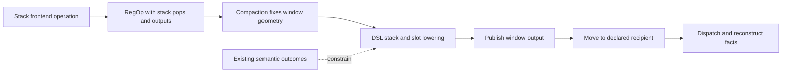
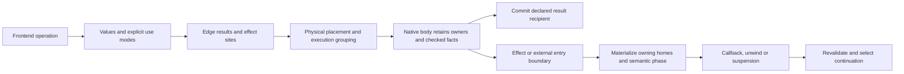
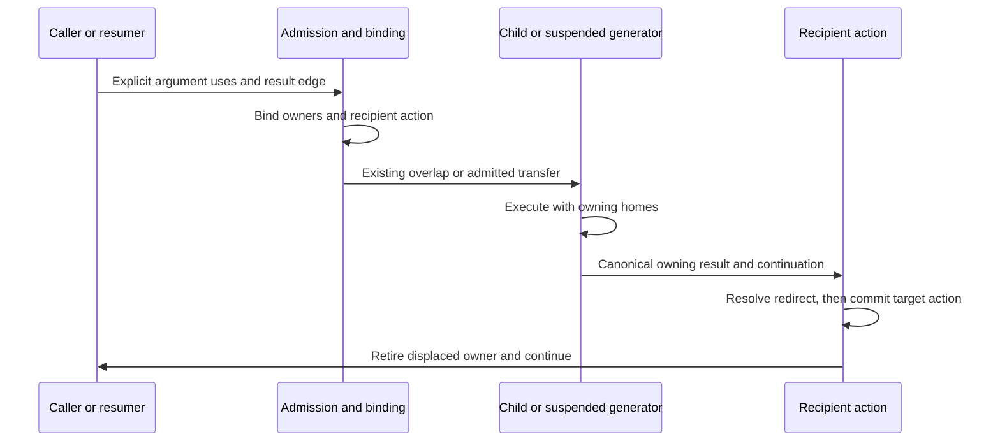

# Register semantics and physical execution

Status: closed first-cycle experiment design, 2026-11-14. All five executable
screens lose important workloads; no candidate is selected. The
[trial report](../../issues/register-semantics59/report.md) records qualification
and measurements. The reviewed [next design](interpreter-parity60.md) now drives
implementation. Keep this document as the contracts and rationale for rejected
packets, not an active instruction to retry them.
Selected57 (`0dcba75bb3df40c32137db453b001f7e8f101de0`) is the runtime baseline.
The [review ledger](../../issues/register-semantics59/review-astra.md) separates
source facts, retained measurements and hypotheses. The coordinator owns
implementation, native measurements and admission.

## First trial: normal-edge result binding (rejected executable)

Freeze this narrow contract before broadening the design. A `FOR_ITER_LIST`
BODY result already belongs to recipient A in `_PyIR_Outcome`. Its handler
already uses `_PyIR_OUTPUT_OUTCOME`. The defect is physical: `IRStack.store`
publishes `next` to window B+2, then `emit_final_outputs` moves it to A and
clears B+2. Do not describe this as inventing an outcome or converting a
`WINDOW_DST_FIRST` handler.

Introduce a generator declaration with these meanings (names are an API sketch):

```python
@dataclass(frozen=True)
class FinalOutputBinding:
    edge: NormalEdge             # BODY, matched to the semantic outcome
    output_index: int            # external output 2, not arbitrary C name
    destination_role: OperandRole  # ROLE_DST
    phase: PublicationPhase      # FINAL_COMMIT only in this trial
    source_home_policy: SourceHomePolicy  # VACATE_SOURCE in the first trial
```

Resolve the declaration against the instruction's external IO, family format,
result ownership and existing semantic outcome. The declaration is associated
with the producer contract; the store emitter must not contain a
`FOR_ITER_LIST` name test. A source annotation or a declarative generator table
is acceptable if its identity and shape are checked during generation and its
actual publication receipt is exported with the handler contract. Do not add a
general annotation language before this consumer works.

The first execution variant admits an ordinary local recipient only. In
`emit_final_outputs`, install the binding for the final flush. In
`IRStack.store`, consume it only for the identified owning output while
`stack.final` is true. Require an actual receipt that this value has not been
published, spilled, exposed by address, reloaded after a frame switch, or held
for a deferred observer. All earlier `address()` and `store()` behavior remains
the existing lowering. Redirecting `SlotLayout.address(B+2)` globally is unsafe:
an error or observer flush can precede the BODY commit.

Preserve result acquisition, cursor advancement/publication, guards,
canonicalization and exhaustion exactly in this first trial. At final BODY
commit, replace A using the existing local publication/retirement sequence,
record the actual destination write, and suppress only the corresponding final
window-to-destination move. Every observable state must match the existing
BODY outcome. An arbitrary displaced local owner can finalize: publication and
cursor state must precede that retirement, and the generator may not use a
borrow invalidated by it afterward.

The first trial retains the explicit B+2=NULL write at its existing commit
position, before displaced-local retirement. It removes the intermediate owned
publication/read/move, not every write to B+2. Independent peer review found
that compiler compaction leaves the folded output unoccupied, but constructed
image geometry does not prove incoming physical NULL. Therefore a later
`KEEP_NULL` policy requires **positive initialized-NULL admission**, not logical
absence. Do not silently turn absence into permission to read, overwrite or
skip retirement of a cell. The existing observed-home post-state is not that
incoming proof. No new admission framework is needed for `VACATE_SOURCE`.

Keep the existing route for temp/discard recipients, instrumented handlers and
any declaration lacking the final-publication proof. This is a bounded
execution-variant admission, not a second meaning for the same semantic result.
The semantic outcome, observed-home reader, generated publication receipt and
physical transfer must agree on A's owner and B+2's state. If the execution
variant changes facts used by those readers, expose the variant explicitly;
do not let a family-wide fact overstate a generic or generator path.

Files/consumers: `Tools/cases_generator/ir_generator.py` (`SlotLayout`,
`IRStack.store`, `emit_final_outputs`, result-publication and handler contracts),
the producer declaration adjacent to its existing contract, generated handler
and metadata products, and the relevant readers in
`Include/internal/pycore_ir_outcomes.h`. The existing output shape and encoded
word need not change. Compiler/admission readers must validate any new
proof-bearing field rather than trust a constructed image to supply it.

Minimal checks: generator refusal of early flush/address escape, borrowed result,
wrong output/edge and observer-deferred publication; generated C proves one
publication and no matching B+2 roundtrip on the admitted arm; ordinary list
iteration with empty/nonempty lists, local replacement with a finalizer,
loop mutation, break/continue, tracing/monitoring, exception and constructed
image admission. Inspect release native code before assigning a work saving.
The hypothesis is removal of the intermediate owned store/read and associated address work,
not removal of item acquisition or a proved whole-benchmark win. Reject the
implementation if the direct arm adds a compensating check/helper, changes
retirement/observation state, or lacks the claimed native simplification.

This trial is deliberately small. It establishes a reusable result-outlet
consumer and independently measures storage coupling. It cannot plausibly close
the 30.38% candidate-instruction gap by itself.

## Architectural decision

Make the semantic operation independent of its stack spelling and physical
instruction. A semantic result is a value delivered on an edge, not the cell
where the bytecode's stack effect happens to leave it. An operand use says
whether it borrows, transfers or acquires an owner. A physical window is one
lowering of argument transport, not the definition of a call. A continuation
specifies the receiving action and semantic state, not merely an integer home.

This revises round58's constraint. Keeping the current CFG, owning-home
interpretation and eight-byte word unchanged throughout would exclude some of
the useful transformations before measuring them. Retain the current runtime
where its contracts work; change any of those representations when a consumer
requires it and the complete reader set can be updated. Neither a wholesale
SSA rewrite nor an eight-byte-format preservation rule is an entry requirement.

There are three different problems:

| Layer | Selected implementation | Adjustment and first consumer |
| --- | --- | --- |
| Already explicit semantics, inefficient lowering | FOR BODY destination A, call/resume completion outcomes, direct exact return | Final-output binding and admitted recipient action; no invented new semantic outcome |
| Semantic/storage coupling | `_PyRegOp` retains stack `npop`, pass-through `out[]`, canonical stack names and mandatory window output offsets; native DSL reuses its callable variable for the result | Independent result/use/edge records; explicit native Invoke result and retirement plan |
| Physical execution choice | Eight-byte handler words, per-word state reload, conservative helper boundaries | Lower semantic runs to compact words, wider descriptors, or resident generated regions according to total work |

Canonicalisation in `regcfg.c` currently renames virtual registers; it does not
itself execute a copy. Do not count every renamed edge as a saving. Its cost is
the allocation and optimization choices it prevents. Similarly, acquisition of
an owning container result is necessary when the result outlives its source;
the redundant part is subsequent transport/revalidation, not that acquisition.

The selected implementation already has one owning frame arena, overlapping
exact Python arguments, initialized storage frontiers, inline return, scalar
publication receipts, explicit normal outcomes, direct generator completion,
checked generator recipients, SHAPE PICs and folded local borrows. Those are
starting points. The discarded57 private getter and canonical-boolean changes
are not new trials under another name.

## Minimum semantic representation

Build on `_PyRegOp` and its operand pool. Add only records consumed by each
trial. The desired record meanings are:

```text
ValueUse(value_id, use_mode, anchor_id?)
    use_mode = BORROW | TAKE
    ACQUIRE(source) is an explicit operation producing another owner
EdgeResult(edge_id, value_id, recipient, publication_phase)
ProtocolUpdate(edge_id, protocol_id, component, value)
EffectSite(site_id, phase, may_fail, may_callback, may_observe, may_suspend)
PhysicalBinding(value_id, location, valid_interval)
```

`TAKE` transfers one owner; it does not destroy the abstract value when another
owner or anchored borrow exists. `BORROW` requires a named owner valid through
the use. Repeated uses do not imply repeated owners. Local binding identity
remains distinct from a snapshot of its current value: a callback may rebind
the local without changing an already acquired snapshot. A CSE/rename must not
merge those two meanings. An explicit acquire is not removable just because
two objects have equal bits.

First keep ordinary persistent homes owning. A value may remain an owned C
local within one generated execution body, or a borrow anchored by a current
owner, until its next declared boundary. Before ordinary dispatch, suspension,
external entry or a callback that can expose the relevant state, materialize
the live values into admitted owning homes and publish the semantic phase.
Error exits consume or publish every uncommitted C owner exactly once. This
uses the current frame/GC protocol. It does not require bitmap execution,
IRSC2, global M4, or borrowed persistent cells.

At a callback, facts have different lifetimes. An owned value's identity can
survive; a projection into a mutable container, a local binding, dictionary
table pointer, cached handler/version or shape guard may not. A release of an
unknown last owner is a callback boundary too. Finish publication and detach
retired homes before such a release; reload state or exit after it. Do not
retain a typed projection merely because its original `PyValue` was canonical.

The semantic state at an effect site must name retained values, protocol state
and result commit phase. The physical map says where those owners currently
reside. Initially these maps reuse current initialized-NULL homes and exception
prefixes. A trial that places a retained exception value outside that prefix
must either materialize it back before the effect or integrate an admitted
explicit exceptional-map consumer. It may not claim the unfinished IRSC2 reader
as present. Line attribution alone is not an effect; a live line observer is.





## Ordered trials after final-output binding

Each numbered item is an independently reviewed implementation and native
comparison. A losing trial does not become a prerequisite for the next one.
Keep its evidence, remove it from the selected composition and revise the
remaining-work account. The default order is 1 above, then 2–6 below.

### 2. Allocate an edge result independently of a window

This is the first compiler allocation packet. Introduce a distinction between
`InputSpan(base, count)`, retained protocol updates and `EdgeResult(value, dst)`.
For a migrated producer, `window` no longer implies that every output j must
occupy base+j. Preserve stack spelling only as frontend import information;
semantic result identity and allocation use the explicit result record.

Use BUILD_LIST/TUPLE as the first complete producer families. They consume an
input span and produce one independent owner on success. Reuse their existing
`out[0]` value ID; an output binding is not another value identity. A folded
local result does not need an artificial temporary output home; a zero-input
builder need not reserve a scratch result window. The first packet preserves
the existing chosen scratch/canonical destination and removes fictitious local
output allocation. Broader scratch placement follows only with a real consumer:
an admitted vacant home, possibly an input home **after successful stealing**,
or a home serving the next consumer's argument layout. Keep the constructor helper's
failure contract: failed allocation must not pretend it consumed the inputs.
This starts from trial 1's final-publication mechanism, but changes allocation
and geometry rather than only the emitted store sequence.

Then migrate FOR_ITER as retained iterator/cursor pair plus independent BODY
result A. Its exhausted edge produces no item. This removes B+2 from required
output geometry where no real owner belongs there; it does not simply stop
clearing a still-admitted cell. Every adaptive family member and generic,
instrumented and generator fallback must support the new geometry before the
compiler emits it. If that closure makes FOR too broad for the first packet,
land the builder consumer first; never emit a layout valid only for LIST while
deoptimization still enters the old generic window contract.

Minimum concrete changes: the migrated operation contract binds its existing
output index separately from its input span/protocol; `compact_op` assigns
that result independently rather than through its `base+j` loop;
`_PyRegCfg_OpSlots` supplies the actual destination; `IRFormat` separates input
extent, retained-window writes and edge result; `SlotLayout` and final-output
emission consume the same contract. Reuse WINDOW input addressing plus the
existing REGISTER_DST output kind if their complete reader set supports that
combination; do not add a new enum or result field merely to rename it.
`Objects/codeobject.c` must stop enforcing
`dst == base + result_offset` only for that admitted format and validate result
bounds, legal input overlap and ownership instead. Update `_PyIR_Outcome`,
`_PyIR_ObservedHomes`, definitions, physical transfers, absence and semantic
admission for the changed shape together. An independent destination is not
permission to overwrite a live owner.

The first native bootstrap exposed a publication-contract mismatch: independent
results were using the legacy macro's old-NULL/same-value assertion. Fresh
scratch publication must instead be write-only after positive NO_HOME/no-owner
admission, or after stealing and detaching an overlapping input. It grants no
incoming NULL or readability fact. A compile-time fresh-publication mode keeps
the existing normalization, new-value checks, local replacement and discard
behavior without another clearing store or runtime mode branch. The concrete
[builder contract](../../issues/register-semantics59/edge-results-proposal.md)
and [trial report](../../issues/register-semantics59/report.md) own this reviewed
correction and its native qualification. The losing FOR executable is removed
from the independent builder candidate; its useful binding mechanism survives
only through an active builder consumer.

Concrete first allocation example: in `first, second = [], []`, the first
scratch result remains live while the second builder folds to a local; the
second builder must not reserve another scratch output just because its input
span is empty. Empty spans may use a base at the scratch limit, with no read,
dereference or construction of an out-of-bounds base+1 pointer. Generator,
helpers, geometry and semantic readers must agree on that zero-extent case.
This does not authorize arbitrary holes across later packed windows.

Allocation remains constrained at current exception and external-entry sites.
Within a continued region the result may occupy a useful vacant home; before
an effect that retains it in an exception prefix, choose the canonical home or
emit an explicit materializing move. At joins use the current canonical home
until trial 5 supplies an edge-transfer consumer. Thus this packet changes
actual operation/allocation semantics without depending on a new EH or CFG
framework. The compiler must count a required materialization against the
saved staging, not hide it in the next instruction.

Checks: zero/nonzero builder arity, successful steals and failed allocation,
local/temp/discard recipients, overlapping versus unrelated destinations,
constructed/marshaled images, try/finally and source/debug entry while the
result is live. Extend window-result, semantic-container, admission and
retirement checks. For FOR extension include every family fallback, exhaustion,
direct generator completion and instrumented entry. Native hypothesis: fewer
temporary homes/transport operations and better producer-to-consumer placement;
some cases only reduce frame extent and may have negligible throughput benefit.
Abort performance expansion if materializing moves cancel the savings or
actual emitted frames/paths do not change. Keep the semantic representation
only with a real consuming implementation, not as unused scaffolding.

### 3. Give native Invoke an independent result and one retirement plan

Concrete first transformation: change the selected method-descriptor call's
semantic contract from a callable slot reassigned to the result followed by
stack pops to `result = Invoke(callable, self?, arguments)`, followed by an
explicit retirement of the input owners and an edge result commit. Preserve
the same `_PyValue_VectorcallTstate` provider and its guards. This isolates
operation/owner transport from the rejected57 native-entry specialization.

Current `_CALL_METHOD_DESCRIPTOR_FAST` writes `callable = result`, closes the
old callable, then composes `_POP_TOP_OPARG`, `POP_TOP` and a periodic check.
These are DSL phases in **one dispatched handler**, not multiple dispatches.
`result_offset()` has to infer the output from assignment to an input name.
RegCFG already gives the call a fresh output virtual register in
`convert_instr`; this is not a missing compiler result ID. The missing link is
an independent native result-owner token and explicit DSL result declaration,
connected to that existing ID even when allocation chooses the input's slot.
Remove the assignment-based inference for migrated producers;
do not add a second annotation that can disagree with it.

Use a producer result declaration plus an ordered `RetireInputs` record
containing actual input roles, detachment phase and result phase. The generator
consumes the record, emits each detachment once and records which homes are
NULL. Its final flush must not run a second clear loop over an already detached
range. Retained selected native code contains argument-close and later clear
loops; the worker must prove their exact overlap and callback obligations from
generated C before deleting either. If a callback invalidates the NULL proof,
move the materialization boundary or keep the required clear; never assume
that callback-preserved canonicality means ownership absence.

First optimize an admitted scratch recipient. Publish the acquired result to
that actual scratch destination before retirement can observe it, then retire
the input tokens and run the existing periodic/observer continuation. A folded
local is a distinct commit: do not expose a result in that local before its
specified successful edge. The selected generic `call_transaction_native`
already distinguishes these phases and can hold `local_result` as an owner;
reuse its semantics, not its entire out-of-line implementation on a fast path.
On failure, the result remains rooted in the declared error state until it is
released. Alias between result, callable, argument and destination must work.

Files: `Python/bytecodes.c`, generator external-IO/result inference and
`ScalarStorageGraph`, `ir_error_effects.py`, actual-publication/retirement
contracts, generated C/metadata and outcome/admission readers. Connect the
compiler's existing output ID to the explicit result and input-use roles;
`regcfg.c` and `assemble.c` may still choose an argument window. Native C APIs
that require contiguous arrays keep a pack; exact Python calls keep their
overlap. No new borrowed-argument frame ABI is part of this trial.

Checks: call result aliases an input, a finalizing argument inspects/rebinds
caller locals, periodic failure, provider failure, local/temp/discard result,
absent self and actual None self, monitoring enabling during the call, constructed
images and error ownership. Extend existing `test_ir_retirement_plan`,
`test_ir_native_owner_effects`, `test_ir_call_roles` and window-result checks.
Native hypothesis: one fewer result staging path and redundant cleanup pass,
with no increase in vectorcall work. Abort if generated proof requires a
general transaction helper on the common path, native cleanup remains the same,
or broad sentinels regress. Only after this consumer wins should other native
call families migrate to the same semantic Invoke operation.

### 4. Encode the recipient action in the continuation

Concrete first transformation: replace repeated interpretation of raw
`return_slot` at return/yield with an admitted recipient descriptor. Existing
`return_pc`, direct frame switching and completion outcomes stay authoritative.
The descriptor means `VACANT_SCRATCH(slot)`, `REPLACE_LOCAL(slot)`, `DISCARD`, or
`EXTERNAL_ENTRY(slot)`. It describes ownership action, not Python value type.

One bounded encoding trial is a 16-bit descriptor: the existing 12-bit home
number plus a kind in the high four bits. This preserves the 112-byte selected
header and tests fewer reader loads without a header-shrink experiment. The
compiler/call binder knows the action before entering the child; generator
suspend/send entry records the incoming action too. `pending_redirect` must
first resolve a debugger redirect and install a newly validated descriptor.
Never apply the old action after a changed recipient. External trampolines and
unstarted/suspended generators require explicit initialization, not a guessed
mode from a zero field.

Update every reader/writer together: `pycore_interpframe_structs.h` and
`pycore_interpframe.h`; call binders in `ceval.c`; return/yield/send emitters and
`bytecodes.c`; `Python/ir.c` completion admission; `frame.c`, `frameobject.c`,
`genobject.c`, `pystate.c`; remote-debugging offsets and asyncio unwinding;
testinternalcapi and generated products. Expose accessors for home and action,
not raw masking spread through consumers. The descriptor must retain validation
of scratch vacancy and local replacement. Direct generator-completion entries
and checked generator recipients already exist; this extends their contract
to common return transport rather than counting them as new improvements.

This removes a code-object/nlocals load and recipient inference where the
native path still performs them. It might add masks or a mode branch instead.
Inspect generated release assembly and measure call-heavy DeltaBlue and
resume-heavy coroutine/generator paths before selecting it. There is no
release debug-home-check loop to remove: `call_transaction_begin`'s diagnostic
scan compiles away. Header54's 80-byte shrink lost, and field-reader costs must
be included. Do not justify this trial by either of those false savings.

Checks: exact/default/keyword calls, temp/local/discard and external return,
nonthread-owned frames, generator send/throw/close, delegated yield and coroutine
completion, finalizers during replacement, debugger redirect, remote asyncio
inspection and frame copying. The existing general-return, frame-call,
disjoint-child, send, delegated-yield and debugger-entry tests supply focused
coverage. Abort if the descriptor complicates common reads more than it removes,
requires growing the header, or cannot share one admitted meaning across those
readers. A competing descriptor layout is a separate trial, not a padding sweep.



### 5. Separate value identity from home identity at a real CFG consumer

The next compiler change is explicit edge arguments and use modes, not global
SSA construction for its own sake. Initial morphology: an acyclic diamond
selects one of two already acquired values, and its join feeds a consuming
operation or multiple callback-free borrowed uses. Represent the merge as an
edge value argument; let coalescing choose one home and parallel moves only
where required. Today stack canonical names identify the merge home from the
start, and allocation reserves folded-load/window positions. A value that
remains live need not keep its stack-position identity merely to cross the
branch.

Example semantic form (not a claim this example currently leaves a redundant
copy): `v = x if flag else y; use(v)` becomes two edges passing `x_snapshot` or
`y_snapshot` to `join(v)`. Each edge explicitly acquires or transfers the one
owner required by `use`; borrowed uses name their anchor. A join with two
uses of the same snapshot may keep one owner and two C borrows within a later
resident body. If either use escapes or a callback can destroy/rebind the
anchor, acquire/materialize before that boundary. Equal values are not proof
that the two input owners may be dropped.

First run the existing compiler capture over the broad hot set and retain the
eligible op sequences. Admission to implementation requires a surviving
allocator/ownership cost, not merely occurrence of a conditional expression.
The first round58 closed COPY-web census was zero across 21 files/426 CFGs.
If this broader morphology has no useful anchors or saving, demote this lane;
do not build a compulsory borrowing framework. Canonical renames alone earn
zero runtime credit. This is a frequency gate for a specific transformation,
not permission to report another unbounded investigation as progress.

For admitted examples, add block-argument/edge-transfer records to
`pycore_regcfg.h`, update conversion, liveness, `compact_op` and verification in
`regcfg.c`, make copy propagation and store folding use `ValueUse` modes in
`regcfg_passes.c`, and have `assemble.c` lower noncoalesced edge moves. Keep the
same ordinary owning homes at dispatch. First exclude exceptional joins and
materialize current exception prefixes before effectful operations. Later
nonprefix exception retention needs an admitted map; the CFG is not permanently
restricted to the current prefix model.

Checks: each predecessor and alias combination, critical edges, moves with
cycles, unbound locals, loop backedges rejected in the first slice, callbacks
replacing anchors, exception entry and source/debug entry. Native acceptance
requires actual removed acquisitions/moves/home traffic on captured examples,
not just fewer IR nodes. This lane generalizes to conditional expressions,
short-circuit operations and argument preparation; it is not a necessary
dependency for trials 1–4 or the first straight-line consumer of trial 6.

### 6. Make execution granularity a physical lowering decision

Concrete first consumer: an admitted producer-to-consumer run whose temporary
is single-use, such as a checked attribute read feeding a checked comparison
and branch, or an iteration item feeding a consuming operation. Preserve the
logical producer and consumer as separate semantic sites. Generate one native
body that passes the owning result or anchored borrow directly between them,
keeps projections valid within the effect interval, and materializes only at
its exits. This is cross-operation value transport. Combining the micro-ops
already inside one producer does not qualify as this trial.

Begin with a measured hot pattern, not a fixed catalogue presumed sufficient.
The selected SHAPE_LOCAL_TEMP handler is a negative control: it already avoids
ordinary getter calls and much receiver transport. Do not wrap every such
handler in a universal metadata load. Admission and selection occur when
building the executing image; ordinary unfused words retain their direct path.
For a result that crosses an unknown finalizing close, materialize before the
close and exit/revalidate. Explicit nonfinalizing/immediate ownership facts may
permit continuation; merely hoping a destructor will not run may not.

The initial physical choices are:

| Choice | First implementation and cost test | Decision |
| --- | --- | --- |
| Short generated region | One selected producer/consumer pattern with resident C owner, static exits and materialization recipes | Default first consumer; low transition cost, bounded code growth |
| Resident operand cache | Carry one or two owning values across ordinary dispatch; spill at effects and all external entries | Rival if short regions have insufficient eligible coverage; requires handler ABI and entry/exit consumers, but need not change persistent frame ownership |
| Wider physical instruction or descriptor | Explicit result and noncontiguous operands, with argument packs only at native/overlap ABI boundaries | Permit when field pressure forces extra moves/windows; do not preserve eight-byte words at their expense |
| Borrowed-argument frame ABI | Callee homes borrow from caller anchors with escape/materialization rules | Separate ownership experiment, requiring frame scanning, observer, suspension and retirement reader admission; not the default rollout |
| Broader dispatch backend | Change state residency/helper layout in the same compiler configuration | Follow only if residual native work is dispatch/spills; no second compiler or padding search as the strategy |

The resident-cache rival has broader reach but charges spills at every effect
and reserves registers globally. A short catalogue can lose coverage to calls,
retirement and observation. Select between them using `eligible executions ×
removed native work − transition work`, measured on the same hot runs. If
regions cannot cover a material share of the residual gap, implement the
resident-cache rival next instead of expanding dozens of low-frequency region
handlers. If field decoding/window packing dominates, choose the wider physical
form first. Neither choice requires changing the Python semantic operations.

Minimum executing-region schema: start physical PC, span/end PC, ordered
semantic-site IDs, per-site expected handler/cache version, legal entry bitmap,
and exit materialization/continuation ID. Internal sites remain addressable by
source, exception and debugger maps. A constructed image cannot enter an
interior site without its normal materialized state. Admission either marks
that site as an external entry and generates an entry adapter, or disallows
that region; it must not forbid an otherwise valid Python debug transfer.

Every instrumentation/specialization writer, including `_PyIR_SetHandler`
callers, must invalidate overlapping regions before publishing changed interior
behavior. The GIL-qualified first trial may rebuild/disable the region at that
point. A running region cannot cross a callback/poll without publishing state
and validating its version before executing the next semantic site. For
callback-free runs the GIL prevents another Python thread rewriting the image
mid-run; tracing hooks and asynchronous eval-breaker handling still require
their established checkpoints. Do not extend this argument to free threading.
Updating only the start handler is insufficient for an interior event.

Files: semantic/use contracts and compiler lowering above; generator
`IRStack`/`ScalarStorageGraph` and effect declarations; `assemble.c` layout and
source/exception maps; `pycore_ir.h` executing-image representation; `Python/ir.c`,
`specialize.c`, `instrumentation.c` and `Objects/codeobject.c` admission;
disassembly, marshal/frozen-image and debugger readers if physical offsets or
format change. Version the affected serialized image and update all readers in
the same coherent increment. Do not conflate physical PC with semantic-site ID.

Checks: taken/fallthrough/error exits, unhandled effects rejected, interior
instrumentation changes, specialization deopt at an interior site, monitoring
enabled by a callback, debugger/exception interior entry, malformed descriptors,
source event order and retained-owner finalization. Inspect code size, spills,
dispatch count, instructions and cycles. Abort or change execution choice if
materialization eats the saving, hot handlers spill more, or eligibility is too
small to account for a meaningful part of the remaining budget.

## Ownership comparison and rejected shortcuts

Pinned upstream's `PyStackRef_Borrow` marks borrowed references;
`PyStackRef_DUP` and `CLOSE` skip object refcount changes for those references,
and `MakeHeapSafe` acquires an owner when necessary. Its compiler admits
borrowing only where an anchor survives, and escape/suspension paths convert
as required. Selected PyJIT already removes many local loads entirely through
folded borrows; an unfolded ordinary home owns its value. Upstream can therefore
avoid some surviving multi-use/argument refcounts that our ordinary-home
protocol requires, but there is no blanket saving equal to every LOAD_FAST or
COPY. The closed zero-web census matters. Trial 5 must demonstrate a surviving
morphology; a borrowed-frame ABI would need its own whole-reader admission.

Python requires live owners, correct values, exceptions, mutation order and
useful observers. It does not require one permanent home per logical value,
stack-shaped argument placement outside an actual ABI, or exact upstream
destruction/debug-display quirks. Those freedoms do not permit losing an owner,
reusing a borrow after a callback, exposing a local result before its commit,
or interpreting uninitialized storage. Source positions remain separate from
semantic recovery; changing one does not supply the other automatically.

Rejected shortcuts remain rejected: reinstating57's private inline getter or
checked method helper as the parity strategy, labeling a canonical flag a
cross-operation fact graph, global bitmap mandates, shrinking headers without
reader accounting, and alignment/second-compiler searches. Handler ABI is
already GCC `no_callee_saved_registers` / Clang `preserve_none`; the normal-ABI
entry shim works around a GCC15.2 entry miscompile. Ordinary handler overhead
is not a conventional SysV callee-save prologue that a new ABI will magically
remove. Real helper spills and handler state reconstruction remain measurable.

## Work budget and repeated admission cycle

The retained selected57 interval is the starting debt:

| Workload | Instructions / upstream | Cycles / upstream | Candidate instructions to remove for equal count | Candidate cycles to remove for equal cycles |
| --- | ---: | ---: | ---: | ---: |
| Comprehensions | 1.436416 | 1.333179 | 30.38% | 24.99% |
| DeltaBlue | 1.361424 | 1.118423 | 26.55% | 10.59% |
| Coroutines | 1.307831 | 1.267788 | 23.54% | 21.12% |

Comprehensions retire about 278,517 versus 193,897 instructions per tray:
approximately 84,620 must disappear for equal count. Per tray, 108 dict.get
operations use CALL_METHOD_DESCRIPTOR_FAST, while 162 LIST_APPEND operations
invoke the direct consuming helper. The append operations are not generic
value-vectorcalls. A hypothetical 20-instruction removal at each of these 270
distinct boundaries totals 5,400 instructions, 1.94% of the candidate or 6.38%
of the excess. This worksheet is neither a measured saving nor an upper bound
on the full method-provider and append-helper costs. Saving 20 per exact predicate call adds
only 840 across 42 calls. Do not add either figure to a region estimate that
includes the same executions. Eighteen generator creations do not imply only
eighteen resumes; resume frequency needs its own count.

Trials 1–4 provide contracts and bounded consumers; their likely local savings
do not explain the whole gap. Parity requires broad value/home transport,
native-boundary and execution-state improvements of the kind trials 2, 5 and 6
make possible, or a different execution choice if their coverage fails. The
rejected57 composition removed about 4.8% of comprehension instructions versus
56 and still lost important workloads. Neither that removal nor flat samples
are selectable savings to subtract from today's debt. No honest current ledger
accounts for all 84,620 instructions. A claim of parity or 2× is unsupported.

For every candidate retain a four-column account: dynamic eligible executions,
removed native operations, new materialization/admission work, and observed
instruction/cycle/elapsed change. Frequency times native-path delta is a
hypothesis until matched counters confirm it. Cycles can improve without equal
instruction counts, and lower counts can lose cycles. Report both, including
code size and spills where they changed; do not name an exclusive cache/layout
cause from the failed57 frontend capture.

Execution order and ownership of the work:

1. A generator worker implements trial 1; an independent source peer checks
   actual receipts and every fallback. Root compares native paths and the hot
   screen before selection.
2. A compiler/generator packet implements trial 2 with one complete builder
   family and its admission readers. A separate reviewer checks success/error
   ownership and physical geometry. FOR migration follows only after family
   closure. This is the earliest substantive allocation freedom.
3. A native-boundary packet implements trial 3 against the same selected
   control. A frame/continuation packet implements trial 4 in a separate branch;
   overlapping generated/runtime files are merged and regenerated by root in
   dependency order. Neither lane silently depends on a losing packet.
4. Capture trial 5's specific surviving morphology while those implementations
   proceed. If useful, implement the edge/use consumer; if empty, record that
   result and proceed directly to trial 6's straight-line resident consumer.
   No CFG framework is required merely to keep two adjacent operation values
   in one generated body.
5. After a coherent composition, review the remaining native work against the
   budget again. Select the next explicit semantic/physical adjustment and
   repeat implementation, independent peer, qualification and measurement.
   Completing this proposal is not completing the parity workstream.

Each increment runs its focused generator/admission/lifetime tests in the
candidate roles, followed by a release-native inspection and the same unchanged
hot set: comprehensions, DeltaBlue, coroutines and generators. Logging, raytrace,
spectral_norm and nqueens are mandatory sentinels. A repeatable sentinel loss
rejects default selection; an explicit tradeoff needs coordinator assessment
with the broad result. Root runs all29 and the coherent full diagnostic suite
at integration checkpoints, not after every source edit. Retain the six known
debugger-jump failures and only the existing GDB PrettyPrintTests quarantine;
do not conceal new failures in them. Selected57 has no fresh full-system run
of its two-file successor, so inherited56 coverage is not a new59 pass.

Stop expanding a lane when its native hypothesis fails, eligibility is too low,
materialization cancels the removal, or repeatable broad regressions remain.
Change the execution choice rather than keep collecting favorable samples.
The remaining task is complete only when unchanged hot workloads reach measured
upstream parity or better with retained broad gains and qualified ownership/
observation behavior. Until then, report the residual debt explicitly.
