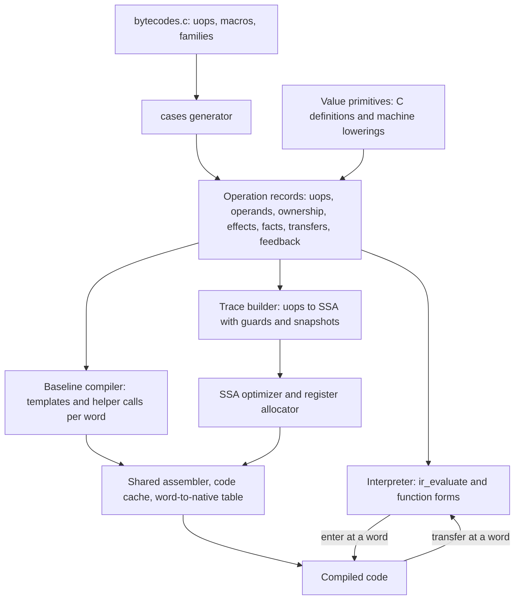

# Tiers87: the interpreter's last wave, a baseline method JIT and a tracing JIT

Approved by the user on 2026-11-22, with the optimizing method tier
deferred as proposed. Base: golden86 (`3cac420ddbf`, `pyjit/round86-golden`).
It updates the selected [JIT system design](../jit-e2e-system.md) with what
the register interpreter now provides, and answers one question: what
structure should the interpreter impose so that the method and tracing JITs
are generated from it rather than written beside it?

## Decisions

1. **One operation contract.** `Python/bytecodes.c` and its generator remain
   the only statement of what an operation does. The generator exports each
   handler as an explicit record of micro-ops (uops): operands, ownership,
   effects, guard facts, typed transfers and feedback layout. The
   interpreter, the baseline compiler and the trace builder are three
   consumers of that record. No tier hand-writes a second copy of an
   operation's semantics.
2. **Two levels of semantics.** Operations are C over a closed set of value
   primitives (tag tests, untag and tag, field loads, checked integer
   arithmetic). The compilers know the primitives; everything else is a
   generated helper with declared effects. Hand-written machine lowering is
   confined to the primitives, a few dozen small functions over the PyValue
   encoding, each tested against its C definition.
3. **Contract87, the interpreter's last wave**, builds that contract and the
   shared runtime improvements that compiled code also calls. Interpreter
   tuning that a compiler removes (dispatch, decode, operand views, layout)
   stops after it.
4. **A Sparkplug-style baseline method JIT.** It compiles a warm code
   object's IR words to x86-64 in one pass. Frames, homes, feedback,
   exception tables and the interpreter's specialization stay as they are.
   Each word becomes a generated inline template or a call to the handler's
   generated function form. It needs no deoptimization: every word boundary
   is an interpreter state.
5. **A tracing JIT on the same contract.** It records hot loops in the
   interpreter, expands each recorded handler into its uops, optimizes in
   SSA using the declared guard facts and effects, and exits through homes
   to baseline code or the interpreter. It shares the baseline's assembler,
   code cache and entry table.
6. **An optimizing method tier waits for evidence.** Traces cover loops and
   the calls inside them; the baseline covers the rest. A method-level
   optimizer is built only if measurements show hot code that traces miss,
   such as deep recursion.

## Where golden86 stands

Golden86 runs 0.877 of upstream's time on the timed all-29 geomean and 0.928
of its instructions. Seven cases remain slower than upstream: comprehensions
1.107, deepcopy_reduce 1.051, deepcopy 1.049, nqueens 1.041, json_dumps
1.017, pickle 1.017 and logging_simple 1.015.

Share of user-mode instructions in handler code (`ir_evaluate` plus the
outlined `ir_run_*` handlers), golden86, whole process, sampled with perf
(`E59/jitplan87/share.txt`):

| Group | Cases (share %) |
| --- | --- |
| Interpreter-bound | richards 66, go 66, nbody 65, spectral_norm 64, deltablue 63, raytrace 59, deepcopy_memo 54, chaos 54 |
| Mixed | coroutines 50, float 43, logging_silent 41, nqueens 40, fannkuch 40, generators 40, comprehensions 39, logging_simple 36, regex_compile 36, deepcopy 33, logging_format 32, deepcopy_reduce 28, xml_etree_generate 26 |
| Runtime-bound | unpack_sequence 21, xml_etree_iterparse 17, xml_etree_process 13, json_dumps 12, xml_etree_parse 7, json_loads 5, unpickle 2, pickle 2 |

HT's ledger shows where a hot handler's instructions go. `BINARY_OP_ADD_INT`
executes 47: operand views 9, the `instr_ptr` store 3, guards and body 14,
owner detach 4, destination store 6, old-value close 5 and dispatch 6.
Compiled code knows the operands, owner flags and destination kind at compile
time, so it keeps the guards, the body and a store: about 20.
`FOR_ITER_LIST` executes 50 and would keep about 25.

If compiled code removes 40–60% of handler instructions, the all-29
instruction geomean falls to 0.77–0.85 of golden86's. This is an estimate to
check at the baseline's second milestone, not a promise. It also shows what
the JIT will not fix: pickle, json and the xml parsers spend 83–98% of their
instructions in the C runtime, so their gaps to upstream need runtime work.

## The operation contract

### What exists

- `bytecodes.c` has 92 `inst`, 274 `op` and 184 `macro` definitions.
  Specialized handlers are macros of guard and action uops, for example
  `BINARY_OP_ADD_INT = _GUARD_TOS_INT + _GUARD_NOS_INT + unused/5 +
  _BINARY_OP_ADD_INT + _POP_TOP_INT + _POP_TOP_INT`.
- Guards use `EXIT_IF` (159) and `DEOPT_IF` (32); errors use `ERROR_IF` (79)
  and `ERROR_NO_POP` (86).
- The analyzer already derives per-uop properties: `escapes`, `pure`,
  `inline_ok`, `deopts`, `side_exit`, `switches_frame`, `returns`.
  `ir_error_effects.py` and `ir_read_effects.py` derive error and read
  effects.
- `ir_generator.py` (8,734 lines) binds each uop's stack signature to
  register fields and emits the skeleton around the bodies: operand views,
  owner detach, destination store and old-value close.
- 76 handlers are outlined as functions with one ABI:
  `_PyIRTransfer ir_run_X(tstate, frame, next_instr, ir_word)`, returning the
  frame to run and its next word, or a null word for an exit that the
  activation describes. This is the seed of the helper ABI that compiled code
  needs.

### What a compiler cannot consume today

- **Bodies jump into the evaluator.** Generated handlers contain `goto
  LABEL_binary_op` (28), `LABEL_start_frame`, `LABEL_process_error` and three
  `call_fallback_*` jumps. The DSL has seven labels and generator macros that
  use evaluator-only variables (`ir_binary_op`, `ir_gen_*`, `lastopcode`).
  These are what stop a handler from having a function form.
- **The record is private.** The generator's model of a handler (uops bound
  to fields, owner events, error checkpoints) exists only while it prints C.
  A compiler would have to re-derive it.
- **Guards state no fact.** `EXIT_IF(!PyValue_IsInlineInt(value))` is code;
  that `value` is an inline int afterwards is not recorded anywhere. Upstream
  CPython's tier 2 answers this with a second, hand-written abstract
  interpreter (`optimizer_bytecodes.c`) that must track every uop by hand. We
  should not repeat that.
- **Effects are partly inferred.** Whether a uop can run Python comes from
  scanning its calls (`escapes`); there is no declared and verified effect
  class.
- **Feedback layout is anonymous.** Cache words appear as `unused/5`; their
  meaning lives in the specializer and the guards.

### The contract

C1. **Operation records.** The generator builds, for every handler, a record:
its uops in order; each uop's inputs and outputs bound to operand fields
(local, temporary, constant slot, immediate, jump target, feedback word);
ownership of each input (borrowed or consumed) and output (owned, borrowed or
inline); the uop's effect class, guard fact, error exits and transfer. It
emits the records as data (a Python module for tools and tests, C tables for
the runtime). The C interpreter emitter becomes one consumer of the records,
so the records cannot drift from the interpreter.

C2. **Typed transfers only.** A body leaves its handler only through a closed
set: next word, conditional branch, jump, deoptimize to the family's generic
form, raise, enter a Python frame, return, yield, and exit. The evaluator's
labels (`binary_op`, `start_frame`, `process_error`, the call fallbacks, the
generator labels) become VM routines with a function form. The interpreter
may still inline them; compiled code calls them.

C3. **No evaluator-only state.** Everything a uop needs is in its operands,
the frame, the thread state or its feedback words. `ir_binary_op` becomes an
operand; generator-label arguments become a transfer's fields. Every word
boundary is then a complete state: the frame's homes, `instr_ptr` and the
thread state.

C4. **The skeleton is bound at the latest time.** Operand views, owner
detach and release, destination store, old-value close and the `instr_ptr`
store are generated from operand declarations and word flags, never written
in bodies. The interpreter binds them at run time, as now. The compilers bind
them at compile time, so the variants that HT left open (old-value close only
for local destinations, one owner test for detach and taken, a fused compare
and branch that builds no bool) cost the compiled code nothing and do not
multiply interpreter handlers.

C5. **Guards are pure, come first and declare their fact.** A guard reads,
never writes, precedes every effect of its handler, and names the fact it
establishes from a closed vocabulary: inline int, inline float, exact type,
type version, dict keys version, shape, not NULL. The generator checks the
ordering. The trace optimizer derives type propagation from these facts and
from declared result facts (the result of `_BINARY_OP_ADD_INT` is an int),
instead of a hand-written abstract interpreter. Choosing a family member
from recorded types becomes a data question: which member's guards hold.

C6. **Effects and ownership are declared and verified.** Each uop has an
effect class: pure, reads heap, writes heap, allocates, may raise, may run
Python, may release (finalizers). The declaration is authoritative; the
existing `escapes` inference becomes a check against it. Compiled code
publishes `instr_ptr` before, and only before, a uop that may run Python or
raise.

C7. **Feedback has a schema.** Each family names and types its cache words in
the DSL. The specializer, the guards and the compilers read them through
generated accessors.

C8. **Leaf uops use the primitive subset.** A uop marked `leaf` may
contain only local variables of PyValue, integer, double or pointer type;
calls to listed value primitives; checked integer arithmetic
(`__builtin_*_overflow`); compares; guard and error exits; and calls to
declared helpers. The generator rejects anything else in such a uop, and
translates the accepted bodies into a small leaf IR. The baseline emits
templates from the leaf IR and the trace builder expands it into SSA. A uop
outside the subset is compiled as a helper call. The primitive list and each
primitive's machine lowering live in one place, tested against the C
definitions on generated values.

The DSL keeps its stack-notation uop signatures; they are local to a uop, and
the generator already binds them to registers. What changes is that the
binding becomes a published record rather than a by-product of printing C.

## Phase 1: contract87, the interpreter's last wave

Units from golden86. The contract units touch the generator; they are
serialized as CR, then TR, then LS. The runtime units touch disjoint files
and run in parallel with them.

| Unit | Work | Done when |
| --- | --- | --- |
| CR | C1, C5, C6, C7: the record model in the generator, guard facts, effect classes, feedback schema; a test that every handler's record is consumed by the C emitter | records exported for all handlers; no undeclared guard fact or effect |
| TR | C2, C3: labels become VM routines with function forms; bodies use typed transfers only; every handler gets a function form | no evaluator jumps in bodies; a function form for every handler; interpreter hot paths unchanged |
| LS | C8: the leaf-subset checker, the primitive list and the leaf IR | a report of inline-eligible uops; failing hot uops rewritten into the subset or declared helpers |
| NV | The native call chain: `CALL_NON_PY_GENERAL` reaches C through three layers, about 100 instructions of prologue per call | one adapter from the call site to the callee |
| EH | The raise-and-catch path (`_PyEval_ProcessError`, `error_clear_slots`; regex_compile's `KeyError`) | handled exceptions cost what upstream's do |
| AT | Attribute misses: richards spends about 10% in `ir_run_LOAD_ATTR`, `_PyValue_GetMethod` and `_PyTypeCache_Lookup`; `x.__dict__`'s subtype walk; `dict.update` into an instance dict through the value API | the sites specialize, or the generic path is cheap |
| FR | The frame reads `ir_words` and `ir_feedback` through the exec instead of per-frame copies | one exec pointer per frame |
| SB | [Stack bytecode recovery](stack-bytecode-recovery.md), accepted 2026-11-05: `co_code` and `.pyc` return to stack bytecode and the IR becomes a hidden cache | upstream's `dis` and code tests pass; IR changes need no magic bump |

XP's change rides with the wave: the C `Element` drops its subclass check
and the Python `Element` gains `__iter__`, so both iterate one way.

**Integrated 2026-11-22** as `pyjit/contract87` (`684a98eb30e`), with ST, a
follow-up that cut first-call lowering's cost; results in the
[contract87 record](../../issues/register-semantics59/contract87.md).

From this wave on, interpreter work must either improve the shared runtime
that compiled code calls, or implement the contract. The hot handlers keep
their inline forms, so the contract work is expected to be neutral for the
interpreter. Each unit's instructions and the timed all-29 are recorded, as
in earlier waves.

## Phase 2: the baseline method JIT

### Why Sparkplug's shape fits

Sparkplug compiles V8's register bytecode directly, keeps the interpreter's
frame layout, calls shared builtins for anything complex and maps machine
PCs back to bytecode offsets. Our IR is also register-based with frame homes,
so compiled code needs no operand-stack model. Because frames stay
interpreter frames, GC traversal, tracebacks, frame introspection,
generators and exception tables keep working, and compiled code needs no
deoptimization: at every word boundary the homes and `instr_ptr` are a
complete interpreter state.

### Design

- **Unit.** One code object's executing copy, compiled whole (cold blocks
  included) after warm-up, so the specialized handler column has settled.
  Warm-up uses the existing function-entry and backedge counters. Compilation
  is one pass and runs synchronously.
- **Per word.** A native label, then one of: the inline templates of its
  uops (from C8), a call to the handler's function form with the word's
  pointer and bits as immediates, or a typed transfer (C2). Jump targets
  become direct native branches.
- **Registers.** The frame and thread state live in callee-saved registers;
  homes are addressed as `[frame + offset]`. No value stays in a machine
  register across words.
- **Publication.** `instr_ptr` is stored as an immediate before a uop that
  may run Python or raise (C6), not on pure paths.
- **Specialization.** Compiled code follows the handler column at compile
  time and reads cache words at run time, as the interpreter does, so it
  embeds no object pointers and needs no invalidation for them. A failed
  guard calls the family's generic function form, which runs the
  interpreter's adaptive logic unchanged. If a word's handler changes more
  than a few times, the code object is recompiled.
- **Entry table.** Every word has an entry address in a dense
  word-to-native table. It serves function entry, return continuations,
  generator resume, exception handlers and loop entry (OSR).
- **Activation and calls.** `_PyEval_EvalFrameLoop` runs a frame in compiled
  code when its code has a unit, else in `ir_evaluate`. Compiled code leaves
  with a `_PyIRTransfer`, the type outlined handlers already return. A
  Python call first goes through this loop: the call's function form pushes
  the callee and returns its transfer; a return returns the caller's
  continuation word. A direct native call between compiled functions comes
  later and is measured against this.
- **Exceptions.** A helper that raises returns to the unit's unwind stub,
  which calls the error-processing routine (a VM routine under C2), then
  jumps to the handler word's entry or returns the transfer that unwinds to
  the caller.
- **Observation.** Enabling monitoring or tracing on a code object retires
  its unit; running activations leave at the next periodic check or word
  boundary that tests the code's epoch. Upstream-incidental timing of that
  switch may change; event content may not. Profilers get a perf map, and
  later the jitdump format.
- **Lifetime.** A unit belongs to the code object's exec. Retired units stay
  with the exec until it is freed, so an activation inside retired code stays
  valid.
- **Scope.** Linux, x86-64, the GIL build.

### Milestones

| Step | Delivers | Evidence |
| --- | --- | --- |
| B0 | Assembler subset with labels and fixups, W^X code memory, code units, perf map, `-X jit=off/on/always` | straight-line pure code runs compiled |
| B1 | Every word compiled as a call of its function form; native branches, calls through the activation loop, exceptions, generators, monitoring | full suites pass with `jit=always`; instructions and cycles recorded (expected near the interpreter's) |
| B2 | Inline templates for the hot uops: guards, int and float arithmetic, compare-and-branch, truth jumps, shape attribute loads and stores, cached global loads, list and tuple subscripts, range and list iteration, constants, return | suites with `jit=always`; per-uop template tests against the interpreter; the all-29 measured against golden86 |
| B3 | OSR at backedges; direct native calls between compiled functions | suites; measured against B2 |

B1 exists for coverage: it is the whole semantics compiled with no
hand-written lowering. B2 is where the instruction estimate above is tested.

**Started 2026-11-23** as [jit88](../../issues/register-semantics59/jit88.md)
(B0 and B1), from golden87, contract87's integration.

## Phase 3: the tracing JIT

- **Selection.** Backedge counters in interpreter and baseline code start
  recording at a hot loop header.
- **Recording.** In the interpreter, through a recording dispatch table that
  the evaluator switches to for the duration, as instrumentation switches
  handlers. Baseline code transfers to the interpreter at the loop header to
  record, so there is one recorder. It logs each word's handler, branch
  direction, callee code and version, and the operand types of generic
  handlers. It never re-executes an operation to learn its result.
- **Trace IR.** Each recorded handler expands into its uops from the record
  (C1). Guards keep their facts (C5); a generic handler becomes the family
  member whose guards hold for the recorded types; a uop outside the leaf
  subset becomes an opaque call with its declared effects (C6). Branches
  become guards on the recorded direction. Python calls inline with logical
  frames. The loop closes with phis.
- **Snapshots and exits.** At every guard the live homes map to SSA values.
  An exit writes them back (boxing unboxed numbers on a defined OOM path),
  sets `instr_ptr`, and jumps to the word's entry in baseline code, or
  transfers to the interpreter. Reference counts are explicit SSA
  operations, so the optimizer can cancel pairs on values that do not
  escape.
- **Optimization layers**, as in the selected design: guard elimination from
  facts, constant and copy propagation, CSE of loads under version guards,
  unboxed ints and floats in registers with linear-scan allocation, loop
  peeling and invariant motion, then call inlining, side traces and
  allocation sinking.

| Step | Delivers | Evidence |
| --- | --- | --- |
| T0 | Recorder, trace buffer, uop expansion and exits; lowered with the baseline's templates and helpers, no optimization | exits and snapshots correct under `trace=eager`; full suites |
| T1 | SSA optimizer: facts, propagation, CSE, unboxing, register allocation, peeling | loop kernels measured against B3 |
| T2 | Side traces and linking, Python-call inlining, reference-count elimination | suites; polymorphic and call-heavy cases measured |
| T3 | Allocation sinking; the decision on an optimizing method tier | measured gap on non-loop hot code |

## Alternatives considered

- **Copy-and-patch**, as upstream CPython's JIT: stencils compiled from uop C
  with clang. It gives one semantic source and fast emission, but adds LLVM
  to a build whose measurements use one GCC configuration, and its stencils
  are opaque to an optimizer; upstream needs the hand-written abstract
  interpreter for that reason. C8's leaf IR serves both tiers. If the
  translator proves expensive, stencils remain an option for B2's templates
  only.
- **Meta-tracing**, as PyPy: the JIT derived from an interpreter written in
  an analyzable language. C8 is the bounded form of that idea: the leaf uops
  are analyzable; the rest are helpers.
- **Generating the interpreter from the baseline's templates**, as
  SpiderMonkey's baseline interpreter: it would replace a fast GCC-compiled
  evaluator with generated machine code; the gain does not justify the
  rewrite.
- **Tracing first:** the largest loop gains, but nothing for code outside
  loops, and exits would have no fast place to land. The baseline provides
  the exit target, the entry table and the activation ABI that tracing
  needs.
- **An optimizing method JIT first** (Maglev, Cinder): a second large
  frontend before we know which hot code traces miss.

## Process

- Workers implement bounded units with deadlines, small-first test ladders
  and 30-minute logs; root reviews every diff, integrates and measures.
- Correctness gates each step: full suites at integration points, with
  `jit=always` and later `trace=eager` once those modes exist, plus the
  ownership and error-effect tests.
- Performance is recorded at each integration point, cold and warm
  separately once compiled code exists. Interpreter comparisons keep the JIT
  disabled. Golden86 is the control for the whole plan.
- The record, the leaf IR and the primitive lowerings are reviewed against
  the rule that review already applies: one path per mechanism, no flags
  choosing between an old form and a new one, and no case keyed to a
  benchmark.
