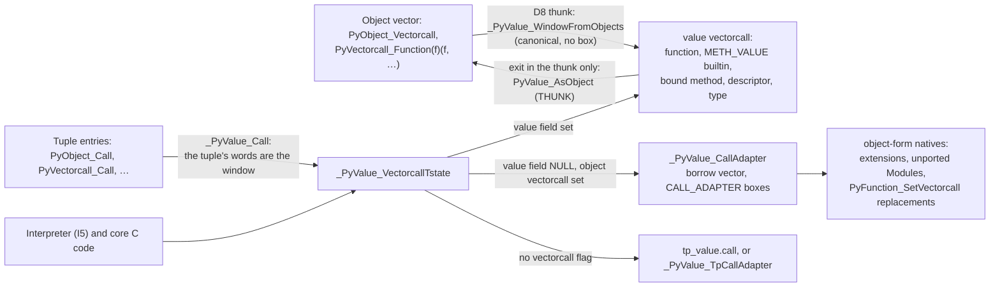

# Value API steps M3a and M3b: the value vectorcall and Clinic value emission (proposal)

Status: proposal, revision 3, 2026-11-04, after
[reviews 1 and 2](../reviews/value-api-m3-review-1.md) and the coordinator's
rulings; accepted for implementation. It specifies
mechanism steps M3a (the value vectorcall, `METH_VALUE`, the self homes,
the value wrapper shape) and M3b (value emission in Argument Clinic) of the
[V2a-0 route](value-api-v2a0.md) (§1.4, rows M3a and M3b). It settles the
interfaces that interpreter step I5 (= V3b) calls and that wave W2 regenerates
core Clinic output against. It writes no code.

Base: shared runtime (`build/worktrees/pyvalue-rc-universal`), read-only.
Revision 1 read `15859d9a592`; revisions 2 and 3 read `f7d374b1f92`, which adds
A3 step 1e, A5b-3 and V2a-0 part 2 (dispatchers, the 12 object-shaped value
wrappers, box kinds, `_PyValue_AdapterBox`); every line number cited holds
at both. M4a's field support has landed. Counts come from two scripts in
`build/pyjit-link-wave1/`: `m3-clinic_conv.py` (Clinic converters and return
converters) and `m3-impl_returns.py` (return statements of `_impl` bodies),
each run as `python3 -I SCRIPT RUNTIME_TREE`, and from `rg` commands quoted
where used. File references are relative to the
runtime tree.

## Changes after reviews 1 and 2

| Finding | Change | Where |
|---|---|---|
| 1 (must) | D11 narrowed: only the tuple-argument entries (`PyObject_Call`, `_PyObject_Call`, `PyObject_CallObject`, `PyVectorcall_Call`, `_PyVectorcall_Call`, `_PyObject_Call_Prepend`) call `_PyValue_Call`, chosen by the form of the arguments, for every callee. The object-vector entries keep upstream's body and reach value callables through D8's per-instance thunks. `_PyValue_TpCallAdapter` passes the original tuple when nothing was prepended. Worker part w1 is gone | D11, §1.3, §1.7 |
| 2 (must) | D13 moves to I5 whole, with one value trace function per thread; `PyEval_SetTrace` and `PyEval_SetProfile` install a boxing adapter. M3a has no monitoring part | D13, §1.8, §5 |
| 3 (must) | `method_hash`, `meth_hash` and `wrapper_hash` keep upstream's identity hash through `_PyValue_IdentityHash`; `hash([].append)` works | §1.6, §3 |
| 4 (must) | The post-check follows what `inherit_slots` copies: a non-zero value offset requires a non-zero object offset. The flag alone decides dispatch, so metaclasses defining `__call__` (`EnumType`) pass | §1.2, §3 |
| 5 | The result check is a debug assertion for value callees; the release check stays in the two adapters | §1.3 |
| 6 | A `check_value_api.py` rule, `window-read`, and the L1 exception for call-scratch arrays in pyvalue.md's edit list | §1.1, §7 |
| 7 | The index parser covers a `__new__`/`__init__` keyword dict through `_PyValue_WindowFromDictValues` | §2.4 |
| 8 | "W2 integrates after I5" is a dependency; `_PyEval_EvalFrameValue` keeps a steal for frames run by a PEP 523 hook, permanently | §1.4, §5, §6 |
| 9 | Estimate per the review's units, plus 1.25 h for revision 2's additions: M3a 14.3 agent-hours (5.6 h wall), M3b 7.4, I5 +3.0 worker-hours; M3 lands at about T9.5 | §5 |
| 10 | D1's `tstate` reason corrected: the gate builds are static, so the saving is one `%fs` load per callee, not a `__tls_get_addr` call | §1.1 |
| 12, rulings | The value wrapper shape is one section that M1b and M2 cite (§1.11); M3a rewrites part 2's 12 wrappers, which landed object-shaped | §1.11 |
| Cross-proposal | `PyValue_FromInt64` wherever revision 1 had `PyValue_FromSsize_t` (V2a-1a drops it). M1b and M2 return the two-word `_PyStatusValue` for their three outcomes; a call keeps the one-word result | §2.3, D3 |
| Rulings on Q1–Q4 | D1 stands; Q1: keep the DUP; Q2: move the structs (SOABI `boilvalrc3`); Q4: one `METH_VALUE` form with a `PyValueBorrow` receiver | §6 |
| Review 2: 14 (must) | Both type-level calls in the dispatcher (`tp_value.call` and `_PyValue_TpCallAdapter`) run inside upstream's recursion guard; `A.__call__ = A(); A()()` raises `RecursionError` | §1.3, §3, §6 |
| Review 2: 15, 16 | The "takes no keyword arguments" check is made once, in `wrapperdescr_value_raw_call`; an empty keyword dict becomes NULL `kwnames`. The `self` check is `PyType_IsSubtype` | §1.3, §1.11 |

Where the plan and the code disagree, the code wins:

| Plan | Code at `15859d9a592` |
|---|---|
| value-api.md §3, §7.5: `VALUES_TO_PYOBJECTS` has 10 uses | 8, all in `Python/ceval.c`: the seven call helpers and `_Py_BuildString_ValueSteal` |
| value-api.md §1.5: seven `_Value` call helpers, all live | Two of the seven, `_Py_VectorCall_ValueSteal` and `_Py_VectorCallInstrumentation_ValueSteal`, have no caller; the call transactions (`call_transaction_native`) replaced them. Five are called from `bytecodes.c` (`CALL_BUILTIN_CLASS`, `_FAST`, `_FAST_WITH_KEYWORDS`, `CALL_METHOD_DESCRIPTOR_FAST`, `_FAST_WITH_KEYWORDS`) |
| value-api.md §3: the vectorcall is `PyValue (*)(PyObject *, const PyValue *, size_t, PyObject *)` | That typedef exists as `_Py_vectorcallvaluefunc` in `pycore_value_slots.h` (V2a-0 part 1), used only by the zero `call` field. D1 below adds `tstate` |
| value-api.md §7.6: 435 core Clinic functions | 459: 435 with the default return converter and 24 with `-> int`, `-> Py_ssize_t`, `-> bool` or `-> double`, which the §7.6 script skipped |
| value-api.md §3: `im_self` and `m_self` become value fields | They are fields of public structs (`Include/cpython/classobject.h:15`, `methodobject.h:10`); R26 rule 2 freezes public word fields at five, so a decision is needed (D10) |

## 0. Decisions, one line each

| # | Decision |
|---|---|
| D1 | The value vectorcall is `PyValue (*)(PyThreadState *tstate, PyObject *callable, const PyValue *args, size_t nargsf, PyObject *kwnames)`. One signature for every core callable, for `tp_value.call`, and for the interpreter |
| D2 | `args` is a window of `PyValue` words that the caller keeps valid for the call; the callee borrows each element and never closes or stores one without `PyValue_DUP`. Not an array of `PyValueBorrow` (L1 forbids borrows in arrays) |
| D3 | The result is an owned `PyValue` in one register; `PyValue_NULL` with an exception set is the only error. No two-word return: a call has two outcomes, not three. M1b's and M2's slots, which also report "absent" (`StopIteration` without an exception, a missing attribute), return the two-word `_PyStatusValue {int status; PyValue value}`; the two forms meet nowhere |
| D4 | `nargsf` keeps `PY_VECTORCALL_ARGUMENTS_OFFSET`; `kwnames` is a tuple of str or NULL, its values after the positional ones. Both as PEP 590 |
| D5 | A bound call with the offset flag writes `PyValue_DUP(self)` into `args[-1]` and closes it before restoring the saved word, because `args[-1]` can be a frame slot. Without the flag it copies into a C array that no traversal reads |
| D6 | Per-instance storage: `PyFunctionObject`, `PyCFunctionObject`, `PyMethodObject` and `PyMethodDescrObject` gain one value-vectorcall field; type objects use V2a-0's `tp_value_vectorcall`. `tp_value_vectorcall_offset` gives its place; it is copied with `tp_vectorcall_offset`; `tp_value_vectorcall` is never inherited |
| D7 | Dispatch reads the value vectorcall only under `Py_TPFLAGS_HAVE_VECTORCALL`, so the metaclass `__call__` rule holds unchanged. A NULL value field means "object form": the call adapter calls the instance's object vectorcall |
| D8 | The object vectorcall field of a core callable holds a thunk over its value field: `_PyFunction_Vectorcall` for functions (its exported name is kept, because the interpreter's guard and `PyFunction_SetVectorcall` compare against it) and `_PyValue_VectorcallThunk` for every other core callable. Both are one macro body. The core never calls either |
| D9 | `METH_VALUE` is one new call-convention flag, `0x0400`, defined in an internal header, valid alone or with `METH_METHOD`, and with `METH_CLASS`, `METH_STATIC`, `METH_COEXIST`. It carries no `METH_FASTCALL`, `METH_O` or `METH_NOARGS` bit, so code that tests those bits never calls a value function with object arguments. *Amended 2026-11-05:* `METH_VALUE` splits on `METH_KEYWORDS` as `METH_FASTCALL` does, `METH_METHOD` requires `METH_KEYWORDS`, and the fixed-arity forms are checked in the trampolines (`d63c129b95f`, `62bfae99844`; `Include/internal/pycore_value_call.h`). |
| D10 | `im_self`, `m_self` and the method-wrapper `self` become `PyValue` homes. `PyMethodObject`, `PyCFunctionObject` and `PyCMethodObject` move to internal headers, as `PySliceObject` did in M4b, rather than add two public word fields to R26's five. The borrowed getters of `self` are deleted; `PyMethod_GetSelfRef` and `PyCFunction_GetSelfRef` replace them |
| D11 | The six tuple-argument entries of the object call API (`PyObject_Call`, `_PyObject_Call`, `PyObject_CallObject`, `PyVectorcall_Call`, `_PyVectorcall_Call`, `_PyObject_Call_Prepend`) call `_PyValue_Call` for every callee: the tuple's words are the window, so nothing is converted. The object-vector entries keep upstream's body; they reach value callables through D8's thunks, which already convert once. The full suite then runs every C-to-core call through the value bodies |
| D12 | M3a provides the replacements for `VALUES_TO_PYOBJECTS` and the seven helpers (the dispatcher, the adapters, direct `METH_VALUE` calls); I5 switches the handlers and deletes them. M3a's only lines in the `ceval.c` unit are four reads of `im_self` and `m_self` that the field type forces (§4), written on A3 step 2's tree |
| D13 | Monitoring and tracing are I5's, whole (§1.8): all their callers are interpreter handlers, so value entry points written in M3a would be stopgaps. I5 stores one value trace function per thread; `PyEval_SetTrace`/`SetProfile` install a boxing adapter |
| D14 | M3b: a file-level Clinic directive `value_emission` selects value output; Clinic refuses it in a limited-API file. Under it every function is `METH_VALUE` (with `METH_METHOD` when it takes `defining_class`), the `_impl` returns `PyValue` for the default return converter, and `object` parameters are `PyValueBorrow` |
| D15 | The value keyword parser returns indices into `args`, not an array of copied words: `_PyArg_UnpackKeywordsValue(args, nargs, kwnames, &_parser, …, Py_ssize_t *index)` |
| D16 | Each public-layout change bumps the fork's SOABI tag (V2a-0 D15): M3a moves it from `boilvalrc2` to `boilvalrc3`, once per landing train with any V2a-0 or M4b change not yet released |
| D17 | Slot wrappers have one value shape, `_Py_wrappervaluefunc` (§1.11): borrowed `self`, the D2 window, `kwnames`, the wrapped value slot. The wrapper descriptor's value call reads `self` from the window and never boxes it; M1b and M2 write their wrappers in this shape |

## 1. M3a: the value vectorcall

### 1.1 Signature and ownership

```c
/* Include/internal/pycore_value_slots.h (replaces V2a-0's 4-parameter form) */
typedef PyValue (*_Py_vectorcallvaluefunc)(
    PyThreadState *tstate, PyObject *callable,
    const PyValue *args, size_t nargsf, PyObject *kwnames);

/* Include/internal/pycore_value_call.h (new) */
#define METH_VALUE 0x0400            /* public methodobject.h reserves the bit */
typedef PyValue (*_PyCFunctionValue)(
    PyValueBorrow self, const PyValue *args, Py_ssize_t nargs,
    PyObject *kwnames);
typedef PyValue (*_PyCMethodValue)(
    PyValueBorrow self, PyTypeObject *defining_class,
    const PyValue *args, Py_ssize_t nargs, PyObject *kwnames);
```

| Position | Type | Who owns | Why this and not the alternative |
|---|---|---|---|
| `tstate` | `PyThreadState *` | – | The dispatch layer needs it for the frame push, the recursion check and errors. The interpreter holds it in a pinned register (r14 under Clang `preserve_none`, rdx under GCC), so passing it costs the caller one move. The saving in the callee is small: the gate builds are static, so `_PyThreadState_GET` is one `%fs` load, not a `__tls_get_addr` call. V8's C++ builtins take the isolate; LuaJIT's C functions take `L`. `_PyCFunctionValue` does not take it: its leaves rarely need it. Cost: a fifth argument, which Win64 passes on the stack; the gate is Linux |
| `callable` | `PyObject *` | caller | The dispatcher has tested the tag (value-api.md §1.2); an inline value is never callable |
| `args` | `const PyValue *` | caller | D2. In the interpreter it is `slots + base`, the call window, whose temporaries own their values (pyvalue.md D4); in C callers it is a C array of owners. A `PyValueBorrow` array would be a home holding borrows, which L1 forbids; a cast between the two element types would also cross strict aliasing. A5b already uses `const PyValue *` for read-only views of owners. The callee reads `PyValue_Borrow(args[i])` |
| `nargsf` | `size_t` | – | D4. The flag lets a bound call use `args[-1]` without a copy, and lets a tuple call (`f(*t)`, `PyObject_Call`) pass `t->ob_item` directly with no copy and no flag, since tuples store `PyValue` words |
| `kwnames` | `PyObject *` | caller | A tuple of str: a typed pointer (value-api.md §1.2) |
| result | `PyValue` | callee gives an owner | D3. One register (rax); `PyValue_NULL` is 0 after pyvalue.md's D5, so the test is one compare. The interpreter's out-of-line `call_transaction_run_*` (A3 step 2) already returns `{status, child}` for frame pushes; the vectorcall itself always completes the call |

**Ownership across the call.** The caller owns `callable`, every element of
`args` and `kwnames` until the call returns. The callee may run Python code
that rebinds the caller's locals; the window's owners keep the borrows valid,
which is the V2a-0 borrow contract (§4.6) applied to a vector. A callee that
keeps an argument (a frame local, a container store, a bound object) takes a
count with `PyValue_DUP`. `_PyEvalFramePushAndInit` consumes owners, so the
Python-function value vectorcall DUPs into a C array first, as
`_PyEval_Vector` does today with `PyValue_NewRef`.

**The window rule (D2, D5).** A value vector is either the caller's owners
or, when a callee or adapter must build one (the no-flag prepend, the
keyword-dict expansion, the object-to-value thunk), a C array of copied words
that lives for one call and that no traversal reads (a call-scratch array).
Only the pyvalue.c window primitives write one, because A5b's compiler rule
forbids a `PyValueBorrow` becoming a `PyValue`:
`_PyValue_WindowFromObjects(PyValue *dst, PyObject *const *src, Py_ssize_t n)`
(canonical borrowed words), `_PyValue_WindowCopy(dst, const PyValue *src, n)`
(words of a window or tuple) and `_PyValue_WindowFromDictValues(dst, PyObject
*dict, PyObject **kwnames)` (§2.4). They are listed with the encoding
primitives (R26 rule 1). That call-scratch arrays are not homes is an
exception to L1, recorded in pyvalue.md (§7). Memory the caller passed in,
`args[-1]` included, receives only owners.

**Reading the window.** `const PyValue *` lets `PyValue x = args[i]` make a
second owner without a count, the gap A5b names. A `check_value_api.py` rule,
`window-read`, with a self-test: in a function of type
`_Py_vectorcallvaluefunc`, `_PyCFunctionValue`, `_PyCMethodValue` or
`_Py_wrappervaluefunc`, every `args[i]` read is an operand of
`PyValue_Borrow`, `PyValue_DUP` or a window primitive.

**The prepend (D5).** `PyValue _PyValue_VectorcallPrepend(PyThreadState
*tstate, PyValueBorrow callable, PyValueBorrow self, const PyValue *args,
size_t nargsf, PyObject *kwnames)`; the bound method passes the canonical
borrow of `im_func` and `PyValue_Borrow(im_self)`:

```c
Py_ssize_t nargs = PyVectorcall_NARGS(nargsf);
if (nargsf & PY_VECTORCALL_ARGUMENTS_OFFSET) {
    PyValue *slot = (PyValue *)args - 1;
    PyValue saved = *slot;
    *slot = PyValue_DUP(self);                  /* args[-1] may be a frame slot */
    res = _PyValue_VectorcallTstate(tstate, callable, slot, nargs + 1, kwnames);
    PyValue_CLOSE(*slot);
    *slot = saved;
}
else {                                          /* copy: C array, read by nobody else */
    /* _PY_FASTCALL_SMALL_STACK words on the C stack, else PyMem_Malloc */
}
```

Upstream stores a borrowed `self` in `args[-1]`. Here `args[-1]` can be a
frame slot, which the GC rechecks as a home; a borrow of a mortal object
there would make it subtract a reference nobody counted (Q1). The DUP costs
one count pair for a mortal receiver and nothing for an inline or immortal
one, and falls on C callers (`sorted(key=o.m)`), since the interpreter
expands bound methods itself (`call_transaction_expand_method`).

### 1.2 Layout and ABI

| Struct | Field added | Header after M3a | `tp_value_vectorcall_offset` |
|---|---|---|---|
| `PyFunctionObject` | `_Py_valuefunc func_value_vectorcall` (opaque storage, V2a-0 D2) | `Include/cpython/funcobject.h` (public) | `offsetof(PyFunctionObject, func_value_vectorcall)` |
| `PyMethodDescrObject` | `_Py_valuefunc d_value_vectorcall` | `Include/cpython/descrobject.h` (public) | `offsetof(…, d_value_vectorcall)` for `method_descriptor`; `classmethod_descriptor` shares the struct but has no vectorcall (`descrobject.c:823`), so it uses the type-level `tp_value.call` |
| `PyCFunctionObject`, `PyCMethodObject` | `_Py_vectorcallvaluefunc m_value_vectorcall`; `m_self` becomes `PyValue` | moved to `Include/internal/pycore_methodobject.h` (new) | `offsetof(PyCFunctionObject, m_value_vectorcall)` |
| `PyMethodObject` | `_Py_vectorcallvaluefunc value_vectorcall`; `im_self` becomes `PyValue` | moved to `Include/internal/pycore_classobject.h` (new) | `offsetof(PyMethodObject, value_vectorcall)` |
| `wrapperobject` (`descrobject.c`) | `self` becomes `PyValue` | already internal | 0: type-level `tp_value.call` |
| `PyTypeObject` | none (V2a-0 added `tp_value_vectorcall_offset`, `tp_value_vectorcall`) | public, opaque storage | `PyType_Type`: `offsetof(PyTypeObject, tp_value_vectorcall)` (R20) |

| Effect | Consequence |
|---|---|
| Sizes | +8 bytes per function, builtin, bound method and method descriptor. `test_sys`'s `sizeof` checks for these four types change |
| Public layout | Two public structs gain a field and three move out of the public headers: D16 bumps the SOABI tag, so a stale non-limited binary fails to load instead of misreading them |
| Public API after the move | The type names stay as opaque structs. `PyCFunction_GET_FUNCTION`, `_GET_FLAGS`, `_GET_CLASS`, `PyMethod_GET_FUNCTION` become exported functions for extensions and stay inline under the same names inside the core, so their uses in `ceval.c`, `bytecodes.c` and `specialize.c` compile unchanged. `PyMethod_GET_SELF`, `PyCFunction_GET_SELF`, `PyMethod_Self` and `PyCFunction_GetSelf` return borrowed objects, which an inline `self` cannot give without a keeper, so they are deleted, as the link wave deleted the borrowed container getters; `PyMethod_GetSelfRef` and `PyCFunction_GetSelfRef` return new references (a THUNK box for an inline `self`) |
| In-tree users of the moved fields | 15 in `Modules/_lsprof.c`, 2 in `Modules/_pickle.c`, 1 in `_testinternalcapi/native_scope.c`; the rest are in `Objects/` and `Python/` (`rg -c 'PyCFunctionObject\|PyMethodObject\b\|->m_self\|->im_self\|->im_func\|->m_ml'`). All are core units and include the internal header. Reads of `self` outside the two type files: `bytecodes.c:4293` and `ceval.c:1647` (`PyValue_FromPyObjectNew(…->im_self)`, which becomes `PyValue_DUP(…->im_self)`), `ceval.c:1149, 1174` (`PyCFunction_GET_SELF` in two helpers that I5 deletes; they become `_PyCFunction_SelfObject`, which keeps a box of an inline `self` on the borrow stack that `VALUES_TO_PYOBJECTS` has opened, kind CALL_ADAPTER), `native_scope.c:111`, `typeobject.c:8634`, `_pickle.c:5169` and `_lsprof.c:159, 189` |
| R26 | No word field is added to a public layout; the frozen five stay five. The new public fields are `_Py_valuefunc` storage |
| Limited API | `PyCFunction_GetSelf` is in the stable ABI; abi3 binaries are already unsupported (pyvalue.md D6) |

**Inheritance and flags.**

* `inherit_slots` copies `tp_value_vectorcall_offset` in the
  `COPYSLOT(tp_vectorcall_offset)` block: the pair is copied together.
* `Py_TPFLAGS_HAVE_VECTORCALL` keeps its rule (inherited when `tp_call` is
  not overridden; cleared when `__call__` becomes `slot_tp_call`, at both
  sites in `typeobject.c`). It now means "instances hold an object vectorcall
  at `tp_vectorcall_offset` and, when `tp_value_vectorcall_offset` is
  non-zero, a value vectorcall at that offset, which may be NULL".
* `tp_value_vectorcall`, like `tp_vectorcall`, is never inherited: a heap
  subclass of `list` has neither, and `type`'s value `call` constructs it.
* `type_ready_post_checks` (debug and release, as upstream checks
  `tp_vectorcall_offset`): a non-zero `tp_value_vectorcall_offset` requires a
  non-zero `tp_vectorcall_offset`, not the flag: `inherit_slots` copies both
  offsets and clears the flag when `tp_call` is overridden, so a metaclass
  defining `__call__` (`EnumType`) has both offsets and no flag. The flag alone decides whether dispatch reads the
  field (D7), as for `tp_vectorcall_offset`.
* Spec types (W4): a `PyMemberDef` named `__valuevectorcalloffset__` sets
  the offset, as `__vectorcalloffset__` does; in-tree only.
* Pair table (V2a-0 D14): the `tp_call` row gets its value side,
  `PyVectorcall_Call` ↔ `_PyValue_InstanceVectorcall`, which calls the
  instance's value vectorcall, or the adapter when it is NULL; a static
  type whose `tp_value.call` is set gets `_PyValue_TpCallThunk` as its
  object `tp_call`. The `slot_tp_call` pair (Python `__call__`) gets its
  value `slot_tp_call`, which calls `__call__` through the value dispatcher.

**Instance invariant** (debug-checked in the dispatcher and the thunks): a
core callable's object field is a value thunk if and only if its value field
is non-NULL. So the dispatcher never reaches a thunk through the adapter, and
a thunk never finds a NULL value field.

### 1.3 Dispatch

```c
/* Include/internal/pycore_value_call.h; the adapters are out of line in call.c */
static inline PyValue
_PyValue_VectorcallTstate(PyThreadState *tstate, PyValueBorrow callable,
                          const PyValue *args, size_t nargsf, PyObject *kwnames)
{
    if (!PyValue_IsObject(callable)) {
        return _PyValue_NotCallable(tstate, callable);   /* "'int' object is not callable" */
    }
    PyObject *c = PyValue_AsKnownObjectBorrow(callable);
    PyTypeObject *tp = Py_TYPE(c);
    if (tp->tp_flags & Py_TPFLAGS_HAVE_VECTORCALL) {
        Py_ssize_t off = tp->tp_value_vectorcall_offset;
        _Py_vectorcallvaluefunc f = NULL;
        if (off != 0) {
            memcpy(&f, (char *)c + off, sizeof(f));
        }
        if (f != NULL) {
            PyValue res = f(tstate, c, args, nargsf, kwnames);
            _PyValue_ASSERT_RESULT(tstate, res);      /* debug builds only */
            return res;
        }
        vectorcallfunc of;
        memcpy(&of, (char *)c + tp->tp_vectorcall_offset, sizeof(of));
        if (of != NULL) {
            return _PyValue_CallAdapter(tstate, c, of, args, nargsf, kwnames);
        }
    }
    /* Type-level calls get upstream's tp_call guard (call.c:224, :278, :372);
       vectorcall callees above keep their own, as upstream's do. */
    if (_Py_EnterRecursiveCallTstate(tstate, " while calling a Python object")) {
        return PyValue_NULL;
    }
    PyValue res;
    _Py_vectorcallvaluefunc vf = _PyType_VALUE_SLOT(tp, call);
    if (vf != NULL) {
        res = vf(tstate, c, args, nargsf, kwnames);
        _PyValue_ASSERT_RESULT(tstate, res);
    }
    else {
        res = _PyValue_TpCallAdapter(tstate, c, args, nargsf, kwnames);
    }
    _Py_LeaveRecursiveCallTstate(tstate);
    return res;
}
```

Without it, `A.__call__ = A(); A()()` (`test_recursive_call`) would recurse
through value `slot_tp_call` and the dispatcher until the C stack overflowed.

| Function | Role | Kind of its boxes |
|---|---|---|
| `_PyValue_VectorcallTstate`, `_PyValue_Vectorcall` (fetches `tstate`) | the dispatcher; the value form of `_PyObject_VectorcallTstate` and `PyObject_Vectorcall` | none |
| `_PyValue_ASSERT_RESULT`, `_PyValue_CheckFunctionResult` | the assertion `(res is NULL) == (an exception is set)` for value callees, which are all core code (the typedef and `METH_VALUE` are internal), as upstream's specialised call handlers only assert it; the release check (`SystemError`, as `_Py_CheckFunctionResult`) runs in the two adapters, where extension code returns | none |
| `_PyValue_CallAdapter(tstate, c, vectorcallfunc, args, nargsf, kwnames)` | object-form natives: opens a borrow scope, `_PyBorrow_ValueVector` (offset slot included), calls, `_Py_CheckFunctionResult`, converts the result with `PyValue_FromObjectSteal`, exits the scope | CALL_ADAPTER, owner the vectorcall pointer (G) |
| `_PyValue_TpCallAdapter` | `tp_call` of an object-form type: builds the argument tuple from the words (no box: tuples store words) and the keyword dict, or takes `_PyValue_Call`'s original pair; calls `tp_call` in a borrow scope; release result check; upstream's "not callable" when `tp_call` is NULL | none for arguments; the object result converts by steal |
| `_PyValue_VectorcallPrepend` | §1.1 | none |
| `_PyValue_Call(tstate, PyValueBorrow callable, PyObject *args, PyObject *kwargs)` | the body of the six tuple entries (D11): a tuple's `ob_item` is the window (no flag); a dict expands with `_PyValue_StackUnpackDict` into a call-scratch array. An object-form `tp_call` reached with nothing prepended receives the original tuple and dict | none (the adapter boxes as `_PyBorrow_TupleItems` did) |
| `_PyValue_CallNoArgs`, `_PyValue_CallOneArg`, `_PyValue_VectorcallMethod`, `_PyValue_CallMethodOneArg` | the fixed-arity forms the core calls most (W2's call family, 283 calls in 56 files: `rg` over `PyObject_Call*`, `PyObject_Vectorcall*`, `_PyObject_VectorcallTstate`); each reserves `args[-1]` | none |
| `_PyValue_TpCallThunk` | the object `tp_call` of a type whose `tp_value.call` is set (the pair row of §1.2): the tuple's words are the window, the dict expands as in `_PyValue_Call`, the exit is `_PyValue_THUNK_EXIT`. Its object callers arrive through `_PyObject_MakeTpCall`, which keeps the guard | THUNK |
| Empty keyword dict | `_PyValue_Call` and `_PyValue_TpCallThunk` turn an empty dict into NULL `kwnames`, so `int.__add__(5, 2, **{})` still works | – |
| `_PyValue_NotCallable` | raises upstream's `TypeError` with `PyValue_TYPE(v)->tp_name` | none |

No borrow scope is opened on the value path: only the adapters reach
object-form code, and they open it (the fork's `_PyObject_VectorcallTstate`
opens one per call).

### 1.4 Core callables

| Callable | Value vectorcall (M3a) | Object field | Notes |
|---|---|---|---|
| Python function | `_PyFunction_ValueVectorcall`: DUP the window into a C array, `_PyEvalFramePushAndInit` (`pycore_interpframe.h:556`), `_PyEval_EvalFrameValue` | `_PyFunction_Vectorcall`, the thunk | `_PyEval_EvalFrameValue` returns the frame's result as a value. Until I3 converts `INTERPRETER_EXIT`, whose handler boxes with `PyValue_AsObject` (`bytecodes.c:1473`), its body is `PyValue_FromObjectSteal(_PyEval_EvalFrame(…))`, so that box stays counted where it is today; I3 makes the handler return the word. A frame run by a PEP 523 hook (`_PyFrameEvalFunction`, `Include/cpython/pystate.h:327`, returns `PyObject *`) keeps the steal permanently: that is the compatibility boundary |
| Bound method | `method_value_vectorcall`: `_PyValue_VectorcallPrepend(tstate, im_func, im_self, …)` | `_PyValue_VectorcallThunk` | `im_self` is a value home (§1.6) |
| Builtin, `METH_VALUE` | `cfunction_value_vectorcall`: recursion check, `meth(PyValue_Borrow(m_self), args, nargs, kwnames)` | thunk | `nargsf`'s flag is masked off: a `METH_VALUE` function sees `nargs` only |
| Builtin, `METH_VALUE \| METH_METHOD` | `cfunction_value_vectorcall_METHOD`, passing `mm_class` | thunk | |
| Builtin, any other flags | NULL | `cfunction_vectorcall_*` as today | the adapter (CALL_ADAPTER) until W2 and W4 port the function |
| Method descriptor, `METH_VALUE` (and `METH_METHOD`) | `method_value_vectorcall_descr{,_METHOD}`: `nargs >= 1`, `descr_check` on `PyValue_TYPE(args[0])` (no box for an inline receiver), `meth(PyValue_Borrow(args[0]), args + 1, nargs - 1, kwnames)` | thunk | other flags: NULL value field, object vectorcall as today |
| Classmethod descriptor | type-level `tp_value.call` = `classmethoddescr_value_call` | – (tp_call) | `type.__dict__['fromkeys'](dict, …)` |
| Method-wrapper (`(5).__add__`) | type-level `tp_value.call` = `wrapper_value_call` (§1.11) | – (`tp_call` = `_PyValue_TpCallThunk`) | `self` is a value home |
| Wrapper descriptor (`int.__add__`) | type-level `tp_value.call` = `wrapperdescr_value_call` (§1.11) | – (`tp_call` = `_PyValue_TpCallThunk`) | `self` read from the window, never boxed |
| Type objects | `tp_value_vectorcall`; M3a writes `type`'s own (`type_value_vectorcall`: `type(x)`, else value `type_call`) | `tp_vectorcall` = thunk where `tp_value_vectorcall` is set | the 19 other constructors (`int`, `float`, `list`, `range`, …) are W2's; 6 of them come from Clinic `@vectorcall` regeneration (`tupleobject.c`, `enumobject.c` ×2, `bytearrayobject.c`, `bytesobject.c`, `floatobject.c`) |
| Python class with `__call__` | type-level value `slot_tp_call` | – | the slotdef pair of §1.2 |

**`PyFunction_SetVectorcall` (R20).** It stores `vectorcall` in the object
field and sets the value field to `_PyFunction_ValueVectorcall` if
`vectorcall == _PyFunction_Vectorcall`, else to NULL, under the existing
stop-the-world and `func_clear_version`. Setting the default back restores the
value form; any other function is reached through the call adapter. The
interpreter's guard (`bytecodes.c:5220`, `vectorcall != _PyFunction_Vectorcall`)
stays valid under the invariant and is not edited by M3a.

### 1.5 `METH_VALUE`

| Item | Decision |
|---|---|
| Value | `0x0400`, the first free bit after `METH_METHOD` (`0x0200`). `Include/methodobject.h` gains a comment reserving it; the definition and the two C types live in `pycore_value_call.h`, so no `PyValue` enters a public header (R10, R26) |
| Valid combinations | `METH_VALUE`; `METH_VALUE \| METH_METHOD`; each with any of `METH_CLASS`, `METH_STATIC`, `METH_COEXIST` |
| Invalid | with `METH_VARARGS`, `METH_KEYWORDS`, `METH_NOARGS`, `METH_O` or `METH_FASTCALL`: `PyCMethod_New`, `PyDescr_NewMethod` and `PyDescr_NewClassMethod` raise `SystemError` ("%s() method: bad call flags"), as for other invalid combinations |
| C function | `_PyCFunctionValue` or `_PyCMethodValue` (§1.1), cast through `PyCFunction` in `ml_meth` as every convention is |
| Arity | the callee checks it. Clinic emits the check and reproduces the message of the convention it replaces: "f() takes no arguments (1 given)" for a function that was `METH_NOARGS`, "f() takes exactly one argument (2 given)" for `METH_O`, `_PyArg_CheckPositional`'s for the rest |
| Selection | `_Py_METH_CALL_FLAGS` gains `METH_VALUE`. `PyCMethod_New`, `PyDescr_NewMethod` and `PyDescr_NewClassMethod` switch on it and set the value field and the thunk (§1.4). `specialize.c`'s two switches leave `METH_VALUE` to `CALL_NON_PY_GENERAL` until I5 adds its handlers |
| Why one form, not five | One C signature per `METH_VALUE` function replaces the four upstream shapes. `METH_O` and `METH_NOARGS` save a vector read that the window already pays; with one form, I5 can merge the seven `CALL_BUILTIN_*`/`CALL_METHOD_DESCRIPTOR_*` handlers into two (§1.7). V8's builtins use one JS linkage with `argc` and leave typed arity to per-builtin descriptors; Clinic's `_impl` is that descriptor here |
| Why a disjoint bit | Cython tests `METH_FASTCALL`, `METH_O` and `METH_NOARGS` by mask and then calls `PyCFunction_GET_FUNCTION` directly with object arguments. A value function that also carried `METH_FASTCALL \| METH_KEYWORDS` (value-api.md §3's wording) would be called with `PyObject **` and corrupt memory; with a disjoint bit such code takes its generic path, which reaches the thunk |
| Agreed with M3b | Clinic emits `METH_VALUE` for every function in a value-emission file (`METH_VALUE\|METH_METHOD` with `defining_class`, plus the binding flags as today); `_PyCFunction_CAST` is unchanged |

### 1.6 Homes

| Home | Field | Writes | Reads |
|---|---|---|---|
| `PyMethodObject.im_self` | `PyValue` (M4a: `_Py_T_VALUE` member `__self__`, traverse `_Py_VISIT_VALUE`, clear, dealloc) | `_PyMethod_NewValue(PyObject *func, PyValueBorrow self)` DUPs; `PyMethod_New` becomes its thunk | prepend; `__self__`; `method_richcompare` (`PyValue_Is`), `method_hash` (`_PyValue_IdentityHash`), `method_repr`, `method_reduce` |
| `PyCFunctionObject.m_self` | `PyValue`, `PyValue_NULL` for none | `_PyCFunction_NewValue(PyMethodDef *, PyValueBorrow self, PyObject *module, PyTypeObject *cls)`; `PyCMethod_New` becomes its thunk; `method_get` (method descriptor `__get__`) calls the value form | value call; adapter (boxes an inline `self` for an object-form native: CALL_ADAPTER); `__self__`; `meth_richcompare`, `meth_hash` (`_PyValue_IdentityHash`), `meth_reduce` |
| `wrapperobject.self` | `PyValue` | `PyWrapper_New`'s value form, from `wrapperdescr_get` | `wrapper_value_call`; `__self__`; compare, hash (`_PyValue_IdentityHash`), repr, reduce |

**Identity hash.** Upstream hashes `self` by identity (`PyObject_GenericHash`,
`classobject.c:285`, `methodobject.c:348`), so `hash([].append)` works and
`hash(o.m)` never runs `o.__hash__`. `_PyValue_IdentityHash(PyValueBorrow
v)` keeps that: `Py_HashPointer` of the value identity, the word for an
inline value and `_PyObject_ValueIdentity` for an object, so it agrees with
`PyValue_Is` and `_PyObject_IsSame` (a box of 5 and an inline 5 hash
equally). `_PyValue_Hash` would be `PyObject_Hash` and is wrong here.

The 4 core `PyMethod_New` callers and `method_get` call the value creators.
The `descr_get` value slots that will call them are M2's mechanism and W2's
type work; until both land, binding `(5).bit_length` boxes `5` where it
boxes today.

### 1.7 The object side and what replaces the interpreter's helpers



* **Thunks.** One macro, `_Py_VALUE_VECTORCALL_THUNK(name)`, makes an object
  vectorcall that reads the instance's value field through
  `tp_value_vectorcall_offset`, converts the object vector (keyword values
  included) into a C array with one reserved slot before it, using
  `_PyValue_WindowFromObjects` (an exact int or float becomes inline, every
  other object a borrowed word: no box), calls it with the offset flag, and
  exits with `_PyValue_THUNK_EXIT` (kind THUNK). It is instantiated twice:
  `_PyFunction_Vectorcall` and `_PyValue_VectorcallThunk`. Each core value
  vectorcall therefore keeps an object form, as value-api.md §3 requires for
  `PyVectorcall_Function` and Cython, without a second hand-written body.
* **The call API (D11).** The object-vector entries (`PyObject_Vectorcall`,
  `_PyObject_VectorcallTstate`, `PyObject_CallOneArg`, `PyObject_VectorcallMethod`
  and the rest) keep upstream's body: they read the instance's object field,
  which is a D8 thunk for a core callable and the native itself otherwise. So
  an object-form native calling another (`_PyNativeScope_InvokeObjectVector`,
  until I5) converts nothing, and a second conversion layer is not built. The
  six tuple entries call `_PyValue_Call` for every callee, because a tuple
  already holds words: today `_PyVectorcall_Call` boxes inline items with
  `_PyBorrow_TupleItems` and the thunk unboxes them again.
* **Keeping the core off them.** The core names neither thunk outside §1.4's
  creators (rule `vectorcall-thunk`, with a self-test); the dispatcher never
  calls a thunk (the instance invariant); the object call API becomes marked
  compatibility API under P3 once W2 has swept its 283 core callers. After
  M3a four core paths still reach a thunk: the call API's core callers (W2), the interpreter's
  object-vector calls through `VALUES_TO_PYOBJECTS` (I5), `_PyEval_Vector`
  (I5 and W2), and the `PyMethod_New` and `PyCMethod_New` callers (W2). The
  rule checks names, not reachability; the gate's THUNK count by owner
  (step G) is the check that none remains after W2 and I5.
* **Thunk creators added by I5 (`d686623e3fb`).** `Python/instrumentation.c`
  and `Python/legacy_tracing.c` create thunks: the branch handler of
  `sys.monitoring` and the legacy trace handlers are value-vectorcall types of
  their own, and each stores `_PyValue_VectorcallThunk` as its object field.
  Both files are in `THUNK_FILES` of `check_value_api.py`.
* **Calls from object-form natives** reach value callables through a D8
  thunk or `_PyValue_Call`, with no box on entry and a box on exit only for
  an inline result.

What replaces the interpreter's helpers (I5 deletes them; M3a supplies every
replacement and changes no handler):

| At HEAD | Uses | Replacement from M3a | I5's edit |
|---|---|---|---|
| `VALUES_TO_PYOBJECTS`, `VALUES_TO_PYOBJECTS_CLEANUP`, `_PyValueArray_ToObjectVector` | 8 in `ceval.c` | `_PyValue_CallAdapter` for object-form callables; nothing for value callables | delete with the helpers below; the eighth use, `_Py_BuildString_ValueSteal`, needs a value join (`_PyUnicode_JoinValues`), which is I1's formatting work |
| `_Py_VectorCall_ValueSteal`, `_Py_VectorCallInstrumentation_ValueSteal` | 0 callers | – | delete (dead at HEAD) |
| `_Py_BuiltinCallFast_Value`, `_Py_BuiltinCallFastWithKeywords_Value` | `CALL_BUILTIN_FAST`, `_WITH_KEYWORDS` | `cfunction_value_vectorcall`'s body, or a direct `_PyCFunctionValue` call from the handler; `_PyValue_CallAdapter` for object natives | merge into one `CALL_BUILTIN_VALUE` handler; keep the object-native specialisations only while `Modules/` has `METH_FASTCALL` natives (W4). `CALL_LEN`, `CALL_ISINSTANCE` and `CALL_LIST_APPEND` stay separate handlers (LuaJIT's split between fast functions in the VM and a generic C fallback) |
| `_PyCallMethodDescriptorFast_Value`, `_FastWithKeywords_Value` | `CALL_METHOD_DESCRIPTOR_FAST`, `_WITH_KEYWORDS` | the descriptor's `_PyCFunctionValue` with `PyValue_Borrow(args[0])` | merge into `CALL_METHOD_DESCRIPTOR_VALUE`; `_NOARGS` and `_O` fold into it |
| `_Py_CallBuiltinClass_Value` | `CALL_BUILTIN_CLASS` | `tp->tp_value_vectorcall`, else the adapter on `tp_vectorcall` | guard on `tp_value_vectorcall` |
| `call_transaction_native` | generic and keyword calls | `_PyValue_VectorcallTstate` inside `call_transaction_run_*` (A3 step 2's R-c function) | the native scope's vector half survives only inside the adapter |
| `_PyEval_Vector` | 2 in `ceval.c`, 1 in `bltinmodule.c` (`__build_class__`) | `_PyFunction_ValueVectorcall` | I5 moves the `ceval.c` two; W2 moves `bltinmodule.c`; then it is deleted |

G9 fit: every replacement takes values or a pointer into the frame window by
value and returns one word; none takes the address of a handler local. The
dispatcher is inline up to the indirect call and the adapters are out of line,
so a handler that inlines it adds no canary.

### 1.8 Monitoring and tracing: I5's (D13)

M3a changes neither: all ten callers of the three entry points
(`pycore_instruments.h:56–65`) are in `ceval.c` and `bytecodes.c`. What I5
builds, for its brief (**landed in `d686623e3fb`, 2026-11-05**; every row
below is built):

`Python/legacy_tracing.c` is a boundary file of `check_value_api.py`: its
`trace_adapter` and `profile_adapter` carry the `PyEval_SetTrace` and
`PyEval_SetProfile` function and box the argument word for it, which is a
boundary box. It is also a thunk creator (§1.7).

| Part | I5 |
|---|---|
| Entry points | `_Py_call_instrumentation_arg`, `_2args`, `_exc2` take `PyValueBorrow` arguments, in place (no second set) |
| Vector | `call_instrumentation_vector` and its 29 object-array sites take `PyValue args[]`; the offset is `PyValue_FromInt64` (inline; today one `PyLong_FromSsize_t` per event); `call_one_instrument` calls `_PyValue_VectorcallTstate` |
| Legacy handlers | `_PyLegacyEventHandler` and `_PyLegacyBranchEventHandler` get value vectorcalls |
| Trace and profile | One value trace function per thread, `int (*)(PyObject *obj, PyFrameObject *, int what, PyValueBorrow arg)`, used by `sys.settrace`/`setprofile`'s trampolines. `PyEval_SetTrace` and `PyEval_SetProfile` install a boxing adapter that carries the extension's `Py_tracefunc` (CALL_ADAPTER, owner that function), so the object form exists only at the C-API entry. `c_tracefunc` and `c_profilefunc` keep their public meaning for readers |
| Workers | `instrumentation.c`, `legacy_tracing.c`, `sysmodule.c` lie outside the `ceval.c` unit: 34 × 3 + 19 × 4 minutes, 3.0 worker-hours beside I5's lead |

### 1.9 New declarations

| Declaration | Header | Test |
|---|---|---|
| 5-parameter `_Py_vectorcallvaluefunc` | `pycore_value_slots.h` (edit) | static asserts; every value vectorcall is assigned through it |
| `METH_VALUE`, `_PyCFunctionValue`, `_PyCMethodValue`, `_PyValue_VectorcallTstate`, `_PyValue_Vectorcall`, `_PyValue_Call`, the fixed-arity forms, `_PyValue_VectorcallPrepend`, `_PyValue_CheckFunctionResult`, `_PyValue_InstanceVectorcall`, the thunk macro | new `Include/internal/pycore_value_call.h` | `test_value_call` |
| `_PyValue_CallAdapter`, `_PyValue_TpCallAdapter`, `_PyValue_TpCallThunk`, `_PyValue_NotCallable`, `_PyValue_StackUnpackDict`, `_PyValue_ASSERT_RESULT` | `pycore_value_call.h`, bodies in `Objects/call.c` | adapter cases |
| `_PyValue_WindowFromObjects`, `_PyValue_WindowCopy`, `_PyValue_WindowFromDictValues`, `_PyValue_IdentityHash` | `pycore_value.h`, bodies in `Python/pyvalue.c` (R26 rule 1 list) | thunk and hash cases; `raw-bits` and `window-read` self-tests |
| `_Py_wrappervaluefunc`; `_PyType_ValueWrapper` returns it | `pycore_value_slots.h` (edit) | `test_value_slots` |
| `_PyFunction_ValueVectorcall`, `_PyEval_EvalFrameValue` | `pycore_function.h`, `pycore_ceval.h` (declaration only; body in `Objects/call.c`) | `test_call` |
| `PyCFunctionObject`, `PyCMethodObject`, `PyMethodObject` layouts; `_PyCFunction_NewValue`, `_PyMethod_NewValue` | new `pycore_methodobject.h`, `pycore_classobject.h` | `test_sys` sizes |
| `PyMethod_GetSelfRef`, `PyCFunction_GetSelfRef`; exported `PyCFunction_GET_FUNCTION` etc. | `Include/cpython/methodobject.h`, `classobject.h` | `test_capi` |
| `__valuevectorcalloffset__` member | `typeobject.c` | a `_testinternalcapi` spec type |

### 1.10 Comparison: V8 and LuaJIT

| Point | V8 builtins (JS linkage, `CallInterfaceDescriptor`) | LuaJIT fast functions | M3a |
|---|---|---|---|
| Callee identity | `target` in a fixed register | the function slot below `base` | `callable` argument. Adopted |
| VM state | isolate root register; `context` register | `L` | `tstate` argument (D1). Adopted |
| Arguments | on the machine stack, receiver in a fixed slot, `argc` in a register (receiver counted) | in place on the Lua stack from `base`; `nargs` = `L->top - base` | in place in the frame window, `nargs` in `nargsf`. In-place adopted: the interpreter passes `slots + base` with no copy. The receiver is an ordinary argument (`args[0]` for descriptors); there is no receiver slot that every call must provide, because a tuple call (`f(*t)`) passes the tuple's items with no writable slot before them |
| Construction | `new.target` register | – | rejected: Python constructs through `type.__call__` (`tp_new`, `tp_init`), which `tp_value_vectorcall` covers |
| Typed arity | per-builtin descriptors (TFS stubs, fast API C signatures) | none: every fast function sees `base` and `nargs` | one vector form for `METH_VALUE` (D9); Clinic's typed `_impl` plays the descriptor's part |
| Typed fast entry | fast API calls: a typed C entry beside the generic builtin, chosen by the optimiser when argument types match | builtins identified by `ffid` and recorded by the trace compiler | nothing to build in M3: the `_impl` is that entry and `ml_meth` identifies it (as `ffid`). The JIT step calls `_impl` directly after its type guards; its register gain comes from there, not from changing D1 |
| Results | accumulator register | written back into the caller's stack at the function slot, with a count (`nres`) | one word in rax (D3). Rejected `nres`: a Python call returns one value, and writing into the caller's window would let the callee alias the caller's homes, which G9 R-a avoids |
| Re-entry | builtins tail-call into JS functions on the same stack | a fast function may return "tail call a Lua function" (`FFH_TAILCALL`) or "retry in the interpreter" (`FFH_RETRY`) | rejected for the vectorcall: one entry serves C callers, which cannot take a frame back. The interpreter recognises Python functions by the value field (one compare) and pushes frames itself; `{status, child}` stays inside A3's `call_transaction_run_*`. `_PyCFunction_CallScoped`'s NOT_INVOKED retry has no successor: the dispatcher decides before calling |

### 1.11 The value wrapper shape (D17; M1b and M2 cite this)

```c
/* Include/internal/pycore_value_slots.h: the type _PyType_ValueWrapper returns */
typedef PyValue (*_Py_wrappervaluefunc)(
    PyValueBorrow self, const PyValue *args, Py_ssize_t nargs,
    PyObject *kwnames, void *wrapped_value);
```

| Item | Rule |
|---|---|
| `self` | A borrow. The caller holds the owner: a window word or the `wrapperobject.self` home. The wrapper passes it to the value slot as it is and never boxes it |
| `args`, `nargs`, `kwnames` | The D2 window, read under `window-read`. The wrapper checks only arity, from `nargs`, with `check_num_args`'s message. The keyword check is not the wrapper's: `wrapperdescr_value_raw_call` makes it once (below) |
| `wrapped_value` | `d_wrapped_value`, cast to the row's `_Py_*valuefunc` |
| Result | An owned `PyValue`, `PyValue_NULL` on error (D3). A wrapper over a three-state slot (M1b's `__next__`, M2's `__getattribute__`) turns `_PyStatusValue`'s "absent" into upstream's exception (`StopIteration`, `AttributeError`) itself, so every wrapper returns one word |
| Selection | `slotdef_value_wrapper` keeps one per slotdef row; `_PyType_ValueWrapper(base)` returns `_Py_wrappervaluefunc`. M3a rewrites part 2's 12 (`wrap_binaryvalue_l` to `wrap_concatvalue`, `typeobject.c:11426–11620`), which take `PyObject *self` and a tuple, and adds `__call__`'s; M1b and M2 add theirs in this shape |

The calls that use it:

* `wrapperdescr_value_call`, the type-level `tp_value.call` of
  `wrapper_descriptor` (`int.__add__(5, 2)`): `nargs >= 1`, else upstream's
  "needs an argument"; `self = PyValue_Borrow(args[0])`; the subclass test
  `PyType_IsSubtype(PyValue_TYPE(self), PyDescr_TYPE(descr))` (upstream's
  `_PyObject_RealIsSubclass` on types, which never calls `__subclasscheck__`)
  with upstream's message; then the raw call with
  `args + 1` and `nargs - 1`. This replaces `wrapperdescr_call`'s
  `PyTuple_GetItemRef(args, 0)` (`descrobject.c:597`), which boxes an inline
  `self`, and its `PyTuple_GetSlice`, which allocates a tuple.
* `wrapper_value_call`, the method-wrapper's (`(5).__add__(2)`): the raw
  call with `PyValue_Borrow(wp->self)` and the whole window.
* `wrapperdescr_value_raw_call(descr, self, args, nargs, kwnames)`: first,
  for a slotdef without `PyWrapperFlag_KEYWORDS`, upstream's "wrapper %s()
  takes no keyword arguments" when `kwnames` is non-NULL (an empty dict
  arrives as NULL), once for both paths; then, with a value wrapper and
  `d_wrapped_value`, one call and no borrow scope; else
  the object `wrapperfunc` with `self` boxed by `_PyValue_AdapterBox`
  (SLOT_ADAPTER), a tuple of the words, a dict for keyword wrappers, a
  borrow scope and the release result check.
* The object `tp_call` of both types becomes `_PyValue_TpCallThunk` (§1.3);
  `wrapperdescr_call` and `wrapper_call` are deleted.

## 2. M3b: value emission in Argument Clinic

### 2.1 Directive and scope

`/*[clinic input] value_emission [clinic start generated code]*/` once per
file, before its first function. Clinic then emits the value forms below for
every function and `__new__`/`__init__` in the file, and starts the generated
header with `#ifndef Py_VALUE_CORE` / `#error "value-emission Clinic output
requires Py_VALUE_CORE"` / `#endif`. Clinic refuses the directive in a limited-API file. A file is value-emission
or not; there is no per-function switch, matching `Py_VALUE_CORE` per unit.
Object emission stays for the compatibility test modules (`_testclinic.c`,
`_testcapi*`, `_testlimitedcapi*`), which test the object API.

### 2.2 Converters

Core (`Objects/`, `Python/`, `Parser/`): 459 functions in 41 files, 186 with
no parameter besides `self`, 130 whose only parameters are `object` or
`*args`. 515 parameters by converter (`m3-clinic_conv.py`):

| Converter | Core params | Value emission | Reads |
|---|---:|---|---|
| `object` | 260 | `PyValueBorrow`; no conversion | the word |
| `object(converter=…)` | 1 | the converter takes `PyValueBorrow` (one hand edit in W2) | – |
| `int` (and `long`, 1) | 59 | `_PyValue_AsInt` / `_PyValue_AsLong`: the inline word directly, else `__index__` through `_PyValue_Index` (V2a-0d, V2a-1a) | inline int: one test |
| `Py_ssize_t` | 27 | `_PyValue_AsSsize_t(v, PyExc_OverflowError)` (V2a-0d) | as above |
| `slice_index` | 24 | `_PyArg_SliceIndexValue(PyValueBorrow, Py_ssize_t *)` (new, M3b, in `Python/getargs.c`; `_PyEval_SliceIndex` lives in `ceval.c`, which M3b does not touch) | as above |
| `bool` | 26 | `_PyValue_IsTrue` (V2a-0d) | inline int or float: no call |
| `double` | 1 | `_PyValue_AsDouble` (V2a-1a-ii) | inline float: one test |
| `unicode`, `str`, `unicode_fs_decoded` | 53 | test `PyValue_IsObject` and the type, then as today with `PyValue_AsKnownObjectBorrow`; an inline value fails the type test and gets `_PyArg_BadArgumentValue` | – |
| `object(subclass_of=…)` | 33 | as `unicode`: the subclass test on `PyValue_TYPE(v)`, no box | – |
| `Py_buffer`, `bytesvalue`, `Py_UCS4`, `setobject` | 24 | tag test, then as today | – |
| `*args` | 4 | a tuple from the words, `_PyTuple_FromValueArray` (no box: tuples store words) | – |
| `**kwargs` | 2 | a dict from `kwnames` and the words | – |
| `self` | – | `PyValueBorrow` for classes whose instances can be inline: the `class int` and `class float` lines change to `"PyValueBorrow"` (27 blocks in `longobject.c` and `floatobject.c`); every other class keeps its typed pointer, converted with `PyValue_AsKnownObjectBorrow` after the descriptor's type check | – |
| `defining_class` | – | `PyTypeObject *`, with `METH_VALUE \| METH_METHOD` | – |

Every error message is upstream's, built from `PyValue_TYPE(v)->tp_name`
(`_PyArg_BadArgumentValue`); no error path boxes.

### 2.3 Return converters

| Return converter | Core functions | Value emission |
|---|---:|---|
| `object` (default) | 435 | the `_impl` returns `PyValue`; the wrapper passes it through |
| `bool` | 9 | `PyValue_True` / `PyValue_False` |
| `int` | 7 | `PyValue_FromInt64` (inline, no box) |
| `Py_ssize_t` | 7 | `PyValue_FromInt64` |
| `double` | 1 | `PyValue_FromDouble` (inline unless NaN) |
| others defined in `return_converters.py` (`long`, `unsigned_*`, `size_t`, `float`) | 0 in core | the matching constructor; used by `Modules/` in W4 |

An `_impl` that returns `PyValue` is one fixed form. The alternative, an
`_impl` that keeps returning `PyObject *` with the wrapper stealing it,
would keep `PyLong_From*` allocations in every numeric builtin and give the
core two return conventions. The cost lands in W2 (§2.6).

### 2.4 The generated parser for an int, a float and an object parameter

```c
/*[clinic input]                        (after `value_emission` in the file)
math.example
    x: object
    /
    n: int = 1
    *
    scale: double = 1.0
[clinic start generated code]*/
static PyValue math_example_impl(PyObject *module, PyValueBorrow x, int n, double scale);

static PyValue                          /* generated */
math_example(PyValueBorrow module, const PyValue *args, Py_ssize_t nargs, PyObject *kwnames)
{
    /* the static keyword parser (_PyArg_Parser _parser = {…}) as today */
    Py_ssize_t index[3];
    int n = 1;
    double scale = 1.0;
    if (_PyArg_UnpackKeywordsValue(args, nargs, kwnames, &_parser, /*minpos*/ 1,
                                   /*maxpos*/ 2, /*minkw*/ 0, /*varpos*/ 0, index) < 0) {
        return PyValue_NULL;
    }
    PyValueBorrow x = PyValue_Borrow(args[index[0]]);
    if (index[1] >= 0) {
        n = _PyValue_AsInt(PyValue_Borrow(args[index[1]]));
        if (n == -1 && PyErr_Occurred()) return PyValue_NULL;
    }
    if (index[2] >= 0) {
        scale = _PyValue_AsDouble(PyValue_Borrow(args[index[2]]));
        if (scale == -1.0 && PyErr_Occurred()) return PyValue_NULL;
    }
    return math_example_impl(PyValue_AsKnownObjectBorrow(module), x, n, scale);
}
#define MATH_EXAMPLE_METHODDEF \
    {"example", _PyCFunction_CAST(math_example), METH_VALUE, math_example__doc__},
```

(Clinic's real output keeps its `goto skip_optional_*` and `exit` labels;
the control flow is the same.)

* **Indices, not copies (D15).** A value `argsbuf` of copied words would be a
  call-scratch array outside the window primitives; an index array holds no
  word. With no `kwnames` and `nargs` in range, an inline macro fills
  `index[i] = i < nargs ? i : -1`. Error messages are upstream's.
* **Positional-only and fixed arity** (`METH_O`- and `METH_NOARGS`-shaped
  functions) skip the index array: `if (nargs != 1 || kwnames) return
  _PyArg_BadArityValue(…)`, then `args[0]`.
* **`__new__` and `__init__`** keep the `newfunc`/`initproc` signatures (not
  value slots, V2a-0 §4.5). With no keyword dict, the tuple's `ob_item` is
  the window and the index parser runs on it with no box (the fork's
  `_borrow_tuple_items` boxes for object emission go). With a dict, indices
  cannot reach its values, and pointers into its entries would dangle if a
  converter (`__index__`) mutated a dict that other code shares. So the
  wrapper copies the tuple's words and then the dict's values into a
  call-scratch window (`_PyValue_WindowCopy`, `_PyValue_WindowFromDictValues`,
  which also yields `kwnames`) and runs the same index parser on it: one
  parser form for both entry kinds.
* **`@vectorcall`** (6 core constructors) emits the type's value vectorcall
  with the D1 signature, stored in `tp_value_vectorcall`.

### 2.5 Hand-written parsing in the core

The 45 hand-written `PyArg_Parse*` sites in the core (v2a0 §1.6) are W2's:
it converts each function to Clinic, then marks `PyArg_*` compatibility API;
the object parsers stay for extensions (`BOX_SITE_PARSER`, THUNK kind). M3b
adds to `getargs.c` only what its output calls: `_PyArg_UnpackKeywordsValue`,
`_PyArg_BadArgumentValue`, `_PyArg_BadArityValue`, `_PyArg_SliceIndexValue`,
`_PyTuple_FromValueArray` (if A5b-3 has not added one).

### 2.6 What regenerating core output costs (W2's)

M3b changes only the generator, `clinic.test.c` and `test_clinic`. W2
regenerates file by file inside its batches, which the per-file directive
allows, after M3a, M3b, V2a-0d and V2a-1a i–ii, because the output calls
their functions; the return edits fall in the same 41 files W2 already
opens for the `object` parameters, so R21's one edit per file holds. What
regeneration breaks, and the wave protocol then fixes:

| Change in regenerated output | Count | Class |
|---|---:|---|
| 41 files gain the directive; 44 generated headers change | 41 | script |
| `object` parameters become `PyValueBorrow` in `_impl` signatures | 260 (value-api.md §7.6: 181 functions with a polymorphic parameter) | the uses are W2's call sites, already in its 2,000 |
| `int`/`float` `self` becomes `PyValueBorrow` | about 25 functions | value semantics, already in W2's int and float work |
| `_impl` returns `PyValue`: 1,075 return statements in 429 bodies (`m3-impl_returns.py`) | `return NULL` 463 → `PyValue_NULL`; `Py_RETURN_NONE`/`TRUE`/`FALSE` 159 → value macros; `return Py_NewRef(x)` 44; number constructors 72 → `PyValue_From*` (class R) | 738 by script |
| | `return local` 107; other expressions 230 | 337 by workers (retype the local, or `PyValue_FromObjectSteal`) |
| Core method tables in generated headers switch to `METH_VALUE` | 419 entries | none (generated) |

v2a0 §1.6 counted the parameters through their call sites but not the return
statements. At its rate of 40 sites per worker-hour the 337 worker sites add
337 / 40 ≈ 8.4 worker-hours to W2, and the 738 script edits need a new
script class (`return` in a value `_impl`), about 0.5 h to write.

### 2.7 M3b tests

* `Lib/test/clinic.test.c`: a value-emission section, one block per row of
  §2.2 and §2.3 (about 30), with `METH_VALUE` definitions, the `#error` line,
  `@vectorcall`, `defining_class` and a `__init__` with keywords.
* `test_clinic`: the directive, its refusals (limited API, after the first
  function), and §1.5's arity messages in the generated text.
* Compiled: `Modules/_testclinic_value.c` (new, `Py_BUILD_CORE_BUILTIN`), one
  function per converter; runtime cases with inline ints and floats, a big
  int, a NaN, keywords, missing and duplicate arguments, each message
  compared with `_testclinic`'s. It needs V2a-0d's and V2a-1a-ii's
  extraction functions, so it lands with the later of M3 and V2a-1a-ii.

## 3. Tests for M3a

Existing: `test_call`, `test_descr`, `test_class`, `test_funcattrs`,
`test_inspect`, `test_functools`, `test_enum`, `test_cprofile` and
`test_pickle` (moved fields), `test_sys` (sizes), `test_capi`
(`test_call`, `test_misc` vectorcall cases in `_testcapi/vectorcall.c`),
`test_gc`, `test_value_slots`, `test_pystats`; `test_descr`'s
`test_recursive_call` (`Lib/test/test_descr.py:3903`) covers the guard.

New `Lib/test/test_value_call.py` over `_testinternalcapi/value_call.c` (core:
`METH_VALUE` functions and methods, a function with
`METH_VALUE | METH_METHOD`, a spec type with `__valuevectorcalloffset__`,
accessors for the value fields) and `_testcapi/value_call.c` (extension: an
object-form callable type with a vectorcall, one with only `tp_call`, a
`PyFunction_SetVectorcall` replacement).

| Case | Expectation |
|---|---|
| A Python metaclass overriding `__call__`; `C()` | `M.__call__` runs, never `type`'s value constructor; `Py_TPFLAGS_HAVE_VECTORCALL` is clear on `M` |
| The same metaclass with `__call__` assigned after class creation, then deleted | `C()` runs `M.__call__` while it is assigned and constructs normally after deletion; the flag stays clear, as upstream |
| `import enum`; a C metaclass (`_testcapi`) defining `tp_call` over `PyType_Type` | `PyType_Ready` passes: both offsets inherited, flag clear; `Color.RED` and `Color(1)` behave |
| `hash([].append)`, `hash([].append) == hash([].append)` with one list; `hash(o.m)` where `o.__hash__` raises; the `int` descriptor `d.__get__(5)` hashed, and equal to a second binding of a boxed 5 | no `TypeError`, `__hash__` never runs; equal bindings hash equally |
| `int.__add__(5, 2)`, `(5).__add__(2)`, `int.__add__('x', 2)` | 7, 7 with zero boxes (stats build); upstream's "requires a 'int' object" message |
| `int.__add__(5, 2, **{})`, `int.__add__(5, 2, x=1)` | 7; upstream's "takes no keyword arguments" |
| `A.__call__ = A(); A()()`, and a `__call__` chain through a method-wrapper | `RecursionError`, as upstream; no C stack overflow |
| A `__init__` with keyword arguments whose `int` parameter's `__index__` mutates the shared kwargs dict | the values bound are those at entry; no crash under ASan |
| `window-read` self-test: a `_PyCFunctionValue` body with `PyValue x = args[0];` | the rule fails; with `PyValue_Borrow(args[0])` it passes |
| `PyFunction_SetVectorcall(f, replacement)` | calling `f` from Python, from `PyObject_Vectorcall`, and through `map(f, …)` runs the replacement; `f`'s value field is NULL; one CALL_ADAPTER box per inline argument |
| `PyFunction_SetVectorcall(f, _PyFunction_Vectorcall)` afterwards | the value field is restored; no adapter box |
| Bound-method prepend, with the offset flag: `o.m` called from C through `_PyValue_CallOneArg` and through the interpreter's generic path | `self` arrives as `args[0]`; `args[-1]` is restored; `sys.getrefcount(o)` unchanged after the call |
| Prepend without the flag: `PyObject_Call(o.m, (1, 2), None)` and `o.m(*t)` with 0, 1, `_PY_FASTCALL_SMALL_STACK` and 100 arguments | the copy path; same results |
| Prepend under GC: the bound method's callee runs `gc.collect()` inside a generator and inside a frame whose `f_locals` was read | no crash; debug-build GC assertions hold (D5) |
| Keywords: `f(1, b=2)`, `o.m(1, b=2)`, a `METH_VALUE` method with keywords, `**{'b': 2}` through `PyObject_Call` | values bound by name; keyword values never boxed |
| `METH_VALUE` method of an inline receiver: a method descriptor for `int` made by the test module (`PyDescr_NewMethod(&PyLong_Type, …)`), called as `d(5, 2.5)` and as `d.__get__(5)(2.5)` | `self` and the argument arrive inline; the bound object's `m_self` is inline; zero boxes on the call (stats build) |
| `METH_VALUE` combined with `METH_O`, `METH_FASTCALL`, `METH_VARARGS` | `SystemError` at creation |
| Arity messages of a `METH_VALUE` function compared with the same function as `METH_NOARGS` and `METH_O` | identical text |
| `5()`, `(1.5)()` | `TypeError: 'int' object is not callable`, no box |
| A value callable returning `PyValue_NULL` without an exception (debug build); an extension callable doing the same through each adapter (release build) | the assertion fires (a `test_capi` subprocess case); `SystemError` from the adapter, as `_Py_CheckFunctionResult` |
| `PyVectorcall_Function(f)` for a function, a builtin, a bound method, `list` | the thunks; calling them directly with an exact int argument gives the right result and a THUNK box only for an inline result |
| `PyCFunction_GetSelfRef(d.__get__(5))`, and `d.__get__(5).__self__` | a new reference to an int equal to 5; the getter boxes once (THUNK) |
| An extension type with only `tp_call`, and one with an object vectorcall, called from Python with inline arguments | `_PyValue_TpCallAdapter` and `_PyValue_CallAdapter`; results equal |
| Spec type with `__valuevectorcalloffset__` | its value field is called; a subclass inherits the offset |

**Box counters this step moves** (stats build; recorded, not gated):

* CALL_ADAPTER: new boxes only where a value path meets an object-form
  native (a bound method over an object-form builtin). Interpreter native
  calls keep their `VALUES_TO_PYOBJECTS` and native-scope boxes until I5.
* THUNK and INTERPRETER_EXIT: a Python function called through the call API
  (`list.sort`'s key, `map`) with an inline result boxes twice until I3
  (once at `INTERPRETER_EXIT`, freed by `_PyEval_EvalFrameValue`'s steal,
  once at the thunk's exit), where it boxed once before (Q5).
* Gone: `_PyVectorcall_Call`'s tuple-item boxes (`_PyBorrow_TupleItems`) for
  value callees, and `wrapperdescr_call`'s box of an inline `self`.
* Unchanged until I5 and W2: the five helpers' boxes and every builtin and
  constructor, since M3a converts no core builtin to `METH_VALUE`. The 35.9%
  of checkpoint boxes in builtin, descriptor and class calls (value-api.md
  §6.2) fall at I5 plus W2.

## 4. Files and collisions

M3a files: `Include/internal/pycore_value_call.h` (new),
`pycore_methodobject.h` (new), `pycore_classobject.h` (new),
`pycore_value_slots.h` (typedefs), `pycore_value.h` (window primitives,
identity hash), `pycore_function.h`, `pycore_call.h`,
`pycore_ceval.h` (declarations only); `Include/methodobject.h`,
`Include/cpython/{funcobject,methodobject,classobject,descrobject,abstract}.h`;
`Objects/{call,funcobject,methodobject,classobject,descrobject,typeobject}.c`;
`Python/{pyvalue,native_scope}.c`;
four lines of the `ceval.c` unit (`Python/bytecodes.c:4293`,
`Python/ceval.c:1149, 1174, 1647`) and the regenerated
`generated_ir_cases.c.h`; `Modules/{_lsprof,_pickle}.c` (moved fields);
two test modules and their
`Setup.stdlib.in` lines; `Lib/test/test_value_call.py`, `test_sys.py`;
`Tools/build/check_value_api.py` (`vectorcall-thunk` and `window-read`
rules, window primitives in the encoding list); `configure.ac`, `configure` (SOABI).

M3b files: `Tools/clinic/libclinic/{parse_args,converters,converter,return_converters,clanguage,dsl_parser}.py`,
`Python/getargs.c` (value helpers), `Include/internal/pycore_modsupport.h`,
`Lib/test/clinic.test.c`, `Lib/test/test_clinic.py`,
`Modules/_testclinic_value.c` (new) and its `Setup.stdlib.in` line.

| Work in flight | Shared files | Resolution |
|---|---|---|
| **A3 step 2** (G9: `bytecodes.c` uops, `ceval.c` helpers, the generator, generated files) | four lines: `bytecodes.c:4293` (`_INIT_CALL_BOUND_METHOD_EXACT_ARGS`), `ceval.c:1647` (`call_transaction_expand_method`, which A3 step 2's lead rewrites to take values) and `ceval.c:1149, 1174` (two helpers I5 deletes). Everything else stays: the monitoring entry points, `_PyEval_Vector`, the seven helpers, and the moved struct accessors, which keep their names inside the core. `pycore_ceval.h` gains declarations only | M3a lands after A3 step 2 (T8 in v2a0 §1.7); a4 writes the four lines against A3 step 2's code and regenerates. I5 rebases on both |
| **V2a-0 part 2** (landed at `f7d374b1f92`) | `typeobject.c` (value wrappers, slotdef pair, inheritance), `descrobject.c` (`d_wrapped_value`, `wrapperdescr_raw_call`), `pycore_value_slots.h` | M3a starts from `f7d374b1f92` or later and rewrites the 12 value wrappers to §1.11's shape |
| **A5b-3** (landed at `c71a3ca6aa2`) | `pycore_value.h`, `pyvalue.c`, `check_value_api.py` | M3a uses only A5b-3's surviving names (`PyValue_DUP`, `PyValue_Borrow`); the `public-value` rule must accept the two new `_Py_valuefunc` public fields |
| **M1b, M2** (value-api-m1b-m2.md) | `typeobject.c` slotdef rows, `pycore_value_slots.h` | they write their wrappers in §1.11's shape; whichever lands first adds `_Py_wrappervaluefunc`, from this text |
| **M2** (attribute dispatch, `descr_get` value sides) | `descrobject.c`, `typeobject.c`, `funcobject.c` | M2 calls M3a's creators (`_PyMethod_NewValue`, `_PyCFunction_NewValue`, `PyWrapper_New` value form); whichever lands second wires them |
| **V2a-1a, M1b, M2 on `typeobject.c`** | `typeobject.c` | v2a0 §1.7 integrates them in that order at T7–T12; M3a rebases onto those that have landed. Its `typeobject.c` hunks are the value wrappers, the `__call__` pair, `type_value_vectorcall` and the offset inheritance |
| **M3b** | none with M3a; agrees on `METH_VALUE` and the C types (§1.5) | M3b imports the flag spelling from this document; its compiled test waits for M3a |

## 5. Steps and estimate

Review 1's unit model: a Sonnet or Haiku worker per disjoint file set, up to
16 at once, then one builder round and one cleanup pass by the lead. A new
function counts 10 minutes (8 for the lead's small ones), a home touch point
or reshaped wrapper 3, a moved-field site 2, a test case 4.

**M3a.**

| Part | Who | Units × minutes | h |
|---|---|---|---:|
| a0: interface note (typedefs, `METH_VALUE` types, §1.11's wrapper shape, declarations), so workers start at once | lead | – | 0.5 |
| a1: dispatcher, 2 adapters, `_PyValue_TpCallThunk`, prepend, `_PyValue_WindowFromObjects`, thunk macro, `_PyValue_Call` and the 6 tuple entries, 4 fixed-arity forms, `NotCallable`, result assertion, `StackUnpackDict`, `InstanceVectorcall` | lead | 15 × 8 + 6 × 3 | 2.35 |
| a3: function value vectorcall, `_PyEval_EvalFrameValue`, `PyFunction_SetVectorcall`, `cfunction_value_vectorcall` as the workers' example | lead | 4 × 15 | 1.0 |
| a2: layout (4 fields, 2 struct moves), SOABI, inheritance and post-check, member, pair rows, value `slot_tp_call` | Sonnet | 10 × 7 | 1.2 |
| w2: `classobject.c` | Sonnet | 2 × 10 + 9 × 3 | 0.8 |
| w3: `methodobject.c` | Sonnet | 3 × 10 + 9 × 3 | 0.95 |
| w4: `descrobject.c` (§1.11's calls, descriptor value vectorcalls, wrapper home) | Sonnet | 5 × 10 + 6 × 3 | 1.15 |
| w5: `typeobject.c`: 12 wrappers reshaped, `__call__`'s added, `type_value_vectorcall` | Sonnet | 13 × 3 + 10 | 0.8 |
| w8: moved-field users | Haiku | 25 × 2 | 0.85 |
| w9: tests, two workers (§3: about 25 cases, 2 C modules) | Sonnet | 25 × 4 + 2 × 15 | 2.2 |
| w10: `pyvalue.c`: `_PyValue_WindowCopy`, `_FromDictValues`, `_PyValue_IdentityHash`; the `window-read` rule and self-test | Sonnet | 3 × 10 + 15 | 0.75 |
| a4, builder round, cleanup, GCC debug and Clang release suites | lead | – | 1.75 |
| **Total** | | | **14.3** (lead 5.6, workers 8.7) |

Review 1 counted 13.05; revision 2 adds 1.25 (the thunk in a1, w10, five
test cases). Wall: a0 (0.5 h), then the lead's a1 and a3 (3.35 h) while the
workers finish by about 2.2 h, then a4, the builder round and cleanup
(1.75 h): **about 5.6 h**. I5 takes D13: w6 and w7 of revision 1, 3.0
worker-hours beside its lead, at no cost in wall time.

**M3b.**

| Part | Who | h |
|---|---|---:|
| Generator: 23 converter and return kinds × 5 min; index-parser and tuple-and-dict emission 2 × 20 min; directive, refusals, selection, prototypes, `@vectorcall`, header guard 6 × 5 min | lead, then two workers on the converters | 3.1 |
| `getargs.c` value helpers, 5 × 12 min | lead | 1.0 |
| `clinic.test.c` value section, 30 blocks × 3 min, and `test_clinic` text cases | Sonnet | 1.5 |
| `_testclinic_value.c` and runtime cases, 40 × 2 min | Sonnet | 1.3 |
| Review fixes and a regeneration dry run on a scratch copy (count the compile errors W2 will meet) | lead | 0.5 |
| **Total** | | **7.4** |

Wall about 3 h, beside M3a from its start.

**Schedule.** M3a opens at T3.5 (v2a0 §1.7), needs 5.6 h and A3 step 2
(T8): M3 lands at about **T9.5**. Combined M3 is 21.7 agent-hours (v2a0: 10);
I5 gains 3.0, W2 about 8.9 (§2.6). **W2 integrates after I5**, a dependency:
builtins W2 converts would otherwise fall to `CALL_NON_PY_GENERAL` and box
each inline result. I5 runs about T9.5–T15.5 and W2 T12–T18: 2 h of margin.

Scope cut, if the time is short: `__valuevectorcalloffset__` (spec types are
W4's) and the two method forms move to W2's first batch (0.3 h of the lead's
path). Every other part is an interface that I5, W2, M1b or M2 calls.

## 6. Risks and open questions

| # | Risk or question | Ruling or recommendation |
|---|---|---|
| Q1 | D5's DUP into `args[-1]` costs a count pair per flagged prepend; upstream writes a borrow | Ruled: keep the DUP. `_PyGC_VisitFrameStack` rechecks frame slots as homes (`gc.c:481–491`); a borrow of a mortal object there would underflow `gc_refs`. The interpreter expands bound methods itself, so the pair falls on C callers' scratch arrays. Counted in the stats run |
| Q2 | D10 moves three public structs and deletes four borrowed getters; Cython embeds `PyCMethodObject` and calls `PyMethod_GET_SELF` | Ruled: move (SOABI `boilvalrc3`). Seven frozen fields would let `->m_self` keep compiling as `PyObject *` and misread an inline word; the move fails at compile time. Cython is a ports item after 10b |
| Q3 | D1's `tstate` | Ruled: keep, for the reason in §1.1 |
| Q4 | One `METH_VALUE` form | Ruled: one form with a `PyValueBorrow` receiver. The arity test moves into the callee (one `kwnames` compare, about three instructions); a value result such as `math.sin`'s saves an allocation |
| Q5 | `_PyEval_EvalFrameValue` boxes at `INTERPRETER_EXIT` until I3, so a C-to-Python call through the call API with an inline result boxes twice (§3) | Recorded; I3 owns the handler. A PEP 523 hook's frames keep the steal permanently (§1.4) |
| Q6 | The six tuple entries take `_PyValue_Call` for every callee in M3a, including object-form `tp_call` callees and `_PyObject_Call_Prepend`'s scratch window | Correctness only; `_PyValue_TpCallAdapter` passes the original pair when nothing was prepended, so object `tp_call` sees the same tuple |
| Q8 | `_PyArg_UnpackKeywordsValue`'s index form changes Clinic's parser structure for every keyword function; Clinic's own tests are large (6,550 lines) | M3b's dry run counts the breakage before W2 |
| Q9 | M3b's compiled test needs V2a-1a-ii's `_PyValue_AsDouble` and `_AsInt` | Lands with the later of M3 and V2a-1a-ii (§2.7) |
| R3 | Moving `wrapperdescr_call`, `wrapper_call` and `slot_tp_call` from `tp_call` to `tp_value.call` takes them out from under upstream's `tp_call` recursion guard (review 2, finding 14) | The dispatcher guards both type-level calls (§1.3). Test: `A.__call__ = A(); A()()` raises `RecursionError` (`test_descr.py:3903`, and §3's case) |
| R1 | A NULL value field reached through a thunk (an extension cached `PyVectorcall_Function(f)` before `PyFunction_SetVectorcall`) | The thunk calls the object field when the value field is NULL; when the object field is the thunk itself, `SystemError` |
| R2 | Workers on `descrobject.c` and `methodobject.c` change error paths of descriptors | Each worker has the upstream function beside its port; `test_descr` runs in the cleanup pass |

Settled after review 2: the identity-hash change gets no What's New note;
`_Py_wrappervaluefunc` takes no `tstate`; deleting `wrapperdescr_call` and
`wrapper_call` loses no message, only the guard that R3 restores.

## 7. Edits other design documents need

| Document | Edit |
|---|---|
| `value-api.md` §3 | The D1 signature with `tstate`; the window rule and D5; `METH_VALUE` alone, not with `METH_FASTCALL \| METH_KEYWORDS`; type-level `tp_value.call` for method-wrapper, wrapper and classmethod descriptors; the borrowed `self` getters deleted |
| `value-api.md` §1.5 | Two of the seven helpers are dead at `15859d9a592`; `VALUES_TO_PYOBJECTS` has 8 uses |
| `value-api.md` §1.6 | R26 rule 2: `PyMethodObject`, `PyCFunctionObject`, `PyCMethodObject` internal (D10), or the five become seven if the reviewer prefers |
| `value-api.md` §7.6 | 459 core Clinic functions, 24 with typed return converters; the converter table of §2.2 |
| `value-api-v2a0.md` §1.4, §1.6, §1.7 | M3a 14.3 and M3b 7.4 agent-hours; M3 lands at about T9.5, after A3a; W2 grows by about 8.9 for `_impl` returns and regenerates file by file; I5 grows by 3.0 for D13; "W2 integrates after I5" as a dependency |
| `pyvalue.md` L1 | "Call-scratch arrays, written only by the `_PyValue_Window*` primitives, are not homes"; the `window-read` rule |
| `value-api-m1b-m2.md` | Value slot wrappers cite §1.11; their three-state slots return `_PyStatusValue` and their wrappers raise the exception |
| `value-api-v2a0.md` §4.3 | The `tp_call` pair's value side is `_PyValue_InstanceVectorcall` |
| `register-ir-v2-a3.md` | I5 calls `_PyValue_VectorcallTstate` inside `call_transaction_run_*`; the vectorcall returns one word; I5 owns monitoring and tracing (§1.8) and keeps `CALL_LEN`, `CALL_ISINSTANCE`, `CALL_LIST_APPEND` |
