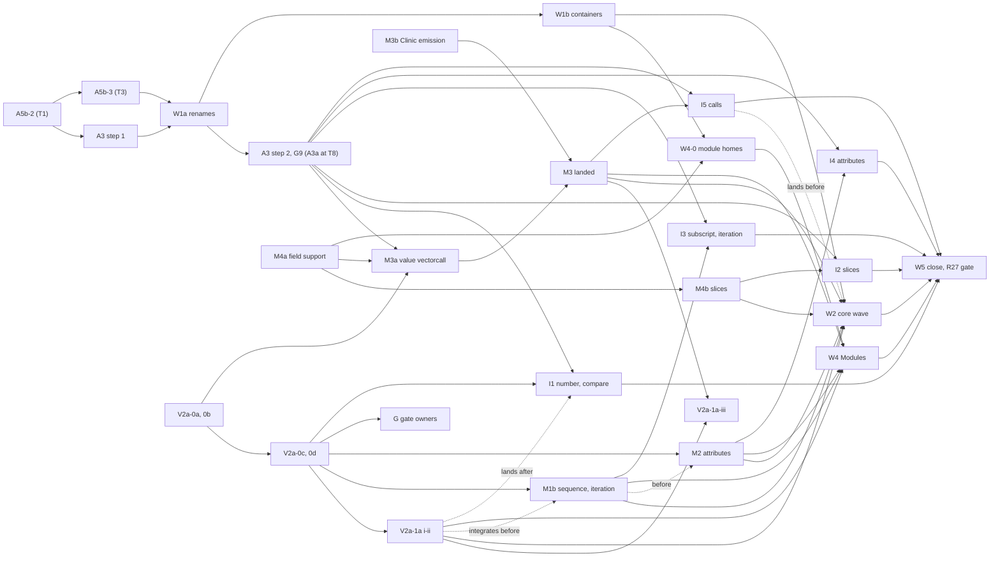

# Value API: the route to R27 and step V2a-0 (proposal)

Status: proposal, revision 2, 2026-11-04, after
[review 1](../reviews/value-api-v2a0-review-1.md) ("accept with changes"). It
plans the route to R27, "no box inside the core"
([value-api.md](../value-api.md) §1.1), as small reviewed mechanism steps and
compiler-driven bulk waves, and specifies the first mechanism step, V2a-0.
Revision 3 redoes the estimates as arithmetic and the timeline on A3
revision 3 (§1.4, §1.6, §1.7). Revision 4 folds in the accepted step
proposals [value-api-m3.md](value-api-m3.md),
[value-api-v2a1a.md](value-api-v2a1a.md),
[value-api-m1b-m2.md](value-api-m1b-m2.md) and
[value-api-g.md](value-api-g.md): their estimates and landing times (§1.4,
§1.6, §1.7), the `tp_call` pair and the writes after ready (§4.3, §4.4) and
the gate's classifier (§3.2).

Base: shared runtime HEAD `faddfd1454d` (`build/worktrees/pyvalue-rc-universal`).
The fork's JIT is out of the build there, so its 7 JIT-helper box calls are
out of scope. Scripts and data are in `build/pyjit-link-wave1/v2a0/` (`B` below
is `build/pyjit-link-wave1`):

| Script | Output |
|---|---|
| `gen_sites.py`, `hand_sites.py` | box calls in generated handlers, hand-written core and `Modules/` (`hand-core.tsv`, `hand-modules.tsv`) |
| `rank_sites.py`, `family_rank.py`, `loops.json` | boxes per pass by site and by family, from the checkpoint's box-caller histogram (`ranked.txt`) |
| `opcode_boxes.py` | per-opcode boxes from the re-measure dumps (`opcode-boxes.json`) |
| `wave_files.py` | object-form calls per file and family, with batch splits (`wave-core.tsv`, `wave-modules.tsv`) |
| `$B/valueapi-objcalls.py`, `-slots.py`, `-clinic.py`, `-valuefuncs.py` | value-api.md §7 counts, rerun at `faddfd1454d` |

Where value-api.md and the code disagree, the code wins:

| value-api.md | Code at `faddfd1454d` |
|---|---|
| §7.5: generated code has 118 box calls (111 IR, 7 JIT) | 102 in `generated_ir_cases.c.h` over 65 targets: 82 `PyValue_Box`, 19 `_PyValueTemps_Object`, 1 `PyValue_AsObject`. The box-site commit `2f572ea0ea8` removed 9 |
| §7.1: 2,173 core calls, 2,723 in `Modules/` | 2,166 core (+53 in Clinic headers), 2,711 in `Modules/` |
| §6.1: an "interpreter handler" site class | `BOX_SITE_INTERPRETER` exists and counts nothing: generated code calls the unattributed forms, so 53.4% of kernel boxes are "unattributed" |
| §1.4: borrowed arguments take a borrow type "if D4 introduces one" | A5b-1 introduced `PyValueBorrow`; value slots and dispatchers take it (§4.1) |
| §2.4: `d_wrapped` stored at `descrobject.c:1092` | `:1071` (`PyDescr_NewWrapper`) |

Unchanged at HEAD: 129 core static types, 527 value-slot entries, 102 of them
pair-table generics; 91 `slotdefs` entries; 435 core Clinic functions, 181 of
them with a polymorphic parameter. Review 1 recounted at `36aa4a0345a`, one
commit later; every count holds except W4's, corrected below.

### Changes after review 1

All 17 findings are accepted; the "Change" column says where a finding was
refined.

| # | Finding | Change | Section |
|---|---|---|---|
| 1 | Wave order | W2 and W3 merge into one core wave, W2, after M3. W4 runs beside it on the forms of M3, V2a-1a, W1-0, M1b and M2. M3 splits: M3a (call machinery) needs V2a-0b and M4a; M3b (Clinic emission) runs beside it. I3, I4 and I5 run in parallel after I1. The R27 gate moves from T48 to about T32 | §1.4, §1.6, §1.7 |
| 2 | Gate attribution | The owner is the code address the boundary crosses into. The kind is an argument to the box primitive. Boxes inside `Py_VALUE_COMPAT` bodies claim THUNK; `BOX_SITE_PARSER` and `_PyBorrow_Keep` are boundary. Stats builds use noinline thunks, `-fno-optimize-sibling-calls`, no LTO. Addresses outside libpython and the in-tree `.so` files are external. Cut: the thread-state kind swap, type and `ht_module` owners, "a Python class is core" | §3 |
| 3 | Module value homes | New W4-0: 24 fields (5 of them arrays) in 9 modules, 19 agent-hours | §1.6 |
| 4 | W1b collides with V2a-0 and M4 | Their files form W1b's last batch; the `ceval.c` unit leaves the batch generator | §1.6, §2 |
| 5 | V2a-1a-iii needs a value call | V2a-1a-iii moves after M3 | §1.4, §4.9 |
| 6 | Typed unary wrappers | Dropped (99 dual forms). Value sides exist only where an operand or result can be inline. The end-of-W2 assertion becomes "the adapter never boxes for a core static type" | §1.6, §3, D12 |
| 7 | Worker traps | Four rules with examples; the NotImplemented wrapper is chosen by script from fixed first-statement patterns | §1.5 |
| 8 | Two paths to a non-zero gate | `sq_concat` and `sq_inplace_concat` get value sides (53 slot fields). ctypes' `py_object` exits are CALL_ADAPTER boxes with a foreign owner. W5 is sized for the suite-only tail | §3, §4.1, §1.6 |
| 9 | `PyType_Modified` recomputation | Dropped with the free-threaded queue work (free threading is a non-goal, pyvalue.md §1.11). The debug pair assertion stays; recomputation is a ports item | §4.4, §4.5 |
| 10 | Limited-API modules | The six are ported in W4b. The three limited-API test modules stay object-form | §1.3, §1.6 |
| 11 | Schedule arithmetic | A3a lands near T16; I2 lands after A3a; "slices: 24%, nearly all fannkuch" | §1.2, §1.7 |
| 12 | D1 | Kept, with the probe's numbers; hot fields first. Public fields are opaque function-pointer storage, so no `PyValue` signature enters a public header and the R26 edit goes | §4.1 |
| 13 | Contract | The borrow contract line and two adapter tests | §4.6, §4.8 |
| 14 | Compatibility | D15 bumps the fork's own SOABI tag (`boilvalrc1` to `boilvalrc2`), a standing rule for public-layout changes. Q3 decided: `PySliceObject` moves to internal. M4 gains `rangeobject.c`, `codeobject.c`, `compile.c`, `marshal.c`, `_ctypes/_ctypes.c` | D15, §1.4, §5 |
| 15 | Collisions | `check_value_api.py` and `configure.ac`/`configure` added; "Shared with A3a: none" corrected | §2, §4.9 |
| 16 | W4 scripting | Script classes for number returns and Clinic return converters | §1.5 |
| 17 | Spec slot ids | `Python/slots.toml` and `Python/slots_generated.c` named; internal ids get a reserved range | D13, §4.9 |

## 0. Decisions proposed

| # | Decision |
|---|---|
| P1 | Two kinds of step. **Mechanism steps** are designed, hand-written and reviewed: M1a (V2a-0), M1b (sequence, iteration and send dispatch), M2 (value attributes), M3a and M3b (value vectorcall, Clinic value emission), M4 (value fields, slices first), V2a-1a (int, float, bool and None value slots) and G (gate owners). **Bulk waves** W1, W2, W4 and W5 sweep callers and type implementations, driven by the compiler; W4-0, the module value homes, is done by a lead agent |
| P2 | A wave marks `Py_VALUE_COMPAT` every object function whose value form exists, builds with `make -k`, lets a script fix the mechanical classes, fans the rest out to parallel Sonnet workers on disjoint file batches, and ends with a remnant cleanup by one agent |
| P3 | Consumers are marked before producers. A function that takes a polymorphic operand is marked as soon as its value form exists, since an object argument converts at entry with no box. A function that returns one is marked only when its callers' consumers have value forms; until then a worker writes an explicit exit `_PyValue_AsObjectAt(v, BOX_SITE_<family>)`, which stays visible and counted |
| P4 | Interpreter conversions (handlers, `ceval.c` helpers, the cases generator) wait for A3a: I1 and I2, then I3, I4 and I5 in parallel. Waves exclude the `ceval.c` unit while A3a is in flight, with a temporary defer line that the check script counts |
| P5 | Each wave edits a file once for every family whose mechanism has landed (value-api.md R21's reason). The core wave W2 therefore waits for M1a, M1b, M2, M3, M4 and V2a-1a; W4 needs the same forms and none of W2's edits, so it runs beside W2 |
| P6 | Order change: M4 (slice fields) runs now, in parallel with V2a-0; its `BUILD_SLICE` handler change, I2, lands after A3a. Slices are 24% of measured boxes, nearly all fannkuch, and depend on no slot mechanism |
| P7 | R27 gate: the box primitives take a kind (core, thunk, slot adapter, call adapter); stats builds record each boundary box's owner, the code address it crosses into; zero boxes of every kind on the kernels, and zero core-kind or core-owned boxes on the suite (§3) |
| P8 | V2a-0 decisions: §4.0 |

## 1. The route to R27

### 1.1 Where the core boxes today

Static inventory at HEAD:

| Family | Generated (65 targets, 102 calls) | Hand-written core (`hand-core.tsv`) | Removed by |
|---|---|---|---|
| Number, unary | `UNARY_INVERT`, `CALL_INTRINSIC_1/2` (4) | `value_binary_operation` (`ceval.c:999–1031`, 3), which generic `BINARY_OP` calls; `value_ops.c` `box_operands` (2) | V2a-1a, I1 |
| Compare, contains | `COMPARE_OP`, `_NOFB`, `CONTAINS_OP`, `_NOFB` (8) | `value_ops.c` mixed paths (through the same `box_operands`) | M1a, I1, I3 |
| Repr, str, format | `CALL_STR_1`, `CONVERT_VALUE`, `FORMAT_SIMPLE`, `FORMAT_WITH_SPEC`, `BUILD_INTERPOLATION`, `BUILD_TEMPLATE` (9) | `_PyValue_WriteRepr`, `anydict_repr_impl` (2), `unicode_fromformat_value_object` | M1a, I1, W2 |
| Slices | `BUILD_SLICE` (3) | `borrow_or_box` in `_PyEval_BinarySlice`, `_PyEval_StoreSlice` | M4, I2 |
| Subscript, iteration, send, unpack, merges, match | 32 calls in 24 targets (`SEND*`, `GET_A*`, `UNPACK_*`, `LIST_EXTEND`, `SET_UPDATE`, `DICT_MERGE/UPDATE`, `MATCH_*`, `GET_LEN`, `CALL_LEN`, `CALL_TUPLE_1`, `INTERPRETER_EXIT`); `DELETE_SUBSCR` (2) | `value_store_subscript` (3), `_PyEval_GetIter` (2), list, tuple, dict and set iterators (5), `list_pop_impl`, `set_pop_impl`, `_PyDict_Pop_KnownHash` | M1b, I3, W2 |
| Attribute, import | `LOAD_SPECIAL`, `LOAD_SUPER_ATTR*` (12), `SET_FUNCTION_ATTRIBUTE`, `LOAD_FROM_DICT_OR_*`, `IMPORT_*` (10) | `value_load_attribute`, `value_store_attribute` (3); `object.c`, `typeobject.c`, `dictobject.c` attribute reads (10) | M2, I4, W2 |
| Calls | `CALL_METHOD_DESCRIPTOR_*` (5), `EXIT_INIT_CHECK`, `MAKE_FUNCTION`, `WITH_EXCEPT_START` (5) | `VALUES_TO_PYOBJECTS` (8), `call_transaction_*` (6), `call.c` (11), `native_scope.c`, `borrow.c`, `getargs.c` (5), `_PyStack_UnpackDict`, `initialize_locals` | M3, I5, W2 |
| Exceptions | `CHECK_EG_MATCH`, `CHECK_EXC_MATCH`, `CLEANUP_THROW`, `POP_EXCEPT`, `PUSH_EXC_INFO`, `RAISE_VARARGS`, `RERAISE` (10) | `dict_value_keyerror`, `value_binary_operation`'s `KeyError` | I1 (typed), W2 (payloads) |
| Monitoring | `INSTRUMENTED_RETURN_VALUE`, `_YIELD_VALUE` (2) | – | I5 (D13 of value-api-m3.md moved there whole) |
| Containers (thunk exits) | – | `PyList_GetItemRef`, `PyTuple_GetItemRef`, cells, struct sequences, `_PyDict_NextEntryRefKnownHash` (about 16) | W1 |
| Frames, compiler | – | frame locals (2), `super()` (1); compiler constants (6) | W2; W5 |

Totals: 102 generated calls; 128 hand-written rows (18 in `bytecodes.c`, 6
the primitives' definitions); 29 in `Modules/`, 23 of them in
`_testinternalcapi`. An object-form module boxes in the call adapter, not in
its own code, so the static list understates `Modules/`. The core also boxes
inside object getters: `PyTuple_GetItemRef` 113 calls, `PyDict_GetItemRef`
77, `PyList_GetItemRef` 33. About 35 generated `PyValue_Box` calls convert
inputs that cannot be inline; they need a typed known-object borrow (I1).

### 1.2 Families ranked by measured boxes

The checkpoint's box-caller histogram (`dbce7b1260d`; 14.39M boxes per pass),
bucketed by `family_rank.py`. The re-measure at `5de7bd62ef9` (14.94M) agrees
in shape; its "unattributed" 53.4% is mostly the interpreter rows.

| Family | Boxes per pass | Share | Main kernels | Removed by |
|---|---:|---:|---|---|
| Call adapter: builtins and C methods (`_Py_BuiltinCallFast_Value`, `_PyNativeScope_Objects`, `FastWithKeywords`, `begin_vector`, `_PyVectorcall_Call`) | 3,572,680 | 24.8% | fannkuch (`perm1.insert`), float (`math.sin`, `cos`, `sqrt`), raytrace | M3, I5, W2, W4 |
| `BUILD_SLICE` and slices | 3,494,138 | 24.3% | fannkuch (3.46M; fannkuch is 41% of all boxes) | M4, I2 |
| Generic `BINARY_OP` | 1,470,730 | 10.2% | raytrace, nbody, chaos | V2a-1a, I1 |
| `STORE_SUBSCR` (`value_store_subscript`) | 862,590 | 6.0% | regex_compile, nqueens, raytrace | M1b, I3 (exact list: done in `2f572ea0ea8`) |
| `COMPARE_OP`, mixed operands | 755,088 | 5.2% | raytrace, chaos | V2a-1a, I1 (both inline: done in `2f572ea0ea8`) |
| List and tuple iterators | 730,260 | 5.1% | spectral_norm | M1b, W2 |
| Call adapter: method descriptors | 675,650 | 4.7% | regex_compile | M3, I5, W2 |
| `SET_ADD`, `MAP_ADD`, `STORE_GLOBAL` | 657,924 | 4.6% | nqueens, comprehensions, go | done in `2f572ea0ea8` |
| `list.pop` result | 645,130 | 4.5% | fannkuch, go | M3, W2 (`METH_VALUE` result) |
| Call adapter: builtin classes | 427,364 | 3.0% | chaos, go | M3, I5 |
| Generator return to C (`INTERPRETER_EXIT`) | 288,654 | 2.0% | generators | M1b, I3 |
| `PyList_GetItemRef` | 256,801 | 1.8% | regex_compile | W1, W2 |
| Dict iteration and lookup | 232,084 | 1.6% | json_dumps | M1b, W1 |
| Attribute reads (instance dict) | 101,083 | 0.7% | richards | M2, I4 |
| `str %` arguments (`unicode_format_getnextarg`) | 100,000 | 0.7% | xml_etree_generate | W2 (no §9 owner) |
| Parser output (`getargs.c`) | 52,010 | 0.4% | json_* | W2, W4 |
| `Modules/` (`array_new`, `_pickle`) | 38,000 | 0.3% | raytrace, pickle | W4 |
| Other | 32,616 | 0.2% | | I2–I4 |

Since the checkpoint, `2f572ea0ea8` removed about 2.28M per pass, and int51
(step 9) added 0.55M (deepcopy's `id()` keys, `KeyError(key)` payloads). The
order of the top five families is unchanged.

### 1.3 Families that no §9 step removes

| Family | Step it needs |
|---|---|
| `str %` argument reads (`Objects/unicode_format.c`) | W2: a value-form argument reader; `%d`, `%f` and `%s` of an inline value format from the word |
| Frame locals (`framelocalsproxy_getval`, `frame_get_var`) and `super()`'s first argument | W2: value mapping slots on `FrameLocalsProxy`; M2 for `super` |
| Generated `PyValue_Box` of typed inputs (about 35 calls) | I1: the generator emits `PyValue_AsKnownObjectBorrow` for typed positions and owned `x_o` locals only for polymorphic ones (refines R22) |
| `MATCH_KEYS`, `MATCH_CLASS`, `_PyEval_MatchKeys` | I3 |
| `IMPORT_NAME`, `IMPORT_FROM` | I4 |
| Native call transactions (`call_transaction_*`), `_PyStack_UnpackDict`, `initialize_locals` (kwargs) | I5 |
| `_testinternalcapi` encoding and mechanism tests that box on purpose (23 sites) | G: a `BOX_SITE_TEST` class, allowed only in `Modules/_testinternalcapi*`, excluded from the gate |
| Limited-API in-tree modules (`errno`, `_stat`, `termios`, `_statistics`, `_scproxy`, `_multiprocessing/posixshmem`) | W4b: drop `Py_LIMITED_API` in the fork, Clinic value emission. The three limited-API test modules stay object-form |
| Module value homes (`deque` blocks, `itertools` state, the `_pickle` memo and `Pdata`, `lru_cache` nodes, future results) | W4-0 (§1.6) |
| Sequence concatenation with an inline operand (`[] + 1`, `b'' + 1`) | `sq_concat` and `sq_inplace_concat` value sides: fields in M1a, types in W2 |

### 1.4 Mechanism steps

| Step | Content | Main files | Needs | Agent-h | Sonnet worker part, beside the lead (h) |
|---|---|---|---|---:|---|
| **M1a = V2a-0** | Slot machinery with no type converted; box kinds (§4) | `object.h`, `descrobject.h`, `typeobject.c`, `descrobject.c`, `abstract.c`, `object.c`, `value_ops.c`, `pystats.h`, `check_value_api.py`, `configure.ac`, new `pycore_value_slots.h` | V1 | 11 | 3.5: the two test modules and `test_value_slots.py`; the 53 slot-table rows; `slotdef_values[]` data; the 12 value wrappers; the 43 three-line thunks; the `test_sys` format |
| **V2a-1a** | i, ii: value slots of `int`, `float`, `bool`, `NoneType` (number, compare, hash, bool, index, int, float, repr, str); `PyValue_FromInt64`, `FromSsize_t`, `FromDouble`, `_PyValue_As*`; digit spans and `_PyLongOut` kernels; `value_ops.c`'s inline arms move into the int and float slots (value-api-v2a1a.md). iii, after M3: value `slot_*` functions for Python classes (`SLOT1BINFULL` and the rest), which call dunders through the value vectorcall; the round-trip identity test (value-api.md §1.3) | `longobject.c`, `floatobject.c`, `boolobject.c`, `object.c`, `typeobject.c`, `value_ops.c` | M1a; iii also M3 | 15.5 for i–ii, lands near T14; iii 2.5 more (value-api-v2a1a.md §8, §9) | 9.75: the other nine span kernels, int's and float's other value functions and thunks, the extractor macro, tests |
| **M1b** | Subscript, item, `ass_*`, contains, `iternext` and send dispatchers and adapters, under R11 and R16; three-outcome results return `_PyStatusValue` by value (B4); `_PyValue_IterNext`, `_PyValue_Send`; `next()` and `PyIter_Send`; `_PyValue_NextNotImplemented`; value `slot_tp_iternext`, `slot_sq_item`; diffs a–e (value-api-m1b-m2.md) | `abstract.c`, `bltinmodule.c` (`next`), `genobject.c`, `typeobject.c` | M1a; the d diffs follow V2a-1a-iii, the e diffs M3a's wrapper reshape | 11.15 | 5.2: thunks, wrappers, iterator slots, `next()`, tests |
| **M2** | `getattro`, `setattro`, `descr_get`, `descr_set` dispatch with value receivers; value sides of the generic attribute pair; getset value getters (value-api.md open question 2, settled: `d_value` in `PyGetSetDescrObject`); the 22 identity tests move to the value side (value-api-m1b-m2.md) | `object.c`, `typeobject.c`, `descrobject.c`, `dictobject.c` (instance reads) | M1a; `super` also M4a | 9.2 | 3.2: moving the 22 identity tests; thin forms, getters, getset tests |
| **M4** | a: value field support (traverse, clear, dealloc, `_Py_T_VALUE` members, `__reduce__`, home-checker hooks). b: `PySliceObject` moves to internal `pycore_slice.h` (Q3, decided); `start/stop/step` become value homes; `_PySlice_FromValues`; `PySlice_Unpack` and `GetIndicesEx` read words. The `BUILD_SLICE` handler change is I2 | `structmember.c`, `sliceobject.c`, `Include/cpython/sliceobject.h`, `rangeobject.c`, `codeobject.c`, `compile.c`, `marshal.c`, `Modules/_ctypes/_ctypes.c` | V1 (not M1a) | 7 | 1.5: the five struct users after the move (`rangeobject.c`, `codeobject.c`, `compile.c`, `marshal.c`, `_ctypes.c`); tests |
| **M3a** | Per-instance value vectorcall, `tp_value_vectorcall_offset`, `tp_value_vectorcall`, the `Py_TPFLAGS_HAVE_VECTORCALL` test, `PyFunction_SetVectorcall`, prepend and the offset rule, `METH_VALUE` alone, `_PyValue_Vectorcall` and `_PyValue_VectorcallTstate` (`tstate` first), `_PyValue_InstanceVectorcall` for the `tp_call` pair, `im_self`/`m_self`/wrapper `self` homes (the borrowed `self` getters go), the value wrapper shape of §1.11. Monitoring and tracing are not here: they move to I5 (D13) | `call.c`, `methodobject.c`, `funcobject.c`, `classobject.c`, `descrobject.c` | V2a-0b, M4a; lands after A3 step 2, about T9.5 | 14.3 (5.6 h wall; value-api-m3.md §5) | 8.7: `classobject.c`, `methodobject.c`, `descrobject.c`, the wrapper reshape, moved-field users, `pyvalue.c` primitives and the `window-read` rule, tests |
| **M3b** | Value emission in Argument Clinic (generator only; return converters emit value forms); `METH_VALUE`'s declaration agreed with M3a up front | `Tools/clinic/` | V1; lands with the later of M3a and V2a-1a-ii | 7.4 (value-api-m3.md §5) | 2.8: `clinic.test.c` expectations, `_testclinic_value.c` and `test_clinic` cases |
| **G** | Gate owners (§3): owner tables in `PyInterpreterState`, the stats-build configuration, `Py_VALUE_ENTRY` and `Py_VALUE_COMPAT` as one mark in two strengths, the `Py_VALUE_COMPAT`-body rule, the `boundary-site` rule, `BOX_SITE_TEST`, `box_cached`, ctypes' foreign exits, `check_r27.py` (classes from DWARF by build-id), `-X pystats_dir`, the bench report (value-api-g.md) | `pystats.h`, `pystats.c`, `pyvalue.c`, `getargs.c`, `configure.ac`, `check_value_api.py`, `summarize_stats.py`, new `Tools/build/check_r27.py`, `pyjit/bench/run.py` | M1a; starts after A5b-3 and V2a-0 part 2 | 10.0 (5.5 h wall) | 4.75: `check_r27.py`, the second lint pass, `summarize_stats.py` tables, the bench report |

Interpreter steps, after A3a lands. Each converts a disjoint handler family and starts when A3a and its mechanism have landed; they integrate in the order I2, I1, I5, I4, I3, regenerating at each, so I3–I5 rebase over I1's generator rule. Sonnet workers take none of it: every hunk is in `bytecodes.c` or the generator.

| Step | Content | Needs | Agent-h |
|---|---|---|---:|
| **I1 = V2a-1b** | Generic `BINARY_OP`, unary ops, `COMPARE_OP`, `TO_BOOL`, `CONTAINS_OP`, formatting and `CALL_STR_1` call the dispatchers; `value_binary_operation` and `_PyValue_Truth` go; the generator rule of §1.3 row 3; `PyValue_Box` deleted (R8, R22); `ceval.c`'s deferred container calls | A3a, M1a; lands after V2a-1a i–ii | 6 |
| **I2** | `BUILD_SLICE`, `BINARY_SLICE`, `STORE_SLICE` with value slices; integrated first | A3a, M4 | 2 |
| **I3** (landed `b904ab8f014`; `INTERPRETER_EXIT` in `5c94f78a582`) | Generic subscript, `STORE_SUBSCR`, `DELETE_SUBSCR`, `FOR_ITER`, `SEND`, unpacking, merges, `MATCH_*`, `INTERPRETER_EXIT`; calls the `_PyStatusValue` dispatchers directly and deletes `PySendResultPair`, `_PyIter_Send` and A3's interim `value_for_iter_next`, `value_mapping_get_optional_item`, `value_async_gen_send` | A3a, M1b | 6 |
| **I4** (landed `1996cbbb080`) | `LOAD_ATTR`, `STORE_ATTR` generic paths, `LOAD_SPECIAL`, `LOAD_SUPER_ATTR*`, imports; deletes A3's interim `super_lookup`; with M3a, the last to touch it deletes `_PyObject_GetMethodValue` | A3a, M2 | 4 |
| **I5 = V3b** (landed `d686623e3fb`) | Call handlers use the value vectorcall (`_PyValue_VectorcallTstate` inside `call_transaction_run_*`); `VALUES_TO_PYOBJECTS` and the seven `_Value` call helpers deleted; call transactions; monitoring and tracing (D13: one value trace function per thread, `PyEval_SetTrace` and `PyEval_SetProfile` through a boxing adapter); `CALL_LEN`, `CALL_ISINSTANCE`, `CALL_LIST_APPEND` kept. W2 integrates after it | A3a, M3 | 9 (6 + 3.0 for D13, value-api-m3.md §5) |

### 1.5 The wave protocol

```mermaid
flowchart LR
    T["Ownership table<br/>(object fn, value fn, argument and result ownership)"] --> MK["Mark: Py_VALUE_COMPAT on every row"]
    MK --> B1["Builder: make -k, clang -ferror-limit=0"]
    B1 --> S["Script: M1 and M3 sites by AST"]
    S --> B2["Builder: rebuild, group errors by file"]
    B2 --> F["Batch files: 8-16 disjoint file sets"]
    F --> W["Sonnet workers: edit only their files; no builds, no git"]
    W --> B3["Builder: rebuild; new errors to the same batches"]
    B3 -->|"round 2-3"| W
    B3 --> R["Remnant cleanup: one agent; lints, suites"]
```



- **Marks.** R23's ownership table has one row per object function: its
  value form and what each argument and the result do (borrow, steal,
  `Take`, new reference). The wave generates `Py_VALUE_COMPAT(replacement)`
  for each row it covers; a function without a value form is not marked.
- **Builder.** One agent owns the build: `make -k -j`, clang 21 with
  `-ferror-limit=0`, so one round lists every site, parsed from `error: 'X'
  is unavailable`. Rounds take 10–15 minutes; with worker checks (below) a wave needs 2.
- **Script** (`Tools/build/value_sweep.py`, from R23). It edits two classes
  by byte offset, using a per-function AST dump (`-ast-dump=json
  -ast-dump-filter=<function>` with the unit's flags):
  - M1: an argument that is `PyValue_AsKnownObjectBorrow(v)` becomes `v`; an
    object argument becomes `_PyValue_FromObjectKnown(o)` when its static
    type is a typed pointer (str, type, code, a `_Py_ID`), otherwise
    `PyValue_FromObjectBorrow(o)`, or `FromObjectSteal` where the table says
    "steal". Releases change as the table says.
  - M3: a result passed straight to another marked call chains the value
    forms.
  - R (review finding 16): `return PyLong_From*(…)`, `PyFloat_FromDouble`,
    `PyBool_FromLong` in a value-returning function become the value
    constructors; Clinic return converters (`-> int`, `-> double`) emit the
    value form. W4 has 937 construction calls (26%).
  - N: a binary, ternary or compare slot whose first statement matches a
    fixed list (`CHECK_BINOP(v, w)`, `if (!PyX_Check(v) || !PyX_Check(w))
    Py_RETURN_NOTIMPLEMENTED`, `CONVERT_TO_DOUBLE`) gets the
    `_Py_VALUE_NOTIMPL_*` wrapper. Every other such slot goes to a worker as
    a value-semantics site.
- **Batches.** `wave_files.py` packs files greedily into N batches of equal
  call counts. Batches split by directory or type family, never within a
  file. The files of the `ceval.c` unit (`ceval.c`, `bytecodes.c`, the
  generated cases, `ceval_macros.h`) are never batched. Each batch file stands alone, as for A5b-3: rules header, one
  before/after example per class, worktree path, "edit only these files; no
  builds, no git", then each site (file:line, error, expected class).
- **Worker rules.** Change a local's type only when every use has a value
  form, or write the explicit exit of P3. Never call
  `PyValue_AsKnownObjectBorrow` on a value read from user data without a
  `PyValue_IsObject` test. Leave a site you cannot fix in a "left" list.
  The rules header gives each trap below a before and after example:

  | Trap | Rule | Example |
  |---|---|---|
  | Borrow from a heap home across Python code | Keep an owner (`PyValue_Dup`, release after) when the callee can run Python, as upstream's `Py_INCREF` does | `list_contains`'s compare; `_PyValue_Hash`'s owner |
  | Pointer identity | `a == b` on objects becomes `PyValue_Is(a, b)` | `PyObject_RichCompareBool`'s `v == w` shortcut |
  | Forwarding slots | Forward the value to the dispatcher; never a NotImplemented wrapper | `weakref.proxy`'s `WRAP_BINARY` (`proxy + 5`) |
  | NotImplemented for an inline operand | Only the script's class N applies the wrapper; a worker never chooses it | – |
- **Defer line.** `#define Py_VALUE_DEFER_MARKS 1` makes `Py_VALUE_COMPAT`
  empty in a unit. Only `Python/ceval.c` carries it, while A3a is in flight;
  `check_value_api.py` lists deferred units, and the gate needs zero.
- **Remnant.** One agent fixes the "left" lists, runs `make check-value-api`,
  the step tests and the GCC and clang debug suites, and records the boxes.
- **Throughput.** The script does 55–70% of call sites. A worker fixes about
  40 call sites, or 5–15 slot functions, an hour. Each wave's first batch is
  a pilot that recalibrates the rest.
- **Worker checks** (coordinator, 2026-11-04, after the user's review).
  Workers check their own files and need no builder round for compile
  errors.
  - `check_unit.sh <build> <file>` compiles one unit with the build's exact
    flags under `-fsyntax-only`. It shares no build state, so every worker
    runs it at once. Errors that come from headers another batch still has
    to fix are noted, not chased.
  - A `Modules/` worker whose module builds as a shared extension builds its
    `.so` into a private directory against the wave's base build, then runs
    that module's tests with the directory first on `PYTHONPATH`.
  - Built-in modules and core files are tested by the builder only, since
    their tests need a relinked interpreter with every batch's edits.
  - So the builder runs one round to collect errors, then one round to
    merge, followed by the targeted tests and the suites.
- **Model tiers.** Batches are tagged by class. Single-class mechanical
  batches (explicit exits, renames, constructor returns the script could not
  place) go to Haiku. Batches with ownership or value semantics (retyped
  locals, the four traps, slot functions) go to Sonnet. A Sonnet checker
  reads each Haiku batch's diff against its class rule. The first wave's
  pilot runs one mechanical batch on both models and keeps Haiku only if its
  diff compiles and the checker finds nothing that Sonnet's run did not.

**What of R23's VS tool to keep.** Keep the ownership table, which is now
also the source of the marks; the per-function AST dumps; the byte-offset
edits; and classes M1 and M3. Site discovery moves to the compiler, which is
complete by construction. M2, the retyping of a local, moves to the workers:
a retyped local's uses cross families, and the compiler lists each one. The
J list becomes per-file batch files. V4's separate first-hour M/J measurement
becomes W1's pilot batch.

### 1.6 The waves

| Wave | Scope | Uses forms that exist | Waits for | Script; batches × workers | Agent-h | Wall | Collisions |
|---|---|---|---|---|---:|---:|---|
| **W1a** renames | A5b-4: 154 renames, 35 rewrites, 8 generator strings, 104 regenerated sites (`$B/a5b/rename.py`) | all | A5b-3 | script only; 1 agent | 1 | 0.5 | Must follow A5b-3 (renames assume no tagged mortals) and precede A3a's branch point |
| **W1b** containers | Core list 129, tuple 295, dict 350, set 67, cell and struct sequence 31: 872 calls, about 100 files. W1-0 by hand first: `PyList_AppendValue`, `PyList_InsertValue`, `PyList_SET_VALUE`, `PyTuple_SET_VALUE`, a non-variadic `PyTuple_Pack` replacement, `PyDict_SetValueString`, `DelValueString`, `PyStructSequence_SetValue`. A script class converts the existing out-parameter value functions (`PyDict_GetValue`, `_PyDict_GetValue_KnownHash`, `_PyDict_LoadGlobalValue`, `_PyDict_LookupIndexAndOwnedValue`, `_PyType_LookupValueAndVersion`, about 15 sites) to returned pairs (value-api-m1b-m2.md B4) | `PyList_GetValue`, `PyTuple_GetValue`/`SetValue`, `PyDict_Get/Set/Del/Contains/PopValue`, `PySet_*Value`, `PyCell_*Value`, `_PyList_AppendTakeValue`, the entry and exit primitives | – | M1 for consumers (450 sites); W1-0 by 2 agents; 8 workers | 17 | 5.5 | After A5b-3 (heap setters in `dictobject.c`, `listobject.c`, `tupleobject.c`, `setobject.c`, `structseq.c`, `cellobject.c`). The files of V2a-0 and M4 (`typeobject.c` 102 calls, `abstract.c`, `object.c`, `descrobject.c`, `sliceobject.c`, M4's users) form the last batch, after those steps land. `longobject.c`, `floatobject.c`, `boolobject.c` and `unicodeobject.c` leave W1b for W2 (value-api-v2a1a.md §7). The `ceval.c` unit is excluded |
| **W2** core wave (review 1 merged W2 and W3) | Core Clinic regenerated with value emission first, file by file, including the `_impl` return converters (459 functions, 258 polymorphic parameters, 24 with typed return converters; value-api-m3.md; this also unblocks W4); **W2a landed `ce9289e2ddb` (fixes `61872dc3152`, `62bfae99844`, `d63c129b95f`); W2b marks `f30173f3de3`, `1e19778c783`, callers in progress; since 2026-11-05 W2 lands in two parts: W2a is the Clinic regeneration and the slots, W2b the callers, the fields and the deferred `ceval.c` sites; W4 starts from W2a**; other core `METH_*` to `METH_VALUE`; `tp_call` 10, `tp_vectorcall` 20. Types: number and compare slots of about 25 core types besides V2a-1a's (about 200 entries: about 140 by script class N, about 60 with value semantics: `complex`, `str`/`bytes`/`bytearray` `%`); `sq_concat` and `sq_inplace_concat` of `list`, `tuple`, `str`, `bytes`, `bytearray`; subscript, item, `ass_*`, contains 52; `iternext` 37 (container iterators wrap `_Py*Iter_NextValue`); send 4; attribute 30 specific plus 85 by pair table; §7.4 fields (about 25 in 12 files; `PyStopIterationObject.value` becomes a home, `StopIteration_init` reading `PyTuple_GetValue`). No typed unary repr, str or hash sides (finding 6). Callers: number 129, compare/hash/bool 119, repr 69, sequence/mapping 241, iteration 102, attribute 274, extraction 192, error payloads 68, call 283, construction 414, `PyObject_IsTrue` 43, `_PyNumber_Index` 25, `PyArg_*` 45 to Clinic: about 2,000 calls in about 95 files | W1 forms; V2a-1a; M3's forms | M1a, M1b, M2, M3, M4, V2a-1a i–ii, W1b; integrates after I5 (a dependency: builtins W2 converts would otherwise fall to `CALL_NON_PY_GENERAL` and box each inline result) | Clinic regeneration; pair table and class N; callers M1, M3, R; 14 workers | 49.2 | 6 | `typeobject.c` (A5b-3's 2 sites landed); `ceval.c` deferred until I1–I5 |
| **W4-0** module homes (landed `1a9b96b1000`) | 24 fields, 5 of them arrays, in 9 modules: `_collections` `deque` `data[BLOCKLEN]`, with value forms as W1-0 gives `list`; `itertools` 12 (`groupby` `tgtkey`, `currkey`, `currvalue`; `_grouper` `tgtkey`; `tee` `values[LINKCELLS]`; `count` `long_cnt`, `long_step`; `repeat` `element`; `accumulate` `total`, `initial`; `zip_longest` `fillvalue`; `pairwise` `old`); `_pickle` `Pdata.data`, the unpickler `memo`; `_functools` `lru_list_elem` `key` and `result`, `cmp_to_key` `obj`; `_operator` `itemgetter.item`; `_asyncio` future result; `_queue` `RingBuf.items`; `_sqlite` `lastrowid`; `_elementtree` `text`, `tail` (cold). §7.4's member regex over `Modules/` finds 50 object members, two of them homes; the rest come from the struct definitions of §7.4's candidates | M4a's field support; W1-0's `list` forms as the pattern | M4a, W1-0 | a lead (`deque`) and 3 workers | 16 | 5 | none (`Modules/`); W4 batches these 9 files last |
| **W4** Modules (W4a landed `229065a3c2c`, post-review `28453e14972`; W4b finishing) | Linux build: 116 files and 3,541 calls. Excluded: the compat test modules (`_testcapi*`, `_testlimitedcapi*`, `xx*`, `_testbuffer`, `_testmultiphase`, `_testsinglephase`, `_testimportmultiple`, `_ctypes_test`), which stay object-form; `_testinternalcapi*` (318 calls, test code under `BOX_SITE_TEST`); `_xxtestfuzz`; and the Windows- and macOS-only `_winapi.c`, `overlapped.c`, `_scproxy.c` (66 calls), which the script sweeps from the ownership table and a non-Linux build checks later. 2,111 Clinic functions, 726 polymorphic; 54 static types and about 1,487 spec slot entries, with value sides only where an operand or result can be inline. Each unit gains `Py_VALUE_CORE`. W4a: the accelerators in kernel box order (`array`, `math`, `_pickle`, `_json`, `_elementtree`, `_functools`, `_operator`, `itertools`, `_collections`, `_struct`, `_datetime`, `_sre`, `_io`, `_random`, `_bisect`, `_heapq`); W4b: the rest, with the six limited-API modules ported (under 2 h) | all core forms | M3 (and W2's core Clinic regeneration), V2a-1a i–ii, W1-0, M1b, M2; W4-0 for its 9 files | Clinic regeneration, then M1, R and N; 18 workers | 54 | 6 | none: `Modules/` is outside A3a; shares W2's builder |
| **W5** remnant and close (V7) | `Parser/` and the compiler (C6): `flowgraph.c` 15 number calls, `compile.c`, `codegen.c`, `Python-ast.c` through `Parser/asdl_c.py` (103 format calls); deferred units; every object function with a value form marked; the paths only the suite run finds (finding 8); measure the `PyValue_AsKnownObject*` release check; run the gate | all | W2, W4, I3–I5 | one agent plus 4 workers for the suite-only tail | 12 | 3 | none |

Each wave's agent-hours are arithmetic from its counts (revision 3). Callers
left to workers are `calls × (1 − script share)`, with the script share at
55–70%, and cost one hour per 40 sites. Slot functions cost 10 an hour when
they need value semantics and 15 when they wrap an existing value form;
fields 5. Every wave adds a pilot, builder hours and one cleanup pass. Worker
counts are sized so that the worker phase takes 2–3 hours, with at most 32
workers at once.

| Wave | Callers to workers (h) | Slots and fields (h) | Lead, pilot, builder, cleanup (h) | Agent-h | Workers × worker phase | Wall |
|---|---|---|---|---:|---|---:|
| W1a | – | – | script 1 | 1 | – | 0.5 |
| W1b | (872 − 450 scripted) / 40 = 10.6 | – | W1-0 3 + builder 1.5 + cleanup 1.5 = 6 | 17 | 8 × 1.3 h | 5.5 |
| W2 | 2,000 × 0.30–0.45 / 40 = 15–22.5 | 60 value-semantics / 10 + 163 wrappers / 15 + 25 fields / 5 = 22 | pilot and Clinic 1.5 + builder 3 + cleanup 3 = 7.5 | 49.2 (45.7–53.2) | 14 × 2.6–3.2 h | 6 |
| W4-0 | – | 19 fields / 5 = 4 + 4 arrays × 1.5 = 6 + `deque` 5 | review 1 | 16 | 3 × 3.3 h, lead 5 h on `deque` | 5 |
| W4 | 3,541 × 0.30–0.45 / 40 = 26.6–39.8 | about 200 entries crossing an inline value, 60 by script, 140 / 12 = 11.7 | limited-API ports 2 + pilot and Clinic 1.5 + builder 3 + cleanup 3 = 9.5 | 54 (48–61) | 18 × 2.1–2.9 h | 6 |
| W5 | about 150 `Parser/` and compiler calls × 0.45 / 40 = 1.7 | – | marking audit 1 + suite-only tail 6 (4 workers) + gate runs 2 + release check 1 | 12 | 4 × 1.5 h | 3 |

Revision 4 moves W2 by +8.9 h for the `_impl` returns that M3 regenerates (value-api-m3.md §5) and by −7.75 h for the thin forms, iterator slots, getters, generator-family functions, R16 slots and attribute sides that M1b and M2 now write (value-api-m1b-m2.md §4: 5.25 h at W2's rates and 2.5 h of tests): net +1.15 h, in the callers and slots columns. W2's slot column is the difference from a callers-only estimate of 30–35
hours: 163 slot functions besides the 60 with value semantics (subscript,
item, `ass_*` and contains 52, `iternext` 37, send 4, attribute 30, call 30,
`sq_concat` 10) and 25 §7.4 fields. W4's slot count comes from its spec
entries that cross an inline value (138 of 1,616, with `tp_getattro`'s 57
mostly generic) plus about 60 in its 54 static types.

**Where the builder is the limit.** One builder (16 CPUs, a 10–15 minute
`make -k` round) serves W2 and W4 together, since one round covers
`Objects/`, `Python/` and `Modules/`. In round 1 the workers are the limit:
batches of 40–90 sites take 1–2 hours. The builder is the limit in the pilot
round, in rounds 2 and 3 of every wave (each worker's new errors take less
than a round to fix), in W1b, whose batches are small, and in the cleanup
passes, whose suites need the same 16 CPUs. Past about 32 workers the gain
is small: the pilot, two or three rounds and the cleanup take about 3 hours
whatever the count, while the worker phase is already under 3.

Totals: mechanism steps about 88 agent-hours (M1a 11, V2a-1a 15.5 + 2.5 for
iii, M1b 11.15, M2 9.2, M4 7, M3a 14.3, M3b 7.4, G 10), of which Sonnet
workers take about 39; interpreter steps 27 (I5 gains 3.0); waves 149 (W1 18,
W2 49.2, W4-0 16, W4 54, W5 12); about 264 in all (revision 3: 225;
revision 2: 357). The mechanism steps' growth comes from their accepted
proposals' unit-level estimates, replacing revision 3's ratios.

### 1.7 Order with A5b-3 and A3



Wall clock from T0, when V2a-0 and M4 start (revision 3, on A3 revision 3).
A5b-2 lands at about T1 and A5b-3 at about T3; A3 lands in two steps, about
5 hours in all, and A3a is in at about T8.

| Window | Running | Free of collisions because |
|---|---|---|
| T0–T7 | V2a-0: lead, second agent and Sonnet parts (0a, 0b by T3.5); M4 (M4a by T2.5, M4b by T7); M3b (T0–T4) | §2 |
| T1–T8 | A3 step 1 beside A5b-3 (T1–T3); W1a (T3–T3.5); A3 step 2 (G9) branches from W1a, or reruns `rename.py` at its rebase; A3a in at T8 | V2a-0 and M4 touch no handler |
| T3.5–T9.5 | M3a (5.6 h wall, after A3 step 2 at T8), landing with M3b at about T9.5; W1b (T3.5–T9: W1-0 by T5, 8 workers, the V2a-0 and M4 files last) | W1b excludes the `ceval.c` unit |
| T5–T10 | W4-0 | `Modules/` |
| T7–T14 | V2a-1a i–ii (lands near T14), M1b (4 h), M2 (3.5 h), G (5.5 h) in parallel with their Sonnet parts, integrated on `typeobject.c` (and `abstract.c`, `object.c`) in the order V2a-1a, M1b, M2; V2a-1a-iii (2.5 h) after M3 and V2a-1a i–ii | disjoint files otherwise |
| T8–T18 | I2 (T8–T10), I1 (T8–T15, after V2a-1a i–ii), I5 (T9.5–T15.5), I4 (T12–T16), I3 (T12–T18), integrated in that order | one agent per handler family |
| T12–T18 | W2 (14 workers; its pilot and core Clinic regeneration start at T12, the rest after V2a-1a i–ii, and it integrates after I5) and W4 (18 workers) on one builder | `ceval.c` deferred; `Modules/` |
| T18–T21 | W5 and the gate | – |

The R27 gate is reachable at about **T21** (revision 2: T32). The critical
path is V2a-0 (T0–T7), then M1b and M2 with the `typeobject.c` integration
(T7–T14, behind V2a-1a i–ii), then W2 and I3 (T12–T18), then W5 (T18–T21). A3 is off it: A3a at
T8 leaves I1 4 hours of slack, and I3 waits for M1b anyway. A 1-hour slip in
V2a-0, M1b or a wave's cleanup moves the gate by an hour; a slip in A3 of up
to 4 hours does not. Kernel box shares fall in this order: slices (24%) at
I2, about T10; `BINARY_OP` and compare (15%) at I1, about T15; calls and
`list.pop` (37%) at I5 (about T15.5) and W2/W4, about T18; iteration, stores and
generator returns (13%) at I3 and W2, about T18.

**§9's order should change** in four ways:
- Slice fields (V5's hottest field) go first, in parallel with V2a-0 (P6).
- V2a-2, V2b and V2c's mechanisms run in parallel after V2a-0, not in a
  chain; their type and caller work merges into W2.
- V3a (M3a) waits only for V2a-0b and M4's field support.
- VS and V6 become waves W1, W2 and W4, interleaved with the mechanisms that
  enable them.

## 2. Collisions in detail

| Step | Shares with A5b-3 (heap setters in `Objects/`, value headers, generator) | Shares with A3a (every handler) | Resolution |
|---|---|---|---|
| M1a (V2a-0) | `object.c` (3 A5b-3 sites), `typeobject.c` (2), `value_ops.c` (both rewrite `_PyValue_Hash`), one line in `pycore_value.h`, `check_value_api.py` (A5b-3's `public-value` rule must accept the opaque slot storage) | `configure.ac` and `configure` (SOABI bump; A3.2's `musttail` check, A3.3's computed-goto options) | Implement now from `faddfd1454d`; rebase onto A5b-3 at its landing; land the SOABI bump as its own commit, or regenerate `configure` at the rebase |
| V2a-1a | `value_ops.c`, `object.c` | none (no handler) | after A5b-3 |
| M4 | home-checker hooks (`pycore_value.h`, A5b-3's merged home check) | `BUILD_SLICE` (I2) | M4a hooks after A5b-3; I2 after A3a lands |
| M3a, M3b | none | call handlers (I5) | handlers wait for I5 |
| W1a | everything A5b-3 renames | the generator and `bytecodes.c` | after A5b-3, before A3a branches |
| W1b | landed by then | `ceval.c` unit | V2a-0 and M4 files in the last batch; `ceval.c` unit excluded |
| W2, W4-0, W4 | landed by then | `ceval.c` unit | defer line; I1–I5 convert it |
| I1–I5 | – | all of it | after A3a; integrated in the order of §1.4, regenerating at each |

## 3. The R27 gate

### 3.1 What V1's counters separate today

`box[site]` has 19 classes, set by the `At` forms around each boxing call
only. `CALL_ADAPTER`, the one boundary class, mixes in-tree natives (core
debt) with extensions; there is no thunk or slot-adapter class; the family
classes mix core and compatibility callers; `UNATTRIBUTED` holds 53.4%. The
counters cannot tell a core box from a boundary box.

### 3.2 What the gate needs

New site classes alone are not enough: an adapter box is boundary only when
its counterpart is an extension, and R27 makes every in-tree module core. So
each box carries a kind and, in stats builds, each boundary box an owner: the
code address the boundary crosses into (review 1, finding 2).

| Part | Design | Step |
|---|---|---|
| Kind | The box primitives take the kind as an argument, as they take the site: CORE, THUNK, SLOT_ADAPTER, CALL_ADAPTER, counted in `box_kind[4]` beside the family classes. `_PyValue_THUNK_EXIT` passes THUNK, the slot adapter SLOT_ADAPTER, the call adapter CALL_ADAPTER, the `At` forms CORE. No thread state, so an extension's nested boxes keep their own kind | M1a |
| Compatibility bodies | A box inside a `Py_VALUE_COMPAT` function (`PyTuple_GetItemRef`, `PyList_GetItemRef`, …) uses a THUNK primitive; `check_value_api.py` checks this. One mark in two strengths: `Py_VALUE_ENTRY` on a declaration, empty outside stats builds; `Py_VALUE_COMPAT(R)` is `Py_VALUE_ENTRY` plus `unavailable` in value-native units (value-api-g.md §1.3). `getargs.c`'s `BOX_SITE_PARSER` boxes (`:388`, `:600`, `:1780`, `:2438`) and `_PyBorrow_Keep` (`:1867`, `:1990`, `:2471`) are THUNK | M1a rule; G sites |
| Owner (stats builds) | Slot adapter: the object-slot function it calls. Call adapter: `ml_meth` or the vectorcall pointer. Thunk: `__builtin_return_address(0)`, taken by `_PyValue_THUNK_EXIT` in the thunk. `getargs.c`: the `PyArg_*` entry's return address, passed down to its box calls. Per-kind tables reuse the checkpoint patch's (`$B/checkpoint-box-callers.diff`) | G |
| Gate build | Thunks `Py_NO_INLINE` under `Py_STATS`; `-fno-optimize-sibling-calls`; no LTO. configure refuses `--enable-shared`, `--disable-gil` and `--with-lto` with `--enable-pystats`. Every extension the suite loads is in-tree. Isolated children (`-E`, `-I`) count through `-X pystats` and `-X pystats_dir`; leftover `.run` markers fail the gate (value-api-g.md §1.5) | G |
| Classifier | `Tools/build/check_r27.py`: the dump names each object by GNU build-id; the classes come from the DWARF compile units of that object, not its path. An object is in-tree if any of its compile units lies under `$SRC`, wherever it was loaded from; `check_value_api.py`'s `unit_kind` gives core, compatibility or test. An address in no object is unresolved, which is debt (value-api-g.md §1.4, §1.8) | G |
| Foreign exits | ctypes' `py_object` conversions (`py_object(1000)`, `pythonapi` arguments) box through the call-adapter primitive with the owner `_Py_BOX_OWNER_FOREIGN` | G |
| Test boxes | `BOX_SITE_TEST` for `_testinternalcapi`'s encoding tests; `check_value_api.py` allows it only in `Modules/_testinternalcapi*`; the gate ignores it | G |
| Cached small ints | Counted as boxes: the conversion is a core path using an object form, whether or not it allocates. A `box_cached` total reports them separately (Q5) | G |

Cut from revision 1: the thread-state kind swap (`_PyValue_SwapBoxKind`),
owners given by type or `ht_module`, the rule "a Python class is core", and
the `compile_commands.json` lookup.

**The check, at W5:**

1. *Static.* No `Py_VALUE_CORE` unit calls a marked function; every object
   function with a value form is marked; no unit is deferred; every
   `Modules/` unit that defines `Py_BUILD_CORE_*` is value-native; boxes in
   `Py_VALUE_COMPAT` bodies are THUNK.
2. *Kernels.* Zero boxes of every kind and class except TEST. The kernels
   run no extension code, so no attribution is needed.
3. *Suite* (gate build, full suite). Zero CORE boxes; zero boundary boxes
   whose owner resolves to a core unit. Boundary boxes owned by the compat
   test modules, external code or `_Py_BOX_OWNER_FOREIGN` are listed.

**Intermediate reports.** Every step and wave records the per-class and
per-kind tables, the CORE total and, from G on, the owner split, on the
kernels and the suite. None of these is a gate: boxes move between kinds
during the migration (V2a-0 moves `box_operands`' boxes to SLOT_ADAPTER),
and performance is recorded, not gated. One debug assertion joins at the end
of W2: the slot adapter never boxes for a `_Py_TPFLAGS_STATIC_BUILTIN` type,
since every operand that can be inline then has a value side.

## 4. Step V2a-0 in detail

### 4.0 Decisions, one line each

| # | Decision |
|---|---|
| D1 | All value fields land at once and inline, after `_tp_cache`, in the part of `PyTypeObject` that is already "internal to the VM": `tp_value` (53 slot fields, `sq_concat` and `sq_inplace_concat` included), `tp_value_vectorcall_offset`, `tp_value_vectorcall`. The 16 hot fields come first and span two cache lines. Review 1's probe: inline is never slower than a per-type table (ns per call, inline / pointer: 1.49 / 1.74 at 1,000 types, 2.95 / 7.02 at 20,000; mispredicted 5.37 / 6.27 and 6.70 / 9.70) |
| D2 | Public fields are opaque function-pointer storage (`_Py_valuefunc`). The 20 typed signatures (`PyValueBorrow` arguments, `PyValue` results) and the typed accessors live in `pycore_value_slots.h`, so no `PyValue` signature enters a public header (R10's intent; R26 needs no edit). Receivers that are never inline stay `PyObject *` (§1.2) |
| D3 | One X-macro table, `_Py_VALUE_SLOT_TABLE(X)` in a new `Include/internal/pycore_value_slots.h`, drives the inheritance pass, the invariant check, the slotdef pairs, the spec slot ids and the thunk macros; static asserts tie it to the struct |
| D4 | The value pass runs once, in `type_ready_inherit` after `type_ready_inherit_as_structs` (R14); debug builds check the invariant in `type_ready_post_checks` |
| D5 | Slotdef value data lives in an internal array parallel to `slotdefs`, filled in `_PyType_InitSlotDefs`; the public `struct wrapperbase` is unchanged. `PyWrapperDescrObject` gains `d_wrapped_value` (R19) |
| D6 | `update_one_slot` writes both sides whenever it writes one; the value side is 0 when the object function has no pair. No value slot is ever left beside an object function it does not pair with. Object slots written after `PyType_Ready` are not tracked (finding 9); debug dispatchers assert the pair |
| D7 | Dispatchers are ports in place: `binary_op1` and its family in `abstract.c`, `do_richcompare`, `PyObject_Hash`, `PyObject_IsTrue`, `PyObject_Repr` and `Str` in `object.c`. The diff reads as the port |
| D8 | Binary deduplication compares object slots, not chosen functions. Under the invariant the object pointer identifies the pair, so this is upstream's test exactly (differs from value-api.md §2.5; Q1) |
| D9 | The adapter boxes inline operands into C locals under kind SLOT_ADAPTER (family class NUMBER, COMPARE or REPR), calls the object slot, and converts the result with `PyValue_FromObjectSteal` |
| D10 | The object functions become thunks: entry with `_Py_VALUE_ARG` (`PyValue_FromObjectBorrow`, inline since A5b-3, which makes an exact int or float inline, so an exact int result is boxed again at exit: Q8's second box), the dispatcher, exit with `_PyValue_THUNK_EXIT` (kind THUNK). V2a-0 adds no inline special case to any dispatcher; `value_ops.c` keeps its existing inline arms ahead of the dispatcher, and V2a-1a moves them into int's and float's slots |
| D11 | `PyValue_NotImplemented` sits beside `PyValue_None` in `pycore_value.h`, with the same tag; dispatchers test it with `PyValue_Is` |
| D12 | Two macro families: `_Py_VALUE_THUNK_<KIND>(name, valuefn)` makes a core type's object thunk from its value slot; `_Py_VALUE_NOTIMPL_<KIND>(name, objfn)` makes the value side of a binary, ternary or compare slot that returns NotImplemented for an inline operand and otherwise calls the object slot (script class N). No typed unary wrappers (finding 6). V2a-0 uses both only in test types |
| D13 | Internal spec slot ids (`_Py_value_nb_add`, …) come from `Python/slots.toml` through `Tools/build/generate_slots.py` into `pycore_slots_generated.h` and `Python/slots_generated.c`, in a reserved range above upstream's ids, so upstream merges cannot collide; core and in-tree spec types only; no public id |
| D14 | Pair table (§4.3): the hash pairs get value sides in V2a-0; the rows for getattr, setattr, `next` and `tp_call` exist with value side 0 until M2, M1b and M3 |
| D15 | V2a-0 bumps the fork's own SOABI tag, `boilvalrc1` to `boilvalrc2` (`configure.ac:7032`, `:7040`), so a stale non-limited binary fails to load instead of reading `tp_value` past the end of its static types. Standing rule: every public-layout change bumps it |

### 4.1 Layout and ABI

```c
/* Include/cpython/object.h: opaque storage, no PyValue in a public header. */
typedef void (*_Py_valuefunc)(void);
typedef struct _PyValueSlots {     /* field order = _Py_VALUE_SLOT_TABLE */
    /* hot, 16 fields, two cache lines */
    _Py_valuefunc nb_add, nb_subtract, nb_multiply, nb_true_divide,
                  nb_floor_divide, nb_remainder, richcompare, hash, nb_bool,
                  nb_index, getattro, subscript, ass_subscript, contains,
                  iternext, call;
    /* cold, 37 fields */
    _Py_valuefunc nb_power, nb_negative, /* … other number slots, 12
                  in-place, nb_int, nb_float */ repr, str, setattro,
                  descr_get, descr_set, item, ass_item, send,
                  sq_concat, sq_inplace_concat;
} _PyValueSlots;                   /* 53 pointers */

    /* struct _typeobject, after _tp_cache: */
    _PyValueSlots tp_value;
    Py_ssize_t tp_value_vectorcall_offset;
    _Py_valuefunc tp_value_vectorcall;

/* Include/internal/pycore_value_slots.h: 20 typed signatures, e.g. */
typedef PyValue (*_Py_binaryvaluefunc)(PyValueBorrow, PyValueBorrow);
typedef PyValue (*_Py_richcmpvaluefunc)(PyValueBorrow, PyValueBorrow, int);
typedef Py_hash_t (*_Py_hashvaluefunc)(PyValueBorrow);
typedef PyObject *(*_Py_reprvaluefunc)(PyValueBorrow);     /* str result */
typedef PyValue (*_Py_concatvaluefunc)(PyObject *, PyValueBorrow);
typedef PySendResult (*_Py_iternextvaluefunc)(PyObject *, PyValue *);
typedef PyValue (*_Py_vectorcallvaluefunc)(PyObject *, const PyValue *,
                                           size_t, PyObject *);
/* … unary, ternary, inquiry, getattro, setattro, descrget, descrset,
   subscript, item, asssubscript, assitem, contains, send */
#define _PyType_VALUE_SLOT(t, field) \
    ((_Py_VALUE_SLOT_TYPE_##field)(t)->tp_value.field)   /* from the table */
```

| Effect | Size or consequence |
|---|---|
| `PyTypeObject` | +440 bytes (55 words). `PyHeapTypeObject`: 960 → 1,400 bytes (`type.__basicsize__` on the re-measure release build); a minimal class (1,744 B by `sys.getsizeof`) grows 25% |
| Memory | 129 core static types +57 KB; about 4.4 MB for 10,000 classes (R2 accepted this) |
| `PyHeapTypeObject` fields | `as_async` and every later field move by 440 B. Non-limited extensions that read `ht_*` or `as_*`, or embed `PyHeapTypeObject` in a metatype struct, must be rebuilt (D15) |
| Static types in old binaries | Their struct ends before `tp_value`; D15 stops them loading |
| Positional static initialisers | They stop before `_tp_cache`, so every value field is 0, which means "adapter". Correct for extensions |
| Limited API (abi3) | `PyTypeObject` is opaque there; pyvalue.md D6 already leaves abi3 binaries unsupported |
| R26 | No word field and no `PyValue` signature in a public header; A5b-3's `public-value` rule accepts `_Py_valuefunc` storage (`check_value_api.py`) |
| `test_sys` | The static type format `P2nPI13Pl4Pn9Pn12PI2PcP` gains `53PnP`; the heap type format follows |

### 4.2 The slot table

`_Py_VALUE_SLOT_TABLE(X)` has one row per value field:
`X(field, object_slot_path, kind, wrapper_kind)`. For example,
`X(nb_add, as_number.nb_add, BINARY, BINARY_L)`,
`X(sq_concat, as_sequence.sq_concat, CONCAT, BINARY_L)` and
`X(hash, tp_hash, HASH, HASH)`. The `kind` column gives each field's typed
signature (`_Py_VALUE_SLOT_TYPE_<field>`). Consumers:

| Consumer | Use |
|---|---|
| `_PyType_ValueSlotFromObjectOffset(int)` | maps a `slotdefs` offset to a value-field offset, once, at startup |
| `type_ready_inherit_value()` | iterates rows: object slot read through `slotptr`, value field by offset |
| `_PyType_CheckValueInvariant()` (debug) | the same iteration |
| `_PyType_VALUE_SLOT`, `_Py_VALUE_THUNK_*`, `_Py_VALUE_NOTIMPL_*` | the `kind` column picks the signature |
| `generate_slots.py` | emits `_Py_value_<field>` ids |
| static asserts | the row count is 53; each field's `offsetof` matches the row order |

### 4.3 Pair table

| Object function | Value function | Value side in |
|---|---|---|
| `PyObject_HashNotImplemented` | `_PyValue_HashNotImplemented(PyValueBorrow)` (raises "unhashable type") | V2a-0 |
| `PyObject_GenericHash` | `_PyValue_GenericHash(PyValueBorrow)` | V2a-0 |
| `PyObject_GenericGetAttr`, `PyObject_GenericSetAttr` | `_PyObject_GenericGetAttrValue`, `_PyObject_GenericSetAttrValue` | M2 |
| `_PyObject_NextNotImplemented` | `_PyValue_NextNotImplemented` | M1b |
| `PyVectorcall_Call` (`tp_call`) | `_PyValue_InstanceVectorcall` (value-api-m3.md) | M3 |

The pair tables live in `Objects/value_pairs.c` (A8 of value-api-m1b-m2.md), which defines `Py_VALUE_PAIR_TABLE` so that the marks expand to nothing there.

`PyBaseObject_Type.tp_hash` is `PyObject_GenericHash`, so nearly every type
inherits a value hash, which exercises the pass across V2a-0's suite run.

### 4.4 Inheritance pass and invariant

`type_ready_inherit_value(type)`, called after `type_ready_inherit_as_structs`:
1. Apply the pair table: a zero value field whose object slot is a
   pair-table object function, with a non-zero value side, gets that side.
2. For each row still zero, walk the MRO from index 1. The first base whose
   object slot equals the type's (through `slotptr`; NULL slot pointers
   compare unequal) supplies its value field.

This covers value-api.md §2.3's cases, the group rules included (a subtype
setting only `tp_hash` keeps a NULL compare slot, so no base matches).

**Invariant check** (`Py_DEBUG`; after ready, after `update_one_slot`, and
for `__class__` assignment's target). Value fields that are non-zero when
`PyType_Ready` starts are the type's own definition: a static initialiser or
`_Py_value_*` spec ids. Each must sit beside a non-NULL object slot. Every
other non-zero value field must form, with the type's object slot, the same
pair as some base in the MRO, or a pair of the pair table or the `slot_*`
table. Failure is `_PyObject_ASSERT_FAILED_MSG` naming the type and the row.

**Writes after ready** (finding 9). Two writers set an object slot after
`PyType_Ready`: the getattr hook, and `slot_tp_descr_get` when `__get__` is
gone (`structseq.c:606` runs before ready). Both go through
`_PyType_WriteSlotPair`, the only writer after ready, which stores both
fields together; `check_value_api.py` rejects other writes (A7 of
value-api-m1b-m2.md). Cython writes slots too, but ports wait until after 10b, so recomputation is a ports item. Debug
dispatchers assert the pair on each value-slot call.

### 4.5 Slotdefs, wrappers and `update_one_slot`

| Item | Change |
|---|---|
| `slotdef_values[]` (internal, `typeobject.c`) | Per `slotdefs` index: value-field offset, value `slot_*` function (0 in V2a-0; V2a-1a and M1b fill it), value wrapper |
| Value wrappers | `wrap_binaryvalue_l/_r`, `wrap_ternaryvalue(_r)`, `wrap_unaryvalue`, `wrap_inquiryvalue`, `wrap_hashvalue`, `wrap_richcmpvalue_{lt,…,ge}`, `wrap_reprvalue`; same `wrapperfunc` signature; they convert `self` and the arguments at entry, call `d_wrapped_value`, and exit through `_PyValue_THUNK_EXIT` |
| `PyWrapperDescrObject.d_wrapped_value` | `void *`; set by `_PyDescr_NewWrapperPair(type, base, wrapped, wrapped_value)`; `PyDescr_NewWrapper` passes 0 |
| `add_operators` | Passes the type's value field for the slotdef, so `int.__add__` carries both functions |
| `wrapperdescr_raw_call` | Uses the value wrapper and `d_wrapped_value` when `d_wrapped_value` is non-zero and `d_base` lies in `slotdefs` |
| `update_one_slot`, specific | `specific` is a pair: `(d->d_wrapped, d->d_wrapped_value)` under the existing tests |
| `update_one_slot`, generic | `(p->function, slotdef_values[i].function)` |
| `generic = *ptr` (method-descriptor case) | Keeps the current value field |
| `__hash__ = None` | `(PyObject_HashNotImplemented, _PyValue_HashNotImplemented)` |
| `tp_iternext` absent | `(_PyObject_NextNotImplemented, 0)` until M1b |
| `tp_new` (`tp_new_wrapper`) | Unchanged; not a value slot |

### 4.6 Dispatchers and adapter

In `Include/internal/pycore_value_ops.h`, exported (`PyAPI_FUNC`) so that
shared in-tree modules can call them in W4. Each takes borrows, has a
same-name macro that applies `PyValue_Borrow`, as A5b-1's readers do, and
returns an owned value or `PyValue_NULL` with an exception set.

| Function | Port of | Thunk that calls it |
|---|---|---|
| `PyValue _PyValue_Add(PyValueBorrow v, PyValueBorrow w)` and 12 other binary ops | `binary_op1`, `binary_op`, `PyNumber_Add`/`Multiply` with `sq_concat`/`sequence_repeat` | `PyNumber_Add` … (13) |
| `_PyValue_InPlaceAdd` … (12) | `binary_iop1`, `binary_iop` | `PyNumber_InPlace*` (12) |
| `_PyValue_Power`, `_PyValue_InPlacePower` (3 operands) | `ternary_op` | `PyNumber_Power`, `InPlacePower` |
| `_PyValue_Negative`, `Positive`, `Absolute`, `Invert` | unary `PyNumber_*` | 4 |
| `_PyValue_Index`, `_PyValue_Long`, `_PyValue_Float` | `_PyNumber_Index`, `PyNumber_Long`, `PyNumber_Float` (R17 checks) | `_PyNumber_Index`, `PyNumber_Index`, `Long`, `Float` |
| `Py_ssize_t _PyValue_AsSsize_t(PyValueBorrow, PyObject *exc)` | `PyNumber_AsSsize_t`; reads an inline int directly | `PyNumber_AsSsize_t` |
| `PyValue _PyValue_RichCompare(…, int op)`; `int _PyValue_RichCompareBool(…)` (exists) | `do_richcompare`, `PyObject_RichCompareBool` | `PyObject_RichCompare`, `RichCompareBool` |
| `int _PyValue_IsTrue(PyValueBorrow)`, `int _PyValue_Not(PyValueBorrow)` | `PyObject_IsTrue`, `PyObject_Not` | 2 |
| `Py_hash_t _PyValue_Hash(PyValueBorrow)` (exists) | `PyObject_Hash` | `PyObject_Hash` |
| `PyObject *_PyValue_Repr(PyValueBorrow)`, `_PyValue_Str`, `_PyValue_ASCII` | `PyObject_Repr`, `Str`, `ASCII`, including the recursion check and the str result check | 3 |

The upstream bodies are deleted; each object function is a thunk of three
lines. `value_ops.c`'s mixed paths (`_PyValue_RichCompareBool`,
`_PyValue_RichCompareObject`, `_PyValue_Hash`, `_PyValue_WriteRepr`) call the
dispatchers, and `box_operands` is deleted. The interpreter's callers are
unchanged (I1).

**Adapter.** Static functions beside each dispatcher, one per signature
kind: `adapt_binary(binaryfunc f, PyValueBorrow v, PyValueBorrow w)` and so
on. A failed box returns `PyValue_NULL` with `MemoryError`. Results convert
with `PyValue_FromObjectSteal`, which makes an exact small-int or float
result inline.

**Contract.** A `PyValueBorrow` argument stays valid for the whole call,
including Python code run by a slot; the caller holds the owner (finding 13).

**Sequence concatenation.** `_PyValue_Add` and `_PyValue_InPlaceAdd` fall
back to the `sq_concat` and `sq_inplace_concat` value sides, with the other
operand as a borrow, before the object slots; V2a-0 adds the fields and the
fallback, W2 the sides of the five core sequences.

**Slot choice.** `SLOT(t, field) = t->tp_value.field ? value call : object
slot through the adapter`. Dedup compares `NB_BINOP(t->tp_as_number, slot)`,
read only on the mixed-type path, which upstream also reads (D8).

**What V2a-0 changes at run time.** No core type has a value number,
compare or repr slot yet, so those dispatches take the adapter;
`value_ops.c`'s mixed paths box an inline operand once for every object slot
the dispatcher tries, of kind SLOT_ADAPTER. Measured after V2a-0
(review-v2a0-2): `1000 == 'a'` makes 3 boxes (1 before), `'a' in [1000,
2000, 'a']` 4 (2), `pow(x, 2, 7)` 7 (3). Exact int and float operations in
the interpreter still make none. C callers of the thunks with exact ints box
twice (Q8). V2a-1a gives `int` and `float` value slots, which takes the
adapter off these paths; until then the cost is recorded, not optimised.

### 4.7 New declarations

| Declaration | Header (R26) | Test |
|---|---|---|
| `_Py_valuefunc`, `_PyValueSlots`, `tp_value`, `tp_value_vectorcall_offset`, `tp_value_vectorcall` | `Include/cpython/object.h` (opaque storage) | `test_sys` sizes; `test_capi` builds; `_testcapi` static types with positional initialisers read 0 |
| `PyWrapperDescrObject.d_wrapped_value` | `Include/cpython/descrobject.h` | `VInt.__add__(a, b)` runs through the value wrapper, with no SLOT_ADAPTER box |
| 20 typed signatures, `_PyType_VALUE_SLOT`, `_Py_VALUE_SLOT_TABLE`, `_Py_VALUE_THUNK_*`, `_Py_VALUE_NOTIMPL_*`, `_PyValue_THUNK_EXIT`, `_PyType_ValueSlotFromObjectOffset`, `_PyType_CheckValueInvariant` | new `Include/internal/pycore_value_slots.h` | static asserts; the test types below |
| `PyValue_NotImplemented` | `Include/internal/pycore_value.h` | dispatcher tests |
| 43 dispatchers (§4.6) | `Include/internal/pycore_value_ops.h` | thunk tests through the existing suites; direct tests through `_testinternalcapi` wrappers |
| `_PyValue_HashNotImplemented`, `_PyValue_GenericHash` | `pycore_value_ops.h` | `hash([])` raises; `hash(object())` unchanged |
| `_PyDescr_NewWrapperPair` | `Include/internal/pycore_descrobject.h` | `add_operators` on the test type |
| `_Py_value_*` spec slot ids (reserved range) | `Python/slots.toml` → `pycore_slots_generated.h`, `Python/slots_generated.c` | a `_testinternalcapi` spec type with `_Py_value_nb_add` |
| `box_kind[BOX_KINDS]` (CORE, THUNK, SLOT_ADAPTER, CALL_ADAPTER); a kind argument on the box primitives; the `Py_VALUE_COMPAT`-body rule in `check_value_api.py`; `summarize_stats.py` prints "Boxing by kind" | `Include/cpython/pystats.h`, `pycore_value_api.h` | `test_pystats`; the stats run shows THUNK and SLOT_ADAPTER non-zero; CALL_ADAPTER equals the existing class |

### 4.8 Tests

Existing: `test_binop`, `test_descr`, `test_class`, `test_richcmp`,
`test_compare`, `test_pow`, `test_index`, `test_bool`, `test_hash`, `test_sys`,
`test_capi.test_number`, `test_pyvalue_slots`, `test_pyvalue_type_slots`.

New `Lib/test/test_value_slots.py`, over two test modules:
- `_testinternalcapi/value_slots.c` (core): `VInt`, a static type with value
  `nb_add`, `nb_multiply`, `richcompare`, `hash` and `repr` defined through
  `_Py_VALUE_THUNK_*`; static subtypes of `VInt` written as an extension
  would write them (object slots only); a spec type with `_Py_value_*` ids. It
  exposes `tp_value` fields as integers for identity checks.
- `_testcapi/value_slots.c` (extension): `ObjAdd`, a type with only object
  `nb_add` and `tp_richcompare`; static subtypes of `int`.

| Case | Expectation |
|---|---|
| Static subtype of `VInt` overriding nothing / only `tp_repr` / `nb_add` (and the same three of `int`) | Value `nb_add` is `VInt`'s / `VInt`'s, with value `repr` 0 / 0 (for `int`: 0 throughout, as `int` has no value slots in V2a-0) |
| Python subclass of `VInt` with nothing; with `__add__`; with `__add__` assigned after creation; on a base after a subclass exists | Inherits `VInt`'s pair / value 0 and `slot_nb_add` / both sides rewritten / both sides rewritten in the subclass |
| `__hash__ = None` on a subclass | Both hash sides are the HashNotImplemented pair |
| `__class__` assignment between `VInt` subclasses with different value slots | The dispatch follows the new type |
| `VInt(3) + ObjAdd()`, `ObjAdd() + VInt(3)`, reflected compare with a `VInt` subclass, `pow(a, b, c)` with a third type | Upstream order of calls (logged by the test types) |
| Two extension types sharing no slot | Both slots tried |
| An extension type that copies `VInt`'s object `nb_add` | Called once, as upstream (D8) |
| Stats build | Kinds SLOT_ADAPTER and THUNK non-zero on the suite |
| Debug build | The invariant check passes for every type the suite creates |
| Extension type with only an object `nb_index`, through `_PyValue_Index` and `operator.index` | One adapter call; the result converts inline |
| An `__eq__` that deletes its own dict key during a lookup, reached through the adapter | No crash: the caller's owner keeps the borrow valid (§4.6 contract) |
| `[] + 1`, `b'' + 1`, `bytearray += 1` | Upstream's `TypeError`; in V2a-0 a SLOT_ADAPTER box, none after W2 |

### 4.9 Files, collisions and steps

Files: `Include/cpython/{object,descrobject,pystats}.h`; internal
`pycore_value_slots.h` (new), `pycore_value_ops.h`, `pycore_value.h` (1
line), `pycore_descrobject.h`; `Python/slots.toml` and the generated
`pycore_slots_generated.h`, `Python/slots_generated.c`;
`Objects/{typeobject,descrobject,abstract,object,value_ops}.c`;
`Python/{pystats,pyvalue}.c`; `Tools/build/{generate_slots,check_value_api}.py`,
`Tools/scripts/summarize_stats.py`; two test modules and their
`Setup.stdlib.in` lines; `Lib/test/test_value_slots.py`, `test_sys.py`;
`configure.ac`, `configure`. `object.c` gains `#define Py_VALUE_ADAPTER`, as
`abstract.c` and `typeobject.c` have.

Shared with A5b-3: `object.c`, `typeobject.c`, `value_ops.c` (both rewrite
`_PyValue_Hash`), `pycore_value.h` (one line), `check_value_api.py`. Shared
with A3a: `configure.ac` and `configure` (A3.2, A3.3). V2a-0 can be
implemented now and rebased onto A5b-3 at its landing (§2).

| Diff | Content | Script or hand | Tests | Agent-h |
|---|---|---|---|---:|
| V2a-0a | Layout (opaque storage, hot order), slot table, pair-table rows, `PyValue_NotImplemented`, the `public-value` rule, the SOABI bump (own commit); every value field 0 | hand | build both compilers; `test_sys`, `test_capi` | 1.5 |
| V2a-0b | Inheritance pass, invariant check, thunk and NotImplemented macros, spec ids in the reserved range, the two test modules | hand; `generate_slots.py` | inheritance rows of §4.8 | 2 |
| V2a-0c | Slotdef value data, value wrappers, `d_wrapped_value`, `add_operators`, `update_one_slot` pairs | hand | `test_descr`, `test_class`, the dunder and `__class__` rows | 2.25 |
| V2a-0d | Dispatchers (with the `sq_concat` fallback), adapter, thunks, `value_ops.c`, the kind argument and counters, the compat-body rule | hand | §4.8 and the existing list; stats run | 3.75 |
| Review fixes, suites | GCC and clang debug suites, release suite, stats box table | – | – | 1.5 |
| **Total** | | | | **11** |

M4, by one agent beside V2a-0:

| Diff | Content | Script or hand | Tests | Agent-h |
|---|---|---|---|---:|
| M4a | Value field support: traverse, clear and dealloc helpers, `_Py_T_VALUE` members, `__reduce__`, home-checker hooks (after A5b-3) | hand | `test_capi` member tests, `test_gc`, the home census | 2.5 |
| M4b | `PySliceObject` to `pycore_slice.h`; `start/stop/step` value homes; `_PySlice_FromValues`; `PySlice_Unpack`, `GetIndicesEx`, `AdjustIndices`, repr, compare, hash, `indices`, `__reduce__`; the slice cache; users in `rangeobject.c`, `codeobject.c`, `compile.c`, `marshal.c`, `_ctypes/_ctypes.c` | hand | `test_slice`, `test_range`, `test_marshal`, `test_ctypes`, `test_compile`, `test_list`, `test_bytes` | 3.5 |
| Review fixes, suites | debug and release suites; box table (slices move only at I2) | – | – | 1 |
| **Total** | | | | **7** |

V2a-1 splits in two. V2a-1a can run while A3a is in flight; V2a-1b = I1
comes after A3a. `str` and `tuple`, which §9 put in V2a-1, move to W2.

| Diff | Content | Script or hand | Tests | Agent-h |
|---|---|---|---|---:|
| V2a-1a-i | `int` and `bool` value slots, object thunks by macro; `PyValue_FromInt64`, `FromSsize_t`; `_PyValue_AsLong`, `AsInt` | hand | `test_long`, `test_int`, `test_bool`, `test_index`, `test_binop`, `test_pow` | 3 |
| V2a-1a-ii | `float` and `NoneType` value slots; `PyValue_FromDouble`, `_PyValue_AsDouble`; `value_ops.c`'s inline arms removed | hand | `test_float`, `test_math`, `test_richcmp`, `test_hash`, `test_compare` | 2 |
| V2a-1a-iii (after M3) | Value `slot_*` functions for Python classes through the value vectorcall; the round-trip identity test | hand | the V2a-0 list, `test_descr`, `test_class`, `test_capi` | 2.5 |
| V2a-1a review | fixes, suites | – | – | 0.5 |
| I1 = V2a-1b | §1.3's generator rule, regeneration; generic number, compare, truth, contains and format handlers call the dispatchers; `value_binary_operation`, `_PyValue_Truth` and `PyValue_Box` deleted | generator by hand, regenerate | `test_generated_cases`, `test_ir_contract`, `test_fstring`, `test_str`, the V2a-1a list; the stats box table | 6 |

## 5. Risks and open questions

Decided after review 1: D8 deduplication on object slots (Q1); no typed
unary wrappers (Q2); `PySliceObject` internal (Q3); the limited-API modules
ported (Q4); cached small ints counted (Q5); no recomputation after ready
(Q6); the SOABI bump (Q7, D15). Backward compatibility is not an admission
gate for this project (AGENTS.md).

| # | Risk or question | Recommendation |
|---|---|---|
| Q8 | V2a-0 alone makes C callers of `PyNumber_*` on exact ints box twice | V2a-1a i–ii follow at T7–T14; record, do not gate |
| Q9 | The hot-field set of D1 is chosen from the dispatch paths, not measured | Record per-field dispatch counts in the stats run after V2a-1a; reorder only on evidence, as a layout change with the SOABI bump |
| Q10 | The internal spec-id range | From 256, with a second lookup table in `slots_generated.c`; settle at V2a-0b's review |
| Q11 | Platform-only modules (`_winapi.c`, `overlapped.c`, `_scproxy.c`, 66 calls) are outside a Linux compiler sweep | Script edits from the ownership table; the gate states Linux; a non-Linux build checks them when one exists |
| R1 | Cheap workers change slot semantics; dispatch order and `NotImplemented` are subtle | Class N by script only; the four traps of §1.5; the full suite per round; a reviewer samples 10% of each batch |
| R2 | A retyped local cascades into families without value forms | P3's rule and its visible exits; the remnant counts the exits per family |
| R3 | One builder serves 32 workers at the T12–T18 peak; rounds take 10–15 minutes | `-ferror-limit=0`; batches sized for one 1–2 h round; a second builder takes `Modules/` if rounds stretch (§1.6) |
| R4 | A3 slips | Up to 4 hours costs nothing (§1.7); beyond that the gate slips with A3 hour for hour |
| R5 | `unavailable` on a function named in a static initialiser or compared by address is an error | Core types name value forms and get generic object sides from the pair table (C7); the 20 identity tests move in M2, before W2 marks the attribute family |
| R6 | Owner attribution needs symbols and debug lines for every shared object | The gate build keeps `-g`; an address in no object is unresolved and counts as debt, and classes come from the DWARF compile units found by build-id (value-api-g.md §1.8) |
| R7 | The estimates assume 40 call sites or 5–15 slots per worker-hour | Each wave's first batch is a pilot; resize the rest from it |
| R8 | I3, I4 and I5 edit `bytecodes.c` and the generator in parallel | Disjoint handler families; integrate in order, regenerating at each |

## 6. Edits other design documents need

| Document | Edit |
|---|---|
| `value-api.md` §9 | Replace the packet chain with §1.4–§1.7: mechanism steps M1a, V2a-1a, M1b, M2, M3a, M3b, M4, G; I1–I5; waves W1, W2, W4-0, W4, W5; VS and V6 become waves; `str`/`tuple` move from V2a-1 to W2 |
| `value-api.md` §2.1 | Opaque public storage and the typed signatures of §4.1; 53 slot fields with `sq_concat` and `sq_inplace_concat`; hot fields first; arguments are `PyValueBorrow` |
| `value-api.md` §2.4, §2.5 | `slotdef_values[]` instead of widened slotdefs; dedup on object slots (D8); no recomputation after ready; the borrow contract (§4.6) |
| `value-api.md` §2.2 | No value sides for unary slots of never-inline receivers |
| `value-api.md` §6.1 | Kind argument, owner as code address, the gate build, `BOX_SITE_TEST`, `box_cached`; the gate of §3 |
| `value-api.md` §7.4 | The `Modules/` homes of W4-0 |
| `value-api.md` §7.5, §1.3 | Generated box calls are 102 at `faddfd1454d`; `PyValue_Box` 82 generated uses |
| `value-api.md` R22 | Typed generated inputs take a known-object borrow, not an owned local |
| `value-api.md` §1.6 | `PySliceObject` is internal; the SOABI bump is a standing rule for public-layout changes |
| `value-api.md` R27 | The limited-API in-tree modules are ported, not exempt |
| `register-ir-v2-a5b.md` §7 | A5b-4 is W1a here; `public-value` accepts `_Py_valuefunc` storage |
| A3a proposal | `configure.ac` is shared with V2a-0's SOABI bump; I2 lands after A3a |
| `STATUS.md`, `HANDOFF.md` | The schedule of §1.7 once accepted |
