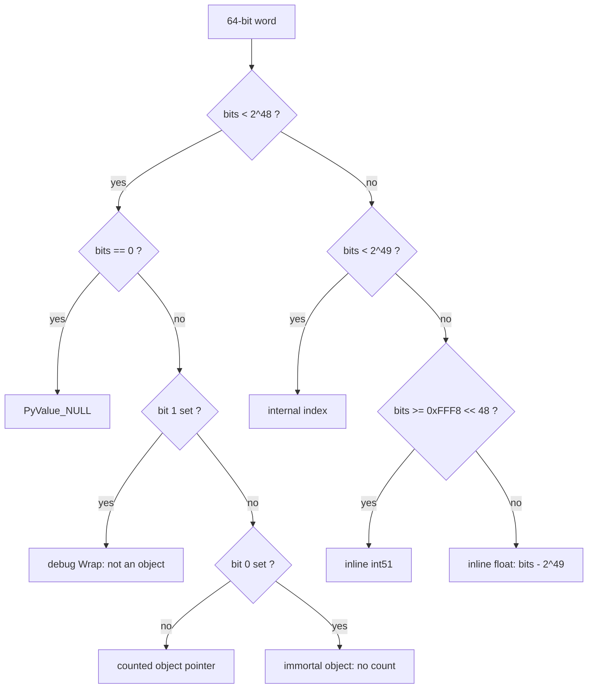
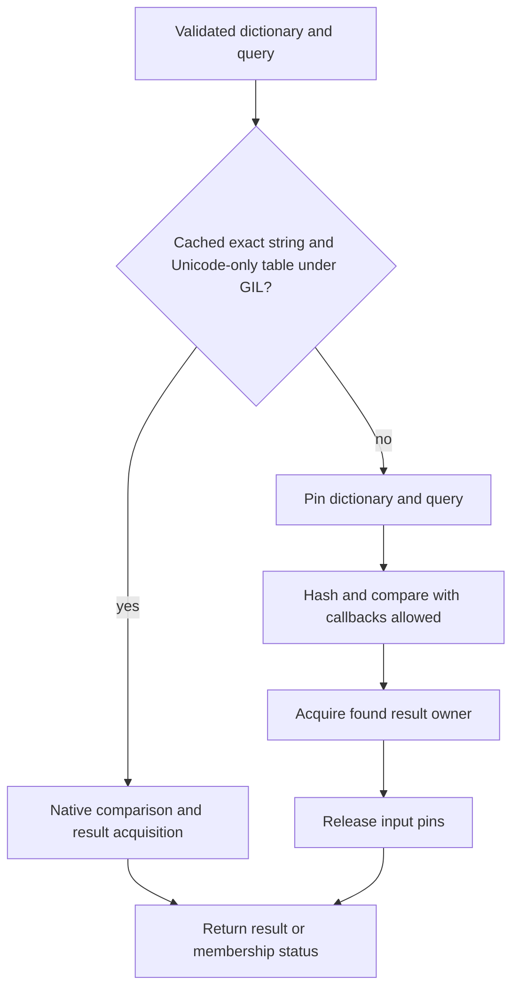

# PyValue: current representation and ownership

PyValue is the canonical eight-byte word in interpreter frames, core containers,
cells, instance fields and value-native C APIs. This page defines the selected
representation; [status](../STATUS.md) owns qualification and measurements.

Related specifications: [call/frame lifetimes](call-and-frame-lifetimes.md),
[native boundary](native-boundary.md), [extension API](extension-api.md),
[register IR](register-ir.md) and [language/lifetime policy](lifetimes-and-language-semantics.md).
Source paths below refer to the selected runtime checkout recorded in status.

## Types and supported profile

`Include/pytypedefs.h` defines two distinct one-word structs:

```c
typedef struct { uintptr_t bits; } PyValue;
typedef struct { uintptr_t bits; } PyValueBorrow;
```

The typed ownership contract distinguishes the two forms.
PyValue represents an owner: a home or an owning C local. PyValueBorrow is a
C-local view of that owner's exact bits and owns no reference. The separate
C types prevent implicit conversion from borrow to owner. They do not prove
arbitrary C aliases or the lifetime of derived PyObject pointers.

Persistent value-cache metadata uses `_PyValueGuarded`, a separate word type
that owns no reference and is not a typed borrow. Its bits may outlive the C
call that recorded them. Only after validating the cache's version and live
owner proof may a reader call `_PyValueGuarded_Load` to create a transient
`PyValueBorrow`, then duplicate it into an owner before any callback can retire
the protecting owner. The runtime shares the existing type
and helpers in `pycore_value.h` between the C type cache and attribute feedback.
Historical feedback snapshots copy guarded metadata without loading a borrow.
This adds no value encoding, owning cache or exception to the C-local borrow rule.

Guarded words also obey the value API's union restriction. Attribute feedback
stores its guarded word independently from the native pointer/shape union;
polymorphic snapshot payloads do the same. No raw-bit or tagged-union exception
was added. The serialized attribute entry uses bytecode magic 64418.

`Include/internal/pycore_pyvalue.h` requires the 64-bit GIL private runtime.
The qualified platform is Linux x86-64 with GCC. Pointers must fit below 2^48;
allocator pointer-space checks and constructor assertions enforce the selected
encoding's assumptions. Free-threaded and 32-bit builds are not this profile.
There is one encoding, without an alternate frame-only or boxed-heap mode.

Only the representation readers listed in [the value API](value-api.md)
may interpret these bits directly. Other code uses the typed value APIs.

## Encoding

| Constant | Value | Defined in |
|---|---|---|
| `Py_TAG_REFCNT` | `1` (bit 0: immortal object; owns no count) | `pycore_value.h` |
| `Py_TAG_INVALID` | `2` (bit 1: debug `PyValue_Wrap`) | `pycore_value.h` |
| `Py_TAG_BITS` | `3` | `pycore_value.h` |
| `Py_PTR_LIMIT` | `1 << 48` | `pycore_pyvalue.h` |
| `Py_INDEX_BASE` | `1 << 48` | `pycore_pyvalue.h` |
| `Py_DOUBLE_OFFSET` | `1 << 49` | `pycore_pyvalue.h` |
| `Py_INT_BASE` | `~0 << 51` (`0xFFF8 << 48`) | `pycore_pyvalue.h` |
| `Py_INT_SHIFT` | `13` (64 - 51) | `pycore_pyvalue.h` |
| `Py_INT_MIN`, `Py_INT_MAX` | `-(1 << 50)`, `(1 << 50) - 1` | `pycore_pyvalue.h` |
| `Py_OWNED_MASK` | `(0xFFFF << 48) \| Py_TAG_BITS` | `pycore_value.h` |
| `PyValue_NULL_BITS` | `0` | `pycore_value.h` |

`pycore_pyvalue.h` is `Include/internal/pycore_pyvalue.h`. There is no
`Include/pyvalue.h`.

The C type, not these bits, distinguishes an owner from its typed borrow.

| Top 16 bits | Low 48 bits | Region | Meaning |
|---|---|---|---|
| `0x0000` | `0` | sentinel | `PyValue_NULL`: absent, empty slot, end of iteration. Zero-filled memory is a valid empty slot |
| `0x0000` | address, bits 1..0 = `00` | pointer | Counted object representation; an owner holds the count and a typed borrow only views it |
| `0x0000` | address, bits 1..0 = `01` | pointer | Immortal object; no count owned. A typed borrow carries its owner's exact bits |
| `0x0000` | address, bits 1..0 = `10` | pointer | Debug builds only: `PyValue_Wrap()` of a non-object pointer |
| `0x0000` | `0x1`, `0x2`, `0x3` | none | Never produced: the tag bits without an address |
| `0x0001` | int48, two's complement | index | Interpreter-internal index, -1 to 2^47-1 |
| `0x0002` to `0x7FF2` | | inline float | IEEE bits + 2^49: +0.0 (`0x0002_0000_0000_0000`) to +inf (`0x7FF2_0000_0000_0000`) |
| `0x7FF2_..._0001` to `0x8001` | | unused | Images of positive NaNs |
| `0x8002` to `0xFFF2` | | inline float | -0.0 (`0x8002_0000_0000_0000`) to -inf (`0xFFF2_0000_0000_0000`) |
| `0xFFF2_..._0001` to `0xFFF7` | | unused | Images of negative NaNs |
| `0xFFF8` to `0xFFFF` | | inline int | int51: `Py_INT_BASE \| (v & (2^51 - 1))`, -2^50 <= v < 2^50. Every word in the region is an int |

Negative NaN images, after the +2^49 offset, wrap modulo 2^64 through the
int, pointer and index regions. That is why no NaN is ever inline: an
arbitrary NaN cannot be encoded safely.



## Predicates and constructors

| Operation | Definition | Where |
|---|---|---|
| `PyValue_IsPointerSpace` | `bits < Py_PTR_LIMIT` | `pycore_value.h` |
| `PyValue_IsNull` | `bits == PyValue_NULL_BITS` | `pycore_value.h` |
| `PyValue_IsObject` | `bits > 2 && bits < 2^48 && (bits & 2) == 0` | `pycore_pyvalue.h` |
| `PyValue_IsTaggedIndex` | `bits - Py_INDEX_BASE < Py_DOUBLE_OFFSET - Py_INDEX_BASE` | `pycore_value.h` |
| `PyValue_IsInline` | `bits >= 2^49` | `pycore_value.h` |
| `PyValue_IsInlineInt` | `bits >= Py_INT_BASE` | `pycore_value.h` |
| `PyValue_IsInlineFloat` | `bits - 2^49 < Py_INT_BASE - 2^49` | `pycore_value.h` |
| `PyValue_BothInlineInt(a, b)` | `(a & b) >= Py_INT_BASE`; exact: the AND has the top 13 bits set only if both words do | `pycore_value.h` |
| `PyValue_IsInlineAt(p)` | Loads the top 16 bits from memory (`cmpw $imm, 6(p)`) | `pycore_value.h:_PyValue_TopBitsAt` |
| `PyValue_IsLanguageValue` | Object, or `bits >= Py_INT_BASE`, or a decoded double that is not NaN | `pycore_pyvalue.h` |
| `PyValue_RefcountOnObject` | `!IsNull && (bits & Py_OWNED_MASK) == 0`; `_PyValue_OwnsCountNotNull` drops the NULL test | `pycore_value.h` |
| `PyValue_IsNone/IsTrue/IsFalse` | Exact compare with `&singleton \| 1` | `pycore_value.h` |
| `PyValue_TYPE` | Inline int gives `&PyLong_Type`, inline float `&PyFloat_Type`, otherwise `Py_TYPE` | `pycore_value.h` |
| `PyValue_InlineInt64` | The value of an inline int, `(int64_t)(bits << Py_INT_SHIFT) >> Py_INT_SHIFT` | `pycore_value.h` |
| `_PyValue_IntScaled(v)` / `_PyValue_FromIntScaled(s)` | `(int64_t)(bits << 13)`, the value times 2^13; `((uint64_t)s >> 13) \| Py_INT_BASE`. A scaled add, subtract, or multiply by an unscaled value overflows int64 exactly when the result leaves int51 | `pycore_value.h` |
| `PyValue_FloatOperandsCheck` / `PyValue_FloatOperandValues` | Two inline floats, or an inline float and an inline int. Anything else, a box or a NaN included, exits | `pycore_value.h` |

Encoding: `PyValue_FromInlineInt(int64_t)` (asserts the range, cannot fail),
`PyValue_FromInt64` (inline if `_PyValue_IntFitsInline`, else a new `PyLong`;
can fail), `PyValue_FromDoubleNotNaN`, and `PyValue_FromDouble`, which boxes a
NaN through `_PyValue_BoxDouble` and so can fail. `PyValue_TagIndex`, `PyValue_UntagIndex` and
`PyValue_IncrementTaggedIndexNoOverflow` handle indices.
`_PyValue_IntFitsInline` is the one test of the inline int range, and
`_PyValue_IntBits` and `_PyValue_DoubleBits` give the encoding, which is also
the value identity.

## Canonical homes

A home contains the single canonical representation of its language value.
Ordinary locals and heap fields hold owners, never typed borrows. Internal
scratch may additionally contain NULL or an encoded index where its operation
contract permits it.

| Python value | Canonical form |
|---|---|
| Exact `int` with -2^50 <= v < 2^50 | Inline int51 |
| Exact `int` outside int51 | `PyLongObject` pointer |
| `int` subclass, `bool` | Boxed. `True` and `False` are immortal singletons with bit 0 set (`PyValue_True`, `PyValue_False`) |
| Exact `float`, not NaN (includes -0.0, ±inf, subnormals) | Inline float |
| NaN, any payload or sign | Boxed `PyFloatObject`; keeps object identity |
| `float` subclass | Boxed |
| `None` | Immortal singleton pointer with bit 0 set (`PyValue_None`) |
| Every other object | Pointer |
| NULL, index | Never a language value |

`PyValue_FromObjectSteal` consumes an object reference and canonicalizes exact
inline-capable numbers, releasing their boxes. `PyValue_FromObjectBorrow`
returns a canonical PyValueBorrow without taking a count or releasing its
source. `PyValue_PrepareOwned` also accepts a NULL object result. Constructors
for int64 and double produce inline values directly when possible; bigint or
NaN boxing can fail. Subclasses retain their object representation.

The value API's release contract permits freeing an exact int/float box without
running Python or changing the active exception; allocator hooks must honor
that contract. Closing an arbitrary object may reenter Python and requires the
normal publication, error-preservation and revalidation rules.

Generic publication uses `_PyValue_Publish`/`_PyValue_Canonicalize` before a
home store. Generated canonical stores bypass that conversion only with a live
canonical representation fact and the existing owning publication protocol.
Local duplication, numeric constructors, guarded exact list/tuple element
acquisition, canonical literals and plain frame transfers supply bounded facts;
an opcode name or native VALUE result type is insufficient. Exact container
reads acquire an owner without a callback before anchor retirement. Their
checked results use canonical temporary and final stores. Outstanding bounds/anchor
facts expire on mutation, control flow or callback; the list interval relies on
the GIL. Unknown chains retain normal publication. `_PyValue_CheckHome` checks
canonical homes in debug.

Representation, ownership, non-NULL and home readability remain independent.
A branch join may preserve a terminal result's separately acquired owner while
losing its common token identity; that weaker fact permits only its first
publication. It cannot make a private native result canonical, duplicate a C
alias into another owner, or authorize a stale frame-home read.

## Ownership and publication

| Operation | Current contract |
| --- | --- |
| `PyValue_Borrow(v)` | Return a PyValueBorrow with exactly the same bits; no tag or count change. |
| `PyValue_FromObjectBorrow(obj)` | Canonical typed view, including NULL; its object owner must remain alive. |
| `PyValue_DUP` / `PyValue_XDUP` | Make an owner from either typed form; increment a mortal object's count. XDUP also accepts NULL. |
| `PyValue_CLOSE` / `PyValue_XCLOSE` | Consume an owner and decrement only a count-owning object; XCLOSE also accepts NULL. A borrow cannot be passed as an owner. |
| `PyValue_FromObjectSteal` / `PyValue_PrepareOwned` | Consume an owned object reference; canonicalize exact numbers. PrepareOwned accepts NULL. |
| `PyValue_AsKnownObjectBorrow` | Read an existing object pointer without boxing; accepts NULL. An inline value calls `_PyValue_FatalNotObject` in every build: this is a fatal contract violation, not a recoverable conversion. |
| `PyValue_AsKnownObjectSteal` | Transfer an object's owner, acquiring a reference for an immortal representation if needed by the object API. |
| `PyValue_AsObject` | Produce an owned PyObject reference, boxing an inline scalar; may fail. |
| `PyValue_CLEAR` / `PyValue_XSETREF` | Detach or replace the home before closing its displaced owner. |

The pointer no-count tag means immortal, not mortal borrow. This holds for
owned and borrowed words because borrowing changes no bits. Static immortals
always carry the tag; an existing untagged reference may become immortal later.
Interpreter immortal teardown is the explicit exception to the normal tagged
immortal invariant. NULL, indices and inline numbers own no heap count.

A copied C word is not automatically a second owner. Use TAKE/move to transfer
one owner, or DUP to acquire another. `LOAD_FAST_BORROW` still produces an owning
temporary; the interpreter may instead read a local in place under its generated
borrowed-input contract. A borrow is valid only while its owner remains alive.
Callback-capable code must pin or otherwise prove that lifetime.

Store and callback order is part of correctness:

1. Prepare the new owner and perform fallible work before mutation.
2. Capture displaced owners, then install output homes without callbacks.
3. Publish the complete frame/continuation state for that outcome.
4. Close detached owners, preserving an active error when required.
5. Revalidate callback-sensitive state; never overwrite a newer redirect.

Python does not guarantee prompt finalization. The implementation still must
avoid leaks, unbounded retention, stale roots and reuse of uncleared slots.
Certified empty-scratch return uses local-only thread retirement. General
return uses outlined full-extent cleanup for retained scratch. Logical
`NO_HOME` is not a physical NULL, initialization or readability fact; the
current NULL-control storage policy remains. See the call/frame contract for
exceptions, frame escape, child overlap and initialized arena storage.

### Dictionary reader callbacks

Internal dictionary value readers protect their dictionary and query across
callback-capable lookup, then acquire a found result before retiring those
input pins. Public readers validate at entry; typed `dict.get` enters the same
provider below that validation. One lookup/result-acquisition helper requires
its caller to supply the dictionary/query lifetime, avoiding nested scopes on
the general path. Callers still owe borrowed inputs their ordinary valid lifetime.
A cached exact-string hash proves only that hashing needs no callback. In a
mixed GENERAL table, a stored custom key's equality can execute Python. The
callback-free shortcut therefore also requires a Unicode-only table under the
GIL. GetValue and ContainsValue use the same admission rule; free-threaded code
uses the scoped route without an unlocked table-kind read. The
[round-57 report](../issues/comprehensions57/report.md) records the isolated
repair and its qualification, separately from rejected speed changes.



Membership has no result owner to acquire. Error paths preserve the active
exception through cleanup. Cached hashes are not lifetime or effect proofs.

## Storage and collection

| Home | Current representation |
| --- | --- |
| Frame | base[] locals/cells/free vars/temporaries contain PyValues. f_executable and f_funcobj are owning typed object pointers; globals/builtins/locals mappings remain object pointers. |
| Tuple, list, struct sequence | Element arrays contain PyValues. |
| Dict | Generic keys and values contain PyValues; specialized unicode keys remain PyObject pointers. Split-dict/inline-instance values contain PyValues. |
| Set/frozenset | Keys contain PyValues; empty entries use NULL. |
| Cell and managed slots | Cell ob_ref and value-aware member fields contain PyValues. |
| Caches | Non-owning canonical payloads use `_PyValueGuarded` metadata, protected by a cache/version and live-owner proof; they are neither owning homes nor persistent typed borrows. |

`_Py_VISIT_VALUE` visits only actual object values. GC therefore skips inline
numbers, indices and NULL. `_PyGC_VisitValue` preserves the distinction between
count-owning and immortal references during cyclic accounting. Frame traversal
uses the actual frame-slot contract; object-container traversal uses value-aware
visitors. Clearing writes NULL before releasing the old owner.

Zero bits are a valid empty value, but not every allocation is already zeroed.
Container allocators and the frame arena explicitly initialize newly exposed
storage and clear owners before reuse. Constants and internal scratch indices
follow their separate allocated-slot contracts.

## Identity, comparison and hashing

Inline int51 values and exact non-NaN floats have value identity equal to their
encoding, whether temporarily boxed or inline. Other objects have pointer
identity. `PyValue_Is`, value-aware operator helpers and id() use this identity;
`builtin_id_impl` returns it through `PyValue_FromUInt64`. Raw C pointer equality
is not a substitute when comparing boxes of inline-capable values.

For example, equal computed int51 values or equal-bit exact floats share value
identity; +0.0 and -0.0 do not. NaNs remain boxed with object identity. The
hash/equality contract still requires equal integer/float values to hash alike.
Int51 fits exactly in a double's significand; wider integer objects use the
ordinary numeric fallback. Arbitrary-size integers and numeric subclasses keep
Python's object protocol and custom hooks.

Internal indices are not Python integers. Use TagIndex/UntagIndex only under
an operation's physical-slot contract. Never feed them into generic language
value accessors or expose them as a logical user value.

## Native and extension boundaries

Value-native methods/slots consume documented owners or typed borrows without
boxing solely to satisfy an obsolete object ABI. Rebuilt object-form entry
points use owning, fallible bridges. Scalar object getters return owned boxes;
there is no borrowed box cache. `_PyValueTemps` and native borrow scopes keep
bridge objects alive for the documented handler/call lifetime and release them
on all exits. A native result is canonicalized before it becomes a home.

Call-scratch arrays are the explicit exception to ordinary home storage: the
`_PyValue_Window*` primitives copy borrowed words for one call while another
owner keeps them alive, and GC does not traverse that scratch as owners. The
value API checker requires reads through Borrow, DUP or window primitives.
A typed borrow cannot escape into a heap field, frame home, global or static.

The private rebuilt-source ABI exposes the one-word types and value-aware
container/native interfaces. It is not a stable external bit layout. The
opaque extension direction and HPy-compatible backend remain separate work;
no second core representation is introduced. Read the native-boundary and
extension-API pages for parser, lifetime and error contracts.

## Observable and reader limits

Inline scalars have no separately allocated heap object for GC referent lists
or stable raw-address introspection. id() is not an address for them; constructing
a PyObject pointer from that integer is invalid. Refcount queries may involve
a boundary box, and marshal may encode repeated inline scalars without object
back-references while preserving decoded values. Bytecode/cache identities
belong to the current IR/cache format, not to this representation page.

`pycore_debug_offsets.h` exports the value encoding and frame layout through a
cookie/schema/ABI-checked descriptor. In-tree remote readers validate the target
layout before reading values. External readers must port to that contract.
GDB pretty-printer diagnostics remain quarantined; other reader checks stay
enabled. [Status](../STATUS.md) records their qualification. Source-aware callback
display remains distinct from compact executable f_lasti.
