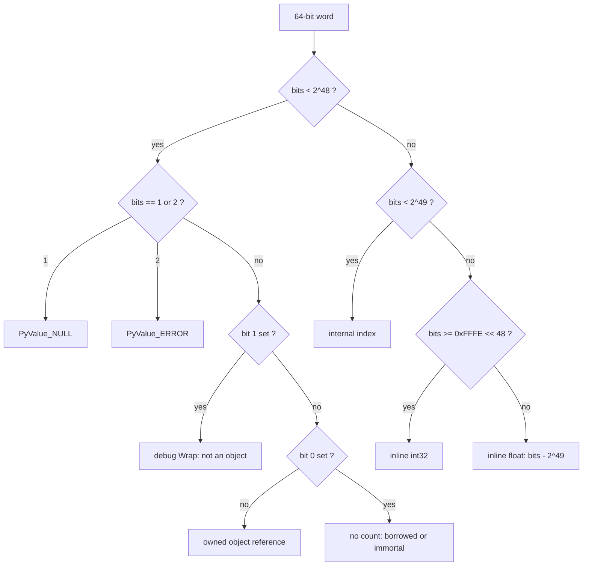
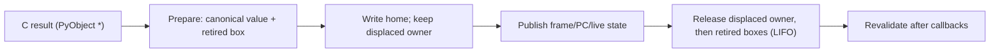

# PyValue: value representation reference

PyValue is the eight-byte value word used in frames, containers, cells,
instance fields and value-native C APIs. This page specifies the encoding as
built, compares it with other dynamic-language runtimes, and lists the gaps
we should close. It is the reference for value, container and C-boundary work.

Source of truth: the universal-value worktree
`build/worktrees/pyvalue-rc-universal` at `0ab5bc42f61` (2026-11-03), which
contains the G1 fix `271f4e435e5`. That tree has not linked, so nothing here
has run. Behaviour described below is
read from source, not observed. Where this page and the code disagree, the code
wins; fix this page. Design review 1
([reviews/pyvalue-review-1.md](reviews/pyvalue-review-1.md)) is folded in,
with the coordinator decisions at the top of section 3.

Related pages: [values and object protocol](values-and-object-protocol.md)
(summary), [memory and lifetimes](gc-roots-and-lifetimes.md),
[extension API](extension-api.md), [native boundary](native-boundary.md)
(argument parsing and borrowed-returning C APIs; this page does not restate
that decision), and the [restoration design](../issues/pyvalue-rc-restoration/design.md)
(provenance). The int-width and NaN rationale first appeared in
`boil/design/02-tagged-values.md`, deleted in `e2d8b438a70`; read it with
`git show e2d8b438a70^:boil/design/02-tagged-values.md`.

File references below are relative to the source worktree.

## 1. Specification as built

### 1.1 Type and profile

`typedef struct { uintptr_t bits; } PyValue;` (`Include/pytypedefs.h`).
The struct prevents implicit conversion to or from `PyObject *`.

The encoding needs a 64-bit GIL build. `Include/pyvalue.h` stops the build
otherwise (`#error "PyValue requires the 64-bit GIL private runtime"`). In
`Include/internal/pycore_value.h` this profile defines `Py_VALUE_INLINE_VALUES`.

### 1.2 Constants

| Constant | Value | Defined in |
|---|---|---|
| `Py_TAG_REFCNT` | `1` (bit 0: reference owns no count) | `pycore_value.h` |
| `Py_TAG_INVALID` | `2` (bit 1: `PyValue_ERROR`, debug `PyValue_Wrap`) | `pycore_value.h` |
| `Py_TAG_BITS` | `3` | `pycore_value.h` |
| `Py_PTR_LIMIT` | `1 << 48` | `pycore_value.h` |
| `Py_INDEX_BASE` | `1 << 48` | `pycore_value.h` |
| `Py_DOUBLE_OFFSET` | `1 << 49` | `pycore_value.h` |
| `Py_INT_BASE` | `0xFFFE << 48` | `pycore_value.h` |
| `Py_OWNED_MASK` | `(0xFFFF << 48) \| Py_TAG_REFCNT` | `pycore_value.h` |
| `PyValue_NULL_BITS` | `Py_TAG_REFCNT` (`1`) | `pycore_value.h` |
| `PyValue_ERROR` | `Py_TAG_INVALID` (`2`) | `pycore_value.h` |

`Include/pyvalue.h` repeats `1 << 48`, `1 << 49` and `0xFFFE << 48` as
literals instead of using these names.

### 1.3 Bit layout

| Top 16 bits | Low 48 bits | Region | Meaning |
|---|---|---|---|
| `0x0000` | `0` | none | Not a value. Zero-filled memory is invalid (`PyValue_CheckValid` asserts `bits != 0`) |
| `0x0000` | `0x1` | sentinel | `PyValue_NULL`: absent, empty slot, end of iteration |
| `0x0000` | `0x2` | sentinel | `PyValue_ERROR` |
| `0x0000` | address, bits 1..0 = `00` | pointer | Owned strong reference |
| `0x0000` | address, bits 1..0 = `01` | pointer | No count owned: borrowed, immortal, or (free-threaded only) deferred |
| `0x0000` | address, bits 1..0 = `10` | pointer | Debug builds only: `PyValue_Wrap()` of a non-object pointer |
| `0x0001` | int48, two's complement | index | Interpreter-internal index, -1 to 2^47-1 |
| `0x0002` to `0x7FF2` | | inline float | IEEE bits + 2^49: +0.0 (`0x0002_0000_0000_0000`) to +inf (`0x7FF2_0000_0000_0000`) |
| `0x7FF2_..._0001` to `0x8001` | | unused | Images of positive NaNs |
| `0x8002` to `0xFFF2` | | inline float | -0.0 (`0x8002_0000_0000_0000`) to -inf (`0xFFF2_0000_0000_0000`) |
| `0xFFF2_..._0001` to `0xFFFD` | | unused | Images of negative NaNs |
| `0xFFFE` | `0x0000` then int32 | inline int | `Py_INT_BASE \| (uint32_t)i` |
| `0xFFFE` with bits 32-47 non-zero, and `0xFFFF` | | unused | Never produced. `PyValue_IsInlineInt` would accept them |

Negative NaN images, after the +2^49 offset, wrap modulo 2^64 through the
int, pointer and index regions. That is why no NaN is ever inline: an
arbitrary NaN cannot be encoded safely.

### 1.4 Predicates and accessors

| Operation | Definition | Where |
|---|---|---|
| `PyValue_IsPointerSpace` | `bits < Py_PTR_LIMIT` | `pycore_value.h` |
| `PyValue_IsObject` | `bits > 2 && bits < 2^48 && (bits & 2) == 0` | `pyvalue.h` |
| `PyValue_IsTaggedIndex` | `bits - 2^48 < 2^48` | `pycore_value.h` |
| `PyValue_IsInline` | `bits >= 2^49` | `pycore_value.h` |
| `PyValue_IsInlineInt` | `bits >= Py_INT_BASE` | `pycore_value.h` |
| `PyValue_IsInlineFloat` | `bits - 2^49 < Py_INT_BASE - 2^49` | `pycore_value.h` |
| `PyValue_BothInlineInt(a, b)` | `(a & b) >= Py_INT_BASE` (relies on `0xFFFF` being unused) | `pycore_value.h` |
| `PyValue_IsInlineAt(p)` | Loads the top 16 bits from memory (`cmpw $imm, 6(p)`) | `pycore_value.h:_PyValue_TopBitsAt` |
| `PyValue_IsLanguageValue` | Object, or exact int pattern `(bits & ~0xFFFFFFFF) == 0xFFFE << 48`, or a decoded double that is not NaN | `pyvalue.h` |
| `PyValue_RefcountOnObject` | `(bits & Py_OWNED_MASK) == 0` | `pycore_value.h` |
| `PyValue_IsNone/IsTrue/IsFalse` | Exact compare with `&singleton \| 1` | `pycore_value.h` |
| `PyValue_TYPE` | Inline int gives `&PyLong_Type`, inline float `&PyFloat_Type`, otherwise `Py_TYPE` | `pycore_value.h` |
| `PyValue_IsCompactInt` / `PyValue_CompactIntValue` | Inline int, or a boxed exact one-digit int | `pycore_value.h` |
| `PyValue_FloatOperandValues` | Both inline floats first, then boxed exact floats and compact ints (a NaN beside an int is refused) | `pycore_value.h` |

Encoding: `PyValue_FromInt32` (cannot fail), `PyValue_FromDoubleNotNaN`, and
`PyValue_FromDouble`, which boxes a NaN through `_PyValue_BoxDouble` and so can
fail. `PyValue_TagIndex`, `PyValue_UntagIndex` and
`PyValue_IncrementTaggedIndexNoOverflow` handle indices.

### 1.5 Canonical forms

"Canonical" means the one form a Python value takes in a home (a frame slot,
container element, field, cell, dict key or value, or set key).

| Python value | Canonical form |
|---|---|
| Exact `int` with -2^31 <= v < 2^31 | Inline int. This includes two-digit `PyLong`s (2^30 <= abs(v) < 2^31) |
| Exact `int` outside int32 | Boxed `PyLongObject`, owned pointer |
| `int` subclass, `bool` | Boxed. `True` and `False` are immortal singletons with bit 0 set (`PyValue_True`, `PyValue_False`) |
| Exact `float`, not NaN (includes -0.0, ±inf, subnormals) | Inline float |
| NaN, any payload or sign | Boxed `PyFloatObject`; keeps object identity |
| `float` subclass | Boxed |
| `None` | Immortal singleton pointer with bit 0 set (`PyValue_None`) |
| Every other object | Pointer |
| NULL, ERROR, index | Never a language value |

`floatobject.c` and `longobject.c` do not canonicalize. Numbers are created as
heap objects and converted when a `PyValue` is built:

| Site | Behaviour |
|---|---|
| `PyValue_FromObjectBorrow` (`Python/pyvalue.c`) | Canonical borrow. Calls `_PyObject_ValueIdentity`, which tests the exact type and, for a non-compact int, calls `PyLong_AsLongAndOverflow` |
| `PyValue_PrepareOwned(obj, &retired)` (`Python/pyvalue.c`) | Consumes an owned object. For an inline-capable scalar it returns the immediate and hands the box back in `*retired`, to be released after publication |
| `_PyValue_Prepare`, `_PyValueTemps_Publish` (`pyvalue.c`, `pycore_value.h`) | Frame publication. The generated register handlers write homes through `IR_STORE_DST`, `IR_STORE_TEMP`, `IR_STORE_INPUT` and `IR_MOVE_TO_DST` (`Python/ceval_macros.h`). Each tests for exact int or float and keeps a retired box in `_PyValueTemps` until handler cleanup |
| `PyValue_FromInt32`, `PyValue_FromDouble`, `LOAD_CONST_INLINE_INT/FLOAT` | Produce inline values directly |
| Object-form container setters (`PyTuple_SET_ITEM`, `PyTuple_SetItem`, `PyList_SetItem`, `PyList_Append`, `PyDict_SetItem`, `PyStructSequence_SetItem`, `PyMember_SetOne`) | Canonicalize through `PrepareOwned` or `FromObjectBorrow` |

These constructors do not canonicalize. They are legal for transient values
and become canonical only when routed through a publication path:
`PyValue_FromPyObjectSteal` (about 157 call sites), `PyValue_FromPyObjectNew`
(about 53) and `PyValue_FromPyObjectBorrow` (about 13). Value-form setters (`PyTuple_SET_VALUE`,
`PyDict_SetValue`, `_PyMember_SetValue`, `_PyCell_SwapValue`) trust the
canonical form of their input. They do promote a borrow to an owner through
`PyValue_MakeHeapSafe` (`tupleobject.c:PyTuple_SetValue`,
`_PyTuple_FromValueStealOnSuccess`). They assert `PyValue_IsLanguageValue` in
debug builds, but nothing checks canonical form. No canonical-form predicate
exists.

The header states the rule as "may be held inline in one place and boxed in
others" (`pycore_value.h`, "Value identity"). The container headers say
"canonical". Section 3, G2, covers the gap between the two.

### 1.6 Ownership operations

| Operation | Contract | Where |
|---|---|---|
| `PyValue_FromPyObjectSteal(o)` | Consumes one strong reference. Immortal objects get bit 0 from `ob_flags`. Does not canonicalize | `pycore_value.h` |
| `PyValue_FromPyObjectNew(o)` | INCREFs a mortal object; tags an immortal one. Tests immortality by the refcount (`_Py_IsImmortal`), not `ob_flags` (G1'). Does not canonicalize | `pycore_value.h:_PyValue_FromPyObjectNew` |
| `PyValue_FromPyObjectBorrow(o)` | Sets bit 0; no INCREF; does not canonicalize | `pycore_value.h` |
| `PyValue_FromObjectBorrow(o)` | Public. Canonical borrow; `NULL` maps to `PyValue_NULL` | `pyvalue.c` |
| `PyValue_PrepareOwned(o, &retired)` | Public. Pure: consumes `o` without releasing it. Publish first, then `Py_XDECREF(retired)` | `pyvalue.c` |
| `PyValue_Borrow(v)` / `PyValue_BorrowAt(p)` | Sets bit 0 in pointer space; leaves scalars unchanged. `Borrow(PyValue_ERROR)` gives `3`, which is neither ERROR, NULL nor an object (G1') | `pyvalue.h`, `pycore_value.h` |
| `PyValue_DUP(v)` | INCREFs only if `v` owns a count, and returns the same bits. A DUP of a borrow is still a borrow | `pycore_value.h` |
| `PyValue_NewRef(v)` | Public. `Py_INCREF`s a mortal object and clears bit 0, which promotes a borrow to an owner. Tags an immortal object with bit 0 (the G1 fix, `271f4e435e5`; the refcount test is G1') | `pyvalue.h` |
| `PyValue_CLOSE` / `PyValue_XCLOSE` | Internal. `Py_DECREF_MORTAL` if `RefcountOnObject`; no immortality check in release builds | `pycore_value.h` |
| `PyValue_Close(v)` | Public. `Py_DECREF` (immortality-aware) if the value is an object with bit 0 clear | `pyvalue.h` |
| `_PyValue_CLOSE_POINTER` etc. | Generator-selected variants that test only bit 0 (`_PyValue_PointerOwnsCount`), for inputs proven to be pointers. They also treat ERROR and `Wrap` values as owned (G3) | `pycore_value.h` |
| `PyValue_IsHeapSafe` / `PyValue_MakeHeapSafe` | A borrowed mortal is promoted with `Py_INCREF`. Telling borrowed from immortal loads the object (`_Py_IsImmortal`) | `pycore_value.h` |
| `_PyValue_OwnArray` | `MakeHeapSafe` over an argument window | `pycore_value.h` |
| `PyValue_Box(v)` | Inline value to owned box; on failure returns `v` unchanged with an exception set | `pycore_value.h`, `pyvalue.c:_PyValue_BoxInlineValue` |
| `PyValue_AsObject(v)` | Public. New object reference, boxing a scalar. Raises `SystemError` for NULL, ERROR or an index | `pyvalue.c` |
| `PyValue_AsPyObjectBorrow(v)` | Masks bit 0. Debug-asserts pointer space only; an inline value gives a garbage pointer in release builds | `pycore_value.h` |
| `PyValue_AsPyObjectSteal(v)` | Transfers ownership, INCREFing if `v` owned no count. Has the same release-build hole as `AsPyObjectBorrow` | `pycore_value.h` |
| `_PyValueTemps` | Handler-scoped owners for private scalar boxes and one displaced local. Released LIFO after publication (`_PyValueTemps_CloseNonempty`) | `pycore_value.h`, `pyvalue.c` |

Store discipline, used by every heap setter that was checked:

1. Prepare the new value without side effects (`PrepareOwned`,
   `MakeHeapSafe(Borrow(v))`).
2. Read the old slot, then write the new value.
3. Release the old owner and any retired box.
4. Revalidate anything a callback could change.

For examples, see `_PyMember_SetValue` (`Python/structmember.c`),
`PyTuple_SetValue` (`Objects/tupleobject.c`), `_PyCell_SwapValue`
(`pycore_cell.h`) and `IR_STORE_DST` (`ceval_macros.h`). Many value-API
releases are wrapped in `PyErr_GetRaisedException`/`_PyValue_RestoreException`
(`Objects/value_ops.c:close_object`, `close_value`; `_PyMember_SetValue`),
because "allocator hooks may raise during release".

### 1.7 Identity, equality and hashing

**Identity.** An exact int32 int and an exact non-NaN float have a value
identity: their inline encoding, whether held inline or boxed
(`Python/pyvalue.c:_PyObject_ValueIdentity`). Every other object's identity is
its address. Encodings are at least 2^49 and addresses are below 2^48, so one
identity names one value.

| Mechanism | Behaviour | Where |
|---|---|---|
| `PyValue_Is(a, b)` | XOR the bits, masking bit 0 if `a` is a pointer. If they differ, call the out-of-line `_PyValue_IsSameValue`, which compares `value_identity` of both | `pycore_value.h`, `pyvalue.c` |
| `IS_OP` | `PyValue_Is` | `Python/bytecodes.c:_IS_OP` |
| `is None`, truth jumps | `PyValue_IsNone` / `PyValue_IsTrue`: an exact bit compare, no fallback | `bytecodes.c:_IS_NONE`, `_POP_JUMP_IF_TRUE` |
| `id()` | `PyLong_FromVoidPtr(_PyObject_ValueIdentity(v))` | `Python/bltinmodule.c` |
| `operator.is_` / `is_not` | Compare `_PyObject_ValueIdentity` | `Modules/_operator.c` |
| C `Py_Is`, `==` on `PyObject *` | Pointer equality. Two boxes of one inline value are different objects to C | n/a |

Consequences: `x is y` is True for equal int32 ints or equal-bit floats however
they were computed. `0.0 is -0.0` is False. NaNs keep CPython identity, so
`nan in [nan]` and NaN dict keys behave as in CPython. `id()` of an inline
value is at least 2^49 and does not change when the value is boxed.

**Equality.** `_PyValue_RichCompareBool` (`Objects/value_ops.c`) applies the
container identity shortcut, then compares two inline operands as doubles in
`compare_inline`. Every int32 converts to a double exactly. Other operands are
boxed (`box_operands`) and passed to `PyObject_RichCompareBool`. List sort
reads inline floats directly (`unsafe_float_compare`), and
`unsafe_object_compare` falls back to the value compare for inline operands
(`Objects/listobject.c`).

**Hashing.** `_PyValue_Hash` (`Objects/value_ops.c`) hashes an inline int as
its value, mapping -1 to -2, and an inline float as
`_Py_HashDouble(Py_None, d)`. For int32 values this equals `long_hash`, and
`float_hash` ignores the instance unless the value is NaN, so boxed and inline
forms hash alike, and equal int/float values hash alike. Tuples hash elements
with `_PyValue_Hash` (`tupleobject.c:tuple_hash`). Dict lookup
(`dictobject.c:compare_generic`) tries `PyValue_Is` first, then compares
hashes, then calls `_PyValue_RichCompareBool`. Unicode-keyed tables keep
`PyObject *` str keys (`PyDictUnicodeEntry.me_key`).

**Invariants.** Any change to the inline int or float range must keep three
rules. Hash equals the Python value, so `_PyValue_Hash` agrees with `long_hash`
and `float_hash`. Comparison stays exact: int32 and int51 fit in a double's
mantissa, while a 62-bit scheme needs a separate exact path and a
`_PyHASH_MODULUS` reduction in the hash. Exact-bit tests (`IsNone`, `IsTrue`,
`IsFalse`) are valid only against *static* immortals. An object made immortal
after a reference to it exists (interning, `_Py_SetImmortal`) can still be held
without bit 0 (`pycore_value.h:PyValue_CheckValid`).

**Subinterpreters.** Inline values belong to no interpreter, and `PyValue_None`
and the other singletons are global statics. Objects made immortal at run time
are per interpreter, which is why exact-bit tests may use static immortals
only.

### 1.8 Storage sites

| Site | Field | Notes |
|---|---|---|
| Interpreter frame | `_PyInterpreterFrame.base[]` (locals, cells, free vars, temporaries), `f_executable`, `f_funcobj` (`pycore_interpframe_structs.h`) | `f_globals`, `f_builtins` and `f_locals` stay `PyObject *`. Temporaries may hold indices (FOR_ITER `null_or_index`, saved lasti) |
| Tuple | `PyTupleObject.ob_item[]` (`Include/cpython/tupleobject.h`) | `co_consts` is a tuple, so constants are inline |
| List | `PyListObject.ob_item` (`Include/cpython/listobject.h`) | |
| Dict, combined | `PyDictKeyEntry.me_key`, `me_value` (`pycore_dict.h`) | |
| Dict, unicode keys | `PyDictUnicodeEntry.me_value`; key stays `PyObject *` | |
| Split dict / instance inline values | `struct _dictvalues.values[]` (`pycore_dict.h`) | Shapes carry `_PySlotKind`, whose only member is `_Py_SLOT_BOXED` |
| Set / frozenset | `setentry.key` (`Include/cpython/setobject.h`) | Unused entries are `PyValue_NULL` with hash 0 |
| Cell | `PyCellObject.ob_ref` (`Include/cpython/cellobject.h`) | |
| `__slots__` | `_Py_T_VALUE_EX` members (`Objects/typeobject.c`, `Python/structmember.c`) | |
| Struct sequences | `ob_item[]` with `_Py_T_VALUE` members (`Objects/structseq.c`) | Unset fields read as `None` |
| Type cache | `pycore_typecache.h` entry `value` | Non-owning; protected by version |

Every heap field owns a strong reference or holds an immortal or an inline
value. Because zero bits are not `PyValue_NULL`, every allocator must
initialise value fields explicitly. `_PyType_AllocNoTrack` walks the
`tp_members` of each base on every allocation to do so
(`typeobject.c:init_value_slots`).

### 1.9 GC traversal and clearing

`_Py_VISIT_VALUE` (`pycore_value.h`) visits only `PyValue_IsObject` values, so
NULL, ERROR, indices and inline scalars are skipped.
`_PyGC_VisitValue` (`Python/gc.c`) skips `visit_decref` for references with
bit 0 set. Frames are scanned over all slots (`gc.c:_PyGC_VisitFrameStack`).
`list_traverse`, `dict_traverse`, set, cell, tuple and structseq traversal use
the same macro. `__slots__` traversal (`typeobject.c:traverse_slots`) instead
calls `visit` directly on every object value, so it does not apply the bit-0
`visit_decref` skip. It asserts `PyValue_IsHeapSafe` first. Under that
invariant the only bit-0 values it visits are immortals. `_Py_SetImmortal`
untracks those, so `visit_decref` does nothing to them and the divergence is
harmless. If the invariant breaks, `traverse_slots` subtracts a count that was
never taken and can free a reachable object early. It should use
`_Py_VISIT_VALUE`, like every other traversal (G6). `_PyTuple_MaybeUntrack`
treats inline elements as untracked.
Clearing detaches before release: `PyValue_CLEAR` and `_PyValue_CloseStack`
write `PyValue_NULL`, then close.

### 1.10 Boxing at C boundaries and its cost

| Boundary | What happens per value | Where |
|---|---|---|
| Native call (vectorcall, builtins) | `_PyObjectArray_FromValueArray`. First `MakeHeapSafe` on each argument, then `PyValue_AsObject` for each. That runs `IsLanguageValue`, INCREFs a pointer or allocates a box for a scalar, and checks `PyErr_Occurred`. Cleanup (`_PyObjectArray_Free`) DECREFs each element through `_PyValueTemps`, with an exception save and restore. More than 10 arguments use `PyMem_Malloc` | `Python/ceval.c`, `ceval_macros.h:VALUES_TO_PYOBJECTS` |
| Native result | Returned `PyObject *` becomes a `PyValue` (`FromPyObjectSteal`); publication canonicalizes and frees an int or float box after the store | `ceval.c`, `_PyValueTemps_Publish` |
| Generated handler inputs | The cases generator boxes each scalar input passed whole to `PyValue_AsPyObject*` (or exits in a guard). Array inputs are not checked | `Tools/cases_generator/interpreter_definition.md`, "Inline values" |
| Owning object getters | `PyTuple_GetItemRef`, `PyList_GetItemRef`, `PyStructSequence_GetItemRef`, `PyMember_GetOne` allocate a fresh box for each inline element read | `tupleobject.c`, `listobject.c`, `structseq.c`, `structmember.c` |
| `tp_iternext`, `sq_item`, generic subscripts | Box (`list_item` uses `PyValue_AsObject`); the interpreter's value iterators (`_PyListIter_NextValue`, `_PyTupleIter_NextValue`) do not | `listobject.c`, `pycore_list.h` |
| Value hash, compare, repr | No box for inline-only cases; mixed cases box | `value_ops.c` |

Call-site counts in `Objects/`, `Python/` and `Modules/` respectively:
`PyTuple_GetItemRef` 94/26/119, `PyList_GetItemRef` 14/97/33,
`PyValue_AsObject` 46/19/22, and `PyValue_AsPyObjectBorrow` 849 in total.
No box is cached and no borrowed box is returned. That is a deliberate rule
(see the [extension API](extension-api.md)).

Compared with upstream CPython's GIL build, every native call now adds an
INCREF/DECREF pair and at least two exception-state checks per argument, plus
one allocation per scalar argument. Every object-form read of a scalar container
element adds an allocation and a free. No measurement exists yet. The stats
counters `inline_ints_created`, `inline_floats_created`, `inline_int_boxes`
and `inline_float_boxes` (`Include/cpython/pystats.h`) count boxing but not
the site or int32 overflow.

### 1.11 C API surface

| Family | Value form (no box) | Object form (owning, fallible, boxes) |
|---|---|---|
| Tuple | `PyTuple_GET_VALUE` (borrow, inline), `PyTuple_GetValue` (owned, checked), `PyTuple_SET_VALUE`, `PyTuple_SetValue` | `PyTuple_GetItemRef`, `PyTuple_SET_ITEM`, `PyTuple_SetItem` |
| List | `PyList_GET_VALUE` (an out-of-line function), `PyList_GetValue`, `PyList_SET_VALUE` | `PyList_GetItemRef`, `PyList_SET_ITEM`, `PyList_SetItem` |
| Dict | `PyDict_GetValue`, `GetValueString`, `NextValue`, `SetValue`, `DelValue`, `ContainsValue`, `PopValue` (`Include/dictobject.h`) | `PyDict_GetItemRef`, `PyDict_SetItem` |
| Cell | `PyCell_GET_VALUE`, `PyCell_GetValue`, `PyCell_SetValue`, `PyCell_NewValue` | — |
| Struct sequence | `PyStructSequence_GET_VALUE`, `SET_VALUE` | `PyStructSequence_GetItemRef`, `PyStructSequence_SetItem` |
| Core-only | `_PyTuple_GET_OBJECT` (metadata proven to hold objects), `_PyList_GetValue`, `_PyList_AppendTakeValue`, `_PyMember_GetValue/SetValue` | — |

The borrowed object getters (`PyTuple_GetItem`, `PyTuple_GET_ITEM`,
`PyList_GetItem`, `PyList_GET_ITEM`, `PyDict_GetItem`, `PyDict_Next`) are gone
from the headers. Some stale users remain, for example
`PySequence_Fast_GET_ITEM` in `Include/cpython/abstract.h` still expands to the
removed macros. The [native boundary](native-boundary.md) page owns the
decision on borrowed-returning APIs and argument parsing.

**ABI policy (decided 2026-11-03).**

* `pyvalue.h` and every declaration that takes or returns `PyValue` are outside
  the limited API: they sit under `#ifndef Py_LIMITED_API`. Today `Python.h`
  includes `pyvalue.h` unconditionally (`Include/Python.h`), and the public
  `PyValue_NewRef` calls `_Py_IsImmortal`, which `Include/refcount.h` hides
  under `_Py_OPAQUE_PYOBJECT` (G1').
* The limited API stays available in source form, minus the deleted borrowed
  getters. `Misc/stable_abi.toml` still lists `PyTuple_GetItem` and
  `PyList_GetItem`, and `PC/python3dll.c` still exports them (lines 348 and
  680), though they have no definition. Remove both entries. Until then
  `test_stable_abi_ctypes` and the Windows `python3.dll` link fail.
* abi3 binaries built against upstream CPython are unsupported, because the
  container layouts differ. Extensions are rebuilt.
* Free threading and abi3t are non-goals. The `test_cext` abi3t builds
  (`Lib/test/test_cext/setup.py`, `CPYTHON_TEST_ABI3T`) are skipped.
* The code change is in progress.

The project intends PyValue as a private core representation behind opaque
extension handles ([extension API](extension-api.md)). As built,
`Include/pyvalue.h` and the container headers expose the struct and inline
functions that compute on its bits to every rebuilt `Python.h` extension. The
encoding is therefore part of the private extension ABI until the opaque
backend exists.

### 1.12 Platform profile and limits

| Property | As built |
|---|---|
| Word | 64-bit only; `#error` otherwise (`pyvalue.h`) |
| Threading | GIL only; free-threaded builds `#error`. Free threading is a non-goal (section 1.11). Aligned 8-byte stores cannot tear. Were it ever a goal, bit 0 would also mean "deferred", and inline values would help |
| Pointers | Must be below 2^48. No runtime or debug check that object addresses fit |
| Alignment | `static_assert(_Alignof(PyObject) >= 8)` (`pyvalue.c`); bit 2 is free |
| Endianness | `_PyValue_TopBitsAt` assumes little-endian for its fast path; other byte orders use a shift |
| Inline int range | -2^31 to 2^31-1 |
| Inline floats | All non-NaN doubles |
| Index range | -1 to 2^47-1 |
| Qualified OS/ISA | Linux x86-64 ([runtime architecture](runtime-architecture.md)). `pycore_value.h` still has `_WIN32` macro variants and a no-inline branch for free-threaded and 32-bit builds |

### 1.13 Observable behaviour and external tools

Expected differences from upstream CPython. Triage test-suite failures against
this list.

| Behaviour | Difference | Where |
|---|---|---|
| `gc.get_referents(container)` | Omits inline elements. Upstream returns them, and memory profilers (pympler, objgraph) rely on that | `Modules/gcmodule.c:referentsvisit` through `_Py_VISIT_VALUE` |
| `sys.getrefcount(x)` | Reports the count of the box made for the call, not of a shared object | `Python/sysmodule.c:sys_getrefcount_impl` |
| `id(x)` | Not an address for inline values (section 1.7). `ctypes.cast(id(x), py_object)` is not valid for them | `Python/bltinmodule.c:builtin_id_impl` |
| `x is y` | True for equal computed int32 ints and equal-bit floats | section 1.7 |

`marshal` and `.pyc` output need no change. A fresh box has refcount 1 and is
never marked `FLAG_REF`, and `w_ref` no longer depends on that shortcut, so
output is deterministic (`Python/marshal.c:w_ref`).

Out-of-process tools: `_Py_DebugOffsets` exports no encoding constants
(`Include/internal/pycore_debug_offsets.h`). The in-tree `_remote_debugging`
module knows PyValue (`asyncio.c:remote_value_object_addr`), but py-spy, austin
and memray would misread frames, tuples and dicts. Add `Py_INT_BASE`,
`Py_DOUBLE_OFFSET`, `Py_PTR_LIMIT` and the tag mask to the debug offsets, in
the same change as any G5 decision.

## 2. Comparison with other runtimes

### 2.1 How others encode values

**JavaScriptCore** (`JSCJSValue.h`) uses the same numeric layout as ours.
Doubles are stored with an offset of 2^49 (`DoubleEncodeOffset`), int32 is
`0xFFFE << 48 | uint32`, and cell pointers have top 16 bits zero. `null`,
`undefined`, `true` and `false` are small immediates in pointer space
(`0x02`, `0x0a`, `0x07`, `0x06`). Every double is inline. JSC does not
convert every NaN to one pattern. Hardware NaNs are trusted, and only
arbitrary bit patterns (for example typed-array loads) are purified, so the
"impure" NaN images that would land on pointers or ints never appear. Arrays carry an
indexing type (Int32, Double, Contiguous, ArrayStorage).

**LuaJIT 2** (`lj_obj.h`, GC64 mode, the x64 default) uses NaN-tagging. The
upper 13 bits are all ones, the next 4 bits are the type tag, and the low 47
bits hold the GC reference. Doubles are stored raw. Dual-number mode stores
int32 separately from doubles. It is off by default on x86 and x64 and on by
default on ARM, ARM64, MIPS and PPC. NaN canonicalisation is partial: LuaJIT
relies on the FPU producing only `0xfff8...` NaNs, `lua_pushnumber`
canonicalises, and FFI conversions do not. Integers overflow to doubles.

**V8**. With pointer compression, Smis are 31-bit with tag bit 0 clear, heap
pointers have bit 0 set, and tagged fields are 32-bit offsets into a 4 GB
cage. Without compression, Smis are 32-bit in the upper half of the word.
Doubles are `HeapNumber`s. Maps track a representation for each field (Smi,
Double, HeapObject, Tagged). A Double field holds a private HeapNumber box
that is updated in place. In-object unboxed doubles were disabled in V8
7.9/8.0 (2019), ahead of pointer compression, and the code was deleted in 9.0
(2021). Arrays have elements kinds (`PACKED_SMI`, `PACKED_DOUBLE` as raw
doubles, `PACKED_ELEMENTS`, plus `HOLEY_*`) with mostly one-way transitions;
the hole is a reserved NaN that appears only in holey double arrays.

**SpiderMonkey** (`js/public/Value.h`) uses "punboxing". A 17-bit tag sits
above a 47-bit payload (`JSVAL_TAG_SHIFT` 47), doubles are stored raw, and
`setDouble` canonicalises NaN. Tags cover int32, undefined, null, boolean,
magic, private GC things, object, BigInt, string and symbol. Unboxed arrays
were removed in Firefox 58 and unboxed objects in Firefox 68 (2019).

**CRuby** (`include/ruby/internal/special_consts.h`) is the closest analogue
to Python: C extensions see its `VALUE` word, and integers overflow into a
bignum. It chose the other trade-off. Fixnums are 62-bit with a low-bit tag.
"Flonums" rotate the exponent so that doubles from about 1e-77 to 1e77 sit
inline; every other double is boxed. **OCaml** (63-bit ints with a low tag
bit) and Chez Scheme are further fixnum precedents. This is the real
alternative to int32 in G5.

**PyPy** does not tag pointers by default; RPython's `taggedpointers` is off.
Ints and floats are boxed objects, and the JIT removes boxes inside traces.
Storage strategies keep homogeneous containers unboxed:

* Lists: Integer, Float, IntOrFloat (int32 NaN-boxed among doubles), Bytes,
  Ascii, Range and others.
* Dicts: Int, Bytes, Unicode.
* Sets: Integer, Bytes, Ascii, Identity.

A container falls back to Object storage on the first incompatible insert.
Since 7.3.4, mapdict stores int and float instance attributes unboxed
(`UnboxedPlainAttribute`). It is guarded per class and turned off for good on
the first type-unstable write. PyPy defines `is` on int, float, long and
complex by value; for floats, by bit pattern. So `0.0 is -0.0` is False, and
unlike ours, `float('nan') is float('nan')` is True.

### 2.2 Feature table

"Ours" is present, partial or missing. The last column says whether the
feature matters for Python.

| Feature | Others | Ours | Matters for Python |
|---|---|---|---|
| Unboxed doubles in the value word | JSC, LuaJIT, SpiderMonkey (V8 and PyPy box) | **Present**, except NaN | Yes: float-heavy code avoids allocation everywhere, not only in JIT traces |
| NaN policy | Canonicalise or purify NaNs and keep them inline | **Present, different**: box every NaN | Yes. Python NaN identity (`nan in [nan]`, NaN dict keys) depends on object identity. Boxing keeps CPython semantics at the cost of one `ucomisd; jp` per float result |
| Inline small ints | JSC int32, V8 Smi31/32, SpiderMonkey int32, LuaJIT dual-number int32 | **Present**: int32 | Yes, but Python overflow goes to a heap bignum, whereas JS and Lua overflow to an inline double. The int32 limit costs more in Python (G5) |
| Wider inline ints | CRuby 62-bit fixnums, OCaml 63-bit ints; none of the JS engines (JS semantics are double); PyPy int strategies use full 64-bit | **Missing** | Probably. Masks such as `0xFFFFFFFF`, large sums, sizes and millisecond timestamps exceed int32. Unmeasured |
| Inline bignums | None of these runtimes | Missing | Low: Python ints beyond 64 bits are rare in hot paths |
| Ownership bit in the value | None (all trace) | **Present** (bit 0) | Required by reference counting, but no other engine shares the hazards (G6) |
| Immediate null/bool | JSC, SpiderMonkey, LuaJIT tags | Partial: immortal heap singletons with bit 0 | Neutral. A singleton test is one compare, provided the encoding is unique (G1) |
| Pointer width | LuaJIT and SpiderMonkey 47, JSC 48, V8 32 (compressed) | 48, unchecked | Pointer compression would halve containers but needs a cage and conflicts with C extensions holding raw pointers. Not a fit while C extensions keep raw `PyObject *` |
| Value-based identity for numbers | JS (no identity), PyPy by value | **Present** for int32 and non-NaN float | Yes. Needed so that `is` and `id()` cannot reveal inline versus boxed |
| Field representation tracking | V8 maps; PyPy mapdict unboxing | **Partial**: `_PySlotKind` has only `_Py_SLOT_BOXED` | Less than in V8. Our fields already hold inline numbers without a box. `_PySlotKind` is deleted in G11 |
| Homogeneous array kinds or strategies | V8 elements kinds, JSC indexing types, PyPy strategies | **Missing** | Partly. Per-element tagging already avoids boxes, but there is no per-container fact for the JIT, `sum` or `sort` to use. Non-goal (G7) |
| Debug checking of value invariants | JSC and SpiderMonkey value asserts; V8 heap verifier | Partial: some setter asserts; no canonical or heap-safety checker | Yes, because canonical and ownership rules are by convention (G2, G6) |
| JIT unboxed arithmetic | All five | **Partial**: int32 add/sub/mul/and with `jo` guards in `jit_backend_x86.c`; float SSE emitters in `jit_x86.h` unused | Yes, for the JIT stage |
| Cheap boundary to native code | V8 and JSC handles; PyPy cpyext is slow | **Partial**: a box or INCREF/DECREF per argument | Yes. Most Python programs spend time in C builtins (G4) |

## 3. Gaps, risks and recommendations

Gaps are in priority order. "Before baseline" means before the first JIT-off
measurement of the linked universal-value interpreter. Representation and
correctness rules belong there. Performance work waits for the baseline's
numbers unless it changes the representation itself.

### Decisions (2026-11-03)

The coordinator accepted design review 1 with these decisions. Each one is
reflected in the gap it names.

| # | Gap | Decision |
|---|---|---|
| D1 | G1, G1' | G1 is fixed (`271f4e435e5`). G1' holds the remaining items. Its code fixes are in progress as a separate packet |
| D2 | G2 | Accepted, before baseline, scheduled right after runtime bring-up. Canonical construction only in the core, with no raw constructors. `PyValue_Is` is a bit compare. Int and float guards accept inline values only. Release contract: freeing an exact int or float box, and allocator hooks, never run Python or raise. That deletes the `retired` out-parameter, the `_PyValueTemps` retire path, the save and restore in `close_object` and `close_value`, and about 912 exception save and restore sites around `Py_DECREF` in earlier ports |
| D3 | G5 | **int51**, decided 2026-11-03 from the upstream histogram ([results](../bench/results/pyvalue-int-width-20261103.md)): 32-51-bit ints are 3-4% of int results on the kernels and pyperformance (mostly `id()` keys in memo dicts), 52-62-bit ints 0.4%, out-of-window floats under 0.001%. Implemented with D2 and D5, before baseline |
| D4 | G6 | Direction accepted in principle: no home (frame slot or heap field) holds a borrow, bit 0 in a home means immortal, and a borrow is a distinct C type in C locals. The final form is decided jointly with G2 (operand ownership at run time) of the register IR design, after that document's review |
| D5 | G9 | Adopt `NULL = 0`. Zero-filled memory is a valid empty slot. This deletes `init_value_slots` and the explicit NULL fills, at the cost of one more compare in `XCLOSE` and the owned test. Scheduled with D2. The `CLOSE` microbenchmark is a measurement to take, not a gate |
| D6 | section 1.11 | ABI policy: `pyvalue.h` and every `PyValue` declaration are outside the limited API; the limited API stays in source form; abi3 binaries built against upstream are unsupported; free threading and abi3t are non-goals. Code change in progress |
| D7 | G13 | Superseded (2026-11-03) by the user's value-native decision: value slots exist; [value-api.md](value-api.md) VA5 specifies them |
| D8 | G7, G8 | G7 is a non-goal with a revisit trigger. G8 (`_PySlotKind`) is deleted as part of the G11 cleanup |

### G1. `PyValue_NewRef` broke the singleton encoding (fixed)

Fixed in `271f4e435e5`. `PyValue_NewRef` cleared bit 0 on every object,
immortals included. For `None`, `True` or `False` that gave a second encoding
(`&_Py_NoneStruct` without bit 0). `PyValue_IsNone`, `IsTrue` and `IsFalse`
compare exact bits and missed it, and internal `PyValue_CLOSE` ran
`Py_DECREF_MORTAL` on an immortal object. The trigger was `LOAD_CONST`, which is
`PyValue_NewRef(PyTuple_GET_VALUE(FRAME_CO_CONSTS, oparg))` (`bytecodes.c`).
`Include/pyvalue.h:PyValue_NewRef` now INCREFs a mortal object and tags an
immortal one. The fix is correct for the core. G1' covers what it left open.

### G1'. Remaining tag-consistency items (in progress)

* **Problem.** The invariant "an immortal reference always carries bit 0" cannot
  hold. An object made immortal after a reference exists (interning,
  `_Py_SetImmortal`) is held without bit 0, as the comment in
  `pycore_value.h:PyValue_CheckValid` says. The invariant that can hold, and
  the one `IsNone`, `IsTrue` and `IsFalse` need, is that *statically allocated*
  immortals always carry bit 0. Exact-bit tests are valid only against those.
  Five paths still break the encoding or the build:

  | Path | Result | Severity |
  |---|---|---|
  | `PyValue_NewRef` is in a public header and calls `_Py_IsImmortal`, which `Include/refcount.h` hides under `_Py_OPAQUE_PYOBJECT`. `Include/Python.h` includes `pyvalue.h` unconditionally | Compile error for an extension that defines `Py_TARGET_ABI3T` (`Include/pyabi.h`) | Bug, introduced by the G1 fix |
  | Two immortality tests. `FromPyObjectSteal` reads `ob_flags`; `_PyValue_FromPyObjectNew`, `NewRef` and `IsHeapSafe` read the refcount sign. A count that saturates makes an object immortal without the flag | Two encodings of one object | Low, inherited from upstream |
  | `BUILD_TUPLE` uses `PyValue_FromPyObjectStealMortal` (`bytecodes.c`), and `_PyTuple_FromValueStealOnSuccess(…, 0)` returns the static empty tuple (`tupleobject.c`) | An untagged static immortal. Debug builds assert; release `CLOSE` runs `DECREF_MORTAL` on it | Latent. Upstream folds `BUILD_TUPLE 0` into `LOAD_CONST ()` |
  | `PyValue_Borrow(PyValue_ERROR)` | `3`, which is neither ERROR, NULL nor an object | Low |
  | `IR_STORE_DST` and `IR_MOVE_TO_DST` store the value as given (`ceval_macros.h`) | A borrowed operand passed through to a local would become a stored borrow | Not shown to occur |

* **Proposal.**
  1. Move the public `PyValue_NewRef` out of the opaque-object path: export it
     as a function for extensions and keep an inline core variant, and guard
     `pyvalue.h` (section 1.11).
  2. Use one helper, `_PyValue_TagFor(obj)`, in `Steal`, `New` and `NewRef`.
  3. Assert `oparg > 0` in `BUILD_TUPLE`, or use `Steal`.
  4. Make `Borrow` set bit 0 only when bit 1 is clear.
  5. Add a debug `PyValue_IsHeapSafe` assert on local destinations in
     `IR_STORE_DST` and `IR_MOVE_TO_DST`.
  6. Add a debug check that no tag-0 value points to a static immortal, on
     every close and in `_PyValueTemps_Publish`.
* **Others.** JSC, SpiderMonkey and LuaJIT give each immediate exactly one
  encoding.
* **Cost and risk.** One flag load in `NewRef`. None otherwise.
* **When.** Before baseline. The code fixes are in progress as a separate packet.

### G2. Canonical form is a convention, so two forms coexist

* **Problem.** The design says one canonical form, but boxed int32 and boxed
  non-NaN floats are legal values. The code pays for both forms:
  * `PyValue_Is` falls back to an out-of-line call (`_PyValue_IsSameValue`,
    which recomputes `_PyObject_ValueIdentity`, including type loads) whenever
    the bits differ. That covers every false `is` (including `IS_OP`) and every
    probe of a dict collision chain against a different key (`compare_generic`).
  * Int and float guards accept both inline values and boxed compact objects
    (`PyValue_IsCompactInt`, `PyValue_FloatOperandsCheck`).
  * Every frame publication tests the result's type (`_PyValueTemps_Publish`
    loads the type of every pointer result), and for a multi-digit int calls
    `PyLong_AsLongAndOverflow` (`_PyObject_ValueIdentity`).
  * Value-form setters trust the canonical form of what they are given.
  * Every release of a retired box runs inside an exception save and restore
    (`value_ops.c:close_object`, `close_value`), and
    `_PyValue_RestoreException` walks the exception context chain to avoid a
    cycle (`pyvalue.c`).
* **Evidence.** The header says a value "may be held inline in one place and
  boxed in others" (`pycore_value.h`, "Value identity"). The non-canonical
  constructors have about 220 call sites (§1.5).
  `genericaliasobject.c:tuple_index` compares a raw
  `PyValue_FromPyObjectBorrow` against tuple elements and depends on the
  fallback. No `IsCanonical` predicate exists, and no setter asserts canonical
  form.
* **Others.** JSC, SpiderMonkey and LuaJIT have exactly one encoding per
  number, so identity and type tests are bit operations. PyPy defines
  identity by value precisely because it boxes and unboxes freely; it pays
  with a slower `is`.
* **Proposal.** Decided: do it before baseline, right after runtime bring-up.
  It is a representation rule, not a tuning step.
  1. State the invariant: every home holds the canonical form; only C locals
     may hold a non-canonical box.
  2. Canonical construction only, in the core. `PyValue_FromPyObjectSteal`,
     `PyValue_FromPyObjectNew` and `PyValue_FromPyObjectBorrow` canonicalize.
     No raw variants remain.
  3. `PyValue_Is` becomes a pure bit compare for all core values. `id()` and
     `operator.is_` keep `_PyObject_ValueIdentity` for `PyObject *` arguments
     from C.
  4. Int and float guards accept `IsInlineInt` and `IsInlineFloat` only. Drop
     `IsCompactInt` for boxed objects and the boxed arm of
     `PyValue_FloatOperandsCheck`.
  5. **Release contract.** Freeing an exact `int` or `float` box never runs
     Python and never raises. Exact int and float boxes have no finaliser, and
     allocator hooks (tracemalloc, the debug hooks, `_testcapi` hooks) must not
     run Python or raise. Then canonicalisation frees the box at once. That
     deletes:
     * the `retired` out-parameter (`PyValue_PrepareOwned`, `_PyValue_Prepare`);
     * the `_PyValueTemps` retire path (`_PyValueTemps_PublishObject`,
       `_PyValueTemps_CloseNonempty`);
     * the save and restore in `close_object` and `close_value`, and with them
       `_PyValue_RestoreException` and its cycle walk;
     * the exception save and restore around `Py_DECREF`, about 912 sites in
       earlier ports.
     The [memory contract](gc-roots-and-lifetimes.md) already requires
     deallocators to preserve the exception they were entered with, and
     `free` has no error channel.
  6. Add a debug canonical-form checker (`_PyValue_IsCanonical`) in every home
     store and in `_PyGC_VisitValue`, and run it over the suite first.
     Remove it from release builds.
* **Benefit.** One form per value in storage, as the project intends. `is` and
  dict-probe misses lose a call. JIT type guards become one compare. The
  per-release exception handling in item 5 goes away.
* **Cost and risk.** An audit of the raw-constructor sites that reach homes,
  and an audit of in-tree allocator hooks, with debug asserts in the hook
  wrappers. The checker will find real bugs, which is the point. Item 5 changes
  a safety convention.
* **Measurements.** The checker should find no violations over the suite. A
  pystats counter of `_PyValue_IsSameValue` true results should read 0 after
  the change. Microbenchmarks: the `IS_OP` false path, and dict misses on
  collision chains. These record the effect; they do not gate it.
* **When.** Before baseline, scheduled right after runtime bring-up.

### G3. The owned-reference test does not exclude ERROR or wrapped pointers

* **Problem.** `PyValue_RefcountOnObject` tests
  `bits & ((0xFFFF << 48) | 1)`. For `PyValue_ERROR` (`2`) and debug
  `PyValue_Wrap` pointers the result is zero, so `PyValue_CLOSE(PyValue_ERROR)`
  calls `Py_DECREF_MORTAL((PyObject *)2)`. The public `PyValue_Close` guards
  with `PyValue_IsObject`; the internal one does not. The `_POINTER` variants
  have the same hole: `_PyValue_PointerOwnsCount` tests bit 0 alone, so
  `_PyValue_CLOSE_POINTER`, `_PyValue_DUP_POINTER` and
  `_AsPyObjectStealPointer` treat ERROR and `Wrap` values as owned.
* **Evidence.** `pycore_value.h:Py_OWNED_MASK`, `PyValue_CLOSE`,
  `_PyValue_PointerOwnsCount`.
* **Proposal.** Define `Py_OWNED_MASK` as `(0xFFFF << 48) | Py_TAG_BITS`. Make
  `_PyValue_PointerOwnsCount` test `Py_TAG_BITS`. The test stays one `movabs`
  and one `test`. If G9 adopts `NULL = 0`, revise the mask once, in that change.
* **Benefit.** A misplaced close of a sentinel becomes a no-op instead of a
  crash.
* **Cost and risk.** None measurable.
* **When.** Before baseline.

### G4. Boxing and defensive overhead at C boundaries

* **Problem.** Native calls convert the whole argument window. Each argument
  costs an INCREF/DECREF pair, an `IsLanguageValue` test, a `PyErr_Occurred`
  check and an exception save/restore at cleanup; each scalar argument also
  costs an allocation. Core C code that moved to owning getters allocates a
  box for every inline element it reads. Value APIs wrap each DECREF in an
  exception save and restore. Concrete regressions against upstream:
  * `lst.append(1000)` allocates and frees a box where upstream INCREFs.
  * `PyDict_GetItemRef` does three INCREFs, a canonical borrow, hashing with an
    exception save, and a box on every inline hit
    (`dictobject.c:dict_getitemref_owned`).
  * `PyDict_GetValue` INCREFs the dict, promotes a borrowed key, saves and
    restores the exception around hashing and twice around closing, and checks
    `PyErr_Occurred` three times.
  * `_PyValue_Hash` saves the exception, INCREFs, and closes with a second save
    and restore for each tuple element (`value_ops.c:_PyValue_Hash`).
* **Evidence.** §1.10; `ceval.c:_PyObjectArray_FromValueArray`;
  `value_ops.c:close_object`, `_PyValue_Hash`; `dictobject.c:PyDict_GetValue`.
  Upstream CPython's array conversion copies masked pointers with no count
  traffic.
* **Others.** V8 and JSC pass handles to native code without per-call count
  traffic. PyPy's cpyext shows what materialising objects on every call costs C
  extensions.
* **Proposal.**
  1. Before baseline, add stats counters by site class (call argument,
     `GetItemRef`, `AsObject`, int32 overflow) so the baseline measures
     boxing.
  2. The release contract (exception save and restore around releases) moved to
     G2, item 5. G4 depends on it.
  3. Make release-build `PyValue_AsObject` skip the `IsLanguageValue` test
     inside the core, keeping it at the extension boundary and as a debug
     assert.
  4. Core consumers move to value forms family by family under the
     [value API](value-api.md) (packets V2 to V4); the counters of item 1
     order the families. Calls use the value vectorcall there (V3), with the
     [native boundary](native-boundary.md)'s borrow stack as the adapter for
     object-form natives. The type-slot boundary is G13.
* **Benefit.** Removes fixed costs from every builtin call and dict lookup.
* **Measurements.** Per-site box counters; microbenchmarks against upstream for
  `list.append`, `dict[k]` and `hash(tuple)`.
* **When.** Items 1 and 3 before baseline; item 4 after.

### G5. An int32 inline range is narrow for Python

* **Problem.** Python ints are arbitrary precision. Beyond int32 every result
  is a heap `PyLong`, allocated on overflow (`_PyValue_BoxInt64`) and freed
  later. In JavaScript and Lua an overflow becomes an inline double, so their
  int32 choice is cheap. Ours is not. Common Python values exceed int32:
  32-bit masks (`0xFFFFFFFF`), running sums, byte offsets and sizes,
  millisecond timestamps, and linear congruential generator state. An
  overflowed value stays boxed in its home, so the loop leaves the specialised
  path for good.
* **Evidence.** `bytecodes.c:_BINARY_OP_ADD_INT` and related ops;
  `pyvalue.c:_PyValue_BoxInt64`. The deleted rationale compared 62-bit,
  31-bit and int32 ranges, chose int32 for its `add r32; jo` overflow test,
  and rejected 62-bit because "the NaN-box holds 32 bits". It did not
  consider the free space above -inf. No counter records how often int32
  overflows.
* **Others.** CRuby chose a 62-bit fixnum with flonums (section 2.1); OCaml has
  63-bit ints. PyPy's int strategies and boxes hold 64 bits. The JavaScript
  engines and LuaJIT have no bignum on the overflow path, so their int32 limit
  has no heap cost to compare.
* **Candidates.**
  * **int32** (current).
  * **int51**, in `0xFFF8 << 48` to `2^64 - 1`, which is unused today. All
    non-NaN doubles end at `0xFFF2_0000_0000_0000`, so the pointer, index and
    float regions do not change.
    * Decoding is `bits << 13`, which yields the value scaled by 2^13;
      encoding is `(uint64)scaled >> 13 | base`.
    * Add, subtract and multiply on scaled values (multiply scaled by
      unscaled) set the overflow flag exactly at the 51-bit limit, so both the
      interpreter and the JIT keep a single `jo`.
    * Every test stays one compare. `IsInlineInt` is one compare, and the
      `BothInlineInt` AND trick holds without the "0xFFFF unused" caveat.
    * Hash stays the value, since 2^50 < 2^61 - 1, and comparison stays exact.
    * Cost: about three more ALU operations per add than int32 (an estimate,
      not measured), `int32_t` signatures at about 72 `PyValue_FromInt32`
      sites, the JIT int32 emitters, and the encoding baked into `pyvalue.h`.
    * It still misses `time.time_ns()` (about 2^60.6), 64-bit masks and
      hashing (FNV, xorshift64), and `hash()` results.
  * **CRuby-style 62-bit fixnum with ranged flonums.** Covers those values.
    It boxes floats outside about 1e±77, needs a `_PyHASH_MODULUS` reduction
    in the hash and a separate exact comparison, and rebuilds the float
    region.
* **Proposal.** Decide before baseline (D3). The measurement does not need the
  linked tree: instrument **upstream** CPython, and record a histogram of int
  results (`BINARY_OP` int paths and `PyLong_From*`) by bit width
  (<=31, 32-51, 52-62, >62), and of float results by exponent (inside or
  outside about 2^±255), over pyperformance and the in-tree benchmarks.
  **Decision rule.** Choose int51 if the 32-51 bucket is material and 52-62 is
  negligible. Evaluate the CRuby scheme only if 52-62 is material and
  out-of-window floats are rare. Otherwise keep int32.
* **Measurement (2026-11-03).** Creation events on instrumented upstream
  `3a440b65695`, by bit length of |x| ([results and method](../bench/results/pyvalue-int-width-20261103.md)):

  | Workload | Int results | Small (-5..256) | <=31 bits | 32-51 | 52-62 | >62 |
  | --- | --- | --- | --- | --- | --- | --- |
  | 29 in-tree kernels | 23.5 M | 75.10% | 20.08% | 4.04% | 0.43% | 0.35% |
  | pyperformance subset (~30) | 49.0 M | 70.78% | 25.09% | 3.30% | 0.40% | 0.43% |
  | Test-suite slice (11 modules) | 34.1 M | 56.55% | 25.14% | 2.00% | 4.87% | 11.43% |

  The 32-51 bucket is mostly 47-bit `id()` values (deepcopy, json encoder,
  pprint memo dicts) and unsigned 32-bit words (crypto tables); upstream boxes
  those too. The 52-62 bucket is `time.time_ns()` and `os.stat` `*_ns` fields,
  Zobrist hashes in `go` and `_pydecimal` limits. Floats outside 2^±255 are
  under 0.001% outside edge-case tests.
* **Decision (D3): int51.** The CRuby scheme is not triggered.
* **Benefit.** Removes heap traffic for the int range Python programs use
  most beyond int32. The limit becomes a measured choice.
* **Cost and risk.** A medium refactor. Any later change to the encoding
  forces a rebuild of extensions, and of out-of-process tools (§1.13).
* **When.** Before baseline, with D2 and D5, after runtime bring-up.

### G6. The ownership bit shares the pointer word and is untyped

* **Problem.** Bit 0 means "owns no count" for three different states:
  borrowed, immortal and (free-threaded) deferred. Several hazards follow:
  * Borrowed and owned values have the same C type, so a borrow stored in a
    heap field compiles and is a use-after-free in waiting.
  * `MakeHeapSafe` must load the object to tell an immortal from a borrow.
  * `_PyGC_VisitValue` skips `visit_decref` for any bit-0 reference. That is
    correct accounting for a reference that owns no count, and upstream CPython's
    `_PyGC_VisitStackRef` (absent from this tree) does the same. The hazard is the stored borrow
    itself, which can outlive its object. It is not a GC leak.
  * `traverse_slots` calls `visit` directly instead of `_Py_VISIT_VALUE`
    (§1.9). It is correct only while the heap-safe invariant holds.
  * There are two closes with different semantics (`PyValue_Close` uses
    `Py_DECREF`; `PyValue_CLOSE` uses `Py_DECREF_MORTAL`).
  * There are two duplications with different semantics (`PyValue_DUP` keeps
    a borrow a borrow; `PyValue_NewRef` promotes it).
* **Evidence.** §1.6, §1.9; `gc.c:_PyGC_VisitValue`; `ceval_macros.h`
  (`IR_LOAD_BORROWED` and the store macros); G1 is one consequence.
* **Others.** The tracing engines carry no ownership in the value. Upstream
  CPython uses the same bit but confines stack references to frames; heap
  storage there holds `PyObject *`.
* **Proposal.** Make borrowing static, not a bit (direction accepted, D4).
  * No home (frame slot or heap field) ever holds a borrow. Bit 0 in a home
    means immortal.
  * Borrows live only in C locals, as a distinct C type that store APIs
    reject. That removes `MakeHeapSafe` from setters and makes the free bit 2
    unnecessary. The register IR already knows which operands are borrowed
    (`IR_IS_LOCAL(F)` in `IR_LOAD_BORROWED`). If bit 2 is kept anyway, `Borrow`
    must leave a tagged immortal unchanged, or `PyValue_IsNone` breaks on a
    borrowed `None`.
  * Merge or rename the `DUP`/`NewRef` and `CLOSE`/`Close` pairs: one name per
    meaning.
  * Debug asserts: "tagged implies immortal" in `_PyGC_VisitValue` (heap), and
    heap safety on local stores in `IR_STORE_DST`. List the producers of
    borrows that reach homes and drive them to zero.
  * Use `_Py_VISIT_VALUE` in `traverse_slots`.
  * The final form is decided jointly with the register IR design's G2
    (operand ownership at run time), after that document's review.
* **Benefit.** Errors move from run time to debug checks or compile time.
* **Cost and risk.** The typed borrow touches every core signature that takes
  a borrowed value. It changes the masks in `PyValue_Is` and
  `AsPyObjectBorrow` only if bit 2 is kept.
* **When.** The debug asserts and the `traverse_slots` fix before baseline. The
  typed form after the joint decision.

### G7. Per-element tagging versus storage strategies (non-goal)

* **Problem.** Lists, dicts and sets record nothing about element types. Per
  element, inline ints and floats already need no box, so a list of ints is
  8 bytes per element, which matches PyPy's Integer strategy. What is missing
  is a container-level fact that would let the JIT, `sum`, `min`, `max`,
  `sort` and `array`-style loops skip per-element type tests.
* **Others.** PyPy uses full strategies, with storage switches, dispatch on
  every operation and raw `int64`. V8 elements kinds and JSC indexing types
  keep a monotone kind word beside a uniform tagged or raw array.
* **Decision.** Non-goal. Do not adopt PyPy-style storage strategies. They
  would bring back dual storage forms, break raw-array C access, and add
  dispatch to every list operation. Inline tagging already gives the Integer and
  Float strategies at 8 bytes per element. Python has no holes. The O(n)
  pre-scan in `list.sort` (`listobject.c:list_sort_impl`, choosing
  `unsafe_long_compare` or `unsafe_float_compare`) is negligible beside an
  O(n log n) sort. A kind word is trustworthy only if `ob_item` is private, and
  it is exposed to C today (`PySequence_Fast_ITEMS`, `PyList_SET_VALUE`).
* **Revisit trigger.** A JIT profile that shows per-element guards as a material
  share of list loops.

### G8. Field representation placeholder (deleted)

`_PySlotKind` has one member, `_Py_SLOT_BOXED` (`pycore_dict.h`), "the only kind
written so far". Under universal PyValue an instance field already holds inline
numbers, so the name describes nothing true. It is a placeholder abstraction.
Delete it as part of the G11 cleanup. If the JIT later needs a representation
guard, define kinds as value facts (int, float, object), not storage forms.

### G9. Sentinels, zero bits and allocation

* **Problem.** NULL, ERROR and index values are kept out of language storage
  only by debug asserts at setters. Release builds instead pay
  `IsLanguageValue` on every `PyValue_AsObject`. The encoding has three
  empty-like states: 0 (invalid), 1 (NULL) and 2 (ERROR). Because zero bits are
  not NULL, every generic allocation walks each base's `tp_members` to
  initialise value fields, even for types that have none
  (`typeobject.c:init_value_slots`, called from `_PyType_AllocNoTrack`).
  Upstream chose `NULL = 1` for stack references, which are never zero-filled.
  PyValue now lives in every heap object, where zero-fill is the norm
  (`PyType_GenericAlloc`, `PyObject_Calloc`, extension `tp_alloc`).
* **Proposal.**
  1. Keep sentinel checks as debug asserts in the core (see G4).
  2. Adopt `NULL = 0` (D5). Zero-filled memory becomes a valid empty slot. This
     deletes `init_value_slots` and the explicit NULL fills, and removes the
     "invalid" meaning of zero (`PyValue_CheckValid` no longer asserts
     `bits != 0`). The cost is one more compare in `XCLOSE` and the owned test,
     because NULL is no longer the bit-0 pattern that `CLOSE` ignores. It
     changes `Py_OWNED_MASK` (G3) and the set-entry empty test
     (`setobject.c`).
* **Measurement.** Microbenchmark `CLOSE` with the extra test, and count
  allocations of types with value fields. This is a measurement to take, not a
  gate.
* **When.** With G2, before baseline.

### G10. The 48-bit pointer assumption is unchecked

* **Problem.** An object at or above 2^48 would decode as an index or a
  number. Nothing checks for this. Linux with 5-level paging returns such
  addresses only on request, but custom allocators, `mmap` hints, or a future
  ARM port with top-byte tags could produce them.
* **Others.** LuaJIT (GC64) and SpiderMonkey make the same kind of
  assumption with 47-bit payloads, so their GC memory must stay in range.
* **Proposal.** Check arena and large-allocation addresses in obmalloc and in
  `PyObject_Malloc` paths, fatally in all builds (it is one compare per arena,
  not per object), plus a debug assert in `PyValue_FromPyObject*`.
* **When.** Before baseline.

### G11. Dead alternative encodings and duplicate constants

* **Problem.** `pycore_value.h` keeps a complete no-inline branch for
  free-threaded and 32-bit builds, plus `_WIN32` macro variants of `DUP`,
  `CLOSE` and `Borrow`, while `pyvalue.h` refuses to build those
  configurations. The `_WIN32` forms have drifted: `PyValue_Borrow`'s macro
  ends in `;`. `pyvalue.h` hard-codes the region constants. Stale macros such as
  `PySequence_Fast_GET_ITEM` reference removed getters, and
  `Modules/_ctypes/callbacks.c` assigns `PySequence_Fast_ITEMS` to
  `PyObject **`. `_PySlotKind` is a placeholder (G8).
* **Proposal.** Delete the unsupported branches, the `_WIN32` macro forms and
  `_PySlotKind`; there is one profile. Define the constants once and use them
  in both headers. Remove `PyTuple_GetItem` and `PyList_GetItem` from
  `Misc/stable_abi.toml` and `PC/python3dll.c` (§1.11). Leave the stale public
  macros to the [native boundary](native-boundary.md) work.
* **When.** Before baseline; this is cleanup with no behaviour change.

### G12. JIT interaction

* **Present.** Frame homes are canonical at publication, so deoptimisation
  writes inline bits straight into the frame. The trace backend does int32
  add, subtract, multiply and AND with `jo` guards. It encodes results with
  `+ Py_INT_BASE` and skips releasing an old inline value by testing the
  slot's top 16 bits (`jit_backend_x86.c`).
* **Gaps.**
  * Float arithmetic is not unboxed (the SSE emitters are unused).
  * A float result needs a NaN exit, because NaN must be boxed.
  * Guards must accept boxed compact ints unless G2 lands.
  * Int width (G5) decides the shape of every emitted integer operation.
* **When.** G2 and G5 are both decided before baseline, so both precede the
  method JIT.

### G13. The type-slot boundary

* **Problem.** `nb_*`, `tp_richcompare`, `tp_hash`, `sq_item`, `mp_subscript`,
  `tp_iternext` and `tp_getattro` all take and return `PyObject *`. Every
  generic operation on an inline value boxes, and every int above 256 or float
  that a slot returns is allocated and then freed at publication. §1.10 lists
  `tp_iternext`, `sq_item` and generic subscripts as a cost. This is wider than
  the vectorcall boundary in G4, and no other gap covers it.
* **Decision (2026-11-03).** Value slots exist. Every type has a value slot
  table paired with its object slots; core types implement the value side,
  extension types keep object slots and are reached through an adapter in the
  value dispatcher. The [value API](value-api.md) §2 (VA5) specifies the
  table, inheritance and Python-class slots. The G4 counters order the slot
  families; they no longer decide whether value slots exist.
* **When.** Packets V2a to V2c of the value API, after the checkpoint
  baseline.

### Summary: where the design falls short of fixed forms

| Standard | Shortfall | Gap |
|---|---|---|
| One encoding per value | Boxed and inline forms of the same number are both legal; static immortals can lack bit 0 on some paths | G1', G2 |
| One operation per meaning | Two closes, two duplications, and two borrow constructors with different canonical behaviour | G2, G6 |
| One build profile | Dead free-threaded, 32-bit and Windows branches | G11 |
| Measured limits | int32 chosen for its overflow instruction, without frequency data; no boxing counters by site; 48-bit addresses assumed, not checked | G4, G5, G10 |
| Private representation | Encoding is inlined into rebuilt extensions through `pyvalue.h`; the limited API must exclude it | §1.11, G5 |
| No reserved empty states | Zero bits are invalid and NULL is 1 | G9 |
