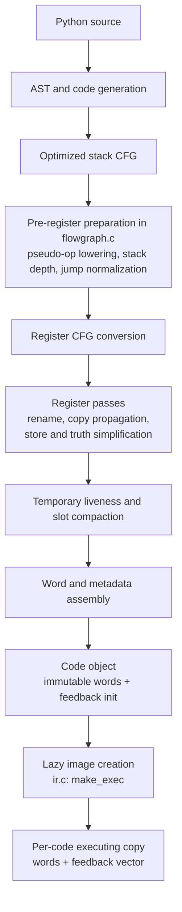

# Register IR: current contract

This page describes the active integration runtime at
`/home/power/code/cpython/.worktrees/python-boil-the-ocean/build/worktrees/execution-boundaries-20261108`:
integrated commit `4b3d739d867`, containing the operand, boolean-boundary and
discarded-result changes. Release and debug each passed 54,421 full-suite tests;
debug passed on retry after an unexplained profiling failure, retained in the
[investigation](../issues/execution-boundaries-20261108/profiling-investigation.md).
Performance promotion is withheld after repeated broad regressions; see the
[candidate report](../issues/execution-boundaries-20261108/report.md). The
immutable golden baseline remains `0765e9be47f`, qualified at functional
`0267d428808`; its [report](../bench/results/interpreter-parity-20261108.md)
does not qualify these new changes.

This is an as-built contract. The archived [register IR history](archive/register-ir-20261108.md)
keeps dated decisions; [compiler and IR](compiler-and-ir.md),
[call/frame lifetimes](call-and-frame-lifetimes.md), and the
[observer contract](handler-and-observer-contract.md) cover deeper details.
Ownership choices do not make prompt finalization a Python language rule; see
[language and lifetime policy](lifetimes-and-language-semantics.md).

## Producer path



`Python/compile.c` sequences CFG optimization, `_PyCfg_OptimizedCfgToRegCfg`
and code-object assembly. The register CFG and passes are in `Python/regcfg.c`
and `Python/regcfg_passes.c`; word emission is in `Python/assemble.c`.
Line and exception tables use the same word-index coordinate system. There is
no runtime stack-bytecode lowering stage.

## Word format and operands

`Include/internal/pycore_ir.h` defines `_PyIRWord`, an eight-byte word:

```
 63      52 51      40 39      28 27      16 15       0
+----------+----------+----------+----------+----------+
|    D     |    C     |    B     |    A     |  handler |
+----------+----------+----------+----------+----------+
```

The low 16-bit handler selects the operation. A, B, C and D are 12-bit fields;
CD is the 24-bit value `C | (D << 12)`. There are no prefix words. Handler
metadata in `pycore_ir_metadata.h` and generated dispatch in
`Python/generated_ir_cases.c.h` define each handler's field roles and effects.

- Slots share `localsplus` numbering: locals, cells, hidden scalar constant
  homes, free variables, then compiler temporaries. A slot field addresses 0–4094; `0xFFF` is
  also `IR_NO_DST`, the encoding for an unused/discarded destination.
- Register-form operations name a destination and their inputs. Inputs are
  ordered bottom-first; stores name the target/object before the stored value.
- Window-form operations name a base slot and access consecutive inputs by
  offset. Call preparation and unpack operations use this form.
- An immediate may be a count or local index in one field, or a constant/name
  index in CD. A feedback index points into the executing copy's feedback
  vector. Some operations store an operation argument in feedback metadata.
- Ordinary jumps carry an absolute word index in CD. `FOR_ITER`, `SEND`, and
  fused compare-and-jump handlers carry a signed word distance in D from the next
  instruction. `FOR_ITER` and `SEND` use forward distances; fused
  compare-and-jumps are forward-only. The assembler relaxes long loop exits and
  leaves out-of-range fused branches unfused.

The generator's format metadata describes reads, writes, destination,
feedback/immediate location, branching, and declared effects. These facts drive
verification, register allocation/compaction, instrumentation and handler
generation; they are not a native-JIT recovery map.

## Constants, temporaries and jumps

Only eligible inline scalar loop constants receive hidden homes in the frame's
`localsplus` array. Other constants use ordinary constant-loading forms. Hidden
constant homes and local/cell/freevar slots are fixed before temporary slot
compaction. The compiler assigns temporary registers from the remaining slot
range and rewrites them densely after liveness analysis.

All physical homes are initialized to a valid `PyValue` or NULL. Compaction
tracks occupied owners through their consumption, not only future reads; a
live owner may need cleanup despite having no later program read. The
verifier checks slot ranges, window extents, destination legality, and jump
boundaries. A jump target is a word index and must land on an instruction.
Exception ranges and source lines are likewise expressed in word offsets.

## Execution copy, feedback and NOP anchors

`Python/ir.c:make_exec` allocates one `_PyCodeExec` per code object, shared by
frames and threads under the free-threaded publication protocol. It contains a
copy of the immutable words and, when needed, feedback storage. Specialization
and monitoring change the handler field of executing words; free-threaded
specialization is disabled. Immutable code-object
words remain the source template. Feedback entries hold borrowed pointers and
counters, not GC-owned references. Entry zero is a shared header-only entry.

Specialization can select six execution-only refinements after slot allocation.
They change only the handler field of the executing copy; the eight-byte format
and canonical words remain unchanged.

| Refinement | Selection and removed ordinary work |
| --- | --- |
| `LOAD_ATTR_SHAPE_LOCAL_TEMP` | Local receiver, temporary result; input class and destination class are static, so the handler does not rediscover them |
| `POP_JUMP_IF_FALSE_BOOL_SKIP_TAKEN`, `_SKIP_FALLTHROUGH`, `_SKIP_BOTH` | One ordinary NOP on the selected edge; constant continuation skips its decode and PC publication |
| `CALL_PY_EXACT_ARGS_DISCARD`, `CALL_PY_GENERAL_DISCARD` | Matching immediate call-result POP; Python return can dispose of the result without publishing its home or dispatching POP |

Each alias inherits its original instruction format, conservative effects,
family, deopt and instrumentation mappings. Generated handler facts include
`SAVES_IP`, derived from the same `no_save_ip` property that controls emitted PC
stores. Fixed opcode tables and feedback rows use canonical specialized opcodes;
physical aliases have full handler-domain rows. Adaptive disassembly displays
the canonical specialization; the internal executing-IR view exposes its alias.
These refinements do not create a Cartesian product of ownership modes.

NOP words still retain distinct source/instrumentation coordinates. For the
three bool variants, selection checks both canonical and live edges once and
requires the post-NOP successor to save its own PC before observable work.
The guarded bool interval cannot call Python, allocate, poll, suspend or
release a finalizing owner. Its ordinary continuation therefore needs neither a
NOP test nor a NOP PC store. Instrumentation resets dependent skip handlers
before patching any target. Debug and free-threaded builds do not select these
variants. The ordinary `POP_JUMP_IF_FALSE_BOOL` handler retains its prior checked
live-NOP continuation and PC publication when no skip variant is selected;
wrappers and debug lltrace retain their ordinary handling.

Call-result POP words also remain addressable. `POP_TOP` names a register
owner to retire; it does not pop a runtime operand stack. A discarded-result
variant uses
a tagged caller recipient, not a new word operand: `IR_POSTCALL_DISCARD` is a
high bit of the existing 16-bit `return_slot`; its low slot bits retain the
original temporary destination. Completion checks the live POP and its input
before direct disposal, or materializes the result for the observer path.
`IR_NO_DST` remains a separate ordinary discard sentinel. POP line/opcode observation enabled
inside a directly disposed result's finalizer starts at the next real instruction;
it does not retroactively execute the dormant POP boundary.

These are bounded execution eliminations. Canonical NOP/POP storage, word-indexed
jumps, source and exception tables, suspended positions and debugger coordinates
remain in place. General metadata-only anchors and physical word compaction
have not been implemented.

## Explicit boundary

The baseline IR is an executable register instruction stream, not optimizing
SSA. It has no machine-register allocation, deoptimization state, OSR protocol,
or general native-JIT recovery map. The current method/tracing JIT recovery
contract remains future work. The [checkpoint report](../bench/results/interpreter-parity-20261108.md)
and [status](../STATUS.md) record qualification and open work.
