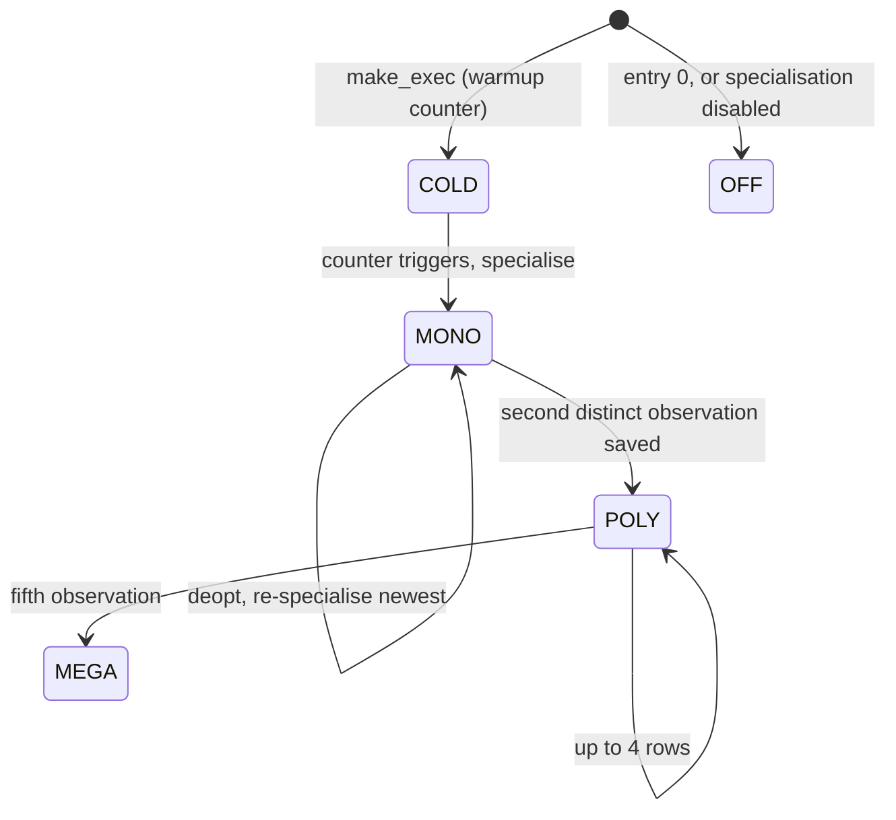

# Register IR and interpreter: design reference

This is the reference for the register IR, its compiler and the interpreter
that runs it. Section 1 specifies the design as built. Section 2 compares it
with V8 Ignition, LuaJIT 2, JSC LLInt and Lua 5.4. Section 3 records the
coordinator's decisions and lists the gaps in priority order. Section 4
proposes the one encoding revision, IR v2, that the format gaps are batched
into. Section 5 specifies the instruction contract, section 6 the interfaces
the JIT needs, and section 7 the decisions still open. Review 1
([reviews/register-ir-review-1.md](reviews/register-ir-review-1.md)) drove
the first revision, and review 2
([reviews/register-ir-review-2.md](reviews/register-ir-review-2.md)) the
second.

**Accepted after review 2 (2026-11-03).**

**Revised 2026-11-04.** The coordinator accepted the
[register IR v2 packet](proposals/register-ir-v2-packet.md) (revision 3;
[review 1](reviews/register-ir-v2-packet-review-1.md),
[review 2](reviews/register-ir-v2-packet-review-2.md)). Its edits to this
document carry the note "(revised 2026-11-04, register IR v2 packet)" or sit in
a paragraph that says so. Code counts that the packet recounted are now the
counts at `48bb4d6d1d3`.

**Source.** The working tree `build/worktrees/pyvalue-rc-universal`
(branch `boil/pyvalue-rc-universal`) at HEAD `ca8a9d6d827` (2026-11-03). None
of the files cited here had uncommitted changes when they were read. Since the
first version of this document (`5e977ec8cbb`), three commits changed cited
files: `c66a0b29253` restored the copy-propagation kill and added
`_PyIR_RUNS_CODE` (G1); `6a7b3769d62` changed which tag bits mean "owns no
count" (§1.4); and `ca8a9d6d827` made the computed-goto build share one
operand box area across handlers (§1.13, G9). Citations have the form `file:function` (or
`file:macro`). Paths are relative to that tree.

**How the facts were established.** The design facts come from reading the
source. That tree does not link yet ([STATUS](../STATUS.md)), so the IR
listings and measurements come from the interim reference-counted build
`build/rc-integrated-release-20261101` (commit `eba351fee7d`, 2026-11-01),
with `dis` taken from the same commit. Between `eba351fee7d` and `5e977ec8cbb`,
`Python/regcfg.c`, `Python/regcfg_passes.c` and `Include/internal/pycore_regcfg.h`
did not change. The `assemble.c` changes port the code to the value API and do
not change the encoding. Numeric handler values printed below come from the
interim build and may differ in the tree; names are stable. The static
measurements in §2.3 compile the 2,071 `.py` files of upstream `3a440b6`'s
`Lib/` (99,831 code objects; 11 test files with deliberate syntax errors fail)
with that build and with the upstream release build
`build/upstream-release-3a440b6`. The measurement scripts are in
[`pyjit/bench/ir/`](../bench/ir/); §2.3 and §2.4 say what each one counts.

Facts about the other VMs come from their public designs (V8
`src/interpreter/bytecodes.h`, LuaJIT `src/lj_bc.h` and the bytecode wiki
page, JSC `BytecodeList.rb` and LLInt, Lua 5.4 `lopcodes.h`), not from code
in this repository. They have not been re-verified for this note, except the
dispatch-state and save-PC facts in §2.1, which review 1 of the v2 packet
checked against the primary sources.

---

## 1. Specification as built

### 1.1 Overview

The compiler emits the register IR directly. There is no stack bytecode at run
time, no lowering at the first call, and no map back to bytecode offsets. A code
object holds one immutable 64-bit word per instruction, followed by a feedback
initialisation table. The first call makes an *executing copy* of the words, with
a feedback vector after them. Specialisation and instrumentation rewrite only the
16-bit handler field of that copy. The interpreter is generated C: one handler per
handler index, dispatched by computed goto or by tail calls.

After the interpreter checkpoint, `co_code` and the `.pyc` return to stack
bytecode and the IR becomes a hidden cache lowered from it
([proposal](proposals/stack-bytecode-recovery.md)).

```mermaid
flowchart LR
    src[source] --> ast[AST / codegen.c]
    ast --> fg["stack CFG<br/>flowgraph.c:_PyCfg_OptimizeCodeUnit"]
    fg --> prep["_PyCfg_OptimizedCfgToRegCfg:<br/>pseudo-op lowering, copy_local_as_load,<br/>stack depth, normalize_jumps,<br/>optimize_load_fast"]
    prep --> conv["register CFG<br/>regcfg.c:convert"]
    conv --> passes["passes (regcfg_passes.c):<br/>SWAP renaming, copy propagation,<br/>store elimination, POP_TOP, truth folding"]
    passes --> compact["liveness + slot compaction<br/>regcfg.c:_PyRegCfg_Compact"]
    compact --> asm["assembler<br/>assemble.c:assemble_words"]
    asm --> co["code object:<br/>co_words, feedback init table,<br/>line table, exception table"]
    co -->|first call: ir.c:make_exec| exec["executing copy:<br/>words + feedback vector"]
    exec --> interp["generated handlers<br/>generated_ir_cases.c.h"]
    interp -->|specialize.c rewrites handler field,<br/>writes feedback| exec
    mon["sys.monitoring<br/>instrumentation.c:set_word_opcode"] -->|rewrites handler field| exec
```



`Python/compile.c:optimize_and_assemble_code_unit` drives the pipeline:
`_PyCfg_OptimizeCodeUnit`, then `_PyCfg_OptimizedCfgToRegCfg` (which calls
`_PyRegCfg_Build`), then `_PyAssemble_MakeCodeObject`. `_PyCompile_Assemble`
runs the same chain for synthetic CFGs.

### 1.2 The instruction word

`Include/internal/pycore_ir.h`:

```
 63      52 51      40 39      28 27      16 15       0
+----------+----------+----------+----------+----------+
|    D     |    C     |    B     |    A     |  handler |
+----------+----------+----------+----------+----------+
              \_____ CD (24 bits) _____/
```

- `handler` (16 bits) indexes the dispatch table. A handler that stands for a
  real opcode has that opcode's number. Handlers that exist only in the IR
  (`IR_JUMP`, `BINARY_OP_ADD` and the other per-operation `BINARY_OP` handlers,
  the `*_NOFB` forms, and the JIT admission handlers) are numbered from
  `IR_FIRST_ONLY_HANDLER` (267), after the pseudo-instructions, so one number
  names one thing (`pycore_ir_metadata.h`). There are `IR_NUM_HANDLERS` = 305
  numbers. 293 of them have a valid format, and 292 have a generated `TARGET`.
- A, B, C and D are 12-bit fields (`IR_FIELD_MAX` = 0xFFF). C and D together
  form the 24-bit field CD (`IR_CD_MAX` = 0xFFFFFF).
- `IR_WORD(H, A, B, C, D)` builds a word, and `IR_A()`…`IR_CD()` and
  `IR_HANDLER()` take it apart.
- Nothing else is encoded. There is no `EXTENDED_ARG`, prefix, second word or
  flag bit. `EXTENDED_ARG` keeps an opcode and a format, but no word in the Lib
  corpus uses it.

Each field plays one **role**. The format of the handler fixes the roles
(`_PyIRFormat.roles`):

| Role | Contents |
|---|---|
| `DST` | slot of the first output |
| `IN0+k` | slot of input *k* of a register-style instruction, bottom of stack first; a store names the object first and the value last |
| `BASE` | slot of the deepest input of a window-style instruction |
| `FB` | index of the instruction's entry in the feedback vector of the executing copy |
| `IMM` | the oparg: a count or local index in a 12-bit field; a constant or name index in CD; for a jump, the **absolute** word index of the target in CD; for `FOR_ITER` and `SEND`, the forward distance in words from the next word to the exit, in D |

`_PyIRFormat` (generated into `pycore_ir_metadata.h` by
`Tools/cases_generator/ir_metadata_generator.py`) also records:

- where the oparg lives (`imm`): one of the fields A–D, CD, `FBARG` (the `arg`
  field of the feedback entry) or nowhere;
- where the feedback index lives (`fb`);
- `ninputs`, the number of register-style inputs;
- `dst`, the offset of dst from the stack depth before the instruction (or from
  `base` for window style);
- `borrow_mask`, the inputs that a folded local load may name. A field that
  names a local is borrowable only if no uop of the instruction may keep the
  input (store it, or pass it to a function not known to only read it).
  Stores (`STORE_FAST`, `STORE_DEREF` and their pairs) take an owned
  temporary. The generator releases an in-place input only if its field names
  a temporary (`if (!IR_IS_LOCAL(F))`), and gives it a count where the
  handler keeps it (`IR_INPLACE_OWN`, `IR_INPLACE_HEAP_SAFE`,
  `IR_INPLACE_OBJECT_STEAL`). It keeps out of `borrow_mask`, or refuses, any
  other use of the value itself, of its copies (which may go only to stack
  variables), and of its object read by `PyValue_AsKnownObjectBorrow` (which
  may not reach a function that takes over or releases it). It also refuses
  any merge where paths disagree on whether a value borrows a local. A
  pointer that leaves through any other expression is not covered by the
  typed borrow (pyvalue.md G6, step A5b), which types `PyValue` words only.
  A5b's generator keeps a checked list of readers for derived `PyObject *`
  pointers and takes an input out of `borrow_mask` for any other use
  ([A5b §4.7](proposals/register-ir-v2-a5b.md));
- `shadow`, the stack instruction that the handler stands for;
- `nofb`, the NOFB form of the handler;
- flags: `WINDOW`, `JUMPS` (oparg is an absolute target), `FORWARD` (oparg is a
  forward distance), `NO_FOLD` (an output may alias a borrowed input),
  `TRANSPARENT` (runs another handler on the same fields), `STORE_DST` (dst
  may name a local, which makes store elimination legal) and `RUNS_CODE` (a
  member may run Python code: it escapes, polls the eval breaker, switches
  frames, or is an instrumented twin; `ir_generator.py:runs_code`). `RUNS_CODE`
  is 128 and fills the `uint8_t` flags field.

The members of a family, their instrumented twins and the IR-only handlers named
after a member all share one format. Specialisation and instrumentation can
therefore change the handler without touching the operand fields (header comment
in `Tools/cases_generator/ir_generator.py`).

### 1.3 Register style and window style

The generator chooses the style from the stack effect in `Python/bytecodes.c`.

- **Register style.** Every input is a scalar, and dst, the inputs, the
  feedback index and the oparg fit in four fields. Example:
  `BINARY_OP_ADD_INT {A: dst, B: in0, C: in1, D: fb}`.
- **Window style.** Used for instructions with array inputs, instructions that
  do not fit four fields, and those annotated `window`. The word names dst (if
  it sits at a fixed offset) and `base`. Inputs are read from consecutive slots
  `base, base+1, …`, and output *j* is written to `base + j`. Example:
  `CALL {A: dst, B: base, C: argc, D: fb}`, where the window is
  `[callable, self_or_null, args…]`. 83 handlers are window style. They use
  10 distinct field layouts (G4 lists them); counting flags, dst offset and
  input count too, there are 19 distinct window formats and 64 formats in
  all.

Representative generic formats (from `pycore_ir_metadata.h`):

| Handler | A | B | C | D | oparg in | notes |
|---|---|---|---|---|---|---|
| `LOAD_FAST_BORROW` | dst | imm (local) | – | – | B | a move into a temporary, mostly a window operand |
| `LOAD_CONST` | dst | – | imm | imm | CD | constant index |
| `LOAD_SMALL_INT` | dst | imm | – | – | B | value in B |
| `STORE_FAST` | in0 | imm (local) | – | – | B | survives only where store elimination fails |
| `BINARY_OP` | dst | in0 | in1 | fb | FBARG | operation is also the handler: `BINARY_OP_ADD`… |
| `COMPARE_OP` | dst | in0 | in1 | fb | FBARG | `COMPARE_OP_NOFB` past the entry limit |
| `LOAD_ATTR` | dst | in0 | fb | – | FBARG | name in the entry; `LOAD_ATTR_NOFB` past the limit |
| `STORE_ATTR` | in1 (owner) | in0 (value) | fb | – | FBARG | |
| `LOAD_GLOBAL` | dst | fb | – | – | FBARG | C and D unused |
| `STORE_SUBSCR` | in1 | in2 | in0 | fb | – | container, key, value |
| `POP_JUMP_IF_FALSE` | in0 | fb | imm | imm | CD | absolute target |
| `JUMP_BACKWARD` | – | – | imm | imm | CD | absolute target; no feedback field |
| `FOR_ITER` | dst | base | fb | imm | D | window `[iter, null_or_index, next]`; dst may be the loop variable |
| `CALL` | dst | base | imm (argc) | fb | C | window `[callable, self_or_null, args…]` |
| `CALL_FUNCTION_EX` | dst | base | fb | – | – | |
| `BUILD_LIST` | dst | base | imm (count) | – | C | |
| `UNPACK_SEQUENCE` | base | imm | fb | – | B | the sequence sits at base; outputs overwrite the window |
| `IMPORT_NAME` | dst | base | imm | imm | CD | |
| `RETURN_VALUE` | in0 | – | – | – | – | |

**Slot operands hidden in `IMM`.** Some formats encode a slot as an oparg, so
a def-use analysis built from roles alone misses them:

- `LOAD_FAST*` and `LOAD_FAST_AND_CLEAR` read slot B (and the latter clears
  it);
- `STORE_FAST` and `DELETE_FAST` write slot B and release its old value;
- `LOAD_DEREF`, `STORE_DEREF` and `MAKE_CELL` use the cell held in slot B.

The generator knows these as `imm_kind`, but `_PyIRFormat` does not export
it. The instruction contract (§5) gives them slot roles.

### 1.4 Register file

A frame's slots form one array of `PyValue`. `_PyFrame_Slots()` returns
`frame->base`, and the handlers keep that pointer as `slots`:

```
slot 0 ............ co_nlocalsplus-1 | co_nlocalsplus ............ +co_stacksize-1
locals, cells, free variables         | temporaries (canonical first, then compacted)
```

- Slots are numbered as in `localsplus`, so a field names a local, a cell, a
  free variable or a temporary with one index (`pycore_ir.h`). `co_stacksize`
  is now the number of temporary slots that compaction assigns, not the stack
  depth (`assemble.c:_PyAssemble_MakeCodeObject`).
- **The NULL invariant.** Every slot holds a value or NULL. A temporary that has
  not been written, or that a handler has consumed, is NULL. A handler that
  consumes a temporary input takes its reference and stores NULL
  (`ceval_macros.h:IR_CONSUME_INPUT`). A handler writes a temporary only into a
  NULL slot, which debug builds assert (`IR_STORE_TEMP`). A handler that writes a
  local releases the old value after the write (`IR_STORE_DST`). A returning
  frame has only NULL temporaries (`_PyFrame_AssertTemporariesClear` in
  `bytecodes.c:_RETURN_VALUE`).
- **Ownership is two facts, and the code merges them.**
  1. **Slot class**: whether a field names a frame variable (local, cell or
     free variable, below `co_nlocalsplus`) or a transfer temporary. It
     decides the *slot transfer*: a handler that reads a temporary takes the
     value and NULLs the slot; one that reads a frame variable leaves it in
     place. Today the handler decides it at run time: `IR_IS_LOCAL(F)`
     compares the field with `nlocalsplus`, which it loads from the
     `_PyCodeExec` header just before the words
     (`ceval_macros.h:IR_NLOCALSPLUS`).
  2. **Value tag**: whether the reference in hand owns a count. A
     pointer-space reference owns a count only if all its tag bits are clear
     (`Py_OWNED_MASK` includes `Py_TAG_BITS`). Since step A5a no frame slot
     holds a borrow, so bit 0 in a frame slot means only "immortal".

  The two now agree on the tag, and still differ on the transfer.
  `LOAD_FAST_BORROW` into a temporary takes a count for a mortal object
  (`PyValue_DUP`), so the temporary owns its value. An in-place read of a
  local is an untagged borrow in the handler's C variable
  (`IR_LOAD_BORROWED(F)`, which is `IR_SLOT(F)`; `PyValue_BorrowAt` returns the
  slot's bits). In debug builds `_PyValue_CheckFrameHome` rejects a mortal
  with bit 0 in a frame slot, and window consumers recheck their window
  (`_PyValue_RecheckWindow`); release builds take no window counts.
  `IR_IS_LOCAL` and the macros built on it (`IR_CONSUME_INPUT`,
  `IR_STORE_DST`, `IR_INPLACE_OWN`, `IR_INPLACE_HEAP_SAFE`,
  `IR_INPLACE_OBJECT_STEAL`), with `IR_STORE_INPUT`, `IR_STORE_TEMP_DST` and
  `IR_MOVE_TO_DST`, appear on 1,040 lines in 211 handlers of the generated
  file (recounted at `48bb4d6d1d3`, before A5a removed `IR_BORROW_KNOWN` and
  `IR_DROP_BORROW`; not recounted since).

  **A5b, in implementation (target design, nothing landed).** The generator
  emits, for each borrowable field, a view and an owner
  ([proposal](proposals/register-ir-v2-a5b.md) §4.2):

  * `x` is a `PyValueBorrow`, set once by `IR_VIEW(F)`, the one load of the
    slot.
  * `ir_own_F` is a `PyValue`: `PyValue_NULL` for a local, else adopted from
    the word the view already loaded. `_PyIR_AdoptTemp` does the adoption. It
    is private to `ceval_macros.h`, and the same expression that adopts the
    word clears the temporary's slot, so the count moves from the slot to the
    C local.
  * A release is `PyValue_XCLOSE(ir_own_F)`. The conditional
    `if (!IR_IS_LOCAL(F))` releases, `IR_INPLACE_*`, `IR_KEEP_BOX` and
    `IR_LOAD_BORROWED` go.
  * The DSL form `TAKE(x)` is for a value that goes to a home. It takes a
    count for a local (`DUP`) and passes the owner on for a temporary.
    `OWNER(x)` is the input's own owner, NULL for a local, for a receiver
    that is held only so that `IR_RETIRE_PUBLISHED` can release it. It needs
    no count.
  * The consume (`IR_CONSUME_INPUT(F, x)`) happens at the DSL consume point or
    at the first `TAKE` or `OWNER`, whichever comes first, so the slot never
    shares a count with a taken value.
  * The generator refuses a view of a local that is read after an escaping
    call in the same instruction, unless the value was taken (`TAKE`) or the
    owner was taken (`OWNER`) before the call. The fix is a `TAKE` before the
    escape, or the input leaves `borrow_mask`.

  A JIT must preserve the slot class at every word boundary: a temporary
  that the next word consumes must hold a value, and every other temporary
  must be NULL. It must preserve the value tag wherever a value is stored to
  a home, because the tag says whether the store transfers a count. Decision
  IR-D3 (§3) makes the slot class static, in the instruction. A5a already
  limits the tag in a frame slot to "immortal".
- **Why NULL, and what it costs.** There is no stack pointer. The GC
  traversal of frames, frame walkers and the unwinder
  therefore cannot tell a dead temporary from a live one except by its
  contents, so a consumed temporary must be NULL. That costs a store per
  consumed temporary (`IR_CONSUME_INPUT`), which neither the stack machine
  (whose stack pointer bounds the live region) nor V8 nor LuaJIT pays. On
  the kernels that is at most 0.66–1.21 NULL stores per executed word (§2.4); G9
  lists it as an item to measure in time.
- **Cells and free variables** are ordinary slots that hold cell objects.
  `MAKE_CELL` and `COPY_FREE_VARS` run before `RESUME`. `LOAD_DEREF` and
  `STORE_DEREF` name the slot in a field.
- **Canonical temporaries.** At the entry of a block reached by a jump or by more
  than one edge, and at an exception handler, the value at stack position *k* is
  in slot `nlocalsplus + k`. Predecessors therefore agree without phi nodes
  (`pycore_regcfg.h`, "Virtual registers").
- **Windows.** The inputs of a window are consecutive slots. Compaction keeps
  them that way, and the verifier checks it (`regcfg.c:_PyRegCfg_Verify`).
- **Values.** A slot holds a `PyValue`: a tagged 64-bit value that can hold an
  inline int or float, or an object pointer whose bit 0 (`Py_TAG_REFCNT`) means "immortal".
  On every store the handlers *publish* boxed int and float objects in canonical
  inline form (`pycore_value.h:_PyValue_Publish`).

#### State at a word boundary

Between two words the interpreter holds this state, and a JIT exit, an OSR
entry, a debugger or a generator resume must reproduce it:

| Item | Rule | Where |
|---|---|---|
| Slots below `co_nlocalsplus` | the frame variables, each a value or NULL (unbound) | `pycore_ir.h` |
| Temporaries | a value exactly where a later word reads it before any write; NULL everywhere else | NULL invariant; `_PyFrame_AssertTemporariesClear` at return |
| Value tags in slots | owned or immortal only (since A5a, `3e28e1755bd`) | `pycore_value.h` |
| Constant slots (G6) | from frame entry onward, each holds its constant; OSR entry, a JIT exit and generator resume must preserve them; the verifier treats them as written once | G6 |
| `frame->instr_ptr` | valid at every observation point (a call out, a raise, a monitoring event, a deoptimisation); built, 289 of 292 handlers store it on entry, and G9.1 would store it only on escaping and error paths, in which case a JIT exit sets it before it leaves | §1.13 |
| `frame->return_slot` | for a frame with a pending call or a suspended `SEND`/`YIELD_VALUE`, the caller's slot that receives the result | §1.12 |
| Exception state | at a handler, the slot named by the exception entry holds the exception, and `lasti` is pushed below it when the entry asks | §1.9 |
| Feedback | not part of the frame state; any value is correct | §1.10 |

Liveness is computed by `_PyRegCfg_Liveness` for compaction and then
discarded. A consumer that needs it must recompute it from the words, which
needs the slot reads and writes of every word, including those hidden in
`IMM` (§1.3). Whether to emit liveness or recompute it is open decision O2
(§7).

### 1.5 Compiler pipeline

#### 1.5.1 Stack CFG front end

`flowgraph.c:_PyCfg_OptimizeCodeUnit` is the upstream CFG optimiser: jump
threading, constant folding, dead-code removal, cold blocks moved to the end,
and line-number resolution. `flowgraph.c:_PyCfg_OptimizedCfgToRegCfg` then:

1. lowers pseudo conditional jumps (`convert_pseudo_conditional_jumps`);
2. turns a `COPY` of a just-loaded local into a second load of the local
   (`copy_local_as_load`), so that the second load can borrow;
3. computes the stack depth, prepares `localsplus`, lowers pseudo-ops and
   normalises jumps;
4. runs `optimize_load_fast`, which decides which loads may borrow
   (`LOAD_FAST_BORROW`);
5. removes redundant NOPs. **No superinstructions** are formed; the comment
   says the register CFG folds loads instead;
6. hands over the blocks in layout order, with targets and handlers as block
   indices (`cfg_to_regcfg`, which calls `_PyRegCfg_AddBlock` and
   `_PyRegCfg_AddInstr`), and calls `_PyRegCfg_Build`.

The flowgraph also drops a `TO_BOOL` before a conditional jump. The jumps test
the truth of any value and specialise as `TO_BOOL` does (`bytecodes.c`, comment
on the `POP_JUMP_IF_FALSE` family).

#### 1.5.2 Conversion to registers

`regcfg.c:convert` and `convert_instr` simulate the stack with *virtual
registers*. A register below `nlocalsplus` is a local. `_PyReg_CANON(k)` is
the canonical temporary of stack position *k*. Registers from
`_PyReg_FRESH0` up are fresh temporaries, each defined once and live within one
*region*: a chain of blocks that only fall through into each other
(`mark_blocks`). `canonicalise` renames a fresh register to its canonical name:

- at every jump, for the target;
- at the end of a region;
- below the handler depth of any op that has an exception handler.

An op records the stack instruction it stands for (`_PyRegOp.opcode`), so the
opcode metadata and IR format still apply. It also records:

- `in[]`, with the popped inputs on top;
- `nimplicit`, the values that a raise leaves for the unwinder;
- `out[]`, the outputs;
- `dst`, a local written in place of `out[]`;
- `target`, `except`, the stack depth and the source location.

#### 1.5.3 Passes

`regcfg.c:run_passes` runs each pass once, in this order. Debug builds run the
verifier after each pass.

| Pass | Function | Effect |
|---|---|---|
| SWAP renaming | `regcfg_passes.c:_PyRegPass_SwapRename` | A `SWAP` whose outputs are all read by one register-style reader is removed by permuting that reader's inputs (augmented attribute and subscript stores). |
| Copy propagation | `_PyRegPass_CopyProp` | A `LOAD_FAST_BORROW` whose only reader takes the value in a borrowable field disappears; the reader names the local. The pass keeps a load if the line changes before the reader. A write to the local, or an op whose format has `RUNS_CODE`, kills the pending load (`c66a0b29253`; gap G1, done). |
| Store elimination | `_PyRegPass_StoreElim` | A `STORE_FAST z` of a value from a `STORE_DST`-format producer becomes the producer's dst = z. It requires the same line, and nothing in between may raise, escape, jump, read or write z, or read the value. |
| POP_TOP of a pure value | `_PyRegPass_PopTop` | A pure producer whose inputs are all locals is removed together with its `POP_TOP`. A `NOP` keeps the line event if nothing else is left on the line. |
| Truth folding | `_PyRegPass_TruthFold` | `COPY 1; POP_JUMP_IF_x; [NOT_TAKEN]; POP_TOP` becomes `JUMP_IF_x_OR_POP` (for `and` and `or` in value context). |

Every pass rewrites fresh temporaries only. Canonical temporaries carry values
across edges and stay as the conversion made them (`regcfg_passes.c` header).

**The pass order is load-bearing.** Copy propagation is sound only because it
runs before store elimination. `RUNS_CODE` is a property of the format, but
whether a word may run Python code also depends on its operands. A
`STORE_DST` word whose dst names a local releases the local's old value
(`IR_STORE_DST` calls `IR_RETIRE_LOCAL`), and that can run
`__del__`, which can rebind any local through `frame.f_locals`. `LOAD_CONST`,
`LOAD_SMALL_INT_INLINE`, `LOAD_FAST_BORROW`, `LOAD_DEREF` and `PUSH_NULL` are
`STORE_DST` formats without `RUNS_CODE`. While copy propagation runs, every
store to a local is still a `STORE_FAST` (which has `RUNS_CODE`); only store
elimination, later, moves stores into dst fields. Running copy propagation
after store elimination, or folding a load in a later pass, would reintroduce
G1 silently. The instruction contract (§5) states this per word: "may run
Python" is the format's effect, plus "releases the old value of a local" when
a dst operand names a local. The verifier should then reject a folded load
whose reader comes after any word whose operand-dependent effect may run
Python, which makes the order a checked rule rather than a convention.

#### 1.5.4 Liveness and compaction

`regcfg.c:_PyRegCfg_Liveness` runs a backward fixed point over blocks and
exception edges, with bit sets over temporaries. `_PyRegCfg_Compact` (with
`compact_op`) gives every temporary a slot. Slots are handed out LIFO rather
than freed at the last read: a value holds its slot until an op takes it,
because a value that no op takes (an iterator under a loop that never exits)
must not be overwritten. The rules are:

- a temporary takes the lowest slot above every slot held at its definition;
- a canonical temporary takes the slot of its stack position;
- window outputs go where their window is;
- a folded load under a temporary that its reader also reads reserves a slot
  until the reader runs (`reserve_folded`, `release_folded`).

These rules guarantee three properties, which `_PyRegCfg_Verify` checks:

- a window's inputs are consecutive;
- temporaries live across an exception handler's range lie below the
  handler's first slot;
- a temporary live across a call lies below the call's window.

The second property lets the unwinder clear everything from the handler's first
slot upwards. The third lets the callee's frame overlap the window
(`regcfg.c:overlapping_call` lists `CALL_PY_EXACT_ARGS` and
`CALL_BOUND_METHOD_EXACT_ARGS`). A debug build prints the register CFG after
each stage when `PYTHONREGCFGDUMP` is set (`regcfg.c:dump`).

#### 1.5.5 Assembly

`assemble.c:assemble_words` works in five steps:

1. **Checks the frame.** It raises `SyntaxError` if
   `nlocalsplus + ntemps > IR_MAX_SLOTS` (`assemble.c:943`; corrected
   2026-11-04, register IR v2 packet). Compaction may already have failed
   with "too many temporaries" (`regcfg.c:occ_take`).
2. **Chooses handlers** (`choose_handler`):
   - `BINARY_OP` becomes `_PyIR_BINARY_OP_FIRST + op`;
   - `LOAD_SMALL_INT` becomes `LOAD_SMALL_INT_INLINE`;
   - a `LOAD_CONST` of an inline int or inline float becomes
     `LOAD_CONST_INLINE_INT` or `LOAD_CONST_INLINE_FLOAT`;
   - every other op keeps its opcode.
3. **Numbers the feedback entries** (`assign_handlers`). Entry indices are
   assigned from 1 in op order. Past `IR_FIELD_MAX`, sites share entry 0, and a
   handler whose static operand lives in its entry switches to its NOFB form.
4. **Lays out the words** (`layout`). It iterates until no `FOR_ITER` or `SEND`
   exit is further than `_PyIR_MaxForward` words. Each relaxed loop grows to 4
   or 3 words with `IR_JUMP` trampolines. It raises `SyntaxError` past 2^24
   words (`too_large`, `assemble.c:716`; corrected 2026-11-04).
5. **Encodes** (`encode`). Each role's value goes into its field. For a jump,
   the oparg is the absolute target word (`handler_oparg`). A slot field in
   unreachable code that does not fit becomes 0.

The same function writes the 32-bit feedback initialisers
(`_PyIR_FBINIT(kind, arg)`, one per entry). `assemble_exception_table` and
`assemble_location_info` then write the exception and line tables in word
units.

### 1.6 Instruction families

Static frequencies are percentages of all 4.57M words in the Lib corpus (§2.3).

| Group | Handlers (generic, with notable specialisations) | Style | Notes |
|---|---|---|---|
| Moves | `LOAD_FAST_BORROW` (4.9%), `LOAD_FAST`, `LOAD_FAST_CHECK`, `LOAD_FAST_AND_CLEAR`, `STORE_FAST` (0.9%), `DELETE_FAST`, `COPY` (1.3%), `SWAP` (1.3%), `POP_TOP` (7.5%), `PUSH_NULL` (2.6%) | register / window | Most moves of locals fold away. The rest feed windows (calls, `with`, comprehensions), cross blocks, or drop a result (`POP_TOP` after `CALL`: 229,553 static pairs, counting every `CALL*` family, intrinsics and `CALL_FUNCTION_EX` included). |
| Constants | `LOAD_CONST` (9.8%), `LOAD_CONST_INLINE_INT/FLOAT`, `LOAD_SMALL_INT_INLINE` (3.0%), `LOAD_COMMON_CONSTANT` (5.1%) | register | Every constant takes a word and a temporary; no handler takes a constant operand (§1.7). |
| Arithmetic | `BINARY_OP_<op>` × 27 (one per `NB_*`, `NB_ADD`…`NB_SUBSCR` = 0–26), `BINARY_OP_ADD_INT`, `_FLOAT`, `_UNICODE`, `_EXTEND`, …, `UNARY_*`, `CALL_INTRINSIC_1/2` | register | Specialisations deoptimise to the per-operation handler that the entry records (`IR_DEOPT_BINARY_OP`). |
| Compare and test | `COMPARE_OP` (+ `_INT`, `_FLOAT`, `_STR`), `CONTAINS_OP` (+ `_DICT`, `_SET`), `IS_OP`, `TO_BOOL` (only for `not not x`) | register | Each produces a value in a temporary; a branch is a separate word. |
| Branches | `POP_JUMP_IF_FALSE/TRUE` (+ `_BOOL`, `_INT`, `_STR`, `_LIST`, `_NONE`, `_ALWAYS_TRUE`), `POP_JUMP_IF_NONE/NOT_NONE`, `JUMP_IF_FALSE/TRUE_OR_POP`, `JUMP_FORWARD`, `JUMP_BACKWARD`, `JUMP_BACKWARD_NO_INTERRUPT`, `IR_JUMP`, `NOT_TAKEN` (1.8%) | register | Conditional jumps test truth and specialise on the operand type. Every execution records the taken bit in a 16-bit history (`RECORD_BRANCH_TAKEN`). |
| Attributes, globals, subscripts | `LOAD_ATTR` (+ 14 forms: `_INSTANCE_VALUE`, `_SLOT`, `_SHAPE`, `_MODULE`, `_METHOD_*`, `_PROPERTY`, …), `STORE_ATTR` (+ 5), `LOAD_SUPER_ATTR`, `LOAD_GLOBAL` (+ `_MODULE`, `_BUILTIN`), `STORE_GLOBAL`, `LOAD_NAME`, `STORE_NAME`, `BINARY_OP_SUBSCR_*`, `STORE_SUBSCR` (+ `_DICT`, `_LIST_INT`), `BINARY_SLICE`, `STORE_SLICE`, `DELETE_SUBSCR` | register | Name and global indices live in the feedback entry (`FBARG`). |
| Calls and windows | `CALL` (+ 20 forms), `CALL_KW` (+ 3), `CALL_FUNCTION_EX` (+ 2), `BUILD_LIST/TUPLE/SET/MAP/SLICE/STRING/TEMPLATE/INTERPOLATION`, `LIST_APPEND/EXTEND`, `SET_ADD/UPDATE`, `MAP_ADD`, `DICT_MERGE/UPDATE`, `MAKE_FUNCTION`, `SET_FUNCTION_ATTRIBUTE`, `UNPACK_SEQUENCE` (+ 3), `UNPACK_EX` | window | Calls have the `STORE_DST` format; a result can go straight to a local. |
| Iteration | `GET_ITER` (+ `_SELF`, `_VIRTUAL`; register style), `FOR_ITER` (+ `_LIST`, `_TUPLE`, `_RANGE`, `_GEN`, `_VIRTUAL`), `END_FOR`, `POP_ITER`, `GET_LEN` | window, except `GET_ITER` | The exit distance lives in D. An exhausted iterator jumps past `END_FOR`; `END_FOR` runs only when a generator returns into the loop. |
| Exceptions | `PUSH_EXC_INFO`, `POP_EXCEPT`, `CHECK_EXC_MATCH`, `CHECK_EG_MATCH`, `RAISE_VARARGS`, `RERAISE`, `CLEANUP_THROW`, `WITH_EXCEPT_START` | mixed | Zero-cost table (§1.9). Cleanup code makes up about 5% of static words and sits in cold blocks. |
| Generators and async | `RETURN_GENERATOR`, `YIELD_VALUE`, `SEND` (+ `_GEN`, `_ASYNC_GEN`, `_VIRTUAL`), `END_SEND`, `GET_AWAITABLE`, `GET_AITER`, `GET_ANEXT`, `END_ASYNC_FOR` | window | A suspended frame records the slot that receives the sent value in `return_slot`. |
| `with` and `match` | `LOAD_SPECIAL`, `WITH_EXCEPT_START`, `MATCH_CLASS`, `MATCH_KEYS`, `MATCH_MAPPING`, `MATCH_SEQUENCE` | window / register | `LOAD_SPECIAL` is window style, because register-style outputs could overlay a folded input. |
| Imports | `IMPORT_NAME`, `IMPORT_FROM` | window / register | Name index in CD. |
| Frame entry | `RESUME`, `MAKE_CELL`, `COPY_FREE_VARS` | – | `RESUME` is skipped when it has nothing to do (§1.13). |
| JIT admission (executing copy only) | `CALL_JIT_WARM`, `JUMP_BACKWARD_JIT_WARM`, `RESUME_JIT` | as their base | Never emitted by the compiler (`ir_generator.py: EXEC_ONLY`). |
| Instrumentation | 24 `INSTRUMENTED_*` handlers; `INSTRUMENTED_LINE` and `INSTRUMENTED_INSTRUCTION` are `TRANSPARENT` | same as base | §1.11 |
| Dead | `LOAD_FAST_LOAD_FAST`, `LOAD_FAST_BORROW_LOAD_FAST_BORROW`, `STORE_FAST_LOAD_FAST`, `STORE_FAST_STORE_FAST`, `EXTENDED_ARG` | – | They have formats and `TARGET`s, but the compiler never emits them (no superinstructions, §1.5.1; no oparg needs `EXTENDED_ARG`). A JIT must still support or reject them. IR v2 removes them (§4.2), which leaves 287 targets and 288 valid formats. |

### 1.7 Constants

- `LOAD_CONST dst, k` takes the constant index in CD and creates a new reference.
- `LOAD_CONST_INLINE_INT` and `LOAD_CONST_INLINE_FLOAT` are the assembler's
  choice for constants that are inline values: an exact int with at most one
  digit, or an exact float other than NaN. They still read the value from
  `co_consts`, but no reference count is involved (`bytecodes.c`).
- `LOAD_SMALL_INT_INLINE dst, n` puts a small non-negative int (oparg <
  `_PY_NSMALLPOSINTS`) in B.
- `LOAD_COMMON_CONSTANT dst, i` loads `None`, `True`, `False`, `()` and a few
  others by index (`Lib/opcode.py:_common_constants`).
- **No handler takes a constant operand.** Every constant costs a word, a
  dispatch and a temporary slot. Constant loads are 855,432 of 4,584,034 static
  words (18.7%). A constant-operand experiment was tried and rejected (§3, G6).

### 1.8 Control flow and jump encoding

- There are two target encodings, and `ir.c:_PyCode_InstrTarget` decodes
  both; the JIT (`jit_baseline.c`), JIT admission (`jit_runtime.c`) and
  instrumentation call it.
- A jump keeps the **absolute** word index of its target in CD
  (`assemble.c:handler_oparg`). The handler does
  `JUMPTO(oparg)` = `frame->ir_words + oparg` (`ceval_macros.h:JUMP_TARGET`).
  The 24-bit field bounds a code object at 2^24 − 1 words
  (`assemble.c:layout`).
- `FOR_ITER` and `SEND` need dst, base, fb and the exit, so the exit is a
  12-bit **forward distance** in D. The handler exits by `JUMPBY(oparg + 1)`,
  past `END_FOR` (`bytecodes.c:_FOR_ITER`). `IR_MAX_FORWARD` is 2047, half of
  what D can hold; the source does not say why. A loop whose exit is further
  away is *relaxed* (`assemble.c:layout`, `RELAXED_FOR_ITER_WORDS`). Its exit
  distance becomes 1, and three `IR_JUMP` words follow: to the body, to
  `END_FOR` (generator return) and past `END_FOR` (exhaustion). Tests set
  `_PyIR_MaxForward` lower to exercise this path.
- A generator that returns into a `FOR_ITER` or `SEND` resumes at the exit,
  which `ceval.c:_PyEval_GeneratorReturnTarget` reads from the caller's word.
- `NOT_TAKEN` (80,618 static words, 1.8%) followed every conditional jump in
  the measured baseline, for the `BRANCH_LEFT` monitoring event. B2 removed it
  (§1.11). The jump skipped it on the fall-through path by testing the next
  word's handler (`JUMPBY(INSTR_OPCODE(next_instr) == NOT_TAKEN)`). It cost 8
  bytes and one load and compare, but no dispatch.
- `JUMP_BACKWARD` = `_CHECK_PERIODIC` + jump. Every back edge loads the eval
  breaker. `JUMP_BACKWARD_NO_INTERRUPT` (in `yield from` and `await` loops) does
  not.
- There is no loop-header instruction. Loops are implicit in back edges.
- Conditional jumps only go forward. The flowgraph turns a backward
  conditional jump into a reversed forward one followed by `JUMP_BACKWARD`
  (`flowgraph.c:normalize_jumps_in_block`, as upstream), so only
  `JUMP_BACKWARD` needs the periodic check.

### 1.9 Exception table and line table

- **Exception table** (`assemble.c:assemble_exception_table`). It contains
  varint entries of start, length (in words), handler word, and
  `exc_slot << 1 | lasti`. Unlike the stack design, an entry names the
  **slot** that receives the exception, not a depth. The slot is the canonical
  temporary at the handler's entry depth minus 1. When lasti is set, the
  slot below it receives the offset.
- **Unwinding** (`bytecodes.c`, label `exception_unwind`):
  1. `ceval.h:get_exception_handler` finds the entry, by binary search over the
     table once it is longer than 40 bytes.
  2. `_PyFrame_ClearTemporaries` clears from the highest slot down to
     `exc_slot − lasti`, the order in which upstream pops the stack. This
     relies on the compaction property that live temporaries lie below the
     handler.
  3. The unwinder stores lasti and the exception and jumps to the handler word.

  With no handler, all temporaries are cleared and the frame unwinds. `dis`
  prints the slot, for example `L1 to L2 -> L3 [r1]`.
- **Line table.** The upstream location format, with each entry's length in
  words (`assemble.c:assemble_location_info`; a relaxed loop's extra words
  share its location). `f_lasti`, `co_positions`, tracebacks and
  `frame.f_lineno` count words.
- **`f_lineno` assignment** still reasons about a stack:
  `Objects/frameobject.c:mark_stacks` rebuilds stack depths from the words. It
  accounts for folded loads with `_PyCode_InstrFoldedInputs`, which counts the
  inputs read in place from locals. The copy-propagation and store-elimination
  passes refuse to work across a line boundary, so a line start always sees a
  stack-shaped frame.

### 1.10 Feedback vector, specialisation and the executing copy

```
code object:   | ... | co_words: nwords × 8 B (immutable) | fbinit: co_nfeedback × 4 B |
executing copy (one allocation, ir.c:make_exec):
               | _PyCodeExec | words: nwords × 8 B | _PyFbBlock | entry 0 | entry 1 | ... |
                                                                 \__ FB_STRIDE = 40 B each __/
```

- **Allocation.** `_PyCode_GetExec` allocates the executing copy at the first
  call, under a critical section. It copies the words, sets up the
  `_PyFbBlock` header, and initialises each entry's kind, counter and `arg`
  from `fbinit`. A branch entry starts with history 0x5555 (alternating).
  Entry 0 is a COUNTER entry in state `FB_OFF` that never triggers. Frames cache
  `ir_words` and `ir_feedback`, and `IR_FB(F)` is
  `ir_feedback + F * FB_STRIDE`.
- **Kinds** (`pycore_feedback.h`). Every entry occupies 40 bytes
  (`FB_STRIDE = sizeof(_PyFbAttr)`), so an index finds its entry without a
  table:

  | Kind | Size | Families |
  |---|---|---|
  | BRANCH | 16 / 24 | `POP_JUMP_IF_NONE` and `_NOT_NONE`; `POP_JUMP_IF_FALSE` and `_TRUE` (UNARY layout) |
  | UNARY | 24 | `TO_BOOL`, `UNPACK_SEQUENCE`, `FOR_ITER`, `GET_ITER`, `SEND` |
  | BINARY | 32 | `BINARY_OP`, `COMPARE_OP`, `CONTAINS_OP`, `STORE_SUBSCR` |
  | ATTR | 40 | `LOAD_ATTR`, `STORE_ATTR`, `LOAD_SUPER_ATTR` |
  | GLOBAL | 32 | `LOAD_GLOBAL` |
  | CALL | 24 | `CALL`, `CALL_KW`, `CALL_FUNCTION_EX` |
  | COUNTER | 16 | entry 0 only |

  The header lists `RESUME` and `JUMP_BACKWARD` as COUNTER families, but their
  formats have no fb field, so the assembler never gives them an entry
  (`assemble.c:assign_handlers` asserts this).
- **Header.** Kind, state (`COLD`, `MONO`, `POLY`, `MEGA`, `OFF`), the backoff
  counter, `hits` (JIT heat), `arg` or a 16-bit branch history, and a
  poly-table index.
- **Static operands.** A generic handler whose format says `FBARG` reads its
  oparg from `entry->arg` (`ceval_macros.h:IR_FB_ARG`): the name of
  `LOAD_ATTR`, `STORE_ATTR` and `LOAD_SUPER_ATTR`, the name and NULL bit of
  `LOAD_GLOBAL`, and the operation of `COMPARE_OP` and `CONTAINS_OP`. Past
  4,095 entries a site shares entry 0, and those handlers become their NOFB
  form, with the oparg in a word field. There are 7 NOFB handlers.
  `BINARY_OP` avoids the problem by having one handler per operation.
- **Specialisation** (`Python/specialize.c`, entered from `_SPECIALIZE_*` uops
  when `ADAPTIVE_COUNTER_TRIGGERS`):
  - It writes the entry fields and rewrites the handler field of the executing
    copy with `_PyIR_SetHandler`, an atomic 64-bit store in the free-threaded
    build.
  - A specialisation starts its counter at the cooldown value; every
    deoptimisation advances it.
  - A deoptimising specialisation jumps to its family head's `PREDICTED_`
    label on the same word, so `ir_word` and the fields are unchanged.
    `BINARY_OP` specialisations go to the per-operation handler.
  - The specialiser re-specialises to the newest observation. It keeps up to
    four observations in a lazily allocated poly table; a fifth makes the site
    MEGA. The interpreter's handlers are monomorphic. The poly tables exist
    for the JIT and for shape decisions (`specialize.c`, "Polymorphic
    feedback").
- **The executing copy is fixed for the code object's life** (revised
  2026-11-04, register IR v2 packet; built in A2, `335b86b71e9`).
  `_PyCode_GetExec` creates it once, under its NULL test, and
  `_PyCode_ClearExec` frees it only from `code_dealloc`. The static
  init-cleanup code object starts with the static copy
  `_PyIR_InitCleanupExec` and is never freed. A running frame holds a
  reference to its code object, so `frame->ir_words` and
  `frame->ir_feedback` stay equal to the copy's words and entries while the
  frame runs. Instrumentation and specialisation rewrite handler fields of
  the copy in place and never move it.
  - Helpers that run reentrant code (the release of operands, results and a
    displaced local; native calls; call preparation) take `next_instr` by
    value, keep their `int` status and do not rebase the PC. They still check
    that the frame is current and the saved words are in range, and raise
    `SystemError` if not.
  - A handler must not move `next_instr` and expect a helper to restore it.
    The `_SPECIALIZE_CALL*` uops pass `this_instr` to the specialiser.
  - Debug builds assert the invariant where the PC was rebased
    (`value_operation_refresh`, `native_call_finish`, both publish-PC
    callbacks, a pushed child frame), in `_PyCode_ClearExec`
    (`Py_REFCNT(co) == 0`) and, in the tail-call debug build, at every
    dispatch (A3a). `test_ir_contract.test_next_instr_by_value` checks that
    no generated line takes `&next_instr`.
  - The `instr_ptr` restores rest on a separate invariant (nothing writes a
    running frame's `instr_ptr` during a call it makes) and stay.
- **Pristine words.** The code object's words keep the generic handlers.
  `_PyCode_GenericHandler` restores them on de-instrumentation, and every
  decoder reads operands from them (`ir.c`, file header).
- **Free-threaded build.** Threads share one executing copy, and
  specialisation is disabled (`make_exec` sets the counters unreachable under
  `Py_GIL_DISABLED`).



### 1.11 Instrumentation and monitoring

`instrumentation.c:set_word_opcode` writes `_PyCode_HandlerFor(code, i,
opcode)` into the handler field of the executing copy. The instrumented twin
shares the format, so the fields do not change. Line and per-instruction events
use `INSTRUMENTED_LINE` and `INSTRUMENTED_INSTRUCTION`. These are
`TRANSPARENT`: they run the displaced handler on the same word, which they find
through `_PyIR_RealHandler` and `_PyIR_OriginalHandler`. The per-word original
opcodes live in the side arrays of `_PyCoMonitoringData`, indexed by word.
`RESUME` (`_MAYBE_INSTRUMENT`) re-instruments a code object whose
instrumentation version is stale. Per-instruction events fire once per word, so
a folded load produces no event. This is a deliberate difference from the stack
machine.

`NOT_TAKEN` is gone (B2). A conditional jump fires `BRANCH_LEFT` itself on the
fall-through, at its own offset with the next word as destination, and
`BRANCH_RIGHT` where it jumps. The `END_SEND` that ends an `async for` send loop
fires `BRANCH_LEFT` too. `_PyCoMonitoringData.left_tools` holds the
`BRANCH_LEFT` tools of such instructions, so a tool can disable one of two
events at a location and keep the other.

Instrumentation is current for every running frame, as upstream keeps it.
Setting events re-instruments every code object with a frame on a thread's
stack (`instrument_all_executing_code_objects`), and `RESUME` instruments a
starting frame's code, except while tracing in the default build. A walk that
fails stops at the first code object it cannot instrument, with the error set.
Once Python code has handled the error, the frames the walk did not reach run
their old code until their next `RESUME`, as upstream; the interpreter records
the failed walk's version (`interp->ceval.instrumentation_failed_version`)
until a later walk completes. Value-operation helpers do not instrument. After
each operation, debug builds assert that the code's version is current, or
older than the failed walk's version, or tracing is active, or an error is set
(`ceval.c:instrumentation_is_current`).

### 1.12 Frames and calls

```
thread data-stack chunk:
| slots of A | slots of B ... |  free  | header B | header A |
^ data[0]                    ^ top    ^ limit
  value stack grows up -->          <-- frame stack grows down
```

- **Two stacks in one chunk.** `pycore_interpframe.h:_PyThreadState_PushFrameUnchecked`
  places the 13-word header (`_PyInterpreterFrame` on a 64-bit GIL build) on
  the frame stack, which grows down from `datastack_limit`, and the slots on
  the value stack, which grows up from `datastack_top`. One comparison checks
  room for both (`_PyThreadState_HasStackSpace`). The header has these fields:
  - code (`f_executable`), `previous`, function, globals, builtins, locals and
    frame object;
  - `base`, the first slot;
  - `saved_top`, the value-stack top that popping the frame restores;
  - `instr_ptr`, `ir_words` and `ir_feedback`;
  - `return_slot`, `owner` and flags;
  - `owned_slots[]`, used by generators, frame objects and the entry frame.
- **Overlapping call windows.** `CALL_PY_EXACT_ARGS` and
  `CALL_BOUND_METHOD_EXACT_ARGS` push the callee with `base` at its first
  argument inside the caller's window (`bytecodes.c:_INIT_CALL_PY_EXACT_ARGS`,
  `pycore_interpframe.h:_PyFrame_PushOverlapping`). Nothing is copied. The
  callable moves to `f_funcobj`, and its slot becomes NULL. The caller's slots
  above the window are dead NULL temporaries, which compaction guarantees. A
  caller owned by a generator copies the arguments instead
  (`_PyFrame_PushUnchecked`), as do the keyword, defaults and vectorcall paths.
- **Results.** A pushing call stores its dst in `frame->return_slot`
  (`_SAVE_RETURN_SLOT`). `_RETURN_VALUE` pops the callee and resumes the caller
  at `instr_ptr + 1`. The value goes to `return_slot`, releasing the old value
  if that slot is a local. Calls have the `STORE_DST` format, so
  `x = f()` writes `x` directly.
- **The generic call path.** `CALL` and its non-inlined members run a *call
  transaction*: `call_transaction_begin`, `_expand_method`, `_invoke` and
  `_refresh`, in the generated handler. It converts the `PyValue` window to
  `PyObject*` for vectorcall where needed, and after any code that can run
  Python, it reloads `this_instr`, `ir_word`, `slots` and `fb`.
- **Generators.** A generator owns its slots (`owned_slots`). `YIELD_VALUE`
  and `SEND` are window style. While suspended, `return_slot` names the slot
  that receives the sent value, and `gi_yieldfrom` reads the receiver at
  `return_slot − 2`.
- `__init__` uses a static three-word executing copy (`ir.c:_PyIR_InitCleanup`).

### 1.13 Dispatch

- **Two backends.** Both are generated from one source by
  `Tools/cases_generator/ir_generator.py` into
  `Python/generated_ir_cases.c.h` (20,710 lines, 292 `TARGET`s) and
  `Python/ir_targets.h`:
  - **Computed goto** (GCC, the qualified interim build):
    `DISPATCH_GOTO() = goto *opcode_targets[opcode]`.
  - **Tail calls** (clang, `preserve_none` and `musttail`): each handler is a
    function `(slots, tstate, next_instr, ir_word)`, and dispatch is
    `return instruction_funcptr_handler_table[opcode](...)`. A handler loads
    the frame from `tstate->current_frame` (`TAIL_CALL_LOAD_FRAME`).
  - **The tail-call backend does not build at HEAD** (revised 2026-11-04, register IR v2 packet). The handlers are
    included before the helpers they call, and `ceval_macros.h` stops with
    `#error` unless the compiler has `preserve_none`. GCC 15.2 has `musttail`
    and `no_callee_saved_registers` but not `preserve_none`; Clang 21 has
    `preserve_none`. With two edits each builds, and each fails the same 9 test
    files as computed goto in one diagnostic run, with the JIT compiled out.
  - **The baseline JIT is compiled out under tail calls**, because its entry
    state is loop-local (`pycore_jit.h:157`).
  - **After IR v2's step A3, one backend.** The interpreter has tail-call
    handlers only. A compiler with neither `preserve_none` nor
    `no_callee_saved_registers` uses plain `musttail`, and a compiler without
    `musttail` is unsupported. After step A3c the project's release, debug and
    stats configurations all build with `musttail`, on GCC 15 and Clang 21,
    and `--with-computed-gotos` goes.
- **Fetch and decode** (`ceval_macros.h:NEXTOPARG`). `ir_word = *next_instr`,
  and `opcode = ir_word & 0xFFFF`. Under the GIL with computed goto,
  `IR_FIELD_A()` and the other field macros re-read each field from the word in
  memory with a 16-bit load. Under computed goto, `next_instr` stays in memory
  with or without the escapes; under tail calls, the escapes are what keep it
  there (revised 2026-11-04, register IR v2 packet). The tail-call and free-threaded builds decode `ir_word`.
- **Prologue of every handler.** The generated code shows three steps:
  1. `frame->instr_ptr = next_instr` (289 of 292 handlers; `no_save_ip`
     handlers such as `IR_JUMP` skip it);
  2. `next_instr += 1`;
  3. in the 115 handlers whose contract row has BOXES only, a
     `_PyValueTemps` over a `value_boxes` array, the scratch space of the
     interim value bridge. Since `ca8a9d6d827` the computed-goto build
     declares one array, sized for the largest handler, and shares it; the
     tail-call build keeps a per-handler array. The other 177 handlers use a
     constant NULL record (A1, `44eb4e716dd`).

  `DISPATCH()` tests `value_temps != NULL && value_temps->count != 0` before
  fetching; with the constant NULL the compiler removes the test.
- **`RESUME` skipping** (`ceval_macros.h:IR_SKIP_RESUME`). On frame entry,
  calls and generator resumption, a `RESUME` with nothing to do is skipped: the
  eval breaker equals the code's instrumentation version, and in the
  free-threaded build the frame's copy is the thread's. Otherwise it runs, for
  instrumentation, periodic checks and `PY_START`/`PY_RESUME` events.
- **Periodic checks.** `JUMP_BACKWARD` and the end of calls run
  `check_periodics`, which loads `eval_breaker`.
- **Baseline JIT admission** (`Python/jit_runtime.c`):
  - `_PyJit_SeedBackedges` rewrites real back edges in the executing copy to
    `JUMP_BACKWARD_JIT_WARM`.
  - That handler (`JIT_SITE_ENTRY`) calls `_PyJit_WarmBackedge`, which counts a
    per-code-object `loop_heat` (saturating at 256) and then compiles.
  - Entry is at the current word (`ceval.c`, label `jit_enter`).
  - `CALL_JIT_WARM` and `RESUME_JIT` do the same for calls.
  - There is one counter per code object, not per loop.

### 1.14 Limits

| Limit | Value | Where enforced | Why | Lib measurement |
|---|---|---|---|---|
| Slots per frame (locals + cells + free + temporaries) | 4,095 (fields 0–4,094) | `assemble.c:assemble_words`, `SyntaxError` | 12-bit slot field | max 803 (one code object > 256); p50 7, p99 25, p99.9 39 |
| Feedback entries with own index | 4,095 per code object (v2: 4,095 units of 8 bytes, G5) | `assemble.c:assign_handlers` | 12-bit fb field | max 1,180 (entry 0 excluded); 127 code objects > 255; none > 4,095 entries (one passes 4,095 units) |
| Past the entry limit | share entry 0, never specialise, NOFB form | `assign_handlers` | keeps the word fixed | never reached in Lib |
| Words per code object | 2^24 − 1 | `assemble.c:layout`, `SyntaxError` | absolute 24-bit jump targets | max 7,764 words |
| Constant and name indices | 2^24 − 1 in CD; 12 bits where a narrow field holds them | `assemble.c:encode`, `SyntaxError` | field width | max 4,048 constants; max 368 names |
| `FOR_ITER` and `SEND` exit | 2,047 words forward, then relaxation into 3–4 words | `assemble.c:layout` | 12-bit D | no stdlib loop is relaxed (note 06 §2.1) |
| `BINARY_OP` operations | `NB_OPARG_LAST` | `assemble.c:choose_handler` | one handler per operation | – |
| Handler indices | 65,535 | 16-bit field | – | 305 used |

On generated code (§2.5) nothing passes a hard limit, but 84 code objects pass
the feedback-entry limit.

**The limits rule.** This is the one rule for every limit in the IR; other
sections refer to it. A limit that real or generated code reaches is handled
by a compiler lowering through existing general instructions, or by sharing
feedback entry 0. Code that is valid Python must still compile. A limit that
no measured corpus reaches raises `SyntaxError` naming the limit.

The policy for code past each limit, today and in IR v2:

| Limit | Today | IR v2 |
|---|---|---|
| Slots (4,095) | `SyntaxError`, except compaction's "too many temporaries" (`SystemError`) | `SyntaxError` naming the limit, including compaction's (G10); generated maximum 2,856 |
| Feedback entries (4,095, or 4,095 entries of 8 bytes, G5) | later sites share entry 0; NOFB forms | later sites share entry 0; no NOFB forms, except compare sites, which lower to `CALL_INTRINSIC_2` (G10) |
| Names in a 12-bit field | not applicable (names in entries or CD) | Lowered to an intrinsic call with the name in a slot (O4, decided); one generated code object |
| Words (2^24 − 1), constants in CD | `SyntaxError` (`assemble.c:716–720`, `too_large`) | `SyntaxError`, unchanged; generated maximum 432,946 words and 13,964 constants, far below 2^24 |
| `FOR_ITER`/`SEND` exit (2,047) | relaxation | relaxation, under the signed-distance rule (§4.3) |

The slot limit was meant to raise `SyntaxError` (note 06 §2.3, step 6b).
(revised 2026-11-04, register IR v2 packet): at `48bb4d6d1d3` limit errors already raise `SyntaxError`, from the
assembler (`assemble.c:716–720`, `too_large`). A function with 5,000 locals
fails with a `SyntaxError` that names the 4,095-slot limit. The one limit that
still raises `SystemError` is compaction's "too many temporaries"
(`regcfg.c`, `slot_error`, called at line 820). IR v2 step B1 changes it to
`SyntaxError` and tests it through a test-only limit knob. Both "two live
temporaries" checks, the allocator's (`regcfg.c:823`) and the verifier's
(`regcfg.c:1279`), stay `SystemError`: they are compiler invariants, not
limits.

### 1.15 Worked example

```python
def f(a, n):
    total = 0
    for i in range(n):
        if a[i] > 0:
            total += a[i] * 2
    return total
```

This listing is the actual output of `dis` on the interim build
`eba351fee7d`. The format is `dst <- inputs`, and `rN` is slot N. Slots
r0–r3 are `a`, `n`, `total` and `i` (`nlocalsplus` = 4). r4–r8 are
temporaries (`co_stacksize` = 5).

```
  2           RESUME                   0
  3           LOAD_SMALL_INT           0  r2 <-                 # total = 0: store eliminated, dst is the local
  4           LOAD_GLOBAL              1 (range + NULL)  r4 <-  # window [r4 range, r5 NULL]
              LOAD_FAST_BORROW         1 (n)  r6 <-             # window operand: copied, not folded
              CALL                     1  r4 <- r4              # A=dst 4, B=base 4, C=argc 1, D=fb 2
              GET_ITER                 0  r4 <- r4
      L1:     FOR_ITER                11 (to L3)  r3 <- r4      # dst is the local i: no STORE_FAST
  5           BINARY_OP               26 ([])  r6 <- r0, r3     # a[i]: both loads folded
              LOAD_SMALL_INT           0  r7 <-                 # constant needs its own word
              COMPARE_OP             148 (bool(>))  r6 <- r6, r7
              POP_JUMP_IF_TRUE        13 (to L2)  <- r6         # separate from the compare
              NOT_TAKEN                                         # skipped, not dispatched
              JUMP_BACKWARD            6 (to L1)
  6   L2:     BINARY_OP               26 ([])  r7 <- r0, r3
              LOAD_SMALL_INT           2  r8 <-
              BINARY_OP                5 (*)  r7 <- r7, r8
              BINARY_OP               13 (+=)  r2 <- r2, r7     # writes total in place
              JUMP_BACKWARD            6 (to L1)
  4   L3:     END_FOR               <- r4, r5, r6               # runs only on generator return
              POP_ITER              <- r4, r5
  7           RETURN_VALUE          <- r2
```

Selected raw words (interim handler numbers):

| Word | Hex | Handler | A | B | C | D | Meaning |
|---|---|---|---|---|---|---|---|
| 1 | `00000000000200cf` | `LOAD_SMALL_INT_INLINE` | 2 | 0 | 0 | 0 | dst r2 (local), value 0 |
| 4 | `0020010040040032` | `CALL` | 4 | 4 | 1 | 2 | dst r4, base r4, argc 1, fb 2 |
| 6 | `00b0040040030041` | `FOR_ITER` | 3 | 4 | 4 | 11 | dst r3 (local i), base r4, fb 4, exit = 7 + 11 = 18 (`END_FOR`); exhausted → 19 |
| 7 | `0050030000060126` | `BINARY_OP_SUBSCR` | 6 | 0 | 3 | 5 | dst r6, in r0, r3, fb 5 |
| 9 | `0060070060060036` | `COMPARE_OP` | 6 | 6 | 7 | 6 | operation 148 in `fbinit[6]` = `0x3000094` (kind BINARY, arg 0x94) |
| 10 | `00000d0070060065` | `POP_JUMP_IF_TRUE` | 6 | 7 | 13 | 0 | cond r6, fb 7, CD = target word 13 |
| 16 | `00a0070020020119` | `BINARY_OP_INPLACE_ADD` | 2 | 2 | 7 | 10 | dst r2 (local total) |

The function has 21 words (168 bytes), an 11-entry `fbinit` (44 bytes) and an
empty exception table. Its executing copy holds the 168 bytes of words, a
16-byte block header and 11 × 40 = 440 bytes of entries. Upstream `3a440b6`
compiles the same function to 124 bytes, inline caches included.

Dispatches per loop iteration:

| Path | Upstream | This IR | With fused compare-branch and constant operands (G3, G6) |
|---|---|---|---|
| `if` taken | 15 | 10 | 7 |
| `if` not taken | 8 | 6 | 4 |

The upstream counts take `NOT_TAKEN` as skipped there too. The last column is a
hand count of the proposal, not a measurement.

On the path where the `if` is not taken, two of the dispatches are control
flow alone: `POP_JUMP_IF_TRUE` and `JUMP_BACKWARD`. Conditional jumps only go
forward, so a loop cannot end in a conditional back edge. A fused
compare-and-branch that may jump backward would make that path 3 dispatches
instead of 4, but a backward conditional jump must poll the eval breaker on
its taken side. §4.3 decides this.

### 1.16 Tools

- `dis` decodes words with the generated formats (`Lib/dis.py:_decode_word`).
  It prints slots as `dst <- srcs`, the feedback index, and the exception table
  with slots. `show_caches` and `adaptive` read the entries of the executing
  copy.
- Debug builds:
  - `PYTHONREGCFGDUMP` prints the register CFG after each stage;
  - `_PyRegCfg_Verify` runs after every pass;
  - the field macros check memory against `ir_word`
    (`ceval_macros.h:ir_check_field`);
  - lltrace is available.
- The release build checks only what encoding needs: slot range, oparg range
  and word count.

---

## 2. Comparison

### 2.1 The reference designs

- **V8 Ignition.**
  - An accumulator machine: most bytecodes read or write an implicit
    accumulator, and registers are frame slots.
  - Bytecodes are byte-variable: one opcode byte followed by operands that
    default to 8 bits. The prefixes `Wide` and `ExtraWide` scale every operand
    of the next bytecode to 16 or 32 bits.
  - Operand kinds sit in the opcode: `LdaSmi`, `LdaConstant`, `AddSmi`,
    `TestLessThan r, [slot]`.
  - Feedback lives in a separate `FeedbackVector`, which is allocated lazily.
    Bytecodes carry slot indices to it.
  - Calls take a register list and encode the receiver kind
    (`CallUndefinedReceiver1`, `CallProperty2`, `CallAnyReceiver`).
  - `Star0`…`Star15` are one-byte stores of the accumulator.
  - `JumpLoop` carries the loop depth and polls the interrupt budget, which
    back edges and returns decrement by bytecode size. The budget is per
    function (its `FeedbackCell`), not per loop. The loop depth arms OSR
    against an urgency kept per function.
  - Handlers are generated from CodeStubAssembler graphs by the TurboFan
    backend.
  - Compare and branch are separate bytecodes, but they communicate through the
    accumulator, which a handler keeps in a machine register.
- **LuaJIT 2.**
  - Instructions are fixed 32-bit words: an 8-bit opcode and an 8-bit A, then
    8-bit B and C or a 16-bit D.
  - Operand kinds are in the opcode: `ADDVN`, `ADDNV`, `ADDVV`; `TGETS`,
    `TGETB`; `ISEQS`, `ISEQN`, `ISEQP`.
  - Constants: `KSHORT` (16-bit literal), `KNUM` and `KSTR` (constant index),
    `KPRI` (nil, false, true). Operand-kind ops such as `ADDVN` read a
    constant through the constant base pointer (`KBASE`), which the VM keeps
    in a fixed machine register; nothing is copied into the frame.
  - Every compare (`ISLT`, `ISGE`, …) is followed by a `JMP`. The compare
    handler reads the `JMP`'s target and branches itself, so the pair costs one
    dispatch.
  - Loops: `FORI`/`FORL`, `ITERC`/`ITERL` and `LOOP`. They decrement a hot
    counter, hashed by PC, that starts trace recording. Their `I*` and `J*`
    variants are the non-counting and compiled forms, patched into the
    bytecode.
  - Upvalues: `UGET` and `USETx`, closed with `UCLO`.
  - `CALL A B C` is base-relative: the callee's frame starts at the call
    window, with no copy. The frame link is one or two slots below the base.
  - Slots are limited to 250.
  - The VM is hand-written DynASM assembly with fixed register roles. It
    decodes the next instruction's operands during dispatch.
  - There is no per-site feedback in the bytecode; the trace recorder observes
    types.
- **Dispatch state and save-PC** (revised 2026-11-04, register IR v2 packet). Review 1 checked these against
  LuaJIT v2.1 (`src/vm_x64.dasc`, `lj_bc.h`) and V8 main
  (`src/codegen/x64/register-x64.h`, `src/interpreter/interpreter-assembler.cc`,
  `bytecodes.h`).
  - **Fixed registers.** V8 keeps the accumulator in `rax`, the bytecode
    offset in `r9`, the bytecode array in `r12` and the dispatch table in
    `r15`. LuaJIT on x64 POSIX keeps `BASE` in `rdx` (not callee-saved, "refetched
    anyway"), and `KBASE` in `r15`, `PC` in `rbx` and `DISPATCH` in `r14`, each
    "must be C callee-save". On x86 and Windows x64 they are `edx`, `edi`,
    `esi` and `ebx`.
  - **State across calls into C.** V8's registers are frame slots off the
    interpreted frame pointer, and it reloads the bytecode array after every
    call "in case the debugger has been activated". LuaJIT keeps `PC`, `KBASE`
    and `DISPATCH` in C callee-saved registers.
  - **Operand decode.** LuaJIT's `ins_NEXT` decodes A, D and OP before
    `jmp [DISPATCH+OP*8]`. V8 loads operands from the bytecode array by offset.
  - **Saving the PC.** V8 calls `SaveBytecodeOffset` in `CallPrologue`, unless
    the call is `MakesCallAlongCriticalPath`. LuaJIT handlers store
    `mov SAVE_PC, PC` to a C-stack slot before the calls that need it.
  - **Dispatch table.** V8 holds it in `r15`. LuaJIT's `DISPATCH` register
    addresses one dynamic table and a static copy, and is also the base for
    `global_State` and `jit_State`.
  - **Compare and branch.** LuaJIT's `ISLT` consumes the following `JMP`
    (`add PC, 4`, then `PC_RD`). V8 has no fused bytecode.
- **JSC LLInt.**
  - Bytecode has narrow (8-bit), `wide16` and `wide32` forms, selected by
    prefixes.
  - Per-site metadata (inline caches, value profiles) lives out of line in a
    **metadata table with one array per opcode**. The instruction carries an
    index into its opcode's array.
  - Compare and branch are fused: `jless`, `jnless`, `jstricteq`, `jtrue`, …
  - Constants are virtual registers in a reserved index range. LLInt tests that
    range at run time (`loadConstantOrVariable`) and reads the constant from
    the `CodeBlock`'s constant registers; nothing is copied into the frame.
  - `loop_hint` increments the `CodeBlock`'s execution counter for tier-up;
    the counter is per code block, not per loop.
  - The interpreter is written in offlineasm.
- **Lua 5.4.**
  - Instructions are fixed 32-bit words: a 7-bit opcode, an 8-bit A, a k bit,
    and 8-bit B and C (or 17/25-bit forms).
  - Operand-kind ops: `ADDI` (immediate), `ADDK` (constant), `EQK`, `EQI`,
    `LTI`, `GTI`.
  - Arithmetic runs the fast path inline. The metamethod fallback is the next
    instruction (`MMBIN`), which the fast path skips.
  - Compares are followed by `JMP`.
  - Numeric `for` loops use `FORPREP` and `FORLOOP`, with a precomputed
    iteration count.
  - Registers are limited to 255.

### 2.2 Feature table

**Present** means the feature exists in ours. **Partial** means a weaker form
exists. **Missing** means it does not exist. In the last column of the rows
added by review 1, **I** marks a feature that matters for the interpreter and
**J** one that matters only for the JIT.

| Feature | V8 Ignition | LuaJIT 2 | JSC LLInt / Lua 5.4 | Ours | Matters for Python? |
|---|---|---|---|---|---|
| Fixed-width word, no prefixes | no (Wide/ExtraWide) | yes, 32-bit | JSC no; Lua yes, 32-bit | **present**, 64-bit | Medium. A fixed form keeps decode simple and lets the JIT read a template per handler. Width costs memory (§2.3). |
| Three-address registers, no accumulator | no (accumulator) | yes | yes / yes | **present** | Yes, on balance. V8's registers are frame slots too, so "slots are the deopt state" does not separate the designs. The real trade: V8 keeps the latest result in a machine register across dispatch, while this IR stores every intermediate to a slot, reloads it and NULLs it on consume. §2.4 measures the slot traffic against the dispatch saving. |
| Operand kinds in the opcode (register, constant, immediate) | yes (`LdaSmi`, `AddSmi`) | yes (`VN`/`NV`/`VV`, `KSHORT`, `TGETS`) | JSC: run-time range test; Lua: `ADDI`/`ADDK`/`EQK` | **missing**; constants are loads | Yes. 18.7% of static words load a constant. |
| Ownership kind of operands | n/a (tracing GC) | n/a | n/a | **run-time test** (`IR_IS_LOCAL`) | Yes. RC is the selected memory model, so every input pays this (G2). |
| Compare+branch fusion | no (via accumulator) | effectively (compare handler takes the `JMP`) | JSC yes (`jless`); Lua compare+`JMP` | **missing** | Yes. 80.6% of `COMPARE_OP` feed a jump directly. |
| Feedback vector separate from code | yes, lazy | none | JSC per-opcode metadata arrays | **present**, eager at first call, uniform 40-byte stride | Yes, for the JIT. The layout costs memory (G5). |
| In-place quickening of the opcode | no | yes (hot-count and J variants) | no / no | **present** (handler field of the executing copy) | Yes. It is how CPython specialises. |
| Immutable pristine code alongside the executing copy | yes (bytecode is not patched) | no | – | **present**, words duplicated | Medium. It doubles word memory for executed code. |
| Base-relative call window, callee overlaps | no (register list, args copied into the callee frame) | yes | Lua yes | **partial** (exact-args Python calls only; generator callers and other paths copy) | Yes. Calls dominate (10.4% of words). |
| Receiver kind in the call instruction | yes | n/a | – | **missing** (`PUSH_NULL` is a word: 2.6%) | Medium. |
| Result-discarding call | `CallUndefinedReceiver` + nothing to store | `CALL` with B=1 (no results) | – | **missing** (`CALL` → `POP_TOP`: 229,553 static pairs, every `CALL*` family) | Medium. |
| Loop header / hot counter | `JumpLoop` (depth arms OSR; budget per function) | `LOOP`, `FORL`, `ITERL`; hot counters hashed by PC (per loop) | JSC `loop_hint` (counter per code block) | **partial**: no header; `JUMP_BACKWARD_JIT_WARM` with one counter per code object, like V8 and JSC | Per-code heat suffices for a method JIT; per-loop counters are a tracing-JIT need (G7). J |
| Interrupt and periodic check | budget on jumps and returns | hook dispatch table | – | **present** (eval-breaker load per back edge) | – |
| Counted numeric loop | no | `FORI`/`FORL` | Lua `FORPREP`/`FORLOOP` | **partial** (`FOR_ITER_RANGE` specialisation) | Medium. `range` loops are common. |
| Short forms for common stores | `Star0–15` | – | – | n/a (fixed word) | Low. |
| Superinstructions | few | none (fusion via `JMP` pairs) | Lua `MMBIN` pairing | **none by design**; loads folded instead | Yes where folding does not reach: upstream's `STORE_FAST_STORE_FAST` beats the IR after unpacking (G4). |
| Multiple results written straight to locals | no (destructuring is iterator bytecodes, each value stored with `Star`) | new locals: results land in their slots; existing locals: `MOV` | Lua: as LuaJIT | **missing**: `UNPACK_SEQUENCE` fills a window, then one `STORE_FAST` per element | Yes. Up to 14.2% of dispatches (nbody), 82.8% on unpack_sequence (G4). |
| Zero-cost exception table | yes | n/a (`pcall`) | JSC yes | **present**, names the slot | – |
| Dead temporaries cleared | no (stale registers stay visible to GC) | no (stack scanned to top) | – | **present**: consumed temporaries are NULL | Yes, for RC timing and GC precision. |
| Locals cleared at last use | no | no | – | **no** (Python semantics need them live) | n/a |
| Handlers generated from a DSL | CSA → TurboFan backend | hand-written DynASM | offlineasm / C | **partial**: C from DSL; register allocation left to the C compiler | Yes (G9). |
| Monitoring and debugging by rewriting handlers | debug copy with `DebugBreak` | hook dispatch table | – | **present** (handler field, transparent LINE/INSTRUCTION) | Yes (`sys.monitoring`). |
| Frame header size | about 6 fixed slots | 1–2 slots | – | 13 words, on a separate frame stack | Medium. Call cost. |
| Register limit | none (prefixes) | 250 | Lua 255 | 4,095 | Headroom 5× on Lib (§2.3); generated code reaches 2,856 (§2.5). |
| Deopt and frame-state metadata, liveness maps | yes (register liveness per bytecode, frame states) | snapshots in traces | JSC: liveness per bytecode | **missing**: liveness discarded after compaction (§1.4) | J. Needed for JIT exits and OSR (O2). |
| OSR entry points | `JumpLoop` | trace entry at a hot loop | JSC: `loop_hint` | **partial**: `jit_enter` at "the current word" of a back edge; no entry predicate | J (O3). |
| Generator suspension and resume points | generator resume via a jump table | coroutines are separate Lua stacks | JSC: generators become a state-machine switch | **present** in the interpreter (`return_slot`, §1.12); the baseline JIT rejects `CO_GENERATOR` | J (O8). |
| Value and result-type profiles, call counts | call counts, binary and compare hints | none (recorder observes) | JSC value profiles | **partial**: per-site entries record types and branch history; no result-type profile | J. An optimising JIT reads these (§6). |
| Feedback in the free-threaded build | – | – | – | **missing**: specialisation and counters are off | J (O7). |
| Upvalue and cell access | context slots | `UGET`/`USETx`, closed by `UCLO` | Lua `GETUPVAL` | **present**: cells in slots, `LOAD_DEREF` (0.7% of static words); `COPY_FREE_VARS` (0.2%) copies free variables on every call | I. The per-call copy is a cost the others do not pay. |
| Global caching | property cells | n/a (globals are a table) | JSC: `get_from_scope` with watchpoints | **present**: `LOAD_GLOBAL_MODULE`/`_BUILTIN` with dict versions in the entry | I. |
| Line and exception table size against upstream | – | – | – | **present**, in word units; size not compared with upstream | I. To measure with the v2 encoding. |
| Monitoring-only words | no | no | no | **present**: `NOT_TAKEN`, 80,618 static words (1.8%) | I (G12). |

### 2.3 Measurements over Lib

Static counts over the same 2,071 source files and 99,831 code objects:

| | This IR (interim `eba351fee7d`) | Upstream `3a440b6` |
|---|---|---|
| Instructions | 4,584,034 words | 5,131,332 (not counting `CACHE` units; includes 22,875 `EXTENDED_ARG`) |
| Code bytes | 36,595,448 (8.0 B per instruction) | 25,588,246 with inline caches (5.0 B per instruction) |
| Feedback init table in the code object | 6,294,632 B (1,573,658 entries × 4 B) | – |
| Executing state if every function ran | words 36.6 MB again, plus 1,573,658 × 40 B = 62.9 MB of entries | in place |
| Bytes per instruction for code that has run | ≈ 31 (8 pristine + 1.4 init + 8 copy + 13.8 feedback) | ≈ 5 |
| Words with a feedback entry | 1,492,371 (32.6%) | – |
| Words naming a local in place (folded load) | 422,443 (9.2%) | – |
| Words writing a local through dst | 177,055 (3.9%) | – |

- The IR has 10.9% fewer static instructions than the stack bytecode, but 43%
  more code bytes.
- Once a function has run, its instruction stream and feedback take about six
  times the bytes per instruction of upstream's in-place quickening.
- Feedback entries, not word width, are the largest item.

Operand widths:

| Measure | Count | Share |
|---|---|---|
| Words whose four 12-bit fields are all < 256 | 4,537,553 | 99.2% |
| Words with a slot field > 255 | 1,606 | 0.035% |
| Words with an fb index > 255 | 14,166 | 0.31% |
| Words with a non-jump immediate > 255 | 13,868 | 0.30% |
| Operands per word, not counting feedback: 0 / 1 / 2 / 3 / 4 | 90,693 / 1,124,259 / 2,515,932 / 816,081 / 27,466 | 2.0 / 24.6 / 55.0 / 17.8 / 0.6% |
| Words that need four operands, counting feedback | 672,961 | 14.7% |
| Jumps (138,306) beyond ±127 / ±511 / ±2,047 / ±32,767 words relative | 4,856 / 305 / 8 / 0 | 3.5 / 0.22 / 0.006 / 0% |
| `COMPARE_OP` / `CONTAINS_OP` / `IS_OP` whose result feeds the next conditional jump | 17,381 of 21,564 / 3,557 / 1,960 | 80.6% of compares; all within ±2,047 words |
| Static constant loads | 855,432 | 18.7% |

Interpreter size: the `size` of `Python/ceval.o` is 223,198 bytes of text in
the interim build and 107,446 in the upstream release build. The configure
lines differ only in `--with-shapes`: interim `CC=gcc --with-mimalloc
--with-computed-gotos --with-shapes`, upstream the same without it. Neither
uses PGO or LTO. The generated handler file has 292 targets against upstream's
231; five of the 292 are dead (§1.6).

**Elapsed result.** The IR dispatches 10–41% fewer instructions than upstream
on the kernels (§2.4), yet the last broad matched measurement found it slower:
throughput **0.871× upstream** (geometric mean over 29 matched kernels; 22
slower, 7 faster), that is, about 15% more time. It was measured on
2026-10-30 at integration `aee46aacae2`, before the universal-value runtime,
against the upstream release control
([GC performance report](../issues/gc-cleanup-scanning/performance.md)). It is
the most important performance fact in this document: fewer dispatches have
not paid for what each dispatch now costs (G9).

What this means for word width:

- An 8-bit slot field would cover 99.96% of slot operands. Only one Lib code
  object has more than 256 slots.
- A Lua-style 32-bit word still fails on two counts:
  1. 305 handler numbers need at least 9 bits.
  2. 14.7% of words need a fourth operand, the feedback index.
- A fixed 32-bit form would therefore need an implicit feedback index or fewer
  handler numbers. §3, G8 discusses this.

Unpacking, which G4 uses: Lib has 9,871 static `UNPACK_SEQUENCE` words, and
7,250 of them (73.4%) unpack two values; 9,842 (99.7%) unpack at most seven. In 8,887 the next *n* words are
`STORE_FAST`s (20,397 stores). In 8,050 (81.6% of all unpacks) those stores
name consecutive locals in element order.

### 2.4 Dynamic counts on the internal kernels

Method: each kernel in `pyjit/bench/internal/kernels` is run once to warm up,
then once more under `sys.monitoring` `INSTRUCTION` events. Each event is
named by that build's `dis`. `NOT_TAKEN` is excluded; upstream's
`EXTENDED_ARG` is included, because it is a dispatch there. The builds are the
interim release build (`eba351fee7d`) and upstream release `3a440b6`.

These are counts of words executed, not time, and not exactly the
uninstrumented dispatch path:

- `INSTRUCTION` monitoring replaces each handler with
  `INSTRUMENTED_INSTRUCTION`, so specialisation does not run and each event is
  reported under the generic name. Dispatch counts are unaffected: one event
  per word.
- Skipped `RESUME` words (`IR_SKIP_RESUME`) and the JIT admission handlers
  are not seen. Both are small next to loop bodies.
- The harness boundary is the `set_events` call on either side of `run(1)`:
  events include about ten instructions of the worker around the call, which
  is why harnesses differ by a few events (review 1 measured 9,658 and 5,668
  on unpack_sequence, 11 fewer than the first run on both builds).

Shares are of the IR total. The scripts are `pyjit/bench/ir/dynamic_counts.py`
(worker) and `pyjit/bench/ir/run.py` (driver).

| Kernel | Upstream | This IR | IR / upstream | Constant loads | of which inline scalars | Fusable compare → branch | `CALL` → `POP_TOP` | `PUSH_NULL` | `STORE_FAST` | `NOT_TAKEN` (excluded) | Slot reads / word | Slot writes / word | NULL stores / word |
|---|---|---|---|---|---|---|---|---|---|---|---|---|---|
| fannkuch | 70,923,145 | 47,838,309 | 0.67 | 31.9% | 31.3% | 5.9% | 1.3% | 2.6% | 0.0% | 7.5% | 1.16 | 0.77 | 0.67 |
| raytrace | 41,877,624 | 29,059,387 | 0.69 | 6.5% | 6.4% | 0.9% | 1.8% | 0.5% | 1.6% | 2.4% | 1.39 | 0.83 | 0.87 |
| go | 28,667,983 | 17,926,623 | 0.63 | 6.2% | 6.0% | 7.4% | 1.8% | 0.4% | 0.9% | 5.7% | 1.22 | 0.80 | 0.73 |
| nbody | 28,581,241 | 17,600,944 | 0.62 | 9.7% | 9.7% | 0.0% | 0.0% | 0.0% | 14.2% | 0.0% | 1.56 | 1.23 | 1.02 |
| spectral_norm | 19,045,221 | 16,335,337 | 0.86 | 16.6% | 16.6% | 0.0% | 0.0% | 0.0% | 8.3% | 0.0% | 1.33 | 1.04 | 0.96 |
| nqueens | 14,592,232 | 11,342,629 | 0.78 | 6.9% | 5.5% | 2.1% | 0.0% | 0.7% | 0.0% | 1.7% | 1.41 | 1.13 | 1.07 |
| float | 12,199,935 | 7,599,942 | 0.62 | 5.3% | 5.3% | 3.9% | 1.3% | 0.0% | 1.3% | 3.9% | 1.34 | 0.80 | 0.76 |
| chaos | 10,532,435 | 6,886,593 | 0.65 | 9.0% | 9.0% | 2.4% | 0.1% | 0.5% | 0.4% | 1.0% | 1.50 | 0.93 | 0.88 |
| richards | 9,784,097 | 5,744,424 | 0.59 | 6.1% | 6.1% | 1.5% | 0.8% | 0.0% | 0.0% | 8.9% | 1.11 | 0.68 | 0.66 |
| generators | 6,806,866 | 6,106,863 | 0.90 | 3.3% | 3.3% | 0.0% | 0.0% | 0.0% | 0.0% | 1.6% | 1.27 | 1.21 | 1.21 |
| coroutines | 3,884,596 | 3,277,628 | 0.84 | 22.2% | 22.2% | 7.4% | 0.0% | 7.4% | 0.0% | 3.7% | 1.26 | 1.00 | 1.07 |
| deltablue | 726,098 | 544,698 | 0.75 | 4.3% | 4.3% | 6.0% | 4.0% | 0.0% | 0.0% | 6.2% | 1.15 | 0.78 | 0.84 |
| unpack_sequence | 5,679 | 9,667 | 1.70 | 0.1% | 0.1% | 0.0% | 0.1% | 0.0% | 82.8% | 0.0% | 1.00 | 1.74 | 0.92 |
| comprehensions | 3,223 | 2,363 | 0.73 | 3.5% | 1.9% | 0.8% | 0.2% | 0.8% | 1.1% | 3.1% | 1.50 | 1.26 | 1.19 |

The table was regenerated with the checked-in scripts; totals differ from the
first run by at most 2 events. The slot columns count, per executed word, the
slots it reads (inputs, including folded locals and the slots hidden in `IMM`),
the slots it writes (dst, window outputs and the slot of `STORE_FAST`,
`DELETE_FAST`, `LOAD_FAST_AND_CLEAR` and `MAKE_CELL`), and the consumed
temporaries it NULLs. For window words, reads and writes are the stack
instruction's popped and pushed counts, so a value that stays in place (such
as `FOR_ITER`'s iterator) counts as both. The NULL column is an upper bound:
`dis` does not export `borrow_mask`, so borrowed inputs count as consumed.
`NOT_TAKEN` is shown as a share of the IR total but is not in it.

- **Fewer dispatches.** The IR dispatches 0.59–0.90 times upstream's count on
  every kernel but one. Almost all the saving comes from folded locals. On
  fannkuch, for example, `LOAD_FAST*` falls from 17.3M to 3.6M and
  `STORE_FAST` from 4.8M to 0.
- **Constant loads.** The IR does not fold constants, so it runs the same
  number of constant loads as upstream, and their share grows to 3.3–31.9%
  (G6).
- **Fusable compare–branch pairs.** Up to 7.4% of dispatches (go,
  coroutines), and 6.0% on deltablue (G3).
- **Call overhead.** `PUSH_NULL` reaches 7.4% (coroutines) and `CALL` →
  `POP_TOP` 4.0% (deltablue) (G4).
- **Unpacking.** unpack_sequence is the one kernel where the IR dispatches
  more than upstream, 1.70 times as many. `UNPACK_SEQUENCE` writes a window of
  temporaries, and each element then needs its own `STORE_FAST`. Upstream pairs
  those stores into `STORE_FAST_STORE_FAST`: that kernel runs 4,000 of them
  against the IR's 8,000 `STORE_FAST`s. The same pattern accounts for most
  of nbody's 2.5M `STORE_FAST`s (14.2%) (G4).
- **Slot traffic, the cost of having no accumulator.** Each executed word
  reads 1.0–1.56 slots, writes 0.68–1.74 and NULLs up to 0.66–1.21 consumed
  temporaries. Where V8 keeps the latest result in a machine register across
  dispatch, a producer–consumer pair here costs a store, a load and a NULL
  store. The IR saves 10–41% of dispatches against upstream, and pays about
  about 2.5–4 slot memory operations per word for it. Those operations hit the
  frame's cache lines, so each is cheap next to a dispatch, but the NULL
  stores alone nearly match the writes (G9).
- **Words the v2 steps remove** (revised 2026-11-04, register IR v2 packet). The table gives, per kernel, the
  words of the current IR (C) against upstream instructions (U), the share of
  C that each of steps B5, B6 and B7 removes if the compiler applies it at every
  counted site, and C/U after each step. The source is
  `build/pyjit-link-wave1/irv2/steps.py` over `irv2/dyn-v2/`, with the
  window-fed constants from review `mydyn2.txt`.

  | Kernel | U instructions | C words | B5 | B6 | B7 | C/U now | after B5 | after B6 | after B7 |
  |---|---:|---:|---:|---:|---:|---:|---:|---:|---:|
  | chaos | 10,532,435 | 7,321,871 | 0.7% | 2.3% | 4.2% | 0.70 | 0.69 | 0.67 | 0.65 |
  | comprehensions | 3,223 | 2,417 | 2.4% | 0.8% | 0.8% | 0.75 | 0.73 | 0.73 | 0.72 |
  | coroutines | 3,884,596 | 3,277,628 | 7.4% | 7.4% | 7.4% | 0.84 | 0.78 | 0.72 | 0.66 |
  | deltablue | 726,098 | 545,927 | 4.0% | 6.0% | 0.1% | 0.75 | 0.72 | 0.68 | 0.68 |
  | fannkuch | 70,923,145 | 53,069,157 | 3.5% | 5.4% | 20.5% | 0.75 | 0.72 | 0.68 | 0.53 |
  | float | 12,199,935 | 7,899,942 | 1.3% | 3.8% | 0.0% | 0.65 | 0.64 | 0.61 | 0.61 |
  | generators | 6,806,866 | 6,106,863 | 0.0% | 0.0% | 2.2% | 0.90 | 0.90 | 0.90 | 0.88 |
  | go | 28,667,983 | 18,762,468 | 2.2% | 7.1% | 2.5% | 0.65 | 0.64 | 0.59 | 0.58 |
  | nbody | 28,581,241 | 19,300,999 | 7.8% | 0.0% | 8.8% | 0.68 | 0.62 | 0.62 | 0.56 |
  | nqueens | 14,592,232 | 11,850,310 | 0.7% | 2.0% | 4.5% | 0.81 | 0.81 | 0.79 | 0.75 |
  | raytrace | 41,877,624 | 29,606,956 | 3.7% | 0.9% | 0.5% | 0.71 | 0.68 | 0.67 | 0.67 |
  | richards | 9,784,097 | 5,789,061 | 0.7% | 1.5% | 0.5% | 0.59 | 0.59 | 0.58 | 0.58 |
  | spectral_norm | 19,045,221 | 17,011,597 | 8.1% | 0.0% | 0.0% | 0.89 | 0.82 | 0.82 | 0.82 |
  | unpack_sequence | 5,679 | 9,667 | 91.1% | 0.0% | 0.0% | 1.70 | 0.15 | 0.15 | 0.15 |
  | **Geometric mean** | | | | | | **0.78** | **0.64** | **0.62** | **0.59** |
  | Without unpack_sequence | | | | | | 0.74 | 0.71 | 0.69 | 0.66 |

  - **B5** counts the `POP_TOP` of the result of the `CALL*` just before it
    (not the intrinsics), `PUSH_NULL`, the `STORE_FAST`s of an unpack into
    consecutive locals, and the `LOAD_FAST_BORROW` of the unpacked sequence or
    appended value.
  - **B6** counts compares whose result is the condition of the next
    conditional jump. It does not count loop inversion.
  - **Loop-head shapes** (loop inversion is deferred, §4.3). Compare heads:
    fannkuch 260,650 (0.5%), chaos 5,030, go 133. Constant-then-compare heads
    (`while r != 1:`): fannkuch 260,650. Truth-test heads, which would need a
    plain backward jump: fannkuch 1,731,245 (3.3%), richards 106,950 (1.8%),
    nqueens 40,319.
  - **B7** counts inline scalar constants loaded inside a loop, less those a call
    or build window reads, which keep their load. For fannkuch the window-fed
    constants are 4,086,019 `BUILD_SLICE` inputs, and for go 45,854. The
    figures are still an upper bound on the compiler's coverage.
- **Augmented subscripts.** Augmented subscripts carry stack-machine residue.
  `v[0] -= d` compiles to `LOAD_SMALL_INT`, `LOAD_FAST_BORROW` and `COPY`
  before the `BINARY_OP []`, `BINARY_OP -=` and `STORE_SUBSCR` that do the
  work. The `COPY` keeps the index alive for the store. nbody runs 1.5M each of
  `LOAD_SMALL_INT`, `COPY` and `STORE_SUBSCR`. Upstream runs 3.0M each of
  `COPY` and `SWAP` for the same code.

### 2.5 Limits on generated code

Lib has no machine-generated code, which is where the slot, feedback-site and
name limits are reached. The second corpus is generated-looking code from the
`.py` files of the wheels in the local uv cache: every `*_pb2.py`, plus every
`.py` file larger than 200 KB, deduplicated by content. That is 1,156 files,
451,638 code objects and 20.5M words. Script: `pyjit/bench/ir/static_counts.py`.

| Per code object | Lib max | Lib p99.99 | Generated max | Generated p99.99 | Generated code objects over 255 / 2,047 / 4,095 |
|---|---|---|---|---|---|
| Slots | 803 | 60 | 2,856 | 109 | 10 / 1 / 0 |
| Feedback sites | 1,180 | 553 | 349,174 | 7,325 | 803 / 108 / 84 |
| Feedback in 8-byte units, per-kind sizes (G5) | 4,480 | 2,025 | 20,475 (capped sites) | 18,490 | 11,577 / 309 / 160 |
| Names | 368 | 219 | 4,685 | 714 | 197 / 6 / 1 |
| Constants | 4,048 | 400 | 13,964 | 836 | 341 / 18 / 8 |
| Words | 7,764 | 2,122 | 432,946 | 24,732 | 5,440 / 346 / 157 |

- No code object in either corpus hits a hard limit of today's encoding: the
  build compiled every file, and none raised `SystemError`.
- The feedback-site limit is reached: 84 generated code objects have more than
  4,095 sites, and their later sites share entry 0 today. They are mostly
  chardet's module-level tables and sympy's generated `rubi` tests (one test
  function has 349,174 sites), with a few in protobuf, torch, pulumi and
  similar packages: code that runs once or rarely.
- Halving the slot field (G2 as first proposed) would fail one generated code
  object (2,856 slots). §4.1 therefore puts the slot-class bits elsewhere.
- A 12-bit name field would fail one generated code object (4,685 names), and
  an 11-bit one (`LOAD_ATTR` with its method bit) six. The slot maximum and a
  name count of 1,632 are both in one function, sympy's
  `integrals/rubi/rules/sine.py:sine`.

Feedback by kind over Lib, if every function ran: ATTR 497,326 entries, CALL
513,619, GLOBAL 258,019, BINARY 95,816, BRANCH 78,485, UNARY 49,106 (1,492,371
in all). At the uniform 40-byte stride that is 59.7 MB; at per-kind sizes,
46.6 MB, 22.0% less. The first version of this figure (46.0 MB, 23.0%) counted
every BRANCH entry as 16 bytes; the `POP_JUMP_IF_FALSE` and `_TRUE` entries
are 24 (a UNARY layout, `pycore_feedback.h`), which adds 72,236 × 8 bytes.
`static_counts.py` now adds them. The generated corpus gave 22.2% less with
the old sizes; it was not rerun, and its true figure is somewhat lower.

Compare and contains sites per code object (`COMPARE_OP*` and `CONTAINS_OP*`
words): Lib maximum 70, p99.99 35, none over 255. The generated maximum is
not measured; G10 requires it before `COMPARE_OP_NOFB` goes.

**Reproducing the generated corpus.** The wheels in the local uv cache change
as packages are installed: the same selection rule now finds 1,198 unique files
where the measurement above used 1,156. A rerun therefore does not reproduce
the figures. `run.py --generated` now keeps the file listing, with content
hashes, in `pyjit/bench/ir/generated-corpus.txt`. The next generated
measurement writes it, and that listing is the record.

Constant loads over Lib by kind: inline scalars (small and inline ints,
floats, `None`, `True`, `False`) 382,508 (44.7% of 855,432); strings 265,598;
code objects 98,215; tuples 83,773; bytes 16,270; other 9,068. Only the
scalars are candidates for G6.

---

## 3. Gaps and recommendations

### Decisions (2026-11-03)

The coordinator decided these after review 1. Each is reflected in the gaps
it names.

| # | Gaps | Decision |
|---|---|---|
| IR-D1 | G2, G3, G4, G5, G6, G10, §1.8 | The format changes are designed together as **one encoding revision, IR v2**: the operand-class bit (G2), the fused compare-and-jump (G3), calls without a result destination, omitting `PUSH_NULL` and unpacking into locals with a source field (G4), the feedback layout and index encoding (G5, G10), constants as hidden slots named by operands (G6), one jump-target rule and the conditional back-edge decision (§4.3). §4 gives the bit budget and the format list. Implementation comes after the PyValue representation packet (pyvalue.md D2, D5 and D3 int51, all decided) and before the JIT-off baseline. Its interpreter effect is measured as one step. **Revised 2026-11-04, register IR v2 packet:** the revision lands as a sequence of steps, not one change. Steps B2 to B7 follow the tail-call landing (A3), and each bumps `PYC_MAGIC_NUMBER`. Handlers are renumbered densely in B2, B4, B5 and B6, and in B3 if it wins G2. Counts are recorded per step; elapsed time is measured after A5a, A3c and B7, and for G2. The contract table answers the churn argument: the decoders read it. Proposal and reviews: [packet](proposals/register-ir-v2-packet.md), [review 1](reviews/register-ir-v2-packet-review-1.md), [review 2](reviews/register-ir-v2-packet-review-2.md). |
| IR-D2 | §5, G1 | The **instruction contract** (operand roles, slot reads and writes including those hidden in immediates, and effects: may run Python with its operand dependence, may raise, may deoptimise, releases the old dst, feedback kind, heap reads and writes, allocation, guards, result facts, monitoring events, pass-through inputs and targets) is generated by the cases generator into one exported table. It is the single source for the JIT front end and the compiler passes, and is built as part of IR v2. |
| IR-D3 | G2, §1.4 | **Ownership is two facts.** The slot class (local or temporary) is static. The value tag says only "immortal or not". Decided jointly with [pyvalue.md](pyvalue.md) G6 and D4: no home (frame slot or heap field) ever holds a borrow; borrows exist only in C locals. **Revised 2026-11-04, register IR v2 packet:** whether the slot class is encoded in the instruction (class bits, B3) or kept in dispatch state (A4) is G2's decision. D4 lands in two steps whichever way G2 goes: frame homes after representation step 8 (A5a), and after 9a the typed borrow, D4's debug asserts, the producer list, `traverse_slots` and the removal of `MakeHeapSafe` from setters (A5b). **Status (2026-11-04):** A5a is done (`3c7ac067f7f`, `d60d3be46d6`, `3e28e1755bd`). No frame slot holds a borrow, bit 0 in a frame slot means immortal, `LOAD_FAST_BORROW` into a temporary takes a count, and an in-place read of a local is an untagged borrow in a handler's C variable. A5b is accepted and in implementation, with nothing landed. Its target: a borrow is the C type `PyValueBorrow`, a view of an owner (`PyValue_Borrow`); the generator emits a view and an owner per borrowable field, adopted from the loaded word, with `TAKE` and `OWNER` for values that go to a home or a retire, the consume at the first take, and a refusal of a view read after an escaping call (§1.4; [A5b proposal](proposals/register-ir-v2-a5b.md) §4). |
| IR-D4 | §1.4, §6, §7 | The state at a word boundary, liveness export and OSR entry are **open decisions for the JIT stage**. §7 lists them with their options and costs; §6 lists the interfaces the JIT needs. |

The gaps below are ordered by priority. Each one states the problem, the
evidence, how the other VMs handle it, the proposal, its benefit, its cost and
risk, and its timing. **Before baseline** means before the first JIT-off
baseline measurement of the unified-value interpreter (stage 2). Correctness
work, cheap fixes to wrong documentation and, by IR-D1, the IR v2 encoding
belong there. Other performance changes come after ([GOAL](../GOAL.md); the
owner asks for no intermediate performance gates).

### G1. Folded loads read a local after code that can rebind it (done)

- **Problem.** Copy propagation folded a `LOAD_FAST_BORROW` into a later
  reader even when an op in between could run Python code. The reader then saw
  the local's value at the time it ran, not at the time it was loaded.
- **Evidence.**
  - A test: `g` sets `sys._getframe(1).f_locals['x'] = 100`, and
    `def outer(): x = 1; return x + g()`. `outer()` returns **100** on the
    interim build and **1** on upstream `3a440b6`.
  - Commit `9b9bacc24fe` had added a kill at ops whose family runs code;
    `1440f8c6fd1` removed it.
- **Others.** V8 can name a local's register as an operand after a call,
  because in JavaScript (and Lua) a callee cannot write a caller's
  register-allocated local. Captured variables live in contexts or upvalues.
  Python differs: `frame.f_locals` (PEP 667) and debuggers can write a
  caller's fast local, so the same fold is unsound here.
- **Resolution.** `c66a0b29253` restored the kill at every op whose format has
  `_PyIR_RUNS_CODE`, derived from the generator's escape analysis
  (`ir_generator.py:runs_code`), and added regression tests to
  `test_peepholer`.
- **Remaining caveat.** The fix is sound only because copy propagation runs
  before store elimination (§1.5.3). After store elimination, a `STORE_DST`
  word whose dst names a local releases the old value and can run `__del__`,
  yet its format may lack `RUNS_CODE`. The instruction contract (§5) makes
  "may run Python" operand-dependent, and the verifier should check folded
  loads against it.
- **When.** Done. The verifier check comes with the contract table (IR v2).

### G2. The slot class is decided at run time

- **Problem.** Every handler input asks "frame variable or transfer
  temporary?" with `IR_IS_LOCAL(F)`. The test is
  `F < ((_PyCodeExec *)frame->ir_words - 1)->nlocalsplus`: a chain of
  dependent loads unless the C compiler keeps the value live. Before A5a the same test
  also set the borrow tag on in-place reads, which merged the slot class with
  the value tag (§1.4).
- **Evidence.**
  - 1,040 lines in 211 handlers of `generated_ir_cases.c.h` use these macros,
    counting the store and move macros (recounted at `48bb4d6d1d3`).
  - Note 06 §12.3: with `IR_IS_LOCAL` stubbed to 0, GCC's loop had 2,021
    frame-pointer references instead of 3,736. That is a static count, not a
    time.
  - [GOAL](../GOAL.md) keeps reference counting, so the distinction is
    permanent.
- **Others.** V8 and LuaJIT have no ownership. JSC's run-time constant-range
  test is the nearest analogue, and it costs a compare per operand.
- **Proposal (IR v2, IR-D3).** Make the slot class part of the fixed form,
  as four **temporary bits**, one per field, in the top four bits of the
  handler half-word (§4.1). Handler numbers keep 12 bits (4,096; about 300
  are used), and slot fields keep all 12 bits (4,095 slots). The compiler
  knows each class statically. `IR_IS_LOCAL(A)` becomes a test of bit 12 of
  the word, which is already in a register or in the same cache line. The
  first version put the bit in bit 11 of each slot field; that halves the
  slot limit to 2,047, which one generated code object exceeds (2,856 slots,
  §2.5), and it costs an AND on every slot access. The value tag
  no longer encodes "borrowed": with pyvalue.md D4, no slot holds a borrow,
  and an in-place read produces a borrow only in the handler's C local. Do
  not add a handler per class combination: the constant-operands result (G6)
  shows what multiplying handlers costs.
  - **Decode cost.** Dispatch masks the handler with `0xFFF` instead of
    `0xFFFF`, which is the same instruction. Slot accesses stay `slots[F]`.
    A class test is a bit test on the word. Specialisation and
    instrumentation rewrite only the low 12 bits of the half-word
    (`_PyIR_SetHandler` keeps the class bits).
  - **The bits repeat a fact the code object holds.** A field names a
    temporary if and only if it is at least `nlocalsplus` (hidden constant
    slots, G6, count as frame variables). The bits are a cached decode fact.
    The verifier checks that each bit equals that test and that the bits of
    non-slot fields are zero.
  - **Readers that must mask with `0xFFF`.** Each of these reads or rewrites
    the handler half-word today with a 16-bit mask (paths relative to the
    source tree). (revised 2026-11-04, register IR v2 packet): five literal `0xFFFF` masks remain at `48bb4d6d1d3`:
    `pycore_ir.h:71` (`IR_HANDLER`), `pycore_ir.h:272` (`_PyIR_SetHandler`),
    `specialize.c:311`, `Lib/dis.py:413` and
    `Modules/_remote_debugging/code_objects.c:495`, which reads another
    process's memory. Every other reader goes through `IR_HANDLER`, with about
    70 uses in 17 files. The list below is the set of readers to check.
    - `Include/internal/pycore_ir.h:IR_HANDLER`, the macro behind almost
      every C reader, and `_PyIR_SetHandler` (it must keep bits 12–15; the
      word constructor `IR_WORD` must set them);
    - `Python/specialize.c:set_opcode`, which has its own `0xFFFF` mask, and
      `instr_opcode`;
    - dispatch: `Python/ceval_macros.h:NEXTOPARG` and
      `DISPATCH_SAME_OPARG`, and the tail-call and computed-goto prologues
      that `Tools/cases_generator/ir_generator.py` emits (`INSTR_OPCODE`, the
      `UNKNOWN_OPCODE` handler);
    - `Python/instrumentation.c:word_opcode`, `set_word_opcode`,
      `dest_offset` and `_Py_call_instrumentation_line`;
    - the JIT: `Python/jit_runtime.c:restore_entry` and `_PyJit_PrepareCall`,
      and the decoders in `Python/jit_baseline.c` and `Python/ceval.c`, which
      take the handler from `_PyCode_GenericHandler`;
    - `Python/ir.c:_PyIR_FieldOparg`, `_PyCode_InstrOparg` and
      `_PyIR_RealHandler`; `Objects/genobject.c:is_resume`;
      `Objects/codeobject.c:_PyCode_Validate` and `check_words`;
      `Modules/_testinternalcapi.c:get_ir`;
    - tools: `Lib/dis.py:_unpack_words` (`word & 0xFFFF`), which
      `_decode_word` and the `bench/ir` scripts use;
    - out of process: `Modules/_remote_debugging/code_objects.c`.
  - **Consequence of D4.** A temporary must then hold an owned (or immortal)
    reference. `LOAD_FAST_BORROW` into a temporary, which today copies a
    local into a call window without a count, would take a count for a
    mortal object. Folding, source fields (G4) and constant slots (G6)
    reduce such copies; the remaining cost must be measured with v2. Statically,
    Lib has 232,433 such words (recounted at `48bb4d6d1d3`). The
    count is the `LOAD_FAST_BORROW` words that write a temporary, taken
    dynamically per kernel. `dynamic_counts.py` now reports it
    (`load_fast_borrow_to_temp`): 7.5% of words on fannkuch, 8.5% on nbody,
    8.4% on spectral_norm, 5.3% on float, 3.9% on richards, 3.8% or less on
    go, raytrace, chaos, nqueens and deltablue, 8.0–8.4% on the two tiny
    kernels unpack_sequence and comprehensions, and none on generators and
    coroutines. Each such word
    gains a reference increment, and its consumer a decrement. These are
    counts of words, not time.
- **Control experiment.** A change with no format change exists and should
  be measured first, so that v2's bit is justified by time rather than by a
  static count: keep `nlocalsplus` in dispatch state (a register in the
  tail-call build, a local in the computed-goto loop), or load it once per
  handler. The decision rule below
  says what follows from the result.
  - **Revised 2026-11-04, register IR v2 packet.**
    - The control (A4) passes `nlocalsplus` to the class test explicitly.
      Helpers outside the handlers read it from the executing copy's header.
    - A4 and B3 are prototyped off-tree on the tail-call build (after A3), and
      only the winner lands.
    - Count the static operand roles before deciding. If the contract fixes
      the destinations of the hottest producers as temporaries (the packet's
      open question 9), the class test leaves those handlers without a bit or
      a parameter.
    - **Open question 9, counted (2026-11-05;** `build/pyjit-link-wave1/g2-q9.md`,
      base `a1ecc0eb4f3`**).**
      - Over all of Lib, 4.8% of dst writes name a local (144,234 of
        2,981,060) and 14.3% of named sources do.
      - On the eight kernels, a word runs 1.79 class tests: 0.88 on dsts
        and 0.91 on sources. Half the tests guard sources, which a dst
        rule cannot touch.
      - A fixed-dst rule for handlers that write a temporary at least 99% of
        the time removes 17.8 dst tests per 100 words (10% of all tests) and
        adds 0.01 `STORE_FAST` words; the 99.9% rule removes 9% at no
        word. So the rules that cost no word remove 9 to 14% of the tests.
        Question 9's six handlers and their specialisations remove 28% but
        add 4.21 words per 100, because `x = self.x` writes a local one time
        in four to five. Fixing every dst removes 49% and adds 11.48.
      - The decision stays between A4 and B3, which also cover source tests.
      - `LOAD_FAST_BORROW` writes a temporary in all 239,424 static and all
        dynamic cases (6% of all tests). Its handler needs no bit or
        parameter if the verifier rejects a local dst for it. That fits
        either winner.
    - D4 lands in two steps whichever way G2 goes: A5a for frame homes after
      representation step 8, A5b for the typed borrow after 9a (IR-D3).
  - **Decision rule.** Run the control and the temporary bits on the matched
    elapsed comparison. If keeping `nlocalsplus` in dispatch state recovers
    the cost, the bits are not needed: the JIT knows `nlocalsplus` at compile
    time, and D4 concerns value tags, not slot classes. The bits then go, the
    handler keeps 16 bits, and §4.1 reverts to its v1 row. If the control
    does not recover the cost, the bits stay.
- **Benefit.** No memory load per input test, and one ownership rule shared
  with the value representation. The generator can drop the `nlocalsplus`
  header field.
- **Cost and risk.**
  - Moderate: encoder, decoder, `dis`, `mark_stacks` and the verifier
    change; all are changing in v2 anyway.
  - The handler limit falls from 65,535 to 4,095, which is 13 times the
    handler count.
- **When.** IR v2, before baseline (IR-D1). Run the control first.
  Revised 2026-11-04, register IR v2 packet: the control and the bits are
  prototyped off-tree after A3, and the winner lands as A4 or B3.

### G3. Compare and branch are separate words

- **Problem.** `COMPARE_OP` (and `CONTAINS_OP`, `IS_OP`) writes a bool to a
  temporary. The next word reads it back, records branch history and jumps.
  That costs two dispatches, a slot write and a slot read.
- **Evidence.**
  - 80.6% of static `COMPARE_OP`s feed the next conditional jump directly
    (17,381 of 21,564), plus 3,557 `CONTAINS_OP` and 1,960 `IS_OP`.
  - Dynamically, fusable pairs are 7.4% of dispatches on go and coroutines,
    6.0% on deltablue, 5.9% on fannkuch, and 0–3.9% on the other kernels
    (§2.4).
  - The example loop spends 2 of its 6 not-taken dispatches here (§1.15).
- **Others.** JSC has fused `jless` and friends. LuaJIT and Lua 5.4 pair the
  compare with a `JMP` whose target the compare handler reads. V8 avoids the
  slot traffic with its accumulator.
- **Proposal (IR v2).** Add a fused fixed form, `JUMP_IF_<cmp>` with fields
  `{A: lhs, B: rhs, C: fb, D: signed 12-bit relative target}`, following
  the one jump-target rule (§4.3). All fusable pairs in Lib lie within
  ±2,047 words. Where a target does not fit, the compiler emits the existing
  pair: it declines the optimisation and adds no second encoding. **Revised
  2026-11-04, register IR v2 packet:** fused forms are forward only in v2. The
  backward target and its eval-breaker poll are deferred with loop inversion
  (§4.3).
  - One feedback entry serves both the compare and the branch: 32 bytes, the
    BINARY layout with the taken history in the reserved `misses` half-word
    (G5).
  - The jump sense goes in the handler, and the compare operation in the entry,
    as now.
  - Specialisations `_INT`, `_FLOAT` and `_STR` follow the `COMPARE_OP` family.
  - The fused handler raises `BRANCH_LEFT` and `BRANCH_RIGHT` itself, so
    `NOT_TAKEN` goes for these sites.
- **Benefit.** One dispatch and two slot accesses fewer per conditional
  compare. These are the hottest words in loops.
- **Cost and risk.**
  - Handlers, exactly. Generic: `COMPARE_OP_JUMP`, `CONTAINS_OP_JUMP`,
    `IS_OP_JUMP`, each with the jump sense taken from a bit of the entry, as
    the comparison operation is: 3. Specialised: `_INT`, `_FLOAT`, `_STR`
    for compare and `_DICT`, `_SET` for contains: 5. Instrumented twins that
    fire `BRANCH_LEFT`/`BRANCH_RIGHT`: 3. Total 11, with no NOFB forms if G10
    gives every site an entry. If the sense must be in the handler instead,
    the count doubles to 22.
  - Evaluator text: the evaluator averages about 1.40 KB
    per target (407,484 B of evaluator over 292 targets; hot
    handlers are smaller). 11 handlers add roughly 15 KB (11 × 1.40 KB), about
    3.8% of the evaluator (15.4 KB / 407,484 B). Measure it with v2.
    Revised 2026-11-04, register IR v2 packet; the 15 KB is derived, not
    measured.
  - A flowgraph or regcfg pass, and the line-event rules (compare and jump
    are on the same line today).
  - Per-instruction monitoring sees one word fewer. That is consistent with
    load folding.
- **When.** IR v2, before baseline (IR-D1).
- **Status (2026-11-05).** B6 landed (`4eeb6ea2ff2`, magic 64408): `COMPARE_OP_JUMP`, `CONTAINS_OP_JUMP` and
  `IS_OP_JUMP` words fuse 12,989 pairs on Lib and leave 118. The
  jump distance of forward handlers is signed.

### G4. Window outputs carry extra words: receiver NULL, discarded results, unpack stores

- **Problem.** Calls and unpacking take more words than the work requires:
  - `PUSH_NULL` is 2.6% of static words, and up to 7.4% of dispatches
    (coroutines, §2.4).
  - `CALL` → `POP_TOP` occurs 229,553 times statically (every `CALL*`
    family), and is up to 4.0% of
    dispatches (deltablue) and 1.8% on go and raytrace.
  - Locals passed as arguments are copied into the window by
    `LOAD_FAST_BORROW` (83,110 static `LOAD_FAST_BORROW → CALL` pairs).
  - The generic path runs a call transaction with reloads after every
    reentrant step.
  - `UNPACK_SEQUENCE` writes a window of temporaries, and a `STORE_FAST` per
    element moves them into locals. Here the IR is *worse* than the stack
    machine, which pairs the stores with `STORE_FAST_STORE_FAST`.
    - `for j, u_j in enumerate(u)` takes 4 dispatches per iteration against
      upstream's 3.
    - The unpack_sequence kernel dispatches 1.70 times upstream's count, and
      nbody spends 14.2% of its dispatches on `STORE_FAST` (§2.4).
    - Statically, 81.6% of unpacks store into consecutive locals in element
      order (§2.3).
- **Others.** V8 encodes the receiver kind (`CallUndefinedReceiver`) and copies
  arguments into a register list. LuaJIT's `CALL` has a result count (B=1 means
  none) and copies arguments with `MOV`. Lua and LuaJIT place multiple
  results for new locals straight into the locals' slots (§2.2).
- **Proposal (IR v2).**
  1. **Calls without a result destination.** Slot value 4,095 is outside the
     slot range (`IR_MAX_SLOTS` = 4,095 means 0–4,094), so it can be the
     fixed sentinel "no destination"; the slot fields keep 12 bits in v2
     (§4.1). A call with that dst releases its result, and the
     `POP_TOP` disappears.
  2. **Omit `PUSH_NULL` under the NULL invariant.** Every `PUSH_NULL` in both
     corpora writes a temporary (117,632 in Lib, 425,622 in generated code,
     none a local). `PUSH_NULL` writes NULL
     into a temporary that the NULL invariant already guarantees is NULL
     (`IR_STORE_DST` asserts NULL-or-equal on temporaries). It is a
     dispatched no-op that still saves `instr_ptr` and sets up the value
     scratch. The compiler omits it when its dst is a temporary, and the
     verifier proves the slot dead (NULL) there. `LOAD_GLOBAL`'s NULL bit (set at 93,334 static sites) is
     treated the same way: the window's second slot is already NULL, so the
     bit becomes a no-op. Since no `PUSH_NULL` names a local, the handler
     goes. No new form is needed, unlike the "push NULL" bit the first version
     of this document proposed.
  3. **Window inputs, format by format.** Window copying is what LuaJIT and V8
     do for calls, and the overlap at the callee matters more. A single-value
     window format with a free field could instead read a source slot:

     | Field layout | Handlers | Free fields | Decision |
     |---|---|---|---|
     | `{DST, BASE, IMM argc, FB}` | `CALL`, `CALL_KW` and forms (28) | none | keep copies; the callee overlaps the window. Open for B5 (2026-11-04): under D4 the copy owns a count, so a local passed to a native call reads `sys.getrefcount` 2 against upstream's 1, which C code sees through `PyUnstable_Object_IsUniqueReferencedTemporary` (two `test_capi` failures). B5 either gives native calls a form that reads locals in place or states why the count stays (pyvalue.md §1.13). After A5a, `LOAD_FAST_BORROW` takes the count, not the call window; the reading is unchanged |
     | `{BASE, IMM, –, –}` | `COPY`, `LIST_APPEND`, `LIST_EXTEND`, `SET_ADD`, `SET_UPDATE`, `MAP_ADD`, `DICT_MERGE`, `DICT_UPDATE`, `LOAD_SPECIAL`, … (12) | C, D | `LIST_APPEND`, `SET_ADD` and `MAP_ADD` take their value (and key) from source fields C and D, so a comprehension appending a local needs no copy; the rest keep their window. With a source field the value is not in the window, so BASE names the container alone (window extent 1) and B, the depth, is zero; the verifier checks it |
     | `{DST, BASE, FB, IMM}` | `FOR_ITER`, `SEND` and forms (11) | none | keep |
     | `{DST, BASE, IMM count, –}` | `BUILD_*` (10) | D | keep: the inputs are an array |
     | `{DST, BASE, FB, –}` | `CALL_FUNCTION_EX` and forms (4) | D | keep |
     | `{DST, BASE, –, –}` | `CLEANUP_THROW`, `PUSH_EXC_INFO`, `RETURN_GENERATOR`, `WITH_EXCEPT_START` (4) | C, D | keep: cold |
     | `{DST, BASE, FB, –}` with `FBARG` | `LOAD_SUPER_ATTR` and forms (4) | D | keep; D takes the name if G10 moves it |
     | `{BASE, IMM, FB, –}` | `UNPACK_SEQUENCE` and forms (4) | D | source field (item 4) |
     | `{BASE, –, IMM, IMM}` | `UNPACK_EX`, `END_ASYNC_FOR` (3) | B | `UNPACK_EX` takes a source field in B (item 4) |
     | `{DST, BASE, IMM, IMM}` | `IMPORT_NAME`, `LOAD_SUPER_ATTR_NOFB` (3) | none | keep |

  4. **Unpack into locals, with a source field.** Today the sequence sits at
     the window base and the outputs overwrite it. In v2 the input gets its
     own field: `UNPACK_SEQUENCE {A: base, B: count, C: fb, D: source}`, and
     `UNPACK_EX {A: base, B: source, CD: counts}`.
     - Element 0 goes to the base. When the targets are consecutive locals in
       element order, the base names the first local (its temporary bit
       clear),
       and the unpack writes the locals directly, releasing the old values as
       `STORE_FAST` does. Otherwise it writes temporaries and the
       `STORE_FAST`s stay. One form, one rule.
     - The source field also removes the `LOAD_FAST_BORROW` of the sequence
       (800 of 9,667 dispatches, 8.3%, on unpack_sequence).
     - The compiler cannot renumber locals to manufacture runs, because
       `co_varnames` order is visible.
     - **Generic path.** `__next__` runs Python code, so the generic path must
       collect every element before writing any local: a failure part-way
       must leave the locals as they were, as upstream does. Up to a fixed
       count (8 covers at least 99.7% of Lib's unpacks, §2.3) it collects into a C
       array; beyond that into a temporary list, then stores. The specialised
       tuple and list forms know the length and write directly. The collecting
       code is an out-of-line helper (`noinline`) that owns the array, so the
       handler keeps no address-taken local and G9.6 holds.
- **Benefit.** Fewer dispatches at about 7% of static words. An unpack into
  locals becomes one dispatch instead of one plus one per element. The
  unpack_sequence kernel's targets `a, …, j` are consecutive locals, so by
  arithmetic it would drop from 9,667 dispatches to about 870 (the
  `UNPACK_SEQUENCE`s and the loop), against upstream's 5,679.
- **Cost and risk.** Small to moderate.
  - The return path must handle a "no slot" `return_slot`.
  - The verifier must prove `PUSH_NULL`'s slot NULL where it is omitted.
  - The unpack handlers grow a store loop with releases.
- **When.** IR v2, before baseline (IR-D1).
- **Status (2026-11-05).**
  - B5 landed (`1fc13423e46`, magic 64409): discarded call results have no
    destination and every `PUSH_NULL` is elided. On Lib `PUSH_NULL` falls from
    17,461 words to 0.
  - B5's `POP_TOP` fold is partial. A call folds its `POP_TOP` only when
    another word of the same line follows, because bdb and pdb stop at the first
    word after `pdb.set_trace()` and a folded `POP_TOP` moved that stop one line
    late. Lib keeps 30,021 `POP_TOP` words, against 12,677 with the full fold and
    38,503 before B5. Revisit with the stack-bytecode recovery, where line
    events map through the pcmap.
  - B5b landed (`8eee8081ca0`, magic 64410): unpack writes consecutive locals
    and `LIST_APPEND`, `SET_ADD` and `MAP_ADD` read their items from fields.
    It converts 2,408 of 3,343 unpack sites (72%) on non-test Lib and removes
    5,415 static words. The unpack keeps window style with a dst run: the
    handler unpacks into its window, then stores each element, so a failure
    leaves the locals untouched. This is not the direct collect-then-store
    form above.

### G5. Feedback layout and lifetime

- **Problem.**
  - Every entry takes 40 bytes, whatever its kind.
  - Entries are allocated for every site at the first call, including run-once
    module and class bodies (`STORE_NAME` is 4.2% of static words).
  - Executed code keeps two copies of its words.
- **Evidence.** §2.3: 13.8 bytes of feedback per word if every function ran,
  against 8 for the word itself. CALL entries are 24 bytes and GLOBAL 32, yet
  both occupy 40.
- **Others.** V8 allocates the feedback vector lazily after a budget. JSC keeps
  per-opcode metadata arrays, each with a fixed stride per opcode, and finds
  each array through the `CodeBlock`. LuaJIT keeps no per-site feedback.
- **Proposal.**
  1. **Index encoding (IR v2, decided 2026-11-03).** The fb field holds an
     offset in 8-byte units into one packed vector, and each kind takes its
     own size. The entry address is `vector + (fb << 3)`: one shift, no table,
     and one limit, 4,095 units (32 KB) per code object. Per-kind arrays,
     which the first version proposed as "no table", in fact need one base per
     kind per code object, which is a table or an extra load.
     - **Assignment order.** The assembler assigns entries in this order:
       (1) compare and contains entries, which are required for correctness
       (G10); (2) sites inside loops; (3) all other sites; (4) module and
       class bodies. In a module or class body only the compare entries rank
       above the rest, and its loops are not ranked as loops, because those
       bodies run once and are where the generated overflows are (§2.5).
       Sites that do not fit share entry 0.
     - **Entry 0** is header-only: 16 bytes (2 units), so real entries start
       at unit 2. A generic handler at an entry-0 site touches only the
       header (counter and history) and never specialises; debug builds
       assert that no write at entry 0 goes past the header, and readers of
       history ignore entry 0.
     - **Entry sizes.** Counter 16 B, BRANCH 16 B (`POP_JUMP_IF_NONE`,
       `_NOT_NONE`) or 24 B (`POP_JUMP_IF_FALSE`, `_TRUE`), UNARY 24 B,
       BINARY 32 B, ATTR 40 B, GLOBAL 32 B, CALL 24 B. The fused
       compare-and-jump entry of G3 is 32 B: the BINARY layout, with the
       16-bit taken history in the header's `misses` half-word, which is
       reserved and written by no handler.
  2. **Lazy allocation (after baseline, after G10).** Allocate feedback after
     the first *N* calls or back edges, not at the first call. This depends
     on G10: handlers whose static operand lives in the entry (`FBARG`) have
     nothing to read before allocation, so the operands must move into the
     word first.
  3. Keep the pristine words. The free-threaded build and de-instrumentation
     rely on them, and they are not a second representation.
- **Benefit.** 22.0% less feedback memory from per-kind sizes on Lib (59.7
  MB against 46.6 MB if every function ran; about 22% on generated code, §2.5),
  and much less for run-once code once allocation is lazy.
- **Limit.** In 8-byte units, Lib's largest code object needs 4,480 units, so
  one Lib code object and 160 generated ones pass 4,095. Their later sites
  share entry 0 under G10's policy. The per-site index has the same policy
  and fewer overflows (0 in Lib, 84 generated). 16-byte units would keep Lib
  under the limit (about 2,240 units) but round CALL, UNARY and GLOBAL entries
  up, losing most of the saving. The choice trades 22% of feedback memory
  against specialisation in about one code object in 3,000 of generated
  code. The assignment order above puts the overflow on code that runs once.
  Eight-byte units are decided (O4).
- **Cost and risk.** Moderate: `specialize.c`, `dis`, the JIT readers and
  `_PyIR_InstrFeedback` change.
- **When.** The encoding in IR v2. Lazy allocation after baseline, once G10
  has moved the operands out of the entries.

### G6. Constants are always separate loads

- **Problem.** 18.7% of static words load a constant into a temporary.
  Dynamically, constant loads are 3.3–31.9% of dispatches on every kernel
  but unpack_sequence. They are 31.9% on
  fannkuch, 22.2% on coroutines and 16.6% on spectral_norm, and the IR runs
  exactly as many as upstream (§2.4).
  - The covered subset, inline scalars, is 44.7% of static constant loads
    (382,508; 8.4% of words) but nearly all the executed ones: 1.9–31.3% of
    dispatches, against 3.3–31.9% for all constants, unpack_sequence aside
    (§2.4, §2.5). Strings,
    tuples and code objects are mostly loaded outside loops.
- **Evidence.**
  - The `interpreter-constant-operands` experiment added 13 operand-form
    handlers with a 12-bit immediate on the right-hand side. It was rejected:
    coroutine medians regressed 4.47% and 11.64%, and evaluator text grew 18.4%
    ([status](../issues/interpreter-constant-operands/status.md)).
  - Both controls also regressed, so the attribution is uncertain. The lesson
    stands: adding handler variants has a cost of its own.
  - Constants that are consumed also force copies. In `v[0] -= d` the index
    is loaded and then copied by `COPY`, because both `BINARY_OP []` and
    `STORE_SUBSCR` need it. nbody runs 1.5M of each (§2.4).
- **Others.**
  - LuaJIT (`ADDVN`, `KSHORT`), Lua 5.4 (`ADDI`, `ADDK`, `EQK`) and V8
    (`AddSmi`, `LdaSmi`) put the operand kind in the opcode. LuaJIT and Lua
    read a constant through the function's constant base (`KBASE` in LuaJIT,
    kept in a machine register); nothing is copied into the frame.
  - JSC names constants as virtual registers in a reserved index range. LLInt
    tests the range at run time (`loadConstantOrVariable`) and reads the
    `CodeBlock`'s constant registers; nothing is copied into the frame either.
    The first version of this gap said "as JSC does" of a proposal that copies
    constants into frame slots, which JSC does not do.
- **Proposal (IR v2).** Do not revive per-kind handlers, and do not add a
  run-time range test per operand (that is the cost G2 removes). Give the
  inline scalar constants that a function uses inside loops (small ints,
  inline ints and floats, `None`, `True`, `False`) hidden frame-variable slots
  (`CO_FAST_HIDDEN`). Operands name those slots with the temporary bit clear,
  so they are read in place and never consumed, and the existing handlers
  work unchanged. Strings, tuples, code objects and other constants keep their
  loads.
  - **Table, owner and cap.** The assembler writes a constant-slot table into
    the code object, next to the feedback initialiser table: one entry per
    slot, the slot index and the `co_consts` index of its value
    (revised 2026-11-04, register IR v2 packet: the executing copy builds the
    values, so no value is stored in the table). The frame push (`pycore_interpframe.h:_PyFrame_Initialize`
    and its callers) fills the slots, for generator code objects too:
    `RETURN_GENERATOR` copies the whole frame (`_PyFrame_Copy`), so a
    generator's constant slots arrive filled. The assembler adds constants in
    order of use inside loops while the frame's slots, constant slots included,
    stay at most 4,095 (the generated maximum is 2,856 slots);
    the rest keep their loads, and a code object with no room for any gets no
    table. No cap on the count is needed beyond that.
  - **Initialisation.** The IR has no loop preheader (G7), so the slots are
    filled at function entry: one 8-byte store per constant, with no
    reference count, because inline values and immortal singletons own none.
    Only code objects with a back edge get constant slots, so short
    straight-line functions pay nothing. A compiler-placed init block before
    the first loop is the alternative if entry cost shows up (O6).
- **Benefit.** No constant-load dispatch for the covered constants, with no
  new handlers. Because a constant slot is never consumed, the `COPY` of a
  constant index goes too, and `v[0] -= d` falls from six words to four. The
  one remaining extra word is a `LOAD_FAST_BORROW` of `v` that copy
  propagation does not fold, although only a `COPY` lies between it and its
  reader. That miss deserves its own check.
- **Cost and risk.**
  - Frame slots grow by the number of distinct covered constants per looping
    function.
  - Entry cost: one store per constant slot, paid once per call of a function
    with a loop.
  - `f_locals`, `dis` and frame introspection must hide the slots.
- **Window-fed constants keep their loads** (revised 2026-11-04, register IR v2 packet): they are 27% of
  fannkuch's loop constants (§2.4).
- **When.** IR v2, before baseline (IR-D1), with G2. Revised 2026-11-04,
  register IR v2 packet: step B7, after representation step 9a.

### G7. Heat and OSR: per code object for the method JIT, per loop for tracing

- **Problem.**
  - Loops are implicit in back edges.
  - JIT heat is one per-code `loop_heat` counter
    (`jit_runtime.c:_PyJit_WarmBackedge`), seeded at the back edges by
    `make_exec`.
  - `JUMP_BACKWARD`'s format has free fields A and B and no fb index, although
    `pycore_feedback.h` lists it as a COUNTER family.
- **Others.** The first version of this gap implied that the other VMs count
  heat per loop. They mostly do not:
  - V8's interrupt budget is per function (the `FeedbackCell`); `JumpLoop`'s
    loop depth arms OSR against an urgency kept per function.
  - JSC's `loop_hint` increments the `CodeBlock`'s counter.
  - Only LuaJIT counts per loop, with hot counters hashed by PC, because its
    traces start at loops.
- **Proposal, split by consumer.**
  1. **Method JIT (stage 3).** Per-code heat, as V8 and JSC have and as the
     IR has now, is enough. Add OSR at the hot back edge: the back edge that
     tips the counter is the entry point, and the slots are the frame state
     (§6). No format change.
  2. **Tracing JIT.** Per-loop counters are a trace-anchor need. Two options:
     a COUNTER entry per `JUMP_BACKWARD` (field A in v2), which adds a
     read-modify-write on every back edge for good; or LuaJIT's hashed
     counters, a small table indexed by the back edge's address, which costs
     the same increment but no feedback entry and tolerates collisions.
     Decide when a tracing JIT is scheduled (O9).
- **Benefit.** No change for the method JIT; a choice deferred to the
  consumer that needs it.
- **Cost and risk.** Small.
- **When.** Item 1 with the method JIT. Item 2 with a tracing JIT. v2 reserves
  `JUMP_BACKWARD`'s field A either way (§4.1).

### G8. The 64-bit word

- **Problem.** Words are 8 bytes against Lua's 4. The question is whether the
  width is principled or wasteful.
- **Evidence (§2.3).**
  - 99.96% of slot operands fit 8 bits.
  - 14.7% of words need four operands, counting the feedback index.
  - 305 handler numbers exceed 8 bits.
  - Feedback entries, not words, dominate executed-code memory.
- **Others.** LuaJIT and Lua fit 32 bits because their operations have no
  feedback index and few operand-kind variants. V8 and JSC fit narrow forms by
  using prefixes, which the owner rejects.
- **Proposal.** Keep the fixed 64-bit word. It is a measured form: on Lib
  every operand fits with headroom of 5× for slots, 3.5× for feedback and
  1,000× and more for jumps, and nothing varies in width. Generated code
  reaches the feedback-site limit (84 code objects, §2.5), which G10's
  policy handles. Spend the spare bits on the forms above: the four class
  bits in the handler half-word (G2), the no-dst sentinel (G4), signed
  targets for fused branches (G3) and the loop counter field (G7). §4.1 is
  the budget. Revisit 32 bits
  only if fetch or D-cache measurements of the baseline implicate the word
  stream. A 32-bit design would need an implicit feedback index (a
  word-indexed side array) and fewer handler numbers; quickening a 9-bit
  handler inside a 32-bit word leaves 23 bits for three operands.
- **Decode cost.** 12-bit fields need a shift and a mask each, and GCC's
  computed-goto build re-reads them from memory as 16-bit loads (CD as a
  32-bit load), which is part of why it spills. LuaJIT's byte-aligned fields
  need one `movzx` each. v2 keeps 12-bit fields: the bit budget (§4.1) has no
  room for byte alignment with a 16-bit handler and four operands. The
  tail-call build passes the word in a register, where shift and mask are
  cheap; measure decode in the hot handlers with v2.
- **When.** Keep 64 bits in IR v2; §4.1 gives the budget.

### G9. Handler count, code size and per-dispatch overhead

- **Problem.** Every dispatch pays fixed costs that do not come from the IR
  format:
  - the `frame->instr_ptr` store in 289 of 292 handlers;
  - a `_PyValueTemps` scratch array initialised in every handler, with a count
    test in `DISPATCH`;
  - a large C frame for `_PyEval_EvalFrameDefault` (below);
  - a branch-history read-modify-write on every conditional branch, including
    specialised ones;
  - in the tail-call build, a frame load from `tstate` in each handler;
  - in the computed-goto build, operand fields re-read from memory.

  Revised 2026-11-04, register IR v2 packet. The problem list also has:
  - `next_instr` passed by address to 12 helper families (290 generated sites
    in 185 handlers, plus `finish_value_bridges` in every handler);
  - `frame`, `slots` and `tstate` kept in stack homes;
  - the `_PyValueTemps` record in every handler (all 292);
  - the canary that `-fstack-protector-strong` adds to a handler with an
    address-taken local.

  The evaluator text is more than five times upstream's: `ceval.o` text is
  595,778 B against 107,446 B (5.5×), and the evaluator function is 407,484 B
  against 58,419 B (7.0×) (recounted at `48bb4d6d1d3`).
- **Evidence.**
  - The generated code (§1.13).
  - **C frame size (measured).** Each handler declared its own `value_boxes`
    array and `_PyValueTemps`, and GCC gave every one its own stack slot, so
    `_PyEval_EvalFrameDefault`'s C frame was about 35.6 KB. One
    Python-to-C-to-Python recursion level then overran the stack check's
    safety margin. `ca8a9d6d827` shares one array across handlers, which cut
    the frame to about 5.5 KB; it is 3,304 B at `48bb4d6d1d3`. Upstream's is
    about 360 B. The remaining 3,304 B is per-handler address-taken `PyValue` locals (`&res`, `&left`,
    `window`, …) in about 300 handlers: taking an address forces a local to
    memory, and GCC does not share the slots of different handlers. The cost
    is stack depth per Python call level (about 15 times upstream's), cache
    footprint on deep recursion, and spill traffic in the handlers.
  - The rejected [slot-base experiment](../issues/interpreter-dispatch-state/status.md)
    regressed generators by 26%, which shows how sensitive the result is to
    state transport.
  - The last broad matched result was a throughput of 0.871× upstream over 29
    kernels, although the IR dispatches 10–41% fewer instructions (§2.3).
- **Others.** LuaJIT and V8 store the PC to the frame only when calling out
  (`savePC`, bytecode-offset spill). They keep dispatch state in fixed
  registers and generate slow paths out of line.
- **Status (2026-11-04).** A1 (`44eb4e716dd`) removed the record from the
  177 handlers without BOXES; A2 (`335b86b71e9`) passes `next_instr` by
  value to all 12 helper families. Release loop 406,199 B at `54825c08a1a`,
  323,703 B after A1, 303,064 B after both; the weighted shortest path per
  word 48.9 → 43.3 → 45.1 instructions (A2 costs 1.8 under computed goto,
  where GCC moves `this_instr` to the stack; its gain is for A3a). Kernel
  time against `54825c08a1a`: A1 0.983, A2 alone 1.024, both 0.986
  (`build/pyjit-link-wave1/irv2-a1a2-notes.md`).
- **Proposals.** Measure each on the baseline before adopting it:
  1. Save `instr_ptr` only on escaping and error paths. The generator already
     knows which uops escape.
  2. Stop recording branch history in specialised branch handlers, or record
     it only while the JIT is warming.
  3. Drop the `value_temps` scratch from handlers that cannot box. Revised
     2026-11-04, register IR v2 packet: this is IR v2 step A1, driven by the
     contract table's "boxes inputs" column (§5).
  4. Measure the NULL store per consumed temporary (§1.4): up to 0.66–1.21 per
     executed word on the kernels (§2.4). It is the price of having no stack
     pointer. Measure its time by compiling it out in a diagnostic build that
     accepts stale temporaries.
  5. Track hot-handler text and cold-path placement as a baseline metric.
     Avoid multiplying handlers, and remove the five dead ones (§1.6).
  6. **No address-taken locals in v2 handlers.** A handler passes and returns
     `PyValue`s by value, so they stay in registers. Where a helper must write
     a result, it writes the frame slot itself (`&slots[F]`, which already
     lives in memory), not a C local. Windows are read through `&slots[base]`,
     never copied into a C array. The contract table (§5) gives every operand
     its slot, so the generator can emit slot-addressed helpers instead of
     `&res` and `&left`. Track the evaluator's C frame size as a metric, with
     upstream's 360 B as the reference; the tail-call build, whose handlers
     are separate functions, must keep its frames small too.

     Revised 2026-11-04, register IR v2 packet. One activation record,
     `_PyEvalActivation`, about 850 B, is the activation's one structure. It
     holds the entry frame, the JIT state, the outer borrow floor, the box area
     (37 boxes) and a generated per-handler scratch.
     - Rules: the pointer is passed explicitly; handler fields are dead at
       dispatch; it holds owned values only; it is never scanned; stack
       switching saves the pointer.
     - No handler or label takes the address of a C local. `&slots[F]` is
       compatible with this: it points into the frame's slot array, which
       lives in frame memory, not in a C local.
     - The target is "no address-taken locals; frame at most N bytes",
       checked by a script on every supported compiler.
- **When.** After baseline. This is interpreter tuning against a measured
  profile, not a format change. Revised 2026-11-04, register IR v2 packet:
  state transport and the activation record (steps A1 to A3) move before
  baseline. The measured tail-call gain justifies them: a tail-call link of
  HEAD runs 0.870× the computed-goto build on 12 kernels (review 1). The 39%
  loop share of the gap does not.

### G10. Second encodings and stale descriptions

The design falls short of the "principled fixed form" standard in a few small
places. Each is cheap to fix.

- **NOFB forms and the feedback-site limit.**
  - **Problem.** Seven handlers exist only for sites past 4,095 feedback
    entries. Where the static operand lives depends on whether a site got an
    entry, and G5's lazy allocation cannot start while operands live in
    entries.
  - **Evidence (§2.5).** Lib never passes the limit (maximum 1,180 sites), but
    84 generated code objects do (maximum 349,174 sites), so the limit is
    real. Names reach 4,685 in one generated code object, and six exceed
    2,047.
  - **Options compared.**

    | Option | Handlers | New limit and who fails it |
    |---|---|---|
    | (a) Hard limit: every site gets an entry; `SyntaxError` past 4,095 sites | −7 (NOFB) | 84 generated code objects fail to compile. Rejected by the limits rule (§1.14): real code reaches this limit. |
    | (b) The first version: operands into the word, `COMPARE_OP` and `CONTAINS_OP` one generic handler per operation | −7, +14 (6 compare operations × the bool bit, plus 2), multiplied again by G3's fused forms | `LOAD_ATTR` names at 11 bits (method bit in the oparg): six generated code objects fail. Rejected: it multiplies handlers, against the lesson of G2 and G6. |
    | (c) Operands into the word where a field is free; compare operations stay in their entries, which are assigned first; later sites share entry 0 | −7, +0 as built (B4): `LOAD_ATTR` keeps one head, and D holds `name<<1\|method` | As built, names below index 2,048 are direct. One generated code object (4,685 names) reaches the limit, and the compiler lowers longer names to `LOAD_CONST name; CALL_INTRINSIC_2 GETATTR` (`SETATTR` for stores). `LOAD_SUPER_ATTR` stores `name<<2\|flags` in D and declines the optimisation past name index 1,024 (§1.14, O4). Compare and contains sites past the entry limit lower to `CALL_INTRINSIC_2` (below). |

  - **Proposal (IR v2): option (c).** `LOAD_GLOBAL` takes its name in CD
    (24 bits); `LOAD_ATTR`, `STORE_ATTR` and `LOAD_SUPER_ATTR` take it in D
    (12 bits). As built (B4), `LOAD_ATTR` has one head: D holds
    `name<<1|method`, so names below index 2,048 are direct; `LOAD_SUPER_ATTR`
    names below 1,024. `COMPARE_OP` and `CONTAINS_OP` keep the operation in the entry
    (`FBARG`) and get their entries before any other site. Every other site
    past the limit shares entry 0, which needs no other handler because no
    other operand lives in an entry. Then NOFB goes. Names past the D limit in
    one code object (decided 2026-11-03, O4): the compiler lowers the
    access to an existing general form, an intrinsic call that takes the
    name from a slot loaded from the constants, so valid Python still
    compiles. This is a compiler lowering through instructions that exist
    anyway, not a second encoding of `LOAD_ATTR`. All of this follows the
    limits rule in §1.14, which is stated once there.
    - **Compare sites past the limit.** Neither `COMPARE_OP` nor the fused
      form can run without an entry, because the operation lives in it. A
      compare or contains site that gets no entry (compare entries are 32
      bytes, so at most 1,022 fit after entry 0) lowers to `CALL_INTRINSIC_2`
      with one intrinsic per operation: six comparison operations times the
      bool bit, plus `in` and `not in`, which is 14 new intrinsics and no new
      handlers. The following jump stays a plain `POP_JUMP_IF_*` at entry 0.
      Such a site never specialises.
    - **Required v2 measurement.** `COMPARE_OP_NOFB` is removed only after the
      maximum number of compare and contains sites per code object is measured
      on the generated corpus (`static_counts.py` records it as
      `compare_sites`; Lib's maximum is 70). If that maximum is far below
      1,022, the lowering is a safety path that no measured code takes. The
      measurement was not run for this revision, because the corpus listing
      was not kept (§2.5).
  - **When.** IR v2 (IR-D1), before G5's lazy allocation.
- **`FOR_ITER` and `SEND` relaxation.**
  - **Problem.** It is a multi-word form behind a 2,047-word limit that D could
    double. No stdlib loop needs it.
  - **Proposal.** Raise `IR_MAX_FORWARD` to 4,095, or record why it is 2,047.
    Keep the relaxation as the tested escape.
  - **When.** Cheap; any time.
- **Limit errors.**
  - **Problem.** Revised 2026-11-04, register IR v2 packet: limit errors
    already raise `SyntaxError`, except `regcfg.c`'s "too many temporaries",
    which raises `SystemError`.
  - **Proposal.** Step B1 changes that one error to `SyntaxError` and tests
    it through a test-only limit knob. Both "two live temporaries" checks, the
    allocator's (`regcfg.c:823`) and the verifier's (1279), stay `SystemError`
    as invariants.
  - **When.** Before baseline; this is cheap.
- **Stale text that misleads future agents.**
  - **Problem.** Two descriptions no longer match the code:
    - The `ir_generator.py` docstring says "the assembler folds no load yet"
      and that "handlers keep stack_pointer". Both are false.
    - `pycore_feedback.h` lists COUNTER entries for `RESUME` and
      `JUMP_BACKWARD` that are never allocated. The hand-written
      `_PyFb_FAMILIES` list is what the contract table (§5) replaces.
    (Note 06 §13.1's copy-propagation kill is true again since
    `c66a0b29253`.)
  - **Status.** Revised 2026-11-04, register IR v2 packet: the docstring,
    `_PyFb_FAMILIES`' `RESUME` and `JUMP_BACKWARD` entries and `IR_MAX_FORWARD`
    (2,047, `pycore_ir.h:69`, with no stated reason) are still stale at
    `48bb4d6d1d3`.
  - **Proposal.** Correct the docstring now; the feedback list goes with v2.
  - **When.** Before baseline.

### G11. Exceptions, liveness and debuggability: keep, with two checks

- **Exceptions.** The zero-cost table with named slots is sound. Clearing from
  the handler's first slot depends on the compaction property, which the
  verifier checks only in debug builds.
  - **Proposal.** Run `_PyRegCfg_Verify` over the stdlib in a test job of a
    release build, for example a `-X` option or a test-only API.
  - **Done (register IR v2 step B0a, 2026-11-04).** Release builds run the
    verifier, including the folded-load check against the contract, when
    `PYTHONREGCFGVERIFY` is set. It is read once through the configuration,
    so `-E` and `-I` turn it off, and is documented in
    `Doc/using/cmdline.rst`. `test_ir_contract` runs it over a stdlib sample,
    and over all of `Lib` under `-u cpu`. An environment variable was chosen
    over a `-X` option because the verifier is a test-job tool, like the other
    `PYTHON*` debugging variables.
- **Liveness.** Consumed temporaries are NULL, which is more precise than V8
  or LuaJIT and right for RC timing. Locals stay live until they are
  overwritten, as Python requires. No clearing pass is needed; note 06 §13.4
  cut one for lack of measured retention.
  - **Open risk.** Note 06 §12.1 records that values held only in C variables
    across escaping calls are invisible to the free-threaded collector's
    deferred-reference scan. Check this in free-threaded qualification.
- **Debuggability.** `dis` shows slots, feedback indices and exception slots.
  Per-instruction events differ from the stack machine wherever loads fold, by
  design.
  - **Proposal.** Add a `dis` option that marks folded inputs, using
    `_PyCode_InstrFoldedInputs`, so readers can see where a local is read in
    place.

### G12. `NOT_TAKEN` words exist only for monitoring

- **Problem.** `NOT_TAKEN` follows every conditional jump so that
  `BRANCH_LEFT` has a location. It takes a word, and the uninstrumented jump
  pays a load and a compare on every fall-through to skip it (§1.8).
- **Evidence.** 80,618 static words (1.8%), 645 KB of Lib's word stream;
  §2.4 gives the executed count that the dynamic table excludes.
- **Others.** None of the four reference VMs has a monitoring-only
  instruction; V8 instruments a debug copy of the bytecode.
- **Proposal (IR v2).** Drop `NOT_TAKEN` everywhere. The instrumented twin of
  each conditional jump fires `BRANCH_LEFT` or `BRANCH_RIGHT` itself, with the
  jump's own location, as G3 already proposes for fused sites. `sys.monitoring`
  then reports the left branch at the jump's offset rather than at a separate
  `NOT_TAKEN` offset. That is a visible change for tools that map branch
  events to instruction offsets, and the monitoring tests must say what they
  accept.
- **Benefit.** 1.8% fewer static words and a load and compare less on every
  fall-through.
- **Cost and risk.** Small: the instrumented branch twins, `dis` and the
  monitoring tests.
- **When.** IR v2, before baseline (IR-D1).

### Summary

IR v2 batches every format change into one encoding revision (IR-D1); the
interpreter effect is measured once, after it lands. Revised 2026-11-04: the
revision lands as the step sequence in the [register IR v2
packet](proposals/register-ir-v2-packet.md) ([review
1](reviews/register-ir-v2-packet-review-1.md), [review
2](reviews/register-ir-v2-packet-review-2.md)), with elapsed time measured after
A5a, A3c and B7.

| # | Gap | When | Cost |
|---|---|---|---|
| G1 | Folded loads read locals after reentrant code: wrong results | **Done** (`c66a0b29253`); verifier check with the contract table | Small |
| G10 | One `SystemError` limit (compaction's); stale docstring | **Before baseline** (those parts) | Small |
| §5 | Instruction contract table (IR-D2) | **IR v2, before baseline** | Moderate |
| G2 | Run-time slot-class test on every input | **IR v2**; run the no-format control first | Moderate |
| G3 | No compare-and-branch fusion | **IR v2** | Moderate |
| G4 | `PUSH_NULL`; `POP_TOP` after calls; a `STORE_FAST` per unpacked element (worse than upstream) | **IR v2** | Small to moderate |
| G5 | Uniform 40-byte, eager feedback; index encoding | **IR v2** (encoding); lazy allocation after | Moderate |
| G6 | No constant operands (constant slots) | **IR v2** | Moderate |
| G10 | NOFB second encoding or a hard site limit; relaxation limit | **IR v2** | Small |
| G12 | `NOT_TAKEN` words | **IR v2** | Small |
| G9 | Per-dispatch fixed costs, NULL stores, evaluator text size; C frame 3,304 B against upstream's 360 B | v2 handlers avoid address-taken locals; state transport and the activation record move before baseline (steps A1 to A3); the rest after baseline, measured | Varies |
| G7 | Heat and OSR | Method JIT: per-code heat and OSR at the hot back edge; tracing JIT: per-loop counters | Small |
| G8 | Word width | Keep 64 bits in v2 (§4.1) | – |
| G11 | Release-build verifier, FT C-held values, `dis` markers | Qualification | Small |

---

## 4. IR v2: one encoding revision (proposal)

Each format gap re-encodes the words, bumps the pyc magic number and changes
`dis`, `mark_stacks`, the verifier and the JIT decoders. Landing them one at a
time would churn all of those four or five times, and the JIT would start on a
moving format. IR-D1 batches them. This section is the proposal for review; it
is implemented after the PyValue representation packet and before the JIT-off
baseline.

Revised 2026-11-04, register IR v2 packet ([packet](proposals/register-ir-v2-packet.md),
[review 1](reviews/register-ir-v2-packet-review-1.md),
[review 2](reviews/register-ir-v2-packet-review-2.md)). The format steps land
as a sequence, B2 to B7, after the tail-call landing (A3). Each bumps its own
magic number. Numbering is dense and regenerated in every step that adds or
removes handlers: B2, B4, B5 and B6, and B3 if it wins G2. The churn argument
for one revision is answered by the contract table (§5): the decoders read it.
Counts are recorded per step. Elapsed time is measured after A5a, A3c and B7,
and for G2.

### 4.1 Bit budget of the 64-bit word

The word stays 64 bits with four 12-bit fields, and CD stays one 24-bit
field. v2 splits the 16-bit handler half-word into a 12-bit handler and four
class bits; the operand fields keep their positions.

| Bits | Field | v1 (today) | v2 |
|---|---|---|---|
| 0–11 | handler | dispatch index (bits 0–15), 305 numbers | dispatch index, at most 4,095; dense numbering of the v2 handler set (dead handlers removed, NOFB forms removed by G10) |
| 12–15 | class | part of the handler | one **temporary bit** per field A–D: set if the field is a slot naming a transfer temporary (G2) |
| 16–27 | A | slot, oparg or fb | slot (0–4,094; 0xFFF = no destination, G4), oparg or fb |
| 28–39 | B | as A | as A |
| 40–51 | C | as A | as A |
| 52–63 | D | as A; forward distance for `FOR_ITER`/`SEND` | as A; a 12-bit jump target is a signed distance (§4.3) |
| 40–63 | CD | constant or name index; absolute jump target | constant or name index; absolute jump target (§4.3) |

Rules that make the fields fixed forms:

- Every slot field has its class in the handler half-word (G2). A constant
  slot (G6) is a frame-variable slot with its temporary bit clear. Rejected
  alternative: the class in bit 11 of each slot field, which halves the slot
  limit below the generated-code maximum (§2.5) and adds an AND per slot
  access.
- An fb field is an offset in 8-byte units into the packed feedback vector
  (G5, decided). Entries are assigned in priority order, and sites past the
  limit share entry 0, which is header-only (G5, G10).
- A 12-bit oparg is at most 4,095; a 24-bit one at most 16,777,215.
- The limits are measured on Lib and on generated code (§2.5), and the
  limits rule in §1.14 applies. Code past a slot or word limit, which no
  measured corpus reaches, gets a `SyntaxError` naming it. Constants sit in CD
  (24 bits), where no corpus comes near the limit (maximum 13,964), so they
  raise `SyntaxError` too. Names past 4,095, which one generated code object
  reaches, lower to an intrinsic call (O4). Feedback sites past the limit share
  entry 0, and compare sites past it lower to `CALL_INTRINSIC_2` (G10).

### 4.2 v2 format list

Changes against today's formats (§1.3). Formats not listed keep their layout;
every slot field gets a temporary bit in the handler half-word.

| Family | v1 | v2 | Gap |
|---|---|---|---|
| Every slot field | 12-bit slot; class tested at run time | 12-bit slot; class bit in bits 12–15 | G2 |
| `CALL`, `CALL_KW` and forms | `{DST, BASE, argc, FB}` | same; DST may be 0xFFF (no destination) | G4.1 |
| `PUSH_NULL` | `{DST}` | removed: never emitted (no `PUSH_NULL` names a local) | G4.2 |
| `LOAD_GLOBAL` | `{DST, FB}`, NULL bit in oparg | NULL bit dropped (the slot is already NULL); name index in CD if G10 moves it | G4.2, G10 |
| `UNPACK_SEQUENCE` and forms | `{BASE, count, FB}` | `{BASE, count, FB, SRC}`; base may name a run of locals | G4.4 |
| `UNPACK_EX` | `{BASE, –, CD counts}` | `{BASE, SRC, CD counts}` | G4.4 |
| `LIST_APPEND`, `SET_ADD`, `MAP_ADD` | `{BASE, depth}` | `{BASE, –, SRC [, SRC2]}`: BASE is the container alone, depth is gone | G4.3 |
| `COMPARE_OP`, `CONTAINS_OP`, `IS_OP` + conditional jump | two words | `JUMP_IF_<cmp> {lhs, rhs, FB, signed D}` when the pair is adjacent and in range | G3 |
| Conditional jumps | `{cond, FB, CD absolute}` | unchanged; forward only, as are fused forms (§4.3) | §4.3 |
| `NOT_TAKEN` | a word after every conditional jump | removed | G12 |
| `FOR_ITER`, `SEND` | forward distance in D, `IR_MAX_FORWARD` 2,047 | signed distance in D under the one rule; limit 2,047 each way | §4.3 |
| `JUMP_BACKWARD` | `{–, –, CD target}` | `{FB?, –, CD target}`; field A reserved for a loop counter | G7 |
| Constants | `LOAD_CONST` etc. into temporaries | inline scalar constants used in loops get hidden frame slots that operands name; other constants keep their loads | G6 |
| Feedback index | per-site index into 40-byte entries; NOFB past 4,095 | offset in 8-byte units into a packed vector with per-kind sizes; priority-ordered assignment; entry 0 header-only | G5, G10 |
| Dead handlers | `LOAD_FAST_LOAD_FAST`, `LOAD_FAST_BORROW_LOAD_FAST_BORROW`, `STORE_FAST_LOAD_FAST`, `STORE_FAST_STORE_FAST`, `EXTENDED_ARG` | removed | §1.6 |
| Slots in `IMM` | `LOAD_FAST*`, `STORE_FAST`, `DELETE_FAST`, `*_DEREF`, `MAKE_CELL` keep the slot as oparg | same encoding; the contract table gives them slot roles | §5 |

### 4.3 One jump-target rule and conditional back edges

- **Rule.** A target in CD is an absolute word index. A target in a 12-bit
  field is a signed distance in words from the next word, −2,048 to +2,047.
  No other target encoding exists. `_PyCode_InstrTarget` stays the only
  decoder, and the contract table records which field holds the target.
- **Fallback.** A form whose target does not fit declines: the compiler emits
  the unfused pair (G3), or relaxes `FOR_ITER`/`SEND` with `IR_JUMP` as today.
- **Conditional back edges.** Revised 2026-11-04, register IR v2 packet:
  deferred. Fused forms are forward only in v2, and so is every other
  conditional jump. Loop inversion waits with them. The loop heads it could
  remove a back edge from are in §2.4; truth-test heads would need a plain
  backward jump, which the design excludes. The flowgraph's normalisation
  (`normalize_jumps_in_block`) stays. The first version allowed a backward
  fused jump whose taken side polls the eval breaker as `JUMP_BACKWARD` does
  (`_CHECK_PERIODIC`); that would have cut the example loop's not-taken path
  from 4 dispatches to 3 (§1.15).

### 4.4 Decode cost and what v2 does not change

- Fields stay 12 bits, so decode is a shift and a mask per field, as today; a
  class test is a bit test on the word. G8 discusses why byte alignment does
  not fit.
- Word count, exception table and line table keep their units.
- v2 handlers keep `PyValue`s by value and address only frame slots (G9,
  item 6), so the C frame does not grow with the handler count.
- Measured as one step after it lands: dispatches per kernel (§2.4 scripts),
  slot traffic, `ceval.o` text, and the matched elapsed comparison.

---

## 5. Instruction contract (IR-D2; built with IR v2)

**Problem.** No single table says what an instruction does. A JIT front end or
a compiler pass must combine five sources today:

1. `_PyIR_Formats`: roles and flags;
2. the `shadow` opcode's stack effect (`_PyOpcode_num_popped/pushed`), which
   gives window extents;
3. the `shadow` opcode's `HAS_ERROR`, `HAS_ESCAPES`, `HAS_DEOPT`,
   `HAS_EVAL_BREAK`, `HAS_CONST`, `HAS_NAME` and `HAS_LOCAL` flags;
4. the hand-written `_PyFb_FAMILIES`, already inconsistent (`RESUME`,
   `JUMP_BACKWARD`);
5. `choose_handler` and the handler C code.

`_PyJitHomeEffect` copies only roles, `ninputs`, `borrow_mask` and flags, and
the baseline JIT treats every word as an opaque helper call. V8's
`bytecodes.h` gives each operand a typed direction (`kReg`, `kRegOut`,
`kRegList` with `kRegCount`, `kRegOutPair`, `kIdx`, `kImm`, `kUImm`, `kFlag8`)
and states the implicit accumulator use; LuaJIT's `BCDEF` gives a mode per
field and a metamethod column ("may call Lua").

**Definition.** An IR instruction means its shadow stack instruction, with
operands bound by the format. The contract makes that binding explicit.

**The table.** `Tools/cases_generator` generates one row per handler into
`pycore_ir_metadata.h`. Revised 2026-11-04, register IR v2 packet: the contract
is `_PyIR_Formats` extended, and Python reads it through
`_opcode.get_ir_contract()`, grown from `get_ir_formats()`, for `dis`, tests
and tools. There is no generated Python copy (O1, decided). It replaces `_PyFb_FAMILIES`, `_PyJitHomeEffect` and the passes'
own effect tests.

| Column | Contents |
|---|---|
| Operand roles | per field: `DST`, `IN k`, `BASE`, `SRC`, `FB`, `IMM`, and the slot roles hidden in `IMM` today: `LOCAL_IN`, `LOCAL_OUT`, `LOCAL_CLEAR`, `CELL` |
| Slots read | fields read, and the window extent as a function of the oparg (`argc + 2` for `CALL`, `count` for `BUILD_*`) |
| Slots written | dst, window outputs (extent as a function of the oparg) |
| Consumed or read in place | per input: consumed (a temporary is NULLed) or read in place |
| May raise | from `HAS_ERROR` |
| May run Python | the format's `RUNS_CODE`, **and** operand-dependent: "releases the old value of a local" when a `DST`, `LOCAL_OUT` or window output names a local, because the release can run `__del__` |
| Releases old dst | whether a write to a local releases the previous value (all stores do today) |
| May deoptimise | and to which handler (the family head, or the per-operation `BINARY_OP` handler the entry records) |
| May jump | and where the target is (CD absolute or 12-bit signed, §4.3) |
| May suspend | `YIELD_VALUE`, `SEND` forms, `RETURN_GENERATOR` |
| May push a frame | Python calls, `SEND_GEN`, `FOR_ITER_GEN` |
| Polls the eval breaker | `JUMP_BACKWARD`, `RESUME`, calls |
| Writes feedback | feedback kind and the entry layout it uses |
| Heap reads | the abstract locations read: attribute (by name or slot), item, global dict, builtin dict, cell contents, `f_locals`, none |
| Heap writes | the abstract locations written, from the same set |
| May allocate | whether the handler can allocate an object (boxing, a new container, a frame, an exception) |
| Guards | for each specialised handler, its guards and the feedback fields each reads (`type_version`, `func_version`, `globals_version`, `index`, …) |
| Result facts | per output, the type or representation it is known to have (exact `int`, `bool`, `float`, `str`; a non-NULL object; an inline value) |
| Deopt before side effect | an invariant, not a free choice: every guard runs before the handler's first side effect (a heap write, an escaping call, a consume), so a deoptimisation restarts the same word; the generator checks it |
| Monitoring events | the `sys.monitoring` events the handler fires, and in which instrumented twin |
| Boxes inputs | whether the handler needs the value record (step A1); added 2026-11-04, register IR v2 packet |
| Passed through | inputs that stay in place and are also outputs (`COPY`'s source, `FOR_ITER`'s iterator) |
| Targets | for an instruction with two successors, both: `FOR_ITER` (the exit, which lands on `END_FOR`, and the following word), `SEND` (the exit and the following word); each with its encoding (CD or signed D) |

**Where each column comes from.** The cases generator
(`Tools/cases_generator`) produces the table from the instruction bodies in
`Python/bytecodes.c`. Some columns come from analysis that exists, and the
rest need an annotation or a new check, both built with v2:

| Column | Existing source | To add |
|---|---|---|
| Roles, slots read and written, consumed or in place | `_PyIR_Formats`, stack effects, `borrow_mask` | slot roles hidden in `IMM` |
| May raise, may run Python, may deoptimise, may jump, polls | analyzer `Properties`: `error_*`, `escapes`, `deopts`, `jumps`, `eval_breaker` | operand dependence (releases) |
| May suspend, may push a frame | `always_exits`, `switches_frame`, `returns` | a `suspends` annotation |
| Passed through | the `peek` flag on stack items | – |
| Targets | `jumps` and the jump location in the format | the second successor, from the shadow instruction |
| Writes feedback, guards | `fb->` field references and `DEOPT_IF` in the body; `_PyFb_FAMILIES` | parse each `DEOPT_IF` condition for the fields it reads |
| Heap reads and writes | none (`escapes` only says "something") | a `reads(…)` and `writes(…)` annotation naming abstract locations |
| May allocate | none | an `allocates` annotation, or inferred from calls to allocating helpers |
| Result facts | output types declared in the instruction signature | a `result(…)` annotation for exactness |
| Deopt before side effect | `DEOPT_IF` position in the body | an analyzer check that no side effect precedes a guard |
| Monitoring events | calls to `_Py_call_instrumentation*` and the instrumented twins | a table from twin to event |

**Users.**

- **Copy propagation and store elimination** read "may run Python" with its
  operand dependence instead of the format flag alone. That turns the pass
  order dependency (§1.5.3) into a checked rule: the verifier rejects a
  folded load whose reader comes after a word whose effect may run Python.
- **Liveness** reads slots read and written, including the `IMM` slots.
- **The JIT front end** builds its IR from the table and can compile words
  inline instead of as opaque helpers.
- **`dis`** shows hidden slot operands and folded inputs from it (G11).
- **The handler generator** uses each operand's slot from the table to emit
  slot-addressed helpers (`&slots[F]`) instead of address-taken C locals,
  which keeps the evaluator's C frame small (G9, item 6).

**Cost.** Moderate: generator work, an exported table and replacing three
hand-written consumers. It is built with v2 because v2 changes the roles it
describes.

---

## 6. Interfaces for the JIT

What a method or tracing JIT needs from the IR, and what exists today:

| Interface | Purpose | Today |
|---|---|---|
| Contract table (§5) | operand roles, effects, window extents per handler | partial: `_PyIR_Formats`, `_PyJitHomeEffect` |
| Per-word decoders of slots read and written | data flow without re-deriving roles | missing; proposed `_PyCode_InstrReads` and `_PyCode_InstrWrites`, generated from the table |
| Jump decoder | targets | `_PyCode_InstrTarget` (one rule in v2, §4.3) |
| Liveness at block entries and exception edges | exits, OSR, register allocation | missing; computed for compaction and discarded (O2) |
| OSR entry predicate | at which back edge a frame may enter compiled code, and the state it must have | partial: `jit_enter` at the current word; no predicate (O3) |
| Exit and resume API | write slots back, NULL dead temporaries, set `instr_ptr`, return to the interpreter at a word | partial: the baseline JIT exits per helper |
| Feedback reader | read entries with their version and borrow rules: entries hold borrowed pointers that are valid only while versions match | partial: `_PyIR_InstrFeedback`; rules unwritten |
| Invalidation | on instrumentation changes and type or dict version changes | partial: instrumentation rewrites the executing copy; no JIT dependency registry described here |
| Generator resume | resume compiled code at a suspension point | missing: the baseline JIT rejects `CO_GENERATOR` (O8) |

---

## 7. Open decisions

Each has a proposed owner and the stage it blocks.

| # | Decision | Options and costs | Owner | Blocks |
|---|---|---|---|---|
| O1 | Where the contract table lives | generated into `pycore_ir_metadata.h` and exported through `_opcode.get_ir_contract()`, with no generated Python copy (decided 2026-11-04, register IR v2 packet) | IR v2 workstream | IR v2 |
| O2 | State at a word boundary and liveness export (IR-D4) | (a) emit liveness per block entry and exception edge into the code object: a few bytes per block, always paid; (b) recompute from the contract table when the JIT compiles: no memory, compile time per function; (c) both, emitted only for code that reaches the JIT | JIT workstream | method JIT |
| O3 | OSR entry (IR-D4) | (a) at any back edge whose counter trips, with the slots as the frame state and liveness from O2; (b) only at loop headers marked by the compiler (needs a header word or table, G7); (c) no OSR, function entry only: simplest, misses long-running loops | JIT workstream | method JIT |
| O4 | Feedback-site and name limits | G10 option (c): operands in the word, compare operations' entries assigned first, later sites share entry 0; names past 4,095 in one code object compile to an intrinsic call with the name in a slot (decided 2026-11-03); and the fb field is an 8-byte offset with priority-ordered assignment (decided 2026-11-03, G5); compare sites past the limit lower to `CALL_INTRINSIC_2`, and the generated-corpus maximum of compare sites is a required measurement before `COMPARE_OP_NOFB` goes | coordinator, with the IR v2 workstream | IR v2 |
| O5 | Naming of slot class and value tag | decided by IR-D3: a "temporary bit" per field in the handler half-word; tag means immortal-or-not; final C names with pyvalue.md D4 | PyValue and IR v2 | IR v2 |
| O6 | Constants as slots | hidden frame slots initialised at entry (cost per call for short functions) or at a loop preheader (the IR has none; needs G7's header or a compiler-placed init block); or a constant base like Lua's `KBASE`, which needs a handler variant per operand kind | IR v2 workstream | IR v2 |
| O7 | Feedback in the free-threaded build | none today; free threading is a non-goal (pyvalue.md D6), so record "none" as the decision unless that changes | coordinator | – |
| O8 | Generator resume in compiled code | resume table per suspension point, or interpret generators | JIT workstream | method JIT for generators |
| O9 | Per-loop or per-code heat | per-code for the method JIT (G7.1); per-loop counters or hashed counters for a tracing JIT (G7.2) | JIT workstream | tracing JIT |
