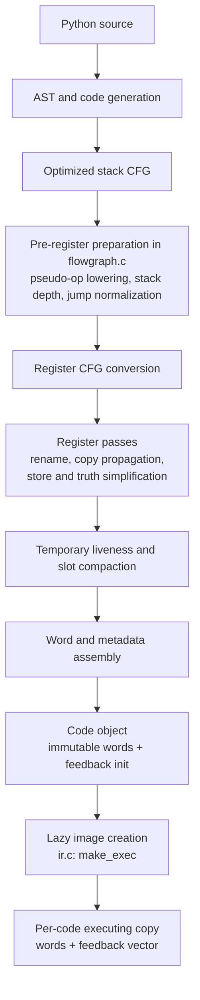

# Register IR: current contract

This describes the register interpreter integrated at `df12a12b131`.
It defines the executable and ownership contract; [status](../STATUS.md)
tracks qualification. The bounded observer and debugger rules below do not
authorize every source transfer.
The immutable golden `0765e9be47f`, qualified at functional `0267d428808`, remains
the [baseline](../bench/results/interpreter-parity-20261108.md).

The [archive](archive/register-ir-20261108.md) retains earlier designs.
[Call/frame lifetimes](call-and-frame-lifetimes.md) and the
[observer contract](handler-and-observer-contract.md) define ownership and
observation. Release points implement the selected RC runtime; they are not a
Python guarantee of immediate finalization. See
[language and lifetime policy](lifetimes-and-language-semantics.md).

## Producer path



`Python/compile.c` sequences CFG optimization, `_PyCfg_OptimizedCfgToRegCfg`
and code-object assembly. The register CFG and passes are in `Python/regcfg.c`
and `Python/regcfg_passes.c`; word emission is in `Python/assemble.c`.
Line and exception tables use the same word-index coordinate system. There is
no runtime stack-bytecode lowering stage.

## Word format and operands

`Include/internal/pycore_ir.h` defines `_PyIRWord`, an eight-byte word:

```
 63      52 51      40 39      28 27      16 15       0
+----------+----------+----------+----------+----------+
|    D     |    C     |    B     |    A     |  handler |
+----------+----------+----------+----------+----------+
```

The low 16-bit handler selects the operation. A, B, C and D are 12-bit fields;
CD is the 24-bit value `C | (D << 12)`. There are no prefix words. Handler
metadata in `pycore_ir_metadata.h` and generated dispatch in
`Python/generated_ir_cases.c.h` define each handler's field roles and effects.

- Slots share `localsplus` numbering: locals, cells, hidden scalar constant
  homes, free variables, then compiler temporaries. A slot field addresses 0–4094; `0xFFF` is
  also `IR_NO_DST`, the encoding for an unused/discarded destination.
- Register-form operations name a destination and their inputs. Inputs are
  ordered bottom-first; stores name the target/object before the stored value.
- Window-form operations name a base slot and access consecutive inputs by
  offset. Call preparation and unpack operations use this form.
- An immediate may be a count or local index in one field, or a constant/name
  index in CD. A feedback index points into the executing copy's feedback
  vector. Some operations store an operation argument in feedback metadata.
- Ordinary jumps carry an absolute word index in CD. `FOR_ITER`, `SEND`, and
  fused compare-and-jump handlers carry a signed word distance in D from the next
  instruction. `FOR_ITER` and `SEND` use forward distances; fused
  compare-and-jumps are forward-only. The assembler relaxes long loop exits and
  leaves out-of-range fused branches unfused.

The generator's format metadata describes reads, writes, destination,
feedback/immediate location, branching, and declared effects. These facts drive
verification, register allocation/compaction, instrumentation and handler
generation; they are not a native-JIT recovery map.

## Constants, temporaries and jumps

Only eligible inline scalar loop constants receive hidden homes in the frame's
`localsplus` array. Other constants use ordinary constant-loading forms. Hidden
constant homes and local/cell/freevar slots are fixed before temporary slot
compaction. The compiler assigns temporary registers from the remaining slot
range and rewrites them densely after liveness analysis.

All physical homes are initialized to a valid `PyValue` or NULL. Compaction
tracks occupied owners through their consumption, not only future reads; a
live owner may need cleanup despite having no later program read. The
verifier checks slot ranges, window extents, destination legality, and jump
boundaries. A jump target is a word index and must land on an instruction.
Exception ranges and source lines are likewise expressed in word offsets.

## Compact execution and source positions

`Python/ir.c:make_exec` allocates a shared `_PyCodeExec` for a code object:
mutable executing words and feedback storage. Specialization and monitoring
patch its handlers; pristine code words remain the template. A frame owns its
code, keeping both code and executing allocation alive. Feedback contains
borrowed predictions and counters, not owning GC edges. Entry zero is the
shared header-only entry. Free-threaded specialization remains disabled.

Compiler source-only operations occupy no executable word. Pristine streams
admit semantic operations and real control transfers; source-only line events live in the versioned
`co_linetable` container alongside ordinary word-position data. `f_lasti`,
disassembly offsets, jump targets and `co_positions()` describe compact real
words. `co_lines()` also retains source-only zero-width entries. There is no
second public instruction coordinate domain and no INSTRUCTION event for an
eliminated operation.

Eligible unique fresh scalar results use `IR_NO_DST`. Calls use the same plain
recipient, including across source lines and generator-related control flow;
there is no tagged postcall recipient or live-POP decoder. A producer may still
use a real internal result window before its final discard; that slot traffic
is distinct from dispatching a release operation. Shared-owner/exception/branch
cleanup words remain a separate unfinished inventory. The overall objective
of eliminating standalone release-only execution is not yet complete.

A single shape-reader ownership variant, `LOAD_ATTR_SHAPE_LOCAL_TEMP`, remains:
its local input and temporary destination are static. Generated canonical,
family, statistics and feedback mappings cover the physical handler domain.
Adaptive disassembly names the specialization; internal executing-IR inspection
can expose an ownership variant. This does not create a product of every mode.

## Semantic completion and generated contracts

FOR_ITER defines its item recipient only on its body edge; exhaustion retires
its iterator/cursor and preserves the last item binding. SEND yields into its
receiver window but completes into its explicit result recipient. CLEANUP_THROW
has its own named real target and shares SEND completion ownership. YIELD_VALUE
names its incoming resume recipient separately from its outgoing value.
Semantic edge definitions override the frontend's stack-shape union.

Source-edge assembly follows the same controlling operation as word encoding.
A fused comparison uses its paired conditional jump's target and fallthrough,
while source records retain the emitted comparison's actual executable offset.

Long FOR_ITER/SEND branches use actual IR_JUMP adapter words. The observer
recognizes only their exact assembler shape for LINE/branch grouping; helper
words retain their own INSTRUCTION events. The static initialization shim also
contains only its real operations, with an explicit saved continuation.

`_PyIRFormat` describes operand roles, stack-shape extents, fold capability,
effects, feedback and monitoring. Per-handler `output_kind` separately describes
actual publication: register dst, window, first window result moved to dst, or
semantic outcome. A conditional trailing window output stays in its actual
window even when the first result moves. `_PyIR_STORE_DST` alone says a local
fold is allowed, not where every output is physically written.

Cold consumers share `_PyIR_Outcome`, `_PyIR_ReadsHome`, `_PyIR_DefinesHome` and
`_PyIR_NullableInputs` from `pycore_ir_outcomes.h`. They distinguish explicit
source fields from untouched window holes, preserve through owners and SWAP
provenance, and admit only audited nullable roles. A generated per-edge
`observer_outcome` declares which terminal observer sees committed output;
unmarked handlers receive no POST claim. `_PyIR_ObservedHomes` decodes the
physical result and retired input homes, keeping a new value or explicit NULL
separate from an old input's unavailable owner. The constructor checks a
declared source callback's POST exception recipe and both compute PRE and
observer POST for ordinary exception coverage. FOR_ITER's temporary A must be
its actual B+2 item home; a local A moves that item, and IR_NO_DST discards it.
These checks are not a general bytecode type verifier or native recovery map.

The positive terminal marker supplies reported source, physical continuation,
monitoring event and an explicit owner edge. Its literal edge and destination
shape drive the same metadata and runtime call. The event does not select the
owner edge: POP_ITER reports BRANCH_RIGHT while its own outcome falls through;
an unconditional JUMP takes its target. The actual executing word remains the
owner/EH site even when a callback reports another source word. Zero-output
transfers have valid committed facts without creating a result owner.

Scoped source callbacks retain the immediate real continuation separately from
the normalized landing in their source record. Only a completed provider grants
SOURCE_POST scope; unproved inline hooks still deliver source events under an
unsupported scope. The setter uses the same Plan for real PRE, certified
owner-neutral committed JUMP and bounded non-neutral committed outcomes. PRE
and neutral JUMP borrow exact site rows. A non-neutral view copies that site's
context, saved bindings and origins, applies the selected normal transfer, then
cuts old input provenance independently of replacement values. Token-creating
transfers are excluded from this copied-row path.

The new non-neutral permission requires exact scope/site/edge/continuation and
redirect generation, inherited handled context, empty stopped and target
saved-binding state and a real target with no incoming scratch-owner requirement.
It cannot use a
pre-site survivor recipe or a source-only fallback. Existing PRE restoration
and neutral JUMP rules retain their own proofs. General SOURCE_POST and yield
transfers require separate stopped-state authority.

## Explicit boundary

The baseline IR is an executable register instruction stream, not optimizing
SSA. It has no machine-register allocation, deoptimization state, OSR protocol,
or general native-JIT recovery map. The current method/tracing JIT recovery
contract remains future work. The [checkpoint report](../bench/results/interpreter-parity-20261108.md)
and [status](../STATUS.md) record qualification and open work.
