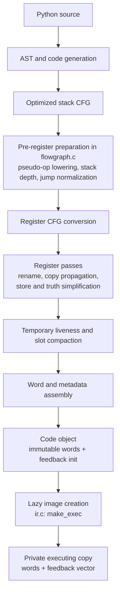

# Register IR: current contract

This page describes the IR in the canonical runtime checkout at
`/home/power/code/cpython/.worktrees/python-boil-the-ocean/build/worktrees/pyvalue-rc-universal`,
HEAD `0765e9be47f55d97ba5d31d2ae1c02a55ea2e5ae` (2026-11-08). That tree is
clean; the checkpoint's full-suite and performance qualification is tied to
`0267d428808`, whose successor only changes comments. This is an as-built
contract, not a proposal. The archived [register IR history](archive/register-ir-20261108.md)
keeps dated decisions and analysis; [compiler and IR](compiler-and-ir.md),
[call/frame lifetimes](call-and-frame-lifetimes.md), and the
[observer contract](handler-and-observer-contract.md) cover deeper details.

## Producer path



`Python/compile.c` sequences CFG optimization, `_PyCfg_OptimizedCfgToRegCfg`
and code-object assembly. The register CFG and passes are in `Python/regcfg.c`
and `Python/regcfg_passes.c`; word emission is in `Python/assemble.c`.
Line and exception tables use the same word-index coordinate system. There is
no runtime stack-bytecode lowering stage.

## Word format and operands

`Include/internal/pycore_ir.h` defines `_PyIRWord`, an eight-byte word:

```
 63      52 51      40 39      28 27      16 15       0
+----------+----------+----------+----------+----------+
|    D     |    C     |    B     |    A     |  handler |
+----------+----------+----------+----------+----------+
```

The low 16-bit handler selects the operation. A, B, C and D are 12-bit fields;
CD is the 24-bit value `C | (D << 12)`. There are no prefix words. Handler
metadata in `pycore_ir_metadata.h` and generated dispatch in
`Python/generated_ir_cases.c.h` define each handler's field roles and effects.

- Slots share `localsplus` numbering: locals, cells, hidden scalar constant
  homes, free variables, then compiler temporaries. A slot field addresses 0–4094; `0xFFF` is
  also `IR_NO_DST`, the encoding for an unused/discarded destination.
- Register-form operations name a destination and their inputs. Inputs are
  ordered bottom-first; stores name the target/object before the stored value.
- Window-form operations name a base slot and access consecutive inputs by
  offset. Call preparation and unpack operations use this form.
- An immediate may be a count or local index in one field, or a constant/name
  index in CD. A feedback index points into the executing copy's feedback
  vector. Some operations store an operation argument in feedback metadata.
- Ordinary jumps carry an absolute word index in CD. `FOR_ITER`, `SEND`, and
  fused compare-and-jump handlers carry a signed word distance in D from the next
  instruction. `FOR_ITER` and `SEND` use forward distances; fused
  compare-and-jumps are forward-only. The assembler relaxes long loop exits and
  leaves out-of-range fused branches unfused.

The generator's format metadata describes reads, writes, destination,
feedback/immediate location, branching, and declared effects. These facts drive
verification, register allocation/compaction, instrumentation and handler
generation; they are not a native-JIT recovery map.

## Constants, temporaries and jumps

Only eligible inline scalar loop constants receive hidden homes in the frame's
`localsplus` array. Other constants use ordinary constant-loading forms. Hidden
constant homes and local/cell/freevar slots are fixed before temporary slot
compaction. The compiler assigns temporary registers from the remaining slot
range and rewrites them densely after liveness analysis.

All physical homes are initialized to a valid `PyValue` or NULL. Compaction
tracks occupied owners through their consumption, not only future reads; a
live owner may need cleanup despite having no later program read. The
verifier checks slot ranges, window extents, destination legality, and jump
boundaries. A jump target is a word index and must land on an instruction.
Exception ranges and source lines are likewise expressed in word offsets.

## Execution copy, feedback and NOP anchors

`Python/ir.c:make_exec` allocates one `_PyCodeExec` per code object, shared by
frames and threads under the free-threaded publication protocol. It contains a
copy of the immutable words and, when needed, feedback storage. Specialization
and monitoring change the handler field of executing words; free-threaded
specialization is disabled. Immutable code-object
words remain the source template. Feedback entries hold borrowed pointers and
counters, not GC-owned references. Entry zero is a shared header-only entry.

Some emitted NOP words retain a source-line or instrumentation location. A NOP
is therefore part of the observable word stream and remains addressable by
line/exception metadata even when ordinary dispatch can skip its handler.
The current M2b optimization checks and executes one live NOP inline only on
the checked `POP_JUMP_IF_FALSE_BOOL` continuation. Instrumented wrappers keep their own
handlers, and debug lltrace declines the inline path. The NOP word and PC
publication remain in place. This dispatch elision is a local optimization,
not a requirement of register IR. Metadata-only anchors have been proposed
but are not implemented.

## Explicit boundary

The baseline IR is an executable register instruction stream, not optimizing
SSA. It has no machine-register allocation, deoptimization state, OSR protocol,
or general native-JIT recovery map. The current method/tracing JIT recovery
contract remains future work. The [checkpoint report](../bench/results/interpreter-parity-20261108.md)
and [status](../STATUS.md) record qualification and open work.
