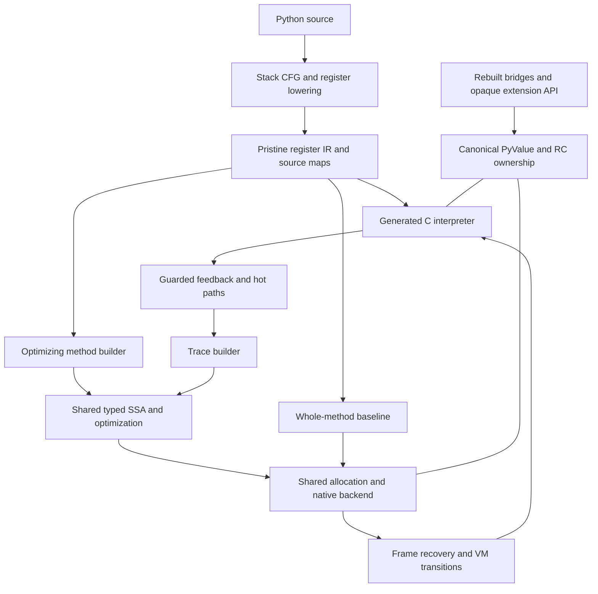

# Runtime architecture

The selected design combines canonical eight-byte PyValues, a compiler-produced
register interpreter, reference counting with cyclic collection, and a cohesive
method/tracing JIT. The [current status](../STATUS.md) separates this target
from the qualified interim runtime and unfinished source.

## Subsystem references

| Subsystem | Design and source organization |
| --- | --- |
| [Compiler and IR](compiler-and-ir.md) | compile/codegen/flowgraph → regcfg/regcfg_passes → assemble; physical frame homes, liveness and generated formats |
| [Interpreter](handler-and-observer-contract.md) | bytecodes and cases generators → ceval; dispatch, frames, effects, specialization and observation |
| [Calls and frame homes](call-and-frame-lifetimes.md) | Frame stack, prepare/commit ownership transfer, initialized homes versus future-read liveness, and observation boundaries |
| [Values and objects](values-and-object-protocol.md) | Canonical scalar/object encoding, managed storage, attributes and ownership boundaries |
| [Memory and lifetimes](gc-roots-and-lifetimes.md) | Reference counting, cyclic traversal, release/reentry and weakref/finalization contracts |
| [PyValue](pyvalue.md) | Accepted ([review](reviews/pyvalue-review-1.md)). Canonical spec for the eight-byte value: as-built encoding, comparison with other engines, prioritised gaps |
| [Native boundary](native-boundary.md) | Accepted with changes ([review](reviews/native-boundary-review-1.md)). Canonical spec for native calls: per-thread borrow stack, parser entry points, Clinic output |
| [Register IR](register-ir.md) | Accepted ([review 1](reviews/register-ir-review-1.md), [review 2](reviews/register-ir-review-2.md)). Canonical spec for the register IR as built, compared with V8 Ignition and LuaJIT |
| [Extension API](extension-api.md) | Owning, fallible rebuilt-source bridges and gradual opaque handle adoption |
| [Method/tracing JIT](jit-e2e-system.md) | Shared semantic helpers, typed SSA, effects, state recovery, backend and code lifetime |
| [JIT feedback and attribute IR](jit-ir-feedback/design.md) | Receiver/descriptor/storage facts, guards and dictionary prediction |

Interpreter IR registers are memory homes, not hardware registers or optimizing
SSA identities. The optimizing compiler must choose registers and spills. The
interpreter encoding and generated C quality remain subjects for measurement;
choosing register IR did not prove either optimal.

All paths share Python semantics: descriptors and custom hooks, arbitrary-size
integers, object identity, exceptions and callbacks. Specialization may guard
common cases; opaque code uses explicit boundaries and recovery. It must not
silently discard effects or confuse a stored value kind with receiver behavior.

## What exists today

The qualified interim images at `eba351fee7d` use register IR, NaN-boxed frame
values and boxed heap/shape fields under RC. The universal PyValue runtime (branch `boil/pyvalue-rc-universal`) now
links in debug and release and passed 54,351 tests in each full profile. Its
diagnostic comparison reports candidate/baseline elapsed-time factors of
1.287/1.075 for the kernel geomean and 1.096/0.913 for the declared
pyperformance subset against upstream/interim; peak-RSS factors are
1.259/1.062. Lower is better. Whole-source R27 and startup-inclusive
zero-box gates still fail their original criteria; they are now diagnostics,
not prerequisites for throughput work. See the
[diagnostic report](../bench/results/checkpoint-6a0e4c12c17.md) and
[current status](../STATUS.md). The runtime still has no new native JIT tier.
Follow-up prioritizes steady-state throughput; RSS is secondary. The completed
[source review](../issues/checkpoint-closure/steady-state-source-review.md)
and hardware counters identify bounded GCC source, attribute/accessor,
Python-call and frame-traffic experiments. On the three selected regressions,
candidate retired instructions are 2.047x, 1.903x and 1.628x upstream, while
CPI is comparable or lower; cache counters are noisy. This narrows the next
experiments but does not prove causation or explain the aggregate gap.

The target has one canonical core representation and one selected collector.
Internal PyValue bits are private; opaque extension handles do not expose them.
The HPy-compatible backend is still unimplemented. Existing object/JIT patterns
may change when better designs are supported by evidence.

The supported interim profile is Linux x86-64/GIL, GCC register-IR tail-call
dispatch and private `boilrc1` ABI. Free-threaded/32-bit and global StackRef-ID
debugging are unqualified. [RC integration](../issues/rc-integration/status.md)
records exact limits. Earlier tracing/nursery proposals remain historical
evidence, not the current architecture or active work.
