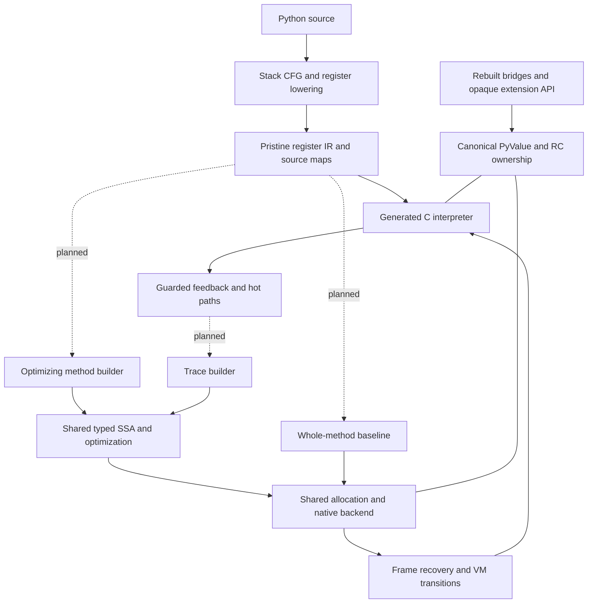

# Runtime architecture

The selected design combines canonical eight-byte PyValues, a compiler-produced
register interpreter, reference counting with cyclic collection, and a cohesive
method/tracing JIT. The [current status](../STATUS.md) separates this target
from the qualified interim runtime and unfinished source.

## Subsystem references

| Subsystem | Design and source organization |
| --- | --- |
| [Compiler and IR](compiler-and-ir.md) | compile/codegen/flowgraph → regcfg/regcfg_passes → assemble; physical frame homes, liveness and generated formats |
| [Interpreter](interpreter.md) | bytecodes and cases generators → ceval; dispatch, frames, effects, specialization and observation; deeper [handler contract](handler-and-observer-contract.md) |
| [Calls and frame homes](call-and-frame-lifetimes.md) | Frame stack, prepare/commit ownership transfer, initialized homes versus future-read liveness, and observation boundaries |
| [Values and objects](values-and-object-protocol.md) | Canonical scalar/object encoding, managed storage, attributes and ownership boundaries |
| [Memory and lifetimes](gc-roots-and-lifetimes.md) | Reference counting, cyclic traversal, release/reentry and weakref/finalization contracts |
| [PyValue](pyvalue.md) | Accepted ([review](reviews/pyvalue-review-1.md)). Canonical spec for the eight-byte value: as-built encoding, comparison with other engines, prioritised gaps |
| [Native boundary](native-boundary.md) | Accepted with changes ([review](reviews/native-boundary-review-1.md)). Canonical spec for native calls: per-thread borrow stack, parser entry points, Clinic output |
| [Register IR](register-ir.md) | Current as-built encoding, operands, source maps and execution copy; [dated comparisons and decisions](archive/register-ir-20261108.md) retain earlier reviews |
| [Extension API](extension-api.md) | Owning, fallible rebuilt-source bridges and gradual opaque handle adoption |
| [Method/tracing JIT](jit-e2e-system.md) | Shared semantic helpers, typed SSA, effects, state recovery, backend and code lifetime |
| [JIT feedback and attribute IR](jit-ir-feedback/design.md) | Receiver/descriptor/storage facts, guards and dictionary prediction |

Interpreter IR registers are memory homes, not hardware registers or optimizing
SSA identities. The optimizing compiler must choose registers and spills. The
interpreter encoding and generated C quality remain subjects for measurement;
choosing register IR did not prove either optimal.

All paths share Python semantics: descriptors and custom hooks, arbitrary-size
integers, object identity, exceptions and callbacks. Specialization may guard
common cases; opaque code uses explicit boundaries and recovery. It must not
silently discard effects or confuse a stored value kind with receiver behavior.

## What exists today

The universal PyValue register interpreter is qualified and frozen at the
[2026-11-08 golden checkpoint](../issues/golden-20261108/README.md).
Release/debug full suites passed at functional `0267d428808`; runtime
`0765e9be47f` only moves a comment. Its interpreter, core heap fields and
rebuilt bundled extensions use canonical values. Owning bridges remain where
value-native APIs have not replaced them. The older `eba351fee7d` image with
boxed heap fields is a historical interim control.

No new native method/tracing JIT tier is qualified. Dashed entry edges in the
diagram describe planned tiers, not an implemented execution path. Logging
remains about 1.38× upstream and the broad screen about 1.24×. Read the
[current report](../bench/results/interpreter-parity-20261108.md) for exact
protocols and limits. Added retired work is the main measured logging
indicator; samples do not establish a causal allocation among helpers.
The [cold review and next plan](../issues/golden-20261108/next-steps.md)
compare structural improvements. Zero-box census and startup RSS are not
throughput admission gates.

The target has one canonical core representation and one selected collector.
Internal PyValue bits are private; opaque extension handles do not expose them.
The HPy-compatible backend is still unimplemented. Existing object/JIT patterns
may change when better designs are supported by evidence.

The supported interim profile is Linux x86-64/GIL, GCC register-IR tail-call
dispatch and private `boilrc1` ABI. Free-threaded/32-bit and global StackRef-ID
debugging are unqualified. [RC integration](../issues/rc-integration/status.md)
records exact limits. Earlier tracing/nursery proposals remain historical
evidence, not the current architecture or active work.
