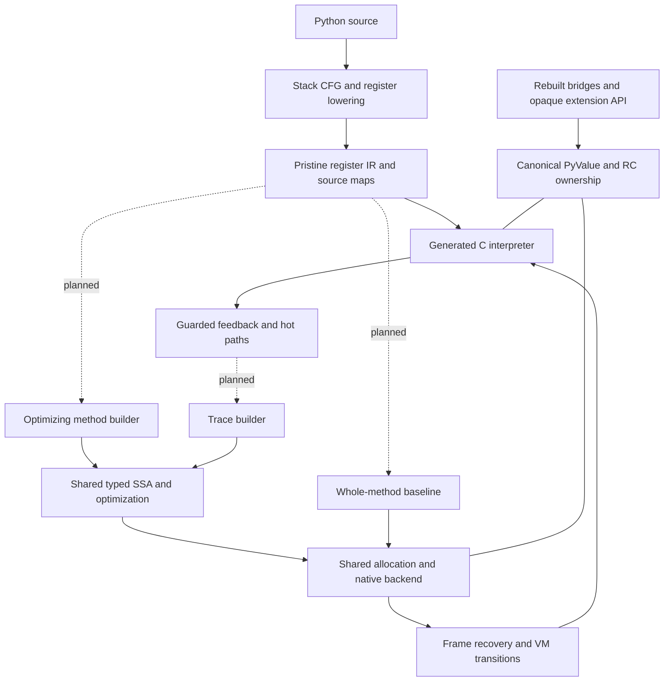

# Runtime architecture

Frozen runtime 39 `4d666e1b482` combines canonical eight-byte PyValues, a
compiler-produced register interpreter and reference counting with cyclic
collection. The method/tracing JIT remains the selected future execution model.
The [closing report](../issues/frame-call-model-20261109/closing-report.md) and
[status](../STATUS.md) own current qualification, measurements and remaining
limits; this page describes the implemented architecture.

## Subsystem references

| Subsystem | Design and source organization |
| --- | --- |
| [Compiler and IR](compiler-and-ir.md) | compile/codegen/flowgraph → regcfg/regcfg_passes → assemble; physical frame homes, liveness and generated formats |
| [Interpreter](interpreter.md) | bytecodes and cases generators → ceval; dispatch, frames, effects, specialization and observation; deeper [handler contract](handler-and-observer-contract.md) |
| [Calls and frame homes](call-and-frame-lifetimes.md) | Initialized arena, known binding plans, owning argument windows, explicit recipients/continuations, semantic completion and observation |
| [Values and objects](values-and-object-protocol.md) | Canonical scalar/object encoding, managed storage, attributes and ownership boundaries |
| [Memory and lifetimes](gc-roots-and-lifetimes.md) | Reference counting, cyclic traversal, release/reentry and weakref/finalization contracts |
| [PyValue](pyvalue.md) | Current encoding, typed ownership, canonical homes, container storage and native boundaries; historical comparisons are archived |
| [Native boundary](native-boundary.md) | Accepted with changes ([review](reviews/native-boundary-review-1.md)). Canonical spec for native calls: per-thread borrow stack, parser entry points, Clinic output |
| [Register IR](register-ir.md) | Current as-built encoding, operands, source maps and execution copy; [dated comparisons and decisions](archive/register-ir-20261108.md) retain earlier reviews |
| [Extension API](extension-api.md) | Owning, fallible rebuilt-source bridges and gradual opaque handle adoption |
| [Method/tracing JIT](jit-e2e-system.md) | Shared semantic helpers, typed SSA, effects, state recovery, backend and code lifetime |
| [JIT feedback and attribute IR](jit-ir-feedback/design.md) | Receiver/descriptor/storage facts, guards and dictionary prediction |

Interpreter IR registers are memory homes, not hardware registers or optimizing
SSA identities. The optimizing compiler must choose registers and spills. The
interpreter encoding and generated C quality remain subjects for measurement;
choosing register IR did not prove either optimal.

All paths share Python semantics: descriptors and custom hooks, arbitrary-size
integers, object identity, exceptions and callbacks. Specialization may guard
common cases; opaque code uses explicit boundaries and recovery. It must not
silently discard effects or confuse a stored value kind with receiver behavior.

## Implemented model

The interpreter, core heap fields and rebuilt bundled extensions use canonical
values. Owning bridges remain where value-native APIs have not replaced them.
PyValueBorrow is a distinct C-local view of its owner's unchanged word; a home
receives an owner, and DUP explicitly acquires one from a borrow.

The [frame/call model](../issues/frame-call-model-20261109/plan.md) implements
compact executable words and source-edge metadata, direct versioned Python
binding, deferred eligible empty kwargs, plain result destinations and real
return continuations, semantic iteration/delegation completion, and an
initialized chunk frontier. Generated physical output facts and shared cold
read/definition/outcome contracts connect compiler ownership to constructor
and debugger consumers. Activation-local source errors and cold LINE handoffs
preserve observation through reentry.

Calls and declared terminal outcomes detach inputs and publish output homes and
the real continuation before callback-capable owner retirement. PRE and POST
exception recipes remain distinct. Scoped observer state identifies the actual
operation, physical next word, selected edge and redirect generation; reported
source positions do not manufacture execution or ownership authority. Cold
debugger Plans prove supported transfers and commit before closing surplus
owners. General context exits, suspension actions and source-aware external
readers remain bounded capabilities, not universal recovery claims.

Runtime39's production implementation is 38; 39 strengthens tests for deliberate
protocol-crossing refusals and immediate Pdb entry. Deferred coroutine 40,
retained-owner experiments and the unfinished GDB port are excluded. The
[golden checkpoint](../issues/golden-20261108/README.md) remains an immutable
comparison control. Component counts, samples and earlier campaign timings do
not establish a causal allocation of cost or qualify the final image.

No native method/tracing JIT tier is qualified. Dashed diagram edges describe
planned tiers, not implemented execution paths. Compiler and interpreter share
one owning baseline ABI; future recovery reconstructs that state. Zero-box
counts and startup RSS are not throughput admission gates.

The target has one canonical core representation and one selected collector.
Internal PyValue bits are private; opaque extension handles do not expose them.
The HPy-compatible backend is still unimplemented. Existing object/JIT patterns
may change when better designs are supported by evidence.

The supported profile is Linux x86-64/GIL with GCC register-IR tail-call
dispatch and the rebuilt private `boilvalrc3` ABI. Free-threaded/32-bit and global StackRef-ID
debugging are unqualified. [RC integration](../issues/rc-integration/status.md)
records exact limits. Earlier tracing/nursery proposals remain historical
evidence, not the current architecture or active work.
