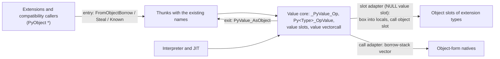
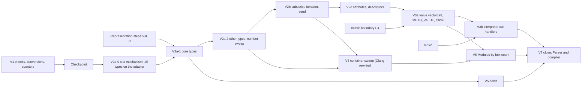

# Value API: a value-native core with an object compatibility layer

Status: revision 2, 2026-11-03, after [review 1](reviews/value-api-review-1.md)
and the coordinator's decisions on it (R1–R13 below). It specifies the user's
decision that `PyValue` is the internal API and `PyObject *` is the
compatibility API, and it is the source for the V packets in section 9.

Source tree: `build/worktrees/pyvalue-rc-universal` in the boil worktree
(`build/` is `/home/power/code/cpython/.worktrees/python-boil-the-ocean/build`),
HEAD `379e92cded9`, recounted at 19:42–20:00 with ten files carrying other
agents' uncommitted edits. Line numbers in `Objects/typeobject.c` move with
those edits, so this page names its functions instead. File references are
relative to that tree. The counting scripts are `build/pyjit-link-wave1/valueapi-*.py`.

Related pages: [PyValue representation](pyvalue.md) (encoding, D1–D8),
[native boundary](native-boundary.md) (borrow stack), [extension API](extension-api.md)
(HPy direction), [representation packet](proposals/pyvalue-representation-packet.md),
[register IR](register-ir.md) (IR v2, IR-D3).

## Decisions

| # | Decision | Status |
|---|---|---|
| VA1 | Core code uses the value form. The `PyObject *` API keeps its names as thin thunks over the value form. Core code never calls a thunk. An object becomes a value once, at the API entry; a value becomes an object only when it leaves to an object consumer | Accepted. The cost of the sweep is stated in C8 |
| VA2 | Polymorphic positions are `PyValue`; typed positions keep a pointer type | Accepted as R1: generic means `PyValue`, concrete means a typed pointer (§1.2). C1 withdrawn |
| VA3 | One canonicalising borrow and one canonicalising steal convert `PyObject *` to `PyValue` | Accepted (§1.3), plus the typed entry of R3. Exact non-NaN floats, not every float, become inline |
| VA4 | Owned boxing (`PyValue_AsObject`) and borrowed boxing through the borrow stack. Small ints box to the cached immortals | Accepted. Holds as built (`_PyValue_BoxInlineValue` calls `PyLong_FromLong`). Slot adapters box into C locals, not the stack (C4) |
| VA5 | A value slot table on every type; `PyType_Ready` fills the missing side; pairs inherit together; `slot_*` functions are native value slots | Accepted with changes: value slots are inline fields (R2); `len` and `iter` need no value slot, `repr`, `str` and `send` do (C2); the extension adapter lives in the dispatcher, and core object thunks are generated per type (C3, §2.2) |
| VA6 | Value vectorcall, a value builtin convention, value-form Clinic output; object-form natives are reached through the borrow stack | Accepted, with a per-instance value vectorcall (R7, §3) |
| VA7 | Arguments borrowed, results owned. Error: `PyValue_NULL`. Absence: three-state `int` with an out parameter | Accepted. `PyValue_NULL` chosen; `PyValue_ERROR` has two producers and is deleted (§1.4) |
| VA8 | `_PyValue_<Op>` for generic operations; `Py<Type>_<Op>Value` for containers | Accepted with the rule stated exactly and 14 renames (§1.5). The suffix collides with the dict sense of "value" (C9) |
| VA9 | Object functions with a value form are marked compatibility-only; a call from a value-native unit is a build error | Accepted with `__attribute__((unavailable))` and no fallback (C7, R12), plus the variadic check of R4 (§4) |
| VA10 | `Objects/`, `Python/`, `Parser/` are value-native at the end; hot `Modules/` are ported by box count; polymorphic fields become `PyValue` | Accepted with a corrected field list (C5) and `Parser/` scheduled last (C6) |
| VA11 | Extensions keep the object API; a public value API is out of scope | Accepted. No `PyValue` in public headers (R10); constraints in §5.2 |
| VA12 | Box counters by site class in the stats build; recorded, not a gate | Accepted (§6). V1 provides them before the checkpoint |
| R1 | Review B1. Every `_PyValue_<Op>` takes `PyValue` for every Python operand, including callables and the receivers of `len`, `iter`, `getitem`, `setitem`, `contains` and `setattr`. Every generic `PyObject_*`, `PyNumber_*`, `PySequence_*`, `PyMapping_*` and `PyIter_*` function becomes a marked thunk. `PyValue_AsPyObjectBorrow`/`Steal` become `PyValue_AsKnownObjectBorrow`/`Steal`, checked in release builds through V7 | Coordinator, 2026-11-03, after review 1. §1.2, §1.3 |
| R2 | Review B2. Value slots are fields at the end of `PyTypeObject`; there is no `tp_as_value` pointer; each pair has its own inheritance rule, `update_one_slot` included | Coordinator, 2026-11-03, after review 1. §2.1, §2.3, §2.4. Open question 6 closed |
| R3 | The typed entry `_PyValue_FromObjectKnown`, debug-checked, for pointers that cannot be exact ints or floats | Coordinator, 2026-11-03, after review 1. §1.3. Open question 1 closed |
| R4 | Review B3. A clang-query matcher in `Tools/build/check_value_api.py`, run by a make target from V1, fails when a `PyValue` reaches a variadic argument in a core unit. Each object format conversion gets a value conversion; V1 picks the spelling | Coordinator, 2026-11-03, after review 1. §4 |
| R5 | Review B4. The dispatchers are specified completely: reflected compare, sequence fallbacks, ternary dedup, truth fallback, result checks, `NotImplemented` | Coordinator, 2026-11-03, after review 1. §2.5 |
| R6 | Rollout: mechanisms first, then a sweep file by file, then each family marked once swept. V2a splits into V2a-0 (mechanism), V2a-1 (core types), V2a-2 (remaining types and sweep). V3 splits; V3a (C level) does not wait for IR v2. `PyObject_IsTrue` and `_PyNumber_Index` are marked after Clinic value emission. Every packet names its tests. V4 uses a Clang classifier and rewriter | Coordinator, 2026-11-03, after review 1. §9 |
| R7 | Calls: core callables get a per-instance value vectorcall; bound-method `im_self` and builtin `m_self` are `PyValue` homes; a bound call prepends `self` by the offset rule | Coordinator, 2026-11-03, after review 1. §3 |
| R8 | `PyValue_Box` is deleted in V2a; D2 removes the non-canonical form | Coordinator, 2026-11-03, after review 1. §1.3 |
| R9 | Round-trip identity is permanent compatibility behaviour | Coordinator, 2026-11-03, after review 1. §1.3 |
| R10 | `pyvalue.h` and `PyTuple_GET_VALUE` move to `Include/internal` in V1. External code gets no `PyValue` until a public value API is designed | Coordinator, 2026-11-03, after review 1. §5.2; pyvalue.md D6. Open question 2 closed |
| R11 | The value `iternext` uses the `am_send` contract. RETURN is only for iterators that end without raising (core iterators, generators), with the return value or `PyValue_NULL` in `*out`. ERROR covers every raised exception, `StopIteration` and subclasses included, left as raised. The adapters for an extension `tp_iternext` and for `slot_tp_iternext` map NULL with no exception to RETURN with `PyValue_NULL` and NULL with any exception to ERROR. Generic consumers treat ERROR with `StopIteration` as the end and clear it; `next()` passes ERROR through and raises a fresh `StopIteration(v)` only on RETURN; `_PyValue_Send`/`PyIter_Send` turn ERROR with `StopIteration` into RETURN with its value. A core type's object thunk raises `StopIteration(v)` only for a non-NULL `v`. Python behaviour is unchanged. Open question 5 closed | Coordinator, 2026-11-03, after review 1 (replacing revision 2's pending-exception end; refined so that `next()` keeps upstream behaviour). §1.4, §2.1, §2.5, V2b |
| R12 | Review I1–I8 enter the specification and the rollout | Coordinator, 2026-11-03, after review 1. §2.4 (I1), §7.7 (I2), §3 (I3), §9 (I4), §1.3 (I5), §6.2 (I6), §4 (I7), §1.3 (I8) |
| R13 | The inventory is recounted at `379e92cded9` | Coordinator, 2026-11-03, after review 1. §7 |

## Challenges to the brief

**C1 (VA2). Withdrawn after review 1.** It made callables and the receivers
of `len`, `iter` and subscripting object positions. That gave each operation
two spellings and needed `PyValue_AsPyObjectBorrow` at every such call, which
yields a garbage pointer for an inline value in release builds (review B1).
R1 replaces it.

**C2 (VA5). The slot list.** `sq_length`/`mp_length` return `Py_ssize_t`;
`tp_iter` returns an iterator, which is never inline (`__iter__` returning `5`
raises). Neither needs a value slot: their receivers cannot be inline once the
operation has tested the tag (§2.5). `tp_repr` and `tp_str` do (an int receiver
can be inline), as do `am_send` (argument and result are polymorphic) and
`nb_index`/`nb_int`/`nb_float` (results are ints or floats).

**C3 (VA5). Extension adapters cannot be derived function pointers.** C has no
closures, so a shared adapter function cannot know which type's object slot it
stands for. Binary dispatch makes this a correctness bug, not a cost:
`binary_op1` drops the right operand's slot when it equals the left one's
(`Objects/abstract.c:958`). Two extension types with the same derived adapter
would look like one type, and the right operand's `__radd__` would never run.
The adapter therefore lives in the dispatcher: a NULL value slot means "box the
operands and call the object slot" (§2.5). In the other direction, core types
need a per-type object thunk for each value slot, because extensions call
`PyBaseObject_Type.tp_repr(self)` or `PyLong_Type.tp_richcompare(a, b, op)`
with subclass instances. That is about 425 thunks (§7.3), generated by a macro.

**C4 (VA4, VA5). Slot adapters box into C locals.** A slot has at most three
operands; owned C locals are cheaper than a push and a scope, and safe under
the D2 release contract. The borrow stack stays the mechanism for
variable-length vectors (the call adapter, P4) and parser outputs
([native-boundary.md](native-boundary.md)).

**C5 (VA10). The field list.** Range iterators hold C `long`s
(`Include/internal/pycore_range.h:11`) and `enumerate` a `Py_ssize_t`; their
overflow forms hold ints beyond the inline range. None needs a home; §7.4
lists the fields that do.

**C6 (VA10). `Parser/` and the compiler gain nothing at run time.** AST
constants are `PyObject *` (`Include/internal/pycore_asdl.h:16`) and
compile-time folding calls `PyNumber_*` (15 calls in `Python/flowgraph.c`).
They are ported only for the invariant "no core unit calls a thunk", which
an exemption would turn into an allowlist; they come last (V7).

**C7 (VA9). Use `unavailable`, not `deprecated` plus `-Werror`.**
`__attribute__((unavailable("…")))` is an error at the use site without a flag,
in Clang and GCC 12 or later. `deprecated` depends on every build passing
`-Werror=deprecated-declarations`, and `_Py_COMP_DIAG_IGNORE_DEPR_DECLS`
silences it (7 core sites use that pragma), so it is not a ratchet. A compiler
without `unavailable` gets `#error` in core builds, not a weaker fallback (R12,
review I7). Naming a function in a static initialiser is also a use: 77 core
static types name `PyObject_GenericGetAttr`. Core type definitions therefore
name only value forms, and `PyType_Ready` fills the object side of generic
pairs from a fixed table (§2.2).

**C8 (VA1). The sweep is the cost.** Core code makes 2173 handwritten calls to
object-form polymorphic APIs, plus 53 in Clinic headers (§7.1), and the
families of §7.7 add number construction, extraction, error payloads and
argument parsing. Under R1 every argument of a generic call converts; the
conversion disappears when the caller's local becomes a `PyValue`. Each family
is swept completely before it is marked (VA9).

**C9 (VA8). "Value" is also a dict word.** `PyDict_ContainsValue(d, key)`
tests a key; `PyDict_NextValue` yields a key and a value. The suffix rule
matches about 40 existing names and is kept for internal names. The public
spelling is decided with the public value API (VA11).

**C10 (VA7). Today a NULL `PyValue` result has four meanings:** error
(`PyTuple_GetValue`), empty cell or error (`PyCell_GetValue`), exhaustion or
error (`_PyDictIter_NextValue`), out of range with no exception
(`_PyList_GetValue`). §1.4 makes NULL mean error only.

**C11 (VA11). Boxing at the compatibility boundary is permanent.**
JavaScriptCore passes value bits through its C API with no boxing because
`JSValueRef` is opaque (§8). `PyObject *` is not opaque: `Py_TYPE`,
`Py_INCREF` and the object macros dereference it. The only way to stop boxing
for extensions is an opaque handle API, the HPy direction of
[extension-api.md](extension-api.md).

## 1. The model

### 1.1 Two forms and one boundary



Value-native units are those with `Py_VALUE_CORE` (§4). A thunk converts
its Python operands with an entry primitive, calls the value form and boxes a
polymorphic result with the exit primitive; it calls no other thunk. The
borrowed getters deleted in the link wave stay deleted. The two adapters are
the only places where the core calls object-form code it does not own.

### 1.2 Positions

**Generic means `PyValue`, concrete means a typed pointer.**

| Position | Type | Example |
|---|---|---|
| Every Python operand of a generic operation: operands, receivers, keys, items, attribute values, callables, call arguments, both arguments of `isinstance` | `PyValue` | `_PyValue_Add(PyValue, PyValue)`, `_PyValue_Len(PyValue)`, `_PyValue_GetItem(PyValue, PyValue)`, `_PyValue_SetAttr(PyValue, PyObject *name, PyValue)`, `_PyValue_Vectorcall(PyValue, const PyValue *, size_t, PyObject *)` |
| A result that can be any object | `PyValue` | `_PyValue_GetAttr(…) -> PyValue` |
| A result of a known type | typed pointer | `_PyValue_Repr(PyValue) -> PyObject *` (a str), `_PyValue_GetIter(PyValue) -> PyObject *` |
| Receiver of a concrete-type API, after the caller's type check | typed pointer | `PyDict_SetValue(PyObject *dict, PyValue key, PyValue value)` |
| Names, kwnames, `PyTypeObject *` arguments, code, frames, modules | typed pointer | unchanged |
| Receiver of a value slot that `int` and `float` lack (`subscript`, `item`, `ass_*`, `contains`, `iternext`, `send`, `call`) | `PyObject *` | the operation tests the tag before it reads the slot (§2.5) |

An inline value in a generic position never needs a box. The operation reads
its type with `PyValue_TYPE` and raises the upstream `TypeError` itself
(`len(5)`, `5()`, `iter(2.5)`, `5[0]`).

### 1.3 Conversions

| Direction | Primitive | Contract | Today |
|---|---|---|---|
| Entry, borrowed | `PyValue_FromObjectBorrow(o)` | Canonical: an exact int in the inline range or an exact non-NaN float becomes inline; otherwise a no-count reference. NULL gives `PyValue_NULL`. The pointer case is inline in `pycore_value.h` (type load, two compares, tag); only int and float call out | Out of line (`Python/pyvalue.c:9`), calling `_PyObject_ValueIdentity` (`:227`). `PyValue_FromPyObjectBorrow` (raw, 13 uses) merges into it |
| Entry, typed | `_PyValue_FromObjectKnown(o)` | For a pointer that cannot be an exact int or float (a str, type, function, iterator, container). Tags it with no type load. Debug builds assert the precondition | New in V1 (R3) |
| Entry, owned | `PyValue_FromObjectSteal(o)` | Canonical; consumes `o`; frees an int or float box at once (D2 release contract) | `PyValue_FromPyObjectSteal` (155 uses) canonicalises at representation step 8 and is renamed there |
| Exit, owned | `PyValue_AsObject(v)` | New reference; boxes an inline value; NULL with MemoryError. In the core it does not test `PyErr_Occurred` or `IsLanguageValue` (pyvalue.md G4 item 3); both stay as debug asserts | Exists. `PyValue_AsPyObjectNewBoxed` (13) merges into it |
| Exit, borrowed (call adapter) | `_PyBorrow_ValueVector`, `_PyBorrow_Keep` | Valid until the scope exits ([native-boundary.md](native-boundary.md) §2) | Exist |
| Value known to hold an object | `PyValue_AsKnownObjectBorrow(v)`, `PyValue_AsKnownObjectSteal(v)` | Masks the tag. Precondition: `v` holds an object or is NULL. Release builds test it during V1–V7 and call a cold `_PyValue_FatalNotObject` on an inline value. V7 measures the test and decides whether it stays | `PyValue_AsPyObjectBorrow`/`Steal`, 892 uses including generated code; renamed in V1 (R1) |

`PyValue_FromPyObjectNew` (53 uses) is deleted:
`PyValue_NewRef(PyValue_FromObjectBorrow(o))` costs the same.
`PyValue_Box` (98 uses in `generated_ir_cases.c.h`, 5 in
`generated_jit_helpers.c.h`, 2 by hand) is deleted in V2a (R8): its uses box
for object-form calls that V2a turns into value calls, and D2 removes the
non-canonical form it produces.

**Identity across the boundary (R9, permanent).** An inline int or float that
crosses to the object form gets a fresh box each time, except an int in
-5..256, which boxes to the cached immortal. Upstream returned the stored
object, so a compatibility caller can see two pointers for one stored value:

* `PyObject_SetAttr(o, name, x)` then `PyObject_GetAttr(o, name)` returns `x'`
  with `x' != x` when `x` is an exact int above 256 or an exact float.
* `PyList_Append(l, x)` then `PyList_GetItemRef(l, 0)` returns `x'` likewise.
* Cython compiles `a is b` on `object` variables to C pointer equality, so
  `l[0] is l[0]` is false for `l = [1000]` in Cython code and true in Python
  code. Python code uses value identity ([pyvalue.md](pyvalue.md) §1.7) and
  agrees with upstream.

Python promises no identity for ints or floats, so this is compatible
behaviour, and it stays: the core does not keep the caller's pointer. V2a adds
a `_testcapi` test that pins the round trips above, so a change is deliberate.

### 1.4 Conventions

* **Ownership.** Arguments are borrowed. Results are owned. This is HPy's
  rule ([extension-api.md](extension-api.md)). A function that consumes an
  argument says so with `Take` in its name. If D4 introduces a distinct C type
  for borrows (pyvalue.md G6, register IR IR-D3), argument positions take that
  type and results stay `PyValue`.
* **Error.** A `PyValue` result signals an error with `PyValue_NULL` and an
  exception set. After D5, `PyValue_NULL` is 0, so the test is one compare,
  and a thunk passes NULL through unchanged.
* **Absence and exhaustion.** Use `int f(…, PyValue *out)`: 1 found (`*out`
  owned), 0 absent or exhausted (`*out` is `PyValue_NULL`, no exception), -1
  error. This matches `PyDict_GetItemRef` and `PyIter_NextItem`. A NULL
  result never means "absent", and core code never raises an exception to
  signal an outcome.
* **Iteration and send.** The value `iternext` and `send` slots return
  `PySendResult`: `PYGEN_NEXT` with the item in `*out`; `PYGEN_RETURN` when
  the iterator ends without raising, with the return value in `*out`
  (`PyValue_NULL` when there is none); `PYGEN_ERROR` for every raised
  exception, `StopIteration` included, left exactly as raised. Generic
  consumers treat a raised `StopIteration` as the end, as upstream does; `next()`
  passes it through (§2.1).
* **Absent arguments.** `PyValue_NULL` in an argument position means "not
  given" where the object form uses NULL (delete in `setattr`).
* **`PyValue_ERROR`.** Two producers, both in `Python/ceval.c`:
  `_PyEval_GetIter` and `_PyForIter_VirtualIteratorNext`, with 4 consumers in
  `Python/bytecodes.c`. The first becomes a NULL result; the second becomes
  three-state. Then the constant is deleted.
* **Internal iteration ABI.** `_PyValueIndexPair` (`Include/object.h:319`)
  keeps its form: the index is the third state.
* **`NotImplemented`.** `PyValue_NotImplemented` is the value of the static
  immortal `_Py_NotImplementedStruct`. Value slots return it; dispatchers
  compare it with `PyValue_Is` (identity of the word, ignoring the count bit).

### 1.5 Naming

1. **Generic operations:** `_PyValue_<Op>`, where `<Op>` is the object-form
   name after `PyObject_`, `PyNumber_`, `PySequence_`, `PyMapping_` or
   `PyIter_` (`_PyValue_Add`, `_PyValue_GetAttr`, `_PyValue_Len`,
   `_PyValue_Vectorcall`). The underscore stays until a public value API exists.
2. **Concrete types:** the object-form name with `Item`, `ItemRef` or
   `EntryRef` replaced by `Value`, else with `Value` appended
   (`PyList_GetItemRef` → `PyList_GetValue`, `PySet_Add` → `PySet_AddValue`,
   `_PyList_AppendTakeRef` → `_PyList_AppendTakeValue`).
3. **Borrowed results:** inline unchecked accessors are upper case
   (`PyTuple_GET_VALUE`); functions returning a borrowed view end in `Borrowed`.
4. **Representation operations** in `pycore_value.h` keep their names
   (`PyValue_Is`, `PyValue_DUP`); G6 already merges the duplicate pairs.

| Today | Becomes | Uses | When |
|---|---|---|---|
| `PyValue_FromPyObjectSteal` | `PyValue_FromObjectSteal` | 155 | representation step 8 |
| `PyValue_FromPyObjectBorrow` | merged into `PyValue_FromObjectBorrow` | 13 | step 8 |
| `PyValue_FromPyObjectNew`, `…NewMortal`, `…StealMortal` | deleted | 53, 1, 14 | step 8 |
| `PyValue_AsPyObjectBorrow`, `PyValue_AsPyObjectSteal` | `PyValue_AsKnownObjectBorrow`, `…Steal`, checked | 892 | V1 |
| `PyValue_AsPyObjectNewBoxed` | merged into `PyValue_AsObject` | 13 | V1 |
| `PyValue_Box` | deleted | 105 | V2a-1 |
| `_PyValue_RichCompareObject` (returns `PyObject *`) | `_PyValue_RichCompare` returning `PyValue` | 5 | V2a-1 |
| `_PyObject_GetAttrValue(PyObject *, …)` | `_PyValue_GetAttr(PyValue, …)` | 3 | V2c |
| `_Py_type_getattro_value` | the type's value `getattro` slot | — | V2c |
| `_PyDict_NextBorrowed`, `_PySet_NextBorrowed` | `_PyDict_NextValueBorrowed`, `_PySet_NextValueBorrowed` | 7, 4 | V4 |
| `PyList_GET_VALUE`, `PyStructSequence_GET_VALUE` (out-of-line functions) | inline, per rule 3 | 40, 5 | V4 |
| `PyCell_GetValue` (NULL for empty or error) | `int PyCell_GetValue(PyObject *, PyValue *out)` | 2 | V4 |
| `_PyListIter_NextValue`, `_PyDictIter_NextValue`, `_PySetIter_NextValue`, `_PyTupleIter_NextValue` | the types' value `iternext` slots | — | V2b |
| `_Py_BuiltinCallFast_Value` and 6 other `_Value` call helpers (`pycore_ceval.h`) | deleted by the value vectorcall | — | V3b |

## 2. Value slots (VA5, R2)

### 2.1 Slots

```c
/* Include/cpython/object.h: appended to struct _typeobject after _tp_cache.
   _tp_iteritem stays where it is (bytecodes.c reads it on FOR_ITER). */
typedef struct {
    binaryvaluefunc nb_add, nb_subtract, /* … the 13 binary and 12 in-place nb_ slots */;
    ternaryvaluefunc nb_power, nb_inplace_power;  /* PyValue (*)(PyValue, PyValue, PyValue) */
    unaryvaluefunc nb_negative, nb_positive, nb_absolute, nb_invert,
                   nb_int, nb_float, nb_index;    /* PyValue (*)(PyValue) */
    int (*nb_bool)(PyValue);
    PyValue (*richcompare)(PyValue, PyValue, int);
    Py_hash_t (*hash)(PyValue);
    PyObject *(*repr)(PyValue);                   /* str result */
    PyObject *(*str)(PyValue);
    PyValue (*getattro)(PyValue self, PyObject *name);
    int (*setattro)(PyValue self, PyObject *name, PyValue value);  /* NULL deletes */
    PyValue (*descr_get)(PyObject *descr, PyValue obj, PyObject *type);
    int (*descr_set)(PyObject *descr, PyValue obj, PyValue value);
    PyValue (*subscript)(PyObject *self, PyValue key);
    PyValue (*item)(PyObject *self, Py_ssize_t i);
    int (*ass_subscript)(PyObject *self, PyValue key, PyValue value);
    int (*ass_item)(PyObject *self, Py_ssize_t i, PyValue value);
    int (*contains)(PyObject *self, PyValue item);
    PySendResult (*iternext)(PyObject *self, PyValue *out);  /* am_send contract */
    PySendResult (*send)(PyObject *self, PyValue arg, PyValue *out);
    vectorcallvaluefunc call;                     /* type-level fallback, §3 */
} PyValueSlots;

    /* in struct _typeobject: */
    PyValueSlots tp_value;
    Py_ssize_t tp_value_vectorcall_offset;        /* §3 */
```

Each entry pairs with the object slot of the same meaning (`nb_add` with
`tp_as_number->nb_add`, `iternext` with `tp_iternext`, `call` with
`tp_call`). A receiver is `PyValue` when `int` or `float` has the slot;
otherwise it is `PyObject *` (§1.2). The fields are inline, so:

* a dispatcher reads `PyValue_TYPE(v)->tp_value.nb_add`, one load less than
  upstream's `tp_as_number->nb_add`;
* positional static initialisers, which stop before `_tp_cache`, leave every
  value slot 0; core types use designated initialisers (`.tp_value.nb_add =`);
* inheritance works per field (§2.3) with no shared sub-table;
* each type grows by 52 fields (416 bytes): about 76 KB over the 183 static
  types in the tree (129 core, 54 in `Modules/`), plus each heap type.

**`iternext` contract (R11).** The value `iternext` follows `am_send`. It
returns `PYGEN_NEXT` with the item in `*out`; `PYGEN_RETURN` when the iterator
ends without raising, with the return value in `*out` (`PyValue_NULL` when
there is none); or `PYGEN_ERROR` for every raised exception, `StopIteration`
and its subclasses included, left exactly as raised. RETURN comes only from
core iterators (exhaustion, `PyValue_NULL`) and from generators and the
async-generator `asend` iterator, which return their value through the send
path (`gen_iternext` gives `PyValue_NULL` for a `None` return). Two core
callers need the return value: `PyIter_Send` (`Objects/abstract.c:3043–3052`,
reached from `SEND` at `Python/bytecodes.c:1635` for `yield from` an iterator
without `am_send`) and `builtin_next` (`Python/bltinmodule.c:1853–1867`).

| Caller or adapter | Use of the result |
|---|---|
| Adapters for an extension `tp_iternext` and for a Python `__next__` (`slot_tp_iternext`) | An item: NEXT. NULL with no exception: RETURN with `PyValue_NULL`. NULL with any exception, `StopIteration` included: ERROR, exception untouched |
| Generic consumers: `_PyValue_IterNext`, `FOR_ITER`, `list()`, unpacking, `PyIter_NextItem` | Three-state 1/0/-1 (§1.4). RETURN is the end and drops the value; ERROR with `StopIteration` pending is also the end and clears it, as upstream `FOR_ITER` does; any other ERROR is -1 |
| `next()` | ERROR passes through unchanged, so a subclass, its arguments and its traceback reach the caller; with a default, a pending `StopIteration` is cleared and the default returned, as upstream. RETURN raises a fresh `StopIteration(v)`, or bare `StopIteration` for `PyValue_NULL`, or returns the default |
| `_PyValue_Send`, `PyIter_Send` | RETURN gives the value of `yield from` (`PyValue_NULL` becomes `None`). ERROR with `StopIteration` pending becomes RETURN with its value and the exception is cleared, as upstream does with `_PyGen_FetchStopIterationValue`; any other ERROR stays ERROR |
| Object-form thunk of a core type's `tp_iternext` | NEXT: the item, boxed. RETURN: raises `StopIteration(v)` only when `v` is not `PyValue_NULL`, as `gen_iternext` does, and returns NULL. ERROR: NULL with the exception as raised |

Check for readers of the value:
`rg -n '_PyGen_FetchStopIterationValue|\(PyStopIterationObject' Objects Python Modules`
and the 12 direct `tp_iternext` calls in `Objects/` and `Python/`.

### 2.2 Who defines which side

| Type | Value side | Object side |
|---|---|---|
| Core static type | Defined in the type's file | Specific slots: per-type thunks generated by a macro (`_Py_VALUE_THUNKS(long, …)`) and named in the static definition. Generic slots: left 0 and filled by `PyType_Ready` from the pair table |
| Extension type (static or `PyType_FromSpec`) | 0, except fields inherited by the rule of §2.3 | As written by the extension |
| Python class | `slot_*` value functions | Shared object thunks `slot_*_obj` that convert and call the value `slot_*` (§2.4) |

Pair table (generic functions; the object pointer keeps its identity, so
`tp_getattro == PyObject_GenericGetAttr` stays true):

| Object side | Value side | Core static types |
|---|---|---|
| `PyObject_GenericGetAttr` | `_PyObject_GenericGetAttrValue` | 77 |
| `PyObject_GenericSetAttr` | `_PyObject_GenericSetAttrValue` | 8 |
| `PyObject_HashNotImplemented` | `_PyValue_HashNotImplemented` | 9 |
| `PyObject_GenericHash` | `_PyValue_GenericHash` | 2 |
| `_PyObject_NextNotImplemented` | `_PyValue_NextNotImplemented` | 0 (installed by `update_one_slot` for `__next__ = None`) |
| `PyVectorcall_Call` (`tp_call`) | the instance's value vectorcall (§3) | 6 |

The core makes 20 identity tests on these pointers (`Objects/object.c` 6,
`Objects/typeobject.c` 7, `Python/specialize.c` 4, `Python/bytecodes.c` 2,
`Python/ceval.c` 1); V2c moves them to the value side.

### 2.3 Inheritance

`inherit_slots` keeps `COPYSLOT`/`COPYNUM`/`COPYSEQ`/`COPYMAP` and its
`SLOTDEFINED` tests for the object side. After the object side is settled,
one rule decides each value field:

> **The subtype takes the base's value slot exactly when its own value slot is
> 0 and its object slot equals the base's object slot.**

| Case | Object slot | Value slot |
|---|---|---|
| Subtype defines neither side (inherits by `COPYSLOT`) | base's | base's |
| Static subtype with `tp_as_number` NULL (`type_ready_inherit_as_structs` shares the base's table pointer, review B2) | base's, through the shared table | base's: the object pointers are equal |
| Extension subtype of `int` that sets `nb_add` | its own | 0: the adapter runs its `nb_add`; the other slots it did not set keep `int`'s value slots |
| Extension subtype that sets only `tp_repr` | base's for every slot but `repr` | base's for every slot but `repr` |
| Core type (defines both) | its own | its own; debug builds assert that every value slot has its object slot after the pair table |

Group rules carry over: `tp_richcompare` and `tp_hash` inherit together, as do
`tp_getattr`/`tp_getattro` and `tp_setattr`/`tp_setattro`; the value pair
follows the object pair's group decision. `tp_value.call` and
`tp_value_vectorcall_offset` follow `tp_call` and `tp_vectorcall_offset`
(including upstream's `Py_TPFLAGS_HAVE_VECTORCALL` rule). `_tp_iteritem` is
never inherited, because a subclass may override `__iter__`. Open question 6
of revision 1 is closed: there is no storage to allocate.

### 2.4 Python classes and slot updates (review I1)

| Mechanism | Change |
|---|---|
| `slotdefs` | Each entry names both offsets (object slot, value field) and both wrappers |
| Wrapper descriptors | `PyWrapperDescrObject` gains `d_wrapped_object` beside `d_wrapped`; `d_wrapped` holds the value function, so `int.__add__(5, 3)` from Python boxes nothing. `add_operators` installs the value wrapper when the type has the value slot, else the object wrapper with `d_wrapped` 0 |
| `update_one_slot`, specific case | `specific` becomes a pair. Where the class's dunder is the base's wrapper descriptor for the same slot (`d->d_base->wrapper == p->wrapper`), both `d_wrapped` and `d_wrapped_object` are installed, so `class MyInt(int): pass` keeps `int`'s value slot. A descriptor from an extension type installs its object function and leaves the value slot 0 |
| `update_one_slot`, generic case | Installs the value `slot_*` function and its object thunk `slot_*_obj` |
| `generic = *ptr` (keep the current slot) | Keeps both sides |
| `__hash__ = None` | Both sides of the hash pair: `PyObject_HashNotImplemented` and its value form (the `update_one_slot` case and the `add_operators` test) |
| `__next__ = None` | `_PyObject_NextNotImplemented` pair |
| `tp_new` (`tp_new_wrapper`) | Unchanged: `tp_new` is not a value slot |
| `__getattribute__`/`__getattr__` resolving to object's | Generic attribute pair, so the identity tests of §2.2 still hold |
| `update_slot` (dunder assigned after creation, on the class or on a base with subclasses) and `fixup_slot_dispatchers` (creation) | Call `update_one_slot`, so they write pairs |
| `__class__` assignment | Unchanged layout check; the value slots come with the new type |
| `slot_*` functions (`SLOT1BINFULL`, `slot_tp_richcompare`, `slot_tp_hash`, `slot_tp_iternext`, `slot_sq_item`, the getattr hook) | Become value functions: they look up the dunder and call it with the value vectorcall (§3). A Python `__add__` that receives an inline int gets it in a frame slot with no box. `SLOT1BINFULL`'s own two-sided dispatch is kept |

### 2.5 Dispatchers (review B4)

Each dispatcher is a line-by-line port of the upstream function. Two changes
apply everywhere: `Py_TYPE(x)` becomes `PyValue_TYPE(x)`, and each slot read
becomes "the value slot if non-zero, else the object slot through the
adapter". The **adapter** boxes the Python operands into owned C locals, calls
the object slot, releases the boxes and converts the result with
`PyValue_FromObjectSteal`. For `iternext` (an extension `tp_iternext` or a
Python `__next__`) it maps NULL with no exception to RETURN with
`PyValue_NULL`, and NULL with any exception, `StopIteration` included, to
ERROR with the exception untouched (§2.1). Where the upstream function compares slot pointers,
the port compares the chosen function (the value pointer if non-zero, else the
object pointer), so two extension types never merge and an `int` subclass that
inherits the pair deduplicates against `int` as upstream. The functions below
replace `value_binary_operation` (`Python/ceval.c:989`) and the boxing in
`Objects/value_ops.c`.

| Operation | Upstream | Behaviour the port keeps |
|---|---|---|
| Binary number ops | `binary_op1` (`Objects/abstract.c:941`) | Right slot dropped when the types are equal or the chosen functions are equal (`:958`); a right operand whose type is a proper subtype goes first; a `NotImplemented` result (§1.4) moves on |
| `+` and `*` | `PyNumber_Add` (`:1139`), `PyNumber_Multiply` (`:1177`) | After `NotImplemented`: the left operand's `sq_concat`; for `*`, `sq_repeat` of either operand with the other converted by `_PyValue_AsSsize_t`, which reads an inline int directly. Sequence slots are object slots, called with a boxed operand only if the other operand is inline |
| In-place ops | `binary_iop1` (`:1229`), `PyNumber_InPlaceAdd` (`:1308`) and `InPlaceMultiply` | The left in-place slot first, then `binary_op1`; then `sq_inplace_concat`/`sq_inplace_repeat`, then `sq_concat`/`sq_repeat` |
| `pow(a, b, c)` | `ternary_op` (`:1031`) | Three chosen functions; `slotw` dropped as in binary; `slotz` tried only if it differs from both (`:1089`); `c` boxed only for an object slot |
| Unary ops | `PyNumber_Negative` and the rest | Chosen slot or `TypeError` "bad operand type for unary -: '%.200s'" with `PyValue_TYPE` |
| Compare | `do_richcompare` (`Objects/object.c:1048`) | The reflected slot of `w` first when the types differ, `PyValue_TYPE(w)` is a subtype of `PyValue_TYPE(v)` and it has a compare slot (no override test, as upstream); then `v`'s; then `w`'s reflected unless already tried; then identity for `==`/`!=`; then the `TypeError` naming both types |
| Truth | `PyObject_IsTrue` (`:2097`) | `True`, `False`, `None` by identity; `nb_bool` (value or object; `slot_nb_bool` keeps its check that `__bool__` returns a bool); else `mp_length`, else `sq_length`, true when positive (object slots; an inline receiver always has `nb_bool`); else true |
| `__index__` | `_PyNumber_Index` (`abstract.c:1411`) | An exact int returns itself; the slot result must be an int (`TypeError` "__index__ returned non-int"); an int subclass result warns (`DeprecationWarning`) and is accepted; the result is canonicalised by `PyValue_FromObjectSteal` |
| `__int__`, `__float__` | `PyNumber_Long` (`:1520`), `PyNumber_Float` (`:1603`) | Same checks: `__int__` must return an int (subclass warns), else `__index__` is tried; `__float__` must return a float (subclass warns), else `__index__`; strings and buffers parse as upstream |
| Hash | `PyObject_Hash` (`object.c:1158`) | A type that is not ready is readied; a zero slot raises "unhashable type"; `-1` from a slot is an error; `slot_tp_hash` keeps its result conversion of a large int |
| Get attribute | `PyObject_GetAttr` | Non-str name raises `TypeError`; `int` and `float` have the generic value pair, so an inline receiver never reaches an object slot |
| `len`, `iter`, `getitem`, `setitem`, `contains`, `call` on an inline value | `PyObject_Size`, `PyObject_GetIter`, `PyObject_GetItem`, `PyObject_SetItem`, `PySequence_Contains`, `PyObject_Call` | `TypeError` with the upstream message and `PyValue_TYPE(v)->tp_name`; no box |

Direct slot calls in core code bypass the dispatchers (33 sites, for example
`(*Py_TYPE(it)->tp_iternext)(it)` in `builtin_next`); each becomes a
dispatcher call or a value-slot call in the packet of its family, and the
check of §4 finds new ones.

## 3. Calls (VA6, R7, review I3)

* **Value vectorcall per instance.** `typedef PyValue (*vectorcallvaluefunc)
  (PyValue callable, const PyValue *args, size_t nargsf, PyObject *kwnames);`
  A type with `tp_value_vectorcall_offset` stores the function in each
  instance, as PEP 590 does with `tp_vectorcall_offset`; `tp_value.call` is
  the type-level fallback. Core callables set it: Python functions (they
  initialise a frame from the values, as Python-to-Python calls do), bound
  methods, builtins (chosen by `METH_*` flags), method descriptors, classmethod
  descriptors and types (construction).
* **Dispatch.** `_PyValue_Vectorcall(callable, …)`: an inline callable raises
  "'int' object is not callable"; else the instance's value vectorcall; else
  `tp_value.call`; else the call adapter.
* **Offset rule.** `PY_VECTORCALL_ARGUMENTS_OFFSET` in `nargsf` keeps its
  meaning for value vectors: `args[-1]` exists and the callee may overwrite
  it temporarily.
* **Bound calls.** `im_self` (`PyMethodObject`), `m_self` (`PyCFunctionObject`)
  and the method-wrapper `self` are `PyValue` homes (V3a). A bound call
  prepends `self` as `_PyValue_VectorcallPrepend` does it, mirroring
  `_PyObject_VectorcallPrepend` (`Objects/call.c:925`): with the offset flag,
  save `args[-1]`, store `self` there borrowed, call with `nargs + 1` and the
  flag cleared, restore; without it, copy `self`, the arguments and the
  keyword values into a stack array of `_PY_FASTCALL_SMALL_STACK` values, or a
  heap array when larger.
* **Builtins.** A new flag `METH_VALUE`, used with `METH_FASTCALL |
  METH_KEYWORDS` (and `METH_METHOD`): `PyValue (*)(PyValue self, const PyValue
  *args, Py_ssize_t nargs, PyObject *kwnames)`. `self` is a value because
  methods of `int` and `float` receive inline receivers.
* **Object-form natives.** A builtin without `METH_VALUE`, an extension
  `tp_call`, or an extension type's vectorcall is reached through
  `_PyBorrow_ValueVector` inside a borrow scope (native-boundary P4). This
  replaces `VALUES_TO_PYOBJECTS` (10 uses). Each core value vectorcall keeps
  an object-form vectorcall thunk, because `PyVectorcall_Function` exposes the
  pointer and Cython calls it directly.
* **Argument Clinic.** A file-level directive selects value emission. The
  generated header then starts with `#ifndef Py_VALUE_CORE #error`. In value
  emission `object` parameters become borrowed `PyValue`; `int`, `Py_ssize_t`,
  `double` and `bool` converters read the inline word directly;
  `object(subclass_of=…)` and the str, bytes and buffer converters test the
  tag and then work as today. 181 of 435 core Clinic functions take a
  polymorphic parameter (§7.6). The 53 calls to `_PyNumber_Index` and
  `PyObject_IsTrue` in core Clinic headers go with value emission, so those
  two functions are marked after it (R6).
* **Monitoring.** `_Py_call_instrumentation_arg`, `_2args` and `_exc2`
  (`Include/internal/pycore_instruments.h:56–65`) take `PyValue` arguments;
  the callbacks they reach are object-form and go through the call adapter.

## 4. Enforcement (VA9, R4, review I7)

```c
/* Include/pyport.h, after the Py_BUILD_CORE_BUILTIN/MODULE logic */
#if defined(Py_BUILD_CORE) && !defined(Py_BUILD_CORE_BUILTIN) \
    && !defined(Py_BUILD_CORE_MODULE) && !defined(Py_VALUE_CORE)
#  define Py_VALUE_CORE 1
#endif
#if defined(Py_VALUE_CORE)
#  if defined(__clang__) || (defined(__GNUC__) && __GNUC__ >= 12)
#    define Py_VALUE_COMPAT(REPLACEMENT) \
         __attribute__((unavailable("compatibility API; use " #REPLACEMENT)))
#  else
#    error "value-native units need __attribute__((unavailable)): Clang or GCC 12+"
#  endif
#else
#  define Py_VALUE_COMPAT(REPLACEMENT)
#endif
```

| Rule | Mechanism |
|---|---|
| Value-native units | Every unit built with `PY_CORE_CFLAGS`: `Objects/`, `Python/`, `Parser/`, and the `Modules/` and `Programs/` files built into the core with those flags (`Modules/main.c`, `getpath.c`, `getbuildinfo.c`, `Programs/python.c`). A ported module adds `#define Py_VALUE_CORE 1` before `Python.h`. No Makefile change and no file list |
| Marking | A family is marked in the packet that sweeps its last core caller: `Py_VALUE_COMPAT(_PyValue_Add) PyAPI_FUNC(PyObject *) PyNumber_Add(…);`. A thunk definition compiles; a thunk that calls another thunk fails |
| Header inlines | GCC 15.2 rejects a use inside an unused `static inline` function (Clang accepts it inside an unavailable function). Six inlines call functions that will be marked: `PyObject_CallMethodNoArgs`, `PyObject_CallMethodOneArg` (`Include/cpython/abstract.h:62`, `:69`), `_PyObject_VectorcallTstate`, `_PyObject_CallNoArgsTstate`, `_PyObject_CallNoArgs` (`pycore_call.h:129–162`), `_PyObject_HashDictKey` (`pycore_object.h:842`). The packet that marks the callee ports each internal one to the value form and wraps each public one in `#ifndef Py_VALUE_CORE` |
| Variadic arguments | Neither GCC nor Clang warns when a `PyValue` reaches `%R`. `check_value_api.py` runs `clang-query` (`/usr/lib/llvm-21/bin`) over the core units with `compile_commands.json`, matching `callExpr(callee(functionDecl(isVariadic())), hasAnyArgument(hasType(asString("PyValue"))))`, and fails on any match. V1 adds the make target `check-value-api` and generates the compile database |
| Value format conversions | Each conversion that takes an object (`%R`, `%S`, `%A`, `%T`, `%N`, and `%#T`/`%#N`) gets a value form that takes a `PyValue`; `%U` and `%V` take a str and stay. V1 picks the spelling. 1025 core format calls, 351 with an object conversion (§7.7) |
| Direct slot-field reads | The same script flags reads of object slot fields (`tp_as_number->nb_*`, `tp_richcompare`, `tp_iternext`, `tp_call` and the rest) in core units; 33 today. A read of a slot whose family is marked fails; other reads are listed. Units that implement adapters or slot machinery (`abstract.c` dispatchers, `typeobject.c` slot code, the thunk macro) `#define Py_VALUE_ADAPTER` and are skipped |
| External extensions | Never define `Py_VALUE_CORE` and see no attribute |
| Generated code | `Python/generated_*.c.h`, Clinic headers and `Python-ast.c` compile in value-native units, so each family's packet fixes its generator, `Tools/cases_generator/jit_helpers_generator.py` included |
| Self-test | V1 adds one marked test declaration; the script compiles a one-line unit that calls it and expects the error, and one that passes a `PyValue` to `PyErr_Format` and expects a match |

The ratchet has no allowlist: a family is either swept and marked, or not yet
marked.

## 5. Scope (VA10) and external extensions (VA11)

### 5.1 Internal scope

* **End state.** No unit with `Py_VALUE_CORE` calls a marked function.
* **`Modules/`.** Hot accelerators are ported in V6, ordered by the box
  counters (§6). Until then the proxy is the object-form call count:
  `_pickle.c` 149, `_ctypes/_ctypes.c` 116, `posixmodule.c` 104,
  `_datetimemodule.c` 92, `_operator.c` 90, `_asynciomodule.c` 88,
  `_elementtree.c` 81, `itertoolsmodule.c` 71. Unported modules need no change.
* **Fields.** §7.4 is the V5 list.

### 5.2 Public headers and a future public value API

* **No `PyValue` outside the core (R10).** V1 moves `Include/pyvalue.h`
  (included by `Python.h` at line 82 for every non-limited extension) and
  `PyTuple_GET_VALUE` (`Include/cpython/tupleobject.h:32`) to
  `Include/internal`. Of the 24 `Modules/` files that use `PyValue`, 22 are
  built with core flags (`Py_BUILD_CORE_BUILTIN`, `_MODULE`, or
  `PY_CORE_CFLAGS`); the two public-API test files (`_testcapi/list.c`,
  `_testcapi/tuple.c`) move their cases to `_testinternalcapi`. External code
  gets no `PyValue` declaration until a public value API is designed.
* **Conventions for that API.** Borrowed arguments, owned results, Dup and
  Close, NULL on error: HPy's rules. An HPy-compatible backend can then map an
  `HPy` handle to a `PyValue` word one to one, as JavaScriptCore maps
  `JSValueRef` to `JSValue` bits on 64-bit platforms (§8). Handles carry no
  borrow bit, and no public header exposes the encoding or pointers into
  container storage.
* Rebuilt `Python.h` extensions are compatibility users for good. Their cost
  is the box at each exit (C11).

## 6. Measurement (VA12) and cost model

### 6.1 Box counters

* **Counters.** `PyStats` gains `box[site]` and `entry_unbox[site]` (boxes
  freed or skipped by canonical entry). In stats builds the boxer takes a site
  (`_PyValue_AsObjectAt(v, SITE)`); `summarize_stats.py` prints "Boxing by
  site"; `inline_int_boxes`/`inline_float_boxes` become the totals.
* **Site classes:** compatibility exit by family (number, compare, repr,
  sequence, iteration, attribute, call, list, tuple, dict, set,
  cell/structseq); slot adapter by slot; call adapter
  (`_PyBorrow_ValueVector`, `_PyBorrow_TupleItems`); parser output
  (`getargs.c`); interpreter handler (`_PyValueTemps_Object`, until V2a the
  generated `PyValue_Box`); field store (V5 list); object thunk of a core type
  called by an extension.
* **Use.** The stats run of the in-tree benchmark set records the table with
  every V packet. The counts order the sweep within V2 and V6. They are not a
  gate.

### 6.2 Cost model (review I6; estimates until measured)

| Cost | Where | Size | Bound or removal |
|---|---|---|---|
| Entry | `PyValue_FromObjectBorrow` is out of line and calls `_PyObject_ValueIdentity`; after int51, an int of 31–51 bits also runs `PyLong_AsLongAndOverflow` | a call, a type load, two compares per conversion | V1 inlines the pointer case; `_PyValue_FromObjectKnown` drops the type load for typed pointers |
| Type of a value | `PyValue_TYPE` in every dispatcher | one predictable branch on the tag | none; upstream loads `ob_type` |
| Slot adapter | an extension object slot with an inline operand: NumPy `arr + 1000` | one allocation and free per operation | permanent for unported extensions; counted |
| Exit box | compatibility callers reading stored inline values | one allocation per read | permanent (C11); counted |
| Release check | `PyValue_AsKnownObjectBorrow`/`Steal` | one compare and a cold branch | measured at V7, which decides whether it stays |
| Thunks | about 425 slot thunks and the API thunks | 30–40 KB of text | none |
| Type size | 52 inline value fields | 416 bytes per type | none |

Packet to gain (estimates, to be checked against the box table of each
packet; kernels are those of `pyjit/bench`):

| Packet | Removes the box or regression in | Kernels expected to move |
|---|---|---|
| V2a-1/2 | arithmetic on mixed int and float, `hash(tuple)`, mixed compares, `str(x)`, f-strings, `value_ops.c` boxing | `nbody`, `float`, `spectral_norm`, `raytrace`, `chaos`, `logging_format` |
| V2b | `d[k]`, `x in s`, dict views, `for` over core iterators | `go`, `deltablue`, `richards`, `comprehensions`, `generators`, `coroutines` |
| V2c | `(5).real`, attribute values that are numbers | `raytrace`, `chaos`, `go`, `deltablue`, `richards` |
| V3a/V3b | `lst.append(1000)`, `len`, `isinstance`, `min`/`max`, every builtin call with a number | `fannkuch`, `nqueens`, `unpack_sequence`, `json_dumps`, `deepcopy` |
| V5 | `range(n)` with `n` above 256, slices, `StopIteration.value` | `fannkuch`, `nqueens`, `spectral_norm`, `nbody`, `generators` |
| V6 | `_pickle`, `itertools`, `_operator`, `_collections`, `_json` | `pickle`, `unpickle`, `json_dumps`, `json_loads`, `deepcopy*`, `nqueens` |

Kernels should beat upstream only after V3 and V5; until then every packet is
gated on correctness and records its numbers.

## 7. Inventory (measured at `379e92cded9`)

Commands run from the source tree; `B=build/pyjit-link-wave1`. Counts are
lexical: a name followed by `(`, not a column-0 definition or `#define`.

### 7.1 Object-form polymorphic calls in `Objects/`, `Python/`, `Parser/`

`python3 -I $B/valueapi-objcalls.py .` (excludes `generated_*.c.h`,
`Python-ast.c` and `*/clinic/*.h`; Clinic headers are listed after the table;
`… Modules` gives the `Modules/` column).

| Family | Calls | Files | Top files | Top functions | `Modules/` |
|---|---|---|---|---|---|
| Number | 153 | 31 | `rangeobject.c` 31, `flowgraph.c` 15, `abstract.c` 11, `longobject.c` 10 | `PyNumber_AsSsize_t` 32, `_PyNumber_Index` 25, `PyNumber_Add` 18 | 176 |
| Compare, hash, bool | 162 | 44 | `rangeobject.c` 23, `bltinmodule.c` 10, `codeobject.c` 7, `object.c` 7 | `PyObject_RichCompareBool` 55, `PyObject_IsTrue` 43, `PyObject_Hash` 33 | 157 |
| Repr, str, format | 66 | 29 | `exceptions.c` 12, `object.c` 5, `unicodeobject.c` 5 | `PyObject_Str` 33, `PyObject_Repr` 23 | 29 |
| Sequence and mapping | 242 | 44 | `abstract.c` 39, `ceval.c` 22, `dictobject.c` 13, `import.c` 12 | `PyMapping_GetOptionalItem` 25, `PyObject_GetItem` 21, `PySequence_List` 20 | 239 |
| Iteration | 111 | 26 | `bltinmodule.c` 22, `dictobject.c` 14, `abstract.c` 12, `setobject.c` 10 | `PyObject_GetIter` 52, `PyIter_Next` 37, direct `tp_iternext` 10 | 116 |
| Attribute | 275 | 44 | `object.c` 31, `typeobject.c` 30, `bltinmodule.c` 15, `crossinterp.c` 15 | `PyObject_GetOptionalAttr` 72, `PyObject_GetAttr` 57, `PyObject_SetAttr` 30 | 299 |
| Call | 284 | 58 | `call.c` 27, `typeobject.c` 27, `import.c` 13, `descrobject.c` 11 | `PyObject_CallOneArg` 55, `PyObject_Vectorcall` 29, `_PyObject_CallNoArgs` 27 | 469 |
| List | 130 | 39 | `exceptions.c` 10, `stringlib/split.h` 10, `import.c` 9, `marshal.c` 8 | `PyList_Append` 55, `PyList_GetItemRef` 34, `PyList_SET_ITEM` 24 | 278 |
| Tuple | 297 | 62 | `exceptions.c` 35, `typeobject.c` 25, `genericaliasobject.c` 22 | `PyTuple_GetItemRef` 115, `PyTuple_SET_ITEM` 100, `PyTuple_Pack` 43 | 452 |
| Dict | 353 | 47 | `typeobject.c` 67, `import.c` 35, `sysmodule.c` 27, `moduleobject.c` 26 | `PyDict_SetItem` 88, `PyDict_GetItemRef` 77, `PyDict_SetItemString` 64 | 342 |
| Set | 69 | 18 | `symtable.c` 29, `codeobject.c` 6, `ceval.c` 5 | `PySet_Add` 27, `PySet_Contains` 25 | 41 |
| Struct sequence, cell | 31 | 10 | `sysmodule.c` 10, `longobject.c` 4, `typeobject.c` 4 | `PyStructSequence_SET_ITEM` 19, `PyCell_Get` 6 | 125 |
| **Total** | **2173** | | | | **2723** |

Clinic headers in core add 53 calls (27 `_PyNumber_Index`, 26
`PyObject_IsTrue`), which value emission removes; `Modules/` Clinic headers
add 333. Under R1 every call in the table is swept, `PyObject_GetIter` and
`PySequence_List` included.

### 7.2 Existing value-form functions

`python3 -I $B/valueapi-valuefuncs.py .` lists every declaration in
`Include/` with `PyValue` in its signature (241 rows at `379e92cded9`, 234 in
revision 1, after removing false matches such as `PyUnicode_MAX_CHAR_VALUE`).

| Area | Representative signatures and conventions |
|---|---|
| Representation and ops (`pycore_value.h`, `pyvalue.h`, `pycore_value_ops.h`) | `PyValue_FromObjectBorrow(PyObject *)` canonical; `PyValue_FromPyObjectSteal` raw; `PyValue_AsObject` new ref or NULL; `PyValue_Box` returns its input on failure; `Py_hash_t _PyValue_Hash(PyValue)`; `PyObject *_PyValue_RichCompareObject(…)` |
| Containers (tuple, list, dict, set, cell, structseq) | `PyTuple_GetValue` owned, NULL on error; `int PyDict_GetValue(PyObject *, PyValue, PyValue *)` three-state; `PyDict_SetValue` borrows both; `_PyList_AppendTakeValue` steals; `_PyTuple_FromValueStealOnSuccess` |
| Interpreter (`pycore_ceval.h`, `pycore_code.h`, frames, JIT, native scope, borrow) | `_Py_BuiltinCallFast_Value` object result; `_PyEval_GetIter` ERROR on error; 16 `_Py_Specialize_*` take `PyValue` operands |
| Object, type, member | `_PyObject_GetAttrValue(PyObject *, PyObject *)` object receiver; `_PyMember_GetValue`; `_PyObject_GetMethodValue` |

Inconsistencies besides C9 and C10, with the fix:

| Inconsistency | Fix |
|---|---|
| `PyValue_FromObjectBorrow` canonicalises and accepts NULL; `PyValue_FromPyObjectBorrow`, one `Py` apart, does neither | merged (§1.5) |
| Three boxing exits fail three ways: `PyValue_Box` returns its input with an exception set; `PyValue_AsObject` returns NULL, raises `SystemError` for a non-language value and fails if an exception is pending; `PyValue_AsPyObjectNewBoxed` returns NULL | one exit, `PyValue_AsObject` (§1.3) |
| `PyValue_AsPyObjectBorrow` of an inline value is a garbage pointer in release builds | `PyValue_AsKnownObjectBorrow`, checked (R1) |
| Generic value operations return objects (`_PyValue_RichCompareObject`) or take object receivers (`_PyObject_GetAttrValue`) | renamed and retyped (§1.5) |
| `PyList_GET_VALUE`, `PyStructSequence_GET_VALUE` are out-of-line functions with macro names | inline (§1.5 rule 3) |
| Three spellings of "consumes": `Take`, `Take2` (`_PyDict_SetValue_Take2`), `StealOnSuccess` | `Take` for one argument, `StealOnSuccess` for arrays |
| `_Py_dict_lookup` takes a `PyValue` key with no marker in its name | V4 adds the marker |

### 7.3 Polymorphic slots in core static types

`python3 -I $B/valueapi-slots.py .` parses 129 static `PyTypeObject`
definitions in `Objects/`, `Python/`, `Parser/` (positional and designated
initialisers, with their number, sequence, mapping and async tables). The
"Spec" column counts `PyType_Slot` entries in core spec-based types.

| Slot | Types | Spec | Slot | Types | Spec |
|---|---|---|---|---|---|
| `tp_getattro` | 88 (77 generic) | 2 | `nb_or` | 18 | 2 |
| `tp_repr` | 67 | 8 | `sq_contains` | 18 | 0 |
| `tp_iternext` | 37 | 1 | `mp_subscript` | 17 | 0 |
| `tp_richcompare` | 35 | 2 | `nb_subtract` | 9 | 0 |
| `tp_hash` | 32 (11 generic) | 0 | `nb_bool`, `nb_and`, `nb_xor` | 8 each | 0 |
| `tp_call` | 16 (6 generic) | 1 | `mp_ass_subscript` | 8 | 0 |
| `tp_vectorcall` | 20 | 0 | `nb_remainder`, `nb_inplace_or` | 7 each | 0 |
| `tp_descr_get` | 12 | 0 | `sq_item` | 7 | 0 |
| `tp_setattro` | 12 (8 generic) | 1 | `nb_add`, `nb_multiply`, `nb_power`, unary ops, `nb_true_divide` | 5 each | 0 |
| `tp_str` | 11 | 0 | `nb_int`, `nb_float`, `nb_floor_divide`, `nb_divmod`, `nb_invert` | 4 each | 0 |
| `am_send` | 4 | 0 | `nb_index`, `nb_lshift`, `nb_rshift` | 3 each | 0 |
| `tp_descr_set` | 3 | 0 | `sq_ass_item`, in-place number slots | 2–3 each | 0 |

Totals (the script's per-slot output summed over the value slots of §2.1):
527 entries, of which 102 name a function of the pair table (§2.2), so
**about 425 need a per-type object thunk** (C3). `tp_vectorcall` adds 20
object-form vectorcall thunks (547 in all). One definition is misaligned by
the parser (a `bytes_str` in a `tp_setattro` position), so single counts may
be off by one. `Modules/` adds 54 static types and 1487 spec slot entries of
all kinds, which stay object-side until ported. `sq_length`/`mp_length` (14
each) and `tp_iter` (61) need no value slot (C2).

### 7.4 Polymorphic `PyObject *` fields of core objects

`rg -n -U '\{\s*"(\w+)",\s*(_Py_T_OBJECT|Py_T_OBJECT_EX)\s*,\s*\n?\s*offsetof\((\w+)' -o -r '$3.$1' Objects Python -g '*.c'`
lists the object members by struct (105 tokens, against 25 `_Py_T_VALUE`
tokens). The fields below were classified by hand: a field is a home if an
exact int or float can be stored in it.

| Field | Where | Heat |
|---|---|---|
| `PySliceObject.start`, `stop`, `step` | `Include/cpython/sliceobject.h:14` | Warm: three-part slices and slices of types other than exact list, tuple and str (`_PyEval_BinarySlice` slices those three without a slice object) |
| `rangeobject.start`, `stop`, `step`, `length` | `Objects/rangeobject.c:37` | Hot: every `range(n)` with `n` above 256 boxes `stop` and `length` |
| `PyCFunctionObject.m_self`, `wrapperobject.self`, `PyMethodObject.im_self` | `Include/cpython/methodobject.h:10`, `Objects/descrobject.c`, `Include/cpython/classobject.h:15` | Warm: `(5).bit_length`, `(5).__add__` as bound objects (V3a, §3) |
| `PyStopIterationObject.value` | `Include/cpython/pyerrors.h:73` | Warm: generator return values seen by `next()` and `send` |
| `_PyAsyncGenWrappedValue.agw_val`, `PyAsyncGenASend.ags_sendval` | `Objects/genobject.c` | Warm: every async-generator `yield` |
| `calliterobject.it_sentinel` | `Objects/iterobject.c:211` | Warm: compared with every result of `iter(f, 0)` |
| `interpolationobject.value` | `Objects/interpolationobject.c:43` | Warm: t-strings |
| `PyContextVar.var_default`, `PyContextToken.tok_oldval`, HAMT `b_array[]` | `pycore_context.h:35`, `:49`; `pycore_structs.h:54` | Warm: context variables; the HAMT is a container |
| `_odictnode.key` | `Objects/odictobject.c:512` | Warm: `OrderedDict` with int keys |
| `PyOSErrorObject.myerrno`, `winerror`, `filename`; `PySyntaxErrorObject.lineno`, `offset`, `end_lineno`, `end_offset`; `PySystemExitObject.code`; `PyAttributeErrorObject.obj` | `Include/cpython/pyerrors.h` | Cold |
| `func_doc`, `func_module`, `prop_doc`, `cm_callable`, TypeVar `bound`, `default_value`, type alias `value` | `funcobject.h`, `descrobject.c`, `funcobject.c`, `typevarobject.c` | Cold (any value is legal) |
| AST `constant` | `Include/internal/pycore_asdl.h:16` | Compile time only (C6) |

Not homes: the iterators of C5, and callables, iterators, exceptions, tuples
and dicts held in fields. Candidate `Modules/` homes for V6, from reading and
not counted: `collections.deque` blocks, `itertools` (`count`, `repeat`,
`accumulate`, `groupby`, `tee` data, `zip_longest` fill value),
`operator.itemgetter` items, `_pickle` memo arrays.

### 7.5 Boxing sites in `Objects/` and `Python/`

`rg -c '\b(PyValue_AsObject|PyValue_AsPyObjectNewBoxed|PyValue_Box|_PyValue_BoxInto|_PyValueTemps_Box|_PyValueTemps_Object|_PyBorrow_TupleItems|_PyBorrow_ValueVector|_PyValue_BoxInlineValue|VALUES_TO_PYOBJECTS)\s*\(' Objects Python -g '!generated_*' -g '!Python-ast.c' -g '!*/clinic/*'`
gives 131 sites in 25 files, unchanged from revision 1: `Python/ceval.c` 31,
`Python/bytecodes.c` 14, `Objects/dictobject.c` 14, `Objects/call.c` 11,
`Objects/typeobject.c` 8, `Python/getargs.c` and `Objects/listobject.c` 6
each, `Python/pyvalue.c` and `Python/borrow.c` 5 each, and 16 more files.
Generated code adds 118 (`generated_ir_cases.c.h` 111,
`generated_jit_helpers.c.h` 7). By function: `PyValue_AsObject` 61,
`_PyValueTemps_Object` 28, `_PyBorrow_TupleItems` 13,
`PyValue_AsPyObjectNewBoxed` 11, `VALUES_TO_PYOBJECTS` 10,
`_PyBorrow_ValueVector` 4, `PyValue_Box` 2, others 2. The owning object
getters box too: core calls `PyTuple_GetItemRef` 115 times,
`PyDict_GetItemRef` 77 and `PyList_GetItemRef` 34 (§7.1).

### 7.6 Clinic

`python3 -I $B/valueapi-clinic.py .` reads every `[clinic input]` block and
counts parameters whose converter is `object` without `subclass_of`, plus
`*args`.

| Scope | Functions | With a polymorphic parameter | Parameters | Polymorphic |
|---|---|---|---|---|
| `Objects/`, `Python/`, `Parser/` | 435 | 181 | 501 | 258 |
| `Modules/` | 2111 | 726 | 3087 | 1191 |

Top core files: `bltinmodule.c` 34 functions, `bytearrayobject.c` 18,
`sysmodule.c` 16, `bytesobject.c` 12, `typevarobject.c` 12,
`unicodeobject.c` 11, `listobject.c` 9.

### 7.7 Families outside the object-call table (review I2)

Counts are calls in `.c` files of `Objects/`, `Python/`, `Parser/` (core) and
`Modules/`, excluding generated files, Clinic headers and column-0
definitions: `rg -N '\b(NAME)\s*\(' DIRS -g '*.c' -g '!generated_*' -g
'!Python-ast.c' -g '!*/clinic/*' | rg -v '^[^:]+:[A-Za-z_]'`, then count the
matches. Format calls were counted by a scratch parser that reads each call's
string literals (`.c` and `.h`).

| Family | Core | `Modules/` | Value form | Packet |
|---|---|---|---|---|
| Number construction: `PyLong_From*` (`FromLong` 157, `FromSsize_t` 85) | 286 | 1107 | `PyValue_FromInt64`, `PyValue_FromSsize_t`, `PyValue_FromDouble`: inline when the value fits, else a box | V2a-1 adds them; sweep in V2a-2 and with each family |
| `PyFloat_FromDouble` | 51 | 123 | `PyValue_FromDouble` | as above |
| Number extraction: `PyLong_As*` (`AsInt` 79, `AsSsize_t` 60, `AsLong` 44) | 158 | 371 | `_PyValue_AsSsize_t`, `_PyValue_AsLong`, `_PyValue_AsInt`, `_PyValue_AsDouble`: read the inline word, else call the object form | V2a-1, sweep in V2a-2 |
| `PyFloat_AsDouble` | 21 | 30 | `_PyValue_AsDouble` | as above |
| Error payloads: `PyErr_SetObject`/`_PyErr_SetObject` 56, `_PyErr_SetKeyError` 10, `_PyGen_SetStopIterationValue` 5 | 71 | 43 | `_PyErr_SetValue(type, PyValue)`, `_PyErr_SetKeyErrorValue`; the exception object boxes at creation until V5 makes `StopIteration.value` a home | V2b |
| Handwritten `PyArg_Parse*`/`PyArg_UnpackTuple` (`UnpackTuple` 24, `ParseTuple` 14, `ParseTupleAndKeywords` 7) | 45 | 698 | Core sites convert to Clinic with value emission; then `PyArg_*` are marked | V3a |
| Format calls (`PyErr_Format`, `PyUnicode_FromFormat` and variants) | 1025 (351 with an object conversion) | 976 (243) | value conversions (§4) | V1 conversions and check; sweep with each family |
| Getset getters that return numbers (`int.real`, `float.imag`, `long_get_real`) | — | — | `PyGetSetDef` gains a value getter; `int.real` returns its inline receiver | V2c |
| Bound objects from `descr_get` (`PyMethod_New` 4, `method_get`, method-wrapper) | 4 | 3 | `self` stored as a value (§3) | V3a |
| Monitoring (`_Py_call_instrumentation_arg`, `_2args`, `_exc2`) | 3 functions | — | `PyValue` arguments (§3) | V3a |
| JIT helpers (`generated_jit_helpers.c.h`: 6 object calls, 5 `PyValue_Box`) | 11 | — | generator emits value calls | each family's packet |
| V5 field support: `tp_traverse` (`_Py_VISIT_VALUE`), `tp_clear`, `tp_dealloc`, `_Py_T_VALUE` members, `__reduce__`, the home checker | per field | — | per field | V5 |

Weak references and the buffer protocol take typed objects and need nothing.
The format-call totals differ from the review's (1129 and 444); the review's
method is not recorded, so this page states its own.

## 8. Prior art

| System | Internal form | API form | What it changes here |
|---|---|---|---|
| V8 | Tagged `Object` (Smi or heap pointer) | `Local<Value>` handles in `HandleScope`s. `src/api/api.cc` converts with `Utils::OpenHandle`/`Utils::ToLocal`; the engine core does not include `v8.h`, while `src/inspector`, `d8` and extensions do ([embedding](https://v8.dev/docs/embed), [api.cc](https://chromium.googlesource.com/v8/v8/+/refs/heads/main/src/api/api.cc)) | Supports VA1 and VA9. Internal operations such as `Object::GetProperty` take a tagged receiver, Smi included, and in the common case find the prototype without allocating a wrapper: the model for R1. Fast API calls pass unboxed C arguments from a typed signature ([v8-fast-api-calls.h](https://chromium.googlesource.com/v8/v8/+/refs/heads/main/include/v8-fast-api-calls.h)); value-form Clinic does the same for `int` and `double` converters |
| JavaScriptCore | NaN-boxed `JSValue` ([JSCJSValue.h](https://github.com/WebKit/WebKit/blob/main/Source/JavaScriptCore/runtime/JSCJSValue.h)) | Opaque `JSValueRef`. On 64-bit, `toRef` is a bit cast of the encoded value; on 32-bit, a non-cell is boxed in a `JSAPIValueWrapper` ([APICast.h](https://github.com/WebKit/WebKit/blob/main/Source/JavaScriptCore/API/APICast.h)). Property access on a primitive uses `synthesizePrototype` instead of a wrapper | An opaque handle can carry immediates with no box (C11, §5.2). Our compatibility layer is JSC's 32-bit case: `PyObject *` is not opaque, so it boxes |
| Lua 5.4, LuaJIT | Tagged `TValue` | Stack-indexed C API: `lua_tointeger(L, i)`, `lua_pushnumber`. Values stay in stack slots; the pointers that do leave (`lua_tostring`, `lua_touserdata`) are valid only while the value stays on the stack ([manual §4](https://www.lua.org/manual/5.4/manual.html#4)) | The borrow stack is the same idea for parser outputs and call vectors: lifetime is the native frame, not the caller's bookkeeping |
| HPy | Interpreter's own | Opaque `HPy` handles; borrowed arguments, owned results, `HPy_Dup`/`HPy_Close`. In CPython ABI mode a handle is a `PyObject *`; in universal mode the representation is the implementation's ([ABI modes](https://docs.hpyproject.org/en/latest/overview.html)) | Fixes the value API's conventions (§1.4) so that a universal-mode backend can map a handle to a `PyValue` word. CPython ABI mode would box like the thunks |
| PyPy cpyext | `W_Root` objects, list strategies | Materialised `PyObject *` per object crossing to C, linked to the `W_Root`. `PyList_GetItem` on an integer-strategy list converts the whole list, because a borrowed box would leak ([Cuni, 2018](https://www.pypy.org/posts/2018/09/inside-cpyext-why-emulating-cpython-c-8083064623681286567.html)) | The deleted borrowed getters and counted boxes (VA12) answer the same problem; no identity map and no box cache (R9) |
| CPython `_PyStackRef` | Tagged references in frames only | Every C call converts with `PyStackRef_AsPyObjectBorrow`; heap storage is `PyObject *` ([pycore_stackref.h](https://github.com/python/cpython/blob/main/Include/internal/pycore_stackref.h)) | Upstream keeps the boundary at the frame. We move it to the C API edge, which is why this page needs value slots and value calls that upstream does not |

## 9. Rollout (R6, review I4)

Order inside the effort: **mechanisms first, then a sweep file by file, then
each family marked once its last core caller is swept.** Every packet lands
alone with the full suite at its baseline pass set, records the box table (§6)
and the in-tree benchmarks, and is gated on correctness only. Sizes are
estimates in agent-hours.



| Packet | Content | Entry | Exit | Tests | Size |
|---|---|---|---|---|---|
| **V1** | Box counters (§6.1); `Py_VALUE_CORE`, `Py_VALUE_COMPAT` with `#error` (§4); `check_value_api.py` (unavailable self-test, variadic matcher, slot-field reads) and `make check-value-api`; value format conversions; `PyValue_AsKnownObject*` rename with the release check; `_PyValue_FromObjectKnown`; inline pointer case of the borrowed entry; `pyvalue.h` and `PyTuple_GET_VALUE` to `Include/internal`; delete `PyValue_ERROR`; merge `PyValue_AsPyObjectNewBoxed` | Runtime links and the suite runs | Stats build prints the box table; the check passes on the tree and fails on its self-tests; no family marked | `test_capi`, `test_pyvalue_slots`, `test_pystats`, a `_testinternalcapi` test that the release check aborts in a subprocess | ≈5 |
| **Checkpoint** | JIT-off baseline against upstream, with the box table | V1, representation packet | Box table recorded | full suite | — |
| **V2a-0** | Mechanism with no type converted: inline `tp_value` fields; inheritance rule (§2.3); slotdefs pairs, `d_wrapped_object`, `update_one_slot` pairs (§2.4); pair table (each value side filled by the packet that writes it); the number, compare, truth, hash, index and repr dispatchers of §2.5 with the adapter (V2b and V2c port theirs the same way); `PyValue_NotImplemented`; thunk macro. Every type runs through the adapter, so behaviour is unchanged | Checkpoint | Suite at baseline; adapter box count recorded | `test_binop`, `test_descr`, `test_class`, `test_richcmp`, `test_compare`, `test_pow`, `test_index`, `test_bool`, `test_hash`, `test_capi.test_number`, plus new `_testcapi` cases: an extension type with only object `nb_add` and `tp_richcompare`; static extension subtypes of `int` overriding `nb_add`, overriding only `tp_repr`, overriding nothing; a Python subclass of an extension type; a dunder assigned after class creation and on a base after a subclass exists; `__class__` assignment between classes with different value slots; `pow(a, b, c)` with a third type; reflected comparison with an `int` subclass | ≈10 |
| **V2a-1** | Value slots (number, compare, hash, bool, repr, str) on `int`, `float`, `bool`, `NoneType`, `str`, `tuple`; value `slot_*` for Python classes; interpreter generic `BINARY_OP`, `COMPARE_OP`, `TO_BOOL` call dispatchers; rewrite `value_ops.c`; `PyValue_FromInt64`/`FromSsize_t`/`FromDouble` and `_PyValue_As*` (§7.7); delete `PyValue_Box`; round-trip identity test (§1.3) | V2a-0; representation steps 7, 8 and 9a (int slots written once for int51) | The six types box nothing on the number kernels' generic paths | V2a-0 list, `test_long`, `test_float`, `test_int`, `test_math`, `test_fstring`, `test_str`, `test_tuple` | ≈8 |
| **V2a-2** | Value slots on the remaining core static types; sweep the number, compare, hash, bool and repr families and number construction and extraction, file by file; mark those families except `PyObject_IsTrue` and `_PyNumber_Index` | V2a-1 | Zero core calls to the marked functions outside Clinic headers | V2a-1 list, `test_complex`, `test_decimal`, `test_fractions`, `test_set`, `test_range` | ≈8 |
| **V2b** | Value slots `subscript`, `item`, `ass_*`, `contains`, `iternext` (send contract, §2.1), `send`; the `iternext` adapter and object thunks; three-state `_PyValue_IterNext`; `next()` and `PyIter_Send` on RETURN; the four `*Iter_NextValue` helpers become slots; error payloads (§7.7); sweep and mark sequence, mapping and iteration | V2a-2 | Families marked; `FOR_ITER` generic path boxes nothing for core iterators | `test_iter`, `test_itertools`, `test_generators`, `test_yield_from`, `test_coroutines`, `test_asyncgen`, `test_builtin`, `test_dict`, `test_list`, `test_contains`, `test_exceptions`, `test_capi.test_abstract`, plus new `_testcapi` cases: an extension `tp_iternext` that sets `StopIteration(v)`, one that returns NULL with nothing pending, and one that raises another error, each through `for`, `next()` and `yield from`; a Python `__next__` raising `StopIteration(v)` through `next()`, `for` and `yield from`; a `StopIteration` subclass with arguments raised by `__next__` reaches the caller of `next()` with its type, arguments and traceback intact; a core generator's object `tp_iternext` called from C for `return None` and `return 5` | ≈10 |
| **V2c** | `getattro`, `setattro`, `descr_get`, `descr_set` with value receivers; generic attribute pair; getset value getters; the 20 identity tests; sweep and mark attributes | V2b | Families marked; `(5).real` boxes nothing | `test_descr`, `test_class`, `test_property`, `test_builtin`, `test_capi.test_object`, `test_opcache` | ≈10 |
| **V3a** | Per-instance value vectorcall and `tp_value_vectorcall_offset`; the offset rule and prepend (§3); `im_self`, `m_self`, wrapper `self` homes; `METH_VALUE`; Clinic value emission and regeneration of core Clinic output; core `PyArg_Parse*` sites to Clinic; monitoring arguments; the call adapter on the borrow stack; sweep calls; mark calls, `PyObject_IsTrue`, `_PyNumber_Index`, `PyArg_*` | V2c; native-boundary P4. Not IR v2 | Call family marked; Clinic headers call no thunk | `test_call`, `test_clinic`, `test_monitoring`, `test_sys_settrace`, `test_descr`, `test_inspect`, `test_functools` | ≈14 |
| **V3b** | Interpreter call handlers use the value vectorcall; delete `VALUES_TO_PYOBJECTS` and the seven `_Value` call helpers | V3a; IR v2 (call handler shapes, IR-D1 G4) | Call handlers box nothing for core callables | `test_call`, `test_generated_cases`, `test_monitoring`, `test_optimizer` | ≈6 |
| **V4** | Container value forms primary; renames of §1.5; object getters and setters become thunks; sweep about 880 calls with the rewriter below | V2a-2 (number construction), V2b (three-state iteration) | List, tuple, dict, set, cell and struct-sequence families marked | `test_list`, `test_tuple`, `test_dict`, `test_set`, `test_structseq`, `test_capi.test_list`, `.test_dict`, `.test_tuple`, `.test_set` | ≈10 plus the judgement list |
| **V5** | §7.4 hot and warm fields become `PyValue` homes, with traverse, clear, dealloc, `_Py_T_VALUE` members, `__reduce__` and the home checker | V2a-1 | Field-store box count near zero on the benchmarks | `test_range`, `test_slice`, `test_exceptions`, `test_asyncgen`, `test_iter`, `test_context`, `test_ordered_dict`, `test_tstring`, `test_pickle`, `test_gc` | ≈8 |
| **V6** | Port `Modules/` accelerators in box-count order; each adds `Py_VALUE_CORE` | V3a, V4 | Each ported module calls no thunk | each module's tests | per module |
| **V7** | Remaining families, `Parser/` and the compiler (C6), generator fixes; every object function with a value form is marked; measure the release check of `PyValue_AsKnownObject*` and decide whether it stays | All above | No `Py_VALUE_CORE` unit calls a marked function | full suite | ≈6 |

**V4 tool (review I4).** Clang 21 is installed; Coccinelle and the libclang
Python bindings are not. `Tools/build/value_sweep.py` runs
`clang -Xclang -ast-dump=json -fsyntax-only` per unit with the flags from
`compile_commands.json`, finds each call to a container object function, and
classifies it:

| Class | Pattern | Handling |
|---|---|---|
| M1 | Argument is `PyValue_AsKnownObjectBorrow(v)` or the result of an entry primitive | Mechanical: call the value form with `v` |
| M2 | Result stored in a local whose uses are all container or generic calls already swept | Mechanical: change the local's type and its release calls (`Py_DECREF` → `PyValue_CLOSE`) |
| M3 | Result passed straight to another swept call | Mechanical: chain the value forms |
| J | The local reaches an unswept object API, a struct field, a macro body, a `goto` error path that releases mixed forms, or a borrowed reference | Judgement: written to a work list for an agent |

The rewriter applies M edits by byte offset and leaves J sites unchanged. The
precedent is the step 6a classifier of the representation packet. V4's first
hour runs the classifier over one family and reports the M/J split; the size
above assumes at least two thirds mechanical.

Dependencies on other plans:

* **Representation packet.** V2a-1 needs canonical construction (step 8), so a
  value slot never meets a boxed small int, the release contract and
  restore-helper removal (steps 5–7), so `value_ops.c` is rewritten once, and
  int51 (step 9a), so `int`'s value slots are written once. D5 (NULL = 0) is
  not a semantic dependency.
* **Register IR v2.** Only V3b waits for it. V2a–V3a change helpers that the
  handlers call. The typed borrow (IR-D3, D4) changes argument types (§1.4).
* **Checkpoint.** It happens after V1 and before V2a-0, so the baseline
  records where boxes come from.

## 10. Open questions

1. **Public names (C9).** Decide the public spelling with the HPy backend:
   keep `Py<Type>_<Op>Value`, or take an HPy-style prefix.
2. **Getset value getters.** A new field in `PyGetSetDef` changes a public
   struct; a flag with a union keeps its size. V2c chooses and records the
   choice here.

Closed in revision 2: typed entry cost (R3), `pyvalue.h` visibility (R10),
`StopIteration.value` (R11, §2.1), extension subtypes' value storage (R2,
§2.3), and the pyvalue.md D7 row (now marked superseded).
