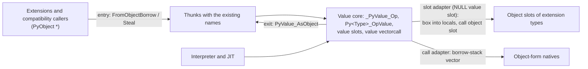
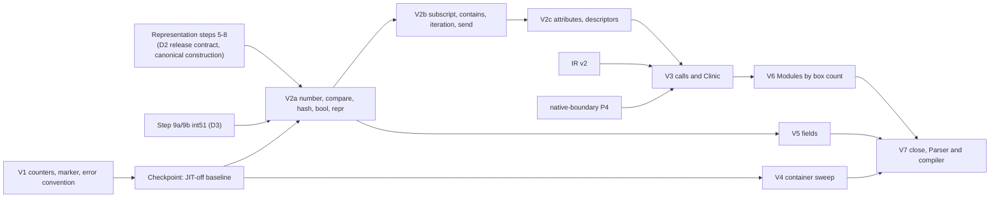

# Value API: a value-native core with an object compatibility layer

Status: draft for review, 2026-11-03. It specifies the user's decision that
`PyValue` is the internal API and `PyObject *` is the compatibility API, and
it is the source for the V packets in section 9.

Source tree: `build/worktrees/pyvalue-rc-universal` in the boil worktree
(`build/` is `/home/power/code/cpython/.worktrees/python-boil-the-ocean/build`),
HEAD `e0a0f05c47d` plus about 50 uncommitted files from packets in progress,
read at 19:00–19:15. File references below are relative to that tree. The
counting scripts are `build/pyjit-link-wave1/valueapi-*.py`.

Related pages: [PyValue representation](pyvalue.md) (encoding, D1–D8),
[native boundary](native-boundary.md) (borrow stack), [extension API](extension-api.md)
(HPy direction), [representation packet](proposals/pyvalue-representation-packet.md),
[register IR](register-ir.md) (IR v2, IR-D3).

## Decisions

| # | Decision | Status |
|---|---|---|
| VA1 | Core code uses the value form. The `PyObject *` API keeps its names as thin thunks over the value form. Core code never calls a thunk. An object becomes a value once, at the API entry; a value becomes an object only when it leaves to an object consumer | Accepted. The cost of the sweep is stated in C8 |
| VA2 | Polymorphic positions are `PyValue`; typed positions keep a pointer type | Accepted with a sharper rule (C1): a position is polymorphic if an exact `int` or `float` can occupy it in an operation that succeeds |
| VA3 | One canonicalising borrow and one canonicalising steal convert `PyObject *` to `PyValue` | Accepted (§1.3). Exact non-NaN floats, not every float, become inline |
| VA4 | Owned boxing (`PyValue_AsObject`) and borrowed boxing through the borrow stack. Small ints box to the cached immortals | Accepted. Holds as built (`_PyValue_BoxInlineValue` calls `PyLong_FromLong`). Slot adapters box into C locals, not the stack (C4) |
| VA5 | A value slot table on every type; `PyType_Ready` fills the missing side; pairs inherit together; `slot_*` functions are native value slots | Accepted with changes: `len` and `iter` need no value slot, `repr`, `str` and `send` do (C2). The extension adapter lives in the dispatcher, and core object thunks are generated per type; `PyType_Ready` fills only the generic pairs (C3, §2.2) |
| VA6 | Value vectorcall, a value builtin convention, value-form Clinic output; object-form natives are reached through the borrow stack | Accepted (§3) |
| VA7 | Arguments borrowed, results owned. Error: `PyValue_NULL`. Absence: three-state `int` with an out parameter | Accepted. `PyValue_NULL` chosen; `PyValue_ERROR` has two producers and is deleted (§1.4) |
| VA8 | `_PyValue_<Op>` for generic operations; `Py<Type>_<Op>Value` for containers | Accepted with the rule stated exactly and 12 renames (§1.5). The suffix collides with the dict sense of "value" (C9) |
| VA9 | Object functions with a value form are marked compatibility-only; a call from a value-native unit is a build error | Accepted with `__attribute__((unavailable))` instead of `deprecated` plus `-Werror` (C7) |
| VA10 | `Objects/`, `Python/`, `Parser/` are value-native at the end; hot `Modules/` are ported by box count; polymorphic fields become `PyValue` | Accepted with a corrected field list (C5) and `Parser/` scheduled last (C6) |
| VA11 | Extensions keep the object API; a public value API is out of scope | Accepted. Constraints in §5.2 |
| VA12 | Box counters by site class in the stats build; recorded, not a gate | Accepted (§6). V1 provides them before the checkpoint |

## Challenges to the brief

**C1 (VA2). "Typed" should mean "no inline value can occupy it".** The brief
lists receivers known to be a str, tuple, type and so on. That misses the
larger class: callables, iterators, file objects, exceptions, descriptors and
the receivers of operations that exact ints and floats do not support. The
test that decides a position is: *does the operation succeed for some exact
`int` or `float` in this position?* If not, the position is an **object
position** and keeps `PyObject *` (or a narrower pointer type). An inline
value that reaches it (`5()`, `len(5)`, `iter(2.5)`) is boxed on that cold
path only so that the upstream `TypeError` is raised. Under this rule the
callable of a call, the receiver of `len`, `iter`, `getitem`, `setitem`,
`contains` and `setattr`, and the class of `isinstance` are object positions;
the receiver of `getattr` (`(5).real`), all arithmetic operands, compare,
hash, truth, repr, container items, keys, call arguments and results are
polymorphic.

**C2 (VA5). The slot list.** `sq_length`/`mp_length` take an object position
and return `Py_ssize_t`; `tp_iter` takes an object position and returns an
iterator, which is never inline (`__iter__` returning `5` raises). Neither
needs a value slot. `tp_repr` and `tp_str` do (an int receiver can be
inline), as do `am_send` (argument and result are polymorphic) and
`nb_index`/`nb_int`/`nb_float` (results are ints or floats).

**C3 (VA5). Extension adapters cannot be derived function pointers.** C has no
closures, so a shared adapter function cannot know which type's object slot it
stands for. Binary dispatch makes this a correctness bug, not a cost:
`binary_op1` drops the right operand's slot when it equals the left one's
(`Objects/abstract.c:958`, `if (slotw == slotv)`). Two different extension
types with the same derived adapter pointer would look like one type, and the
right operand's `__radd__` would never run. The adapter therefore lives in the
value dispatcher: a NULL value slot means "box the operands and call the
object slot" (§2.5). In the other direction, core types need a per-type
object thunk for each value slot, because extensions call
`PyBaseObject_Type.tp_repr(self)` or `PyLong_Type.tp_richcompare(a, b, op)`
with subclass instances and expect that type's implementation. That is 430
thunks (inventory 3), generated by a macro.

**C4 (VA4, VA5). Slot adapters box into C locals.** A slot has at most three
operands. Boxing them into owned C locals and releasing them after the call is
cheaper than a push and a scope, and is safe under the D2 release contract.
The borrow stack stays what [native-boundary.md](native-boundary.md) made it:
the mechanism for variable-length vectors (the call adapter, P4) and parser
outputs.

**C5 (VA10). The field list.** Range iterators already hold C `long`s
(`_PyRangeIterObject`, `Include/internal/pycore_range.h:11`), and `enumerate`
counts in `Py_ssize_t en_index`; their overflow forms (`longrangeiterobject`,
`en_longindex`) hold ints beyond the inline range by construction.
`functools.partial` is in `Modules/` and its fields are an object position
(`fn`), a tuple and a dict. None of these needs a `PyValue` home. Inventory 4
lists the fields that do: slices, range objects, bound-method `self`,
`StopIteration.value`, async-generator wrapped values, the `iter(f, sentinel)`
sentinel, template interpolations, context variables and their HAMT, and
`OrderedDict` node keys.

**C6 (VA10). `Parser/` and the compiler gain nothing at run time.** AST
constants are `PyObject *` (`typedef PyObject * constant`,
`Include/internal/pycore_asdl.h:16`) and compile-time folding calls
`PyNumber_*` (15 calls in `Python/flowgraph.c`). Porting them is needed only
for the invariant "no core unit calls a thunk". Keep them in scope, because an
exemption is an allowlist, but schedule them last (V7).

**C7 (VA9). Use `unavailable`, not `deprecated` plus `-Werror`.**
`__attribute__((unavailable("…")))` is an error at the use site without a
flag. It works in Clang and GCC 12 or later; with GCC 15.2 on this host a call
fails and a definition in the same unit compiles (tested on a scratch file).
`deprecated` depends on every build passing `-Werror=deprecated-declarations`,
and `_Py_COMP_DIAG_IGNORE_DEPR_DECLS` silences it (7 core sites use that
pragma today), so it is not a ratchet. `unavailable` cannot be silenced. Note that
naming a function in a static initializer is also a use: 77 of the 88 core
static types that set `tp_getattro` name `PyObject_GenericGetAttr` (inventory 3). Core type
definitions therefore name only value forms, and `PyType_Ready` fills the
object side of generic pairs from a fixed table (§2.2).

**C8 (VA1). The sweep is the cost.** Core code makes 2172 handwritten calls to
object-form polymorphic APIs, plus 53 in Clinic headers (inventory 1). Under
C1 an argument in an object position needs no conversion; one in a
polymorphic position pays a canonicalising borrow (a type load and two
compares). Every
call that returns a polymorphic result changes the caller's local to
`PyValue`. Each family is swept completely before it is marked (VA9).

**C9 (VA8). "Value" is also a dict word.** `PyDict_ContainsValue(d, key)`
tests a key; `PyDict_NextValue` yields a key and a value. The suffix rule
matches about 40 existing names and is kept for internal names. The public
spelling is decided with the public value API (VA11), where an HPy-style
prefix (`HPyDict_GetItem`) avoids the collision.

**C10 (VA7). Today a NULL `PyValue` result has four meanings.** Error with an
exception set (`PyTuple_GetValue`), an empty cell or an error
(`PyCell_GetValue`), exhaustion or an error (`_PyDictIter_NextValue`), and
out of range with no exception (`_PyList_GetValue`). The convention below
makes NULL mean error only.

**C11 (VA11). Boxing at the compatibility boundary is permanent.**
JavaScriptCore passes value bits through its C API with no boxing because
`JSValueRef` is opaque (§8). `PyObject *` is not opaque: `Py_TYPE`,
`Py_INCREF` and the object macros dereference it. The only way to stop boxing
for extensions is an opaque handle API, which is the HPy direction of
[extension-api.md](extension-api.md).

## 1. The model

### 1.1 Two forms and one boundary



Value-native units are those with `Py_VALUE_CORE` (§4). A thunk converts
polymorphic arguments with the entry primitive, calls the value form and boxes
a polymorphic result with the exit primitive; it calls no other thunk. The
borrowed getters deleted in the link wave stay deleted. The two adapters are
the only places where the core calls object-form code it does not own.

### 1.2 Positions

| Position | Class | Example |
|---|---|---|
| Arithmetic, bitwise and unary operands and results | polymorphic | `_PyValue_Add(PyValue, PyValue) -> PyValue` |
| Compare operands; hash and truth argument | polymorphic | `_PyValue_RichCompareBool(PyValue, PyValue, int)` |
| Repr, str, format argument | polymorphic; result is a typed str | `_PyValue_Repr(PyValue) -> PyObject *` |
| Attribute receiver for get; attribute value | polymorphic | `_PyValue_GetAttr(PyValue, PyObject *name) -> PyValue` |
| Attribute receiver for set and delete | object | `_PyValue_SetAttr(PyObject *, PyObject *name, PyValue)` |
| Container receiver | object | `PyDict_SetValue(PyObject *dict, PyValue key, PyValue value)`: dict object, key and value polymorphic |
| Subscript key, item, iteration result, `in` operand | polymorphic | `_PyValue_GetItem(PyObject *, PyValue) -> PyValue` |
| Callable | object | `_PyValue_Vectorcall(PyObject *, const PyValue *, size_t, PyObject *)` |
| Call arguments and result | polymorphic | as above |
| `isinstance` instance / class | polymorphic / object | `_PyValue_IsInstance(PyValue, PyObject *)` |
| Iterator, exception, type, code, frame, module, str, bytes, tuple, list, dict | object | unchanged `PyObject *` |

### 1.3 Conversions

| Direction | Primitive | Contract | Today |
|---|---|---|---|
| Entry, borrowed | `PyValue_FromObjectBorrow(o)` | Canonical: an exact int in the inline range or an exact non-NaN float becomes inline; otherwise a no-count reference. NULL gives `PyValue_NULL` | Exists (`Python/pyvalue.c`). `PyValue_FromPyObjectBorrow` (raw, 13 uses) merges into it |
| Entry, owned | `PyValue_FromObjectSteal(o)` | Canonical; consumes `o`; frees an int or float box at once (D2 release contract) | `PyValue_FromPyObjectSteal` (155 uses) canonicalises at representation step 8 and is renamed there. `PyValue_PrepareOwned` (32) goes at step 5 |
| Exit, owned | `PyValue_AsObject(v)` | New reference; boxes an inline value; NULL with MemoryError. In the core it does not test `PyErr_Occurred` or `IsLanguageValue` (pyvalue.md G4 item 3); both stay as debug asserts | Exists. `PyValue_AsPyObjectNewBoxed` (13) merges into it |
| Exit, borrowed (call adapter) | `_PyBorrow_ValueVector`, `_PyBorrow_Keep` | Valid until the scope exits ([native-boundary.md](native-boundary.md) §2) | Exist |
| Value in an object position | `PyValue_AsPyObjectBorrow(v)`, `PyValue_AsPyObjectSteal(v)` | Mask the tag. Debug builds assert `PyValue_IsObject` or NULL (today they assert pointer space only) | 846 uses including generated code |

`PyValue_FromPyObjectNew` (53 uses) is deleted:
`PyValue_NewRef(PyValue_FromObjectBorrow(o))` costs the same.
`PyValue_Box` stays as the interpreter's value-to-value box (103 generated
uses), with the NULL error convention; V2 removes most of its uses.

**Identity at the exit.** A boxed inline int in -5..256 is the cached
immortal, so `Py_Is` agrees with upstream for compatibility callers. Other
boxes are fresh, so two exits of one inline value are different pointers,
where upstream returned the same stored object twice. Python `is` uses value
identity ([pyvalue.md](pyvalue.md) §1.7) and is unaffected.

### 1.4 Conventions

* **Ownership.** Arguments are borrowed. Results are owned. This is HPy's
  rule ([extension-api.md](extension-api.md)). A function that consumes an
  argument says so with `Take` in its name. If D4 introduces a distinct C type
  for borrows (pyvalue.md G6, register IR IR-D3), argument positions take that
  type and results stay `PyValue`.
* **Error.** A `PyValue` result signals an error with `PyValue_NULL` and an
  exception set. After D5, `PyValue_NULL` is 0, so the test is one compare,
  and a thunk passes NULL through unchanged.
* **Absence and exhaustion.** Use `int f(…, PyValue *out)`: 1 found (`*out`
  owned), 0 absent or exhausted (`*out` is `PyValue_NULL`, no exception), -1
  error. This matches `PyDict_GetItemRef` and `PyIter_NextItem`. A NULL
  result never means "absent".
* **Absent arguments.** `PyValue_NULL` in an argument position means "not
  given" where the object form uses NULL (delete in `setattr`).
* **`PyValue_ERROR`.** Two producers, both in `Python/ceval.c`:
  `_PyEval_GetIter` (3 returns) and `_PyForIter_VirtualIteratorNext` (2),
  with 4 consumers in `Python/bytecodes.c`. The first becomes a NULL result;
  the second becomes three-state. Then the constant is deleted.
* **Internal iteration ABI.** `_PyValueIndexPair` (`Include/object.h:316`)
  keeps its form: the index is the third state.

### 1.5 Naming

Rules:

1. **Generic operations:** `_PyValue_<Op>`, where `<Op>` is the object-form
   name after `PyObject_` or `PyNumber_` (`_PyValue_Add`, `_PyValue_GetAttr`,
   `_PyValue_RichCompare`, `_PyValue_Vectorcall`). The underscore goes when a
   public value API exists (VA11).
2. **Concrete types:** the object-form name with `Item`, `ItemRef` or
   `EntryRef` replaced by `Value`, else with `Value` appended
   (`PyList_GetItemRef` → `PyList_GetValue`, `PySet_Add` → `PySet_AddValue`,
   `PyCell_Get` → `PyCell_GetValue`, `_PyList_AppendTakeRef` →
   `_PyList_AppendTakeValue`).
3. **Borrowed results:** inline unchecked accessors are upper case
   (`PyTuple_GET_VALUE`); functions returning a borrowed view end in
   `Borrowed`.
4. **Representation operations** in `pycore_value.h` keep their names
   (`PyValue_Is`, `PyValue_DUP`); G6 already merges the duplicate pairs.

Renames and convention fixes:

| Today | Becomes | Uses | When |
|---|---|---|---|
| `PyValue_FromPyObjectSteal` | `PyValue_FromObjectSteal` | 155 | representation step 8 |
| `PyValue_FromPyObjectBorrow` | merged into `PyValue_FromObjectBorrow` | 13 | step 8 |
| `PyValue_FromPyObjectNew`, `…NewMortal`, `…StealMortal` | deleted | 53, 1, 14 | step 8 |
| `PyValue_AsPyObjectNewBoxed` | merged into `PyValue_AsObject` | 13 | V1 |
| `_PyValue_RichCompareObject` (returns `PyObject *`) | `_PyValue_RichCompare` returning `PyValue` | 5 | V2a |
| `_PyObject_GetAttrValue(PyObject *, …)` | `_PyValue_GetAttr(PyValue, …)` | 3 | V2c |
| `_Py_type_getattro_value` | the type's value `getattro` slot (static) | — | V2c |
| `_PyDict_NextBorrowed`, `_PySet_NextBorrowed` | `_PyDict_NextValueBorrowed`, `_PySet_NextValueBorrowed` | 7, 4 | V4 |
| `PyList_GET_VALUE`, `PyStructSequence_GET_VALUE` (out-of-line functions) | inline, per rule 3 | 40, 5 | V4 |
| `PyCell_GetValue` (NULL for empty or error) | `int PyCell_GetValue(PyObject *, PyValue *out)` | 2 | V4 |
| `_PyListIter_NextValue`, `_PyDictIter_NextValue`, `_PySetIter_NextValue`, `_PyTupleIter_NextValue` (NULL for end or error) | three-state, as the value `iternext` slot | — | V2b |
| `_Py_BuiltinCallFast_Value` and 6 other `_Value` call helpers (`pycore_ceval.h`) | deleted by the value vectorcall | — | V3 |

## 2. Value slot table (VA5)

### 2.1 Slots

```c
typedef struct {
    binaryvaluefunc nb_add, nb_subtract, /* … every binary and in-place nb_ slot */;
    ternaryvaluefunc nb_power, nb_inplace_power;      /* PyValue (*)(PyValue, PyValue, PyValue) */
    unaryvaluefunc nb_negative, nb_positive, nb_absolute, nb_invert,
                   nb_int, nb_float, nb_index;        /* PyValue (*)(PyValue) */
    int (*nb_bool)(PyValue);
    PyValue (*richcompare)(PyValue, PyValue, int);
    Py_hash_t (*hash)(PyValue);
    PyObject *(*repr)(PyValue);                       /* typed str result */
    PyObject *(*str)(PyValue);
    PyValue (*getattro)(PyValue self, PyObject *name);
    int (*setattro)(PyObject *self, PyObject *name, PyValue value);  /* NULL deletes */
    PyValue (*descr_get)(PyObject *descr, PyValue obj, PyObject *type);
    int (*descr_set)(PyObject *descr, PyObject *obj, PyValue value);
    PyValue (*subscript)(PyObject *self, PyValue key);
    PyValue (*item)(PyObject *self, Py_ssize_t i);
    int (*ass_subscript)(PyObject *self, PyValue key, PyValue value);
    int (*ass_item)(PyObject *self, Py_ssize_t i, PyValue value);
    int (*contains)(PyObject *self, PyValue item);
    int (*iternext)(PyObject *self, PyValue *out);    /* 1 item, 0 end, -1 error */
    PySendResult (*send)(PyObject *self, PyValue arg, PyValue *out);
    _Py_iteritemfunc iteritem;                        /* today's _tp_iteritem */
    vectorcallvaluefunc call;                         /* §3 */
} PyValueSlots;
```

Each entry pairs with the object slot of the same meaning (`nb_add` with
`tp_as_number->nb_add`, `iternext` with `tp_iternext`, `call` with
`tp_call`/vectorcall). Receivers that are object positions (C1) stay
`PyObject *`. A type gains `PyValueSlots *tp_as_value`, in the same style as
`tp_as_number`; `PyHeapTypeObject` embeds an `as_value`. Generic dispatch
costs the same loads as upstream's `tp_as_number->nb_add`. The existing
value slot `_tp_iteritem` (`Include/cpython/object.h:248`) moves into the
table and keeps its rule: it is never inherited, because a subclass may
override `__iter__`.

### 2.2 Who defines which side

| Type | Value side | Object side |
|---|---|---|
| Core static type | Defined in the type's file | Specific slots: per-type thunks generated by a macro (`_Py_VALUE_THUNKS(long, …)`), named in the static definition. Generic slots (`PyObject_GenericGetAttr`, `PyObject_GenericSetAttr`, `PyObject_HashNotImplemented`): left 0 and filled by `PyType_Ready` from a fixed pair table |
| Extension type (static or `PyType_FromSpec`) | NULL (`tp_as_value` NULL or the entry NULL) | As written by the extension |
| Python class | `slot_*` value functions | Shared object thunks `slot_*_obj` that convert and call the value `slot_*` |

The pair table keeps pointer identity: `tp_getattro == PyObject_GenericGetAttr`
still holds for every type whose value side is
`_PyObject_GenericGetAttrValue`. The core makes 20 such identity tests
(`Objects/object.c` 6, `Objects/typeobject.c` 7, `Python/specialize.c` 4,
`Python/bytecodes.c` 2, `Python/ceval.c` 1); V2 moves them to the value side.

### 2.3 Inheritance

`inherit_slots` (`Objects/typeobject.c:10432`) gets `COPYPAIR` for every
paired slot, in place of `COPYSLOT`/`COPYNUM`/`COPYSEQ`/`COPYMAP`:

1. If the subtype defines **neither** side, copy **both** from the base when
   the base defines the slot at its level (`SLOTDEFINED` on the object side,
   which every type with the slot has). The value side may be NULL (an
   extension base); then it stays NULL.
2. If the subtype defines **only the object side** (an extension subclass of
   `int` that sets `nb_add`), the value side stays NULL. It must not take the
   base's value slot, or `int`'s addition would run for the subclass.
3. A subtype with only the value side does not occur, because core types
   define both sides (2.2). `PyType_Ready` asserts in debug builds that a
   type with a value slot also has its object slot after the pair table is
   applied.
4. Group rules are kept: `tp_richcompare` and `tp_hash` inherit together, and
   the value pair follows the object pair's group decision.
5. `iteritem` is not inherited (2.1).

Upstream's rule that indirect slots are not inherited when the subtype has no
`tp_as_number` storage applies to `tp_as_value`: an extension static subtype
with `tp_as_value` NULL takes the adapter path for every slot. That is
correct and slower; such types are counted (§6).

### 2.4 Python classes: `update_one_slot`, `fixup_slot_dispatchers`, `slot_*`

* `slotdefs` entries name both offsets and both wrappers. A value wrapper
  (`wrap_binaryfunc_l` and so on) calls the value slot, so `int.__add__(5, 3)`
  from Python boxes nothing.
* `update_one_slot` (`typeobject.c:14079`) writes pairs. Where it finds the
  base's wrapper descriptor for the same slot (the "specific" case, so a
  `class MyInt(int): pass` keeps `int`'s implementation), the wrapper's
  `d_wrapped` must identify the pair, and both sides are copied. Otherwise it
  installs the value `slot_*` function and its object thunk. The same holds
  for `update_slot` (`:14263`) after an assignment to a dunder on the class,
  and `fixup_slot_dispatchers` (`:14307`) at class creation.
* The `slot_*` functions (`slot_nb_add` through `SLOT1BINFULL` at `:12650`,
  `slot_tp_richcompare` `:13149`, `slot_tp_hash` `:12981`,
  `slot_tp_iternext` `:13249`, `slot_sq_item` `:12725`, the getattr hook)
  become value functions: they look up the dunder and call it with the value
  vectorcall (§3). A Python `__add__` that receives an inline int gets it in a
  frame slot with no box. `SLOT1BINFULL`'s own two-sided dispatch is kept;
  the shared pointer is deduplicated by `binary_op1` exactly as upstream.

### 2.5 Dispatch and the adapter

The value dispatchers (`_PyValue_Add` and the rest, replacing
`value_binary_operation` in `Python/ceval.c:996` and the boxing in
`Objects/value_ops.c`) read `PyValue_TYPE(v)->tp_as_value`. For each side:

* value slot present: call it with the values;
* value slot NULL, object slot present: box the polymorphic operands into C
  locals (owned), call the object slot, release the boxes, convert the result
  with `PyValue_FromObjectSteal`;
* both NULL: as upstream (NotImplemented or TypeError).

Binary dispatch keeps `binary_op1`'s order and subclass priority. Its
deduplication compares each side's chosen function: the value pointer if
present, else the object pointer. Two extension types therefore never merge,
and an `int` subclass that inherits the pair deduplicates against `int`
exactly as upstream.

Unary, compare, hash, truth, repr and getattr have one receiver and use the
same rule with one side. Direct slot calls in the core bypass the dispatcher
(33 sites, for example `tp_iternext` called through `Py_TYPE(it)`); V2 turns
each into a dispatcher call or a value-slot call.

## 3. Calls (VA6)

* **Value vectorcall.** `typedef PyValue (*vectorcallvaluefunc)(PyObject
  *callable, const PyValue *args, size_t nargsf, PyObject *kwnames);` stored
  as the `call` value slot. Python functions implement it by initialising a
  frame from the values (what the interpreter already does for Python-to-Python
  calls). Bound methods prepend `self` as a value. Types implement it for
  construction.
* **Builtins.** A new flag `METH_VALUE`, used with `METH_FASTCALL |
  METH_KEYWORDS` (and `METH_METHOD`): `PyValue (*)(PyValue self, const PyValue
  *args, Py_ssize_t nargs, PyObject *kwnames)`. `self` is a value because
  methods of `int` and `float` receive inline receivers. The builtin and
  method-descriptor types' `call` slot dispatches on the flag.
* **Object-form natives.** A builtin without `METH_VALUE`, an extension
  `tp_call`, or an extension type's vectorcall is reached through
  `_PyBorrow_ValueVector` inside a borrow scope (native-boundary P4). This is
  the only use of the borrow stack for calls and it replaces
  `VALUES_TO_PYOBJECTS` (10 uses).
* **Argument Clinic.** A file-level directive selects value emission. The
  generated header then starts with `#ifndef Py_VALUE_CORE #error`, so a
  mismatch fails the build. In value emission, `object` parameters become
  borrowed `PyValue`; `int`, `Py_ssize_t`, `double` and `bool` converters
  read the inline word directly (no box, no `PyLong_AsLong` call);
  `object(subclass_of=…)` and the str, bytes and buffer converters test
  `PyValue_IsObject` and then work as today. Object emission is unchanged for
  other files. Inventory 6 sizes this: 181 of 435 core Clinic functions take a
  polymorphic parameter.

## 4. Enforcement (VA9)

```c
/* Include/pyport.h, after the Py_BUILD_CORE_BUILTIN/MODULE logic */
#if defined(Py_BUILD_CORE) && !defined(Py_BUILD_CORE_BUILTIN) \
    && !defined(Py_BUILD_CORE_MODULE) && !defined(Py_VALUE_CORE)
#  define Py_VALUE_CORE 1
#endif
#if defined(Py_VALUE_CORE) && (defined(__clang__) || __GNUC__ >= 12)
#  define Py_VALUE_COMPAT(REPLACEMENT) \
       __attribute__((unavailable("compatibility API; use " #REPLACEMENT)))
#elif defined(Py_VALUE_CORE)
#  define Py_VALUE_COMPAT(REPLACEMENT) Py_DEPRECATED(0)  /* with -Werror=deprecated-declarations */
#else
#  define Py_VALUE_COMPAT(REPLACEMENT)
#endif
```

* Every unit built with `PY_CORE_CFLAGS` is value-native: `Objects/`,
  `Python/`, `Parser/`, and the few `Modules/` and `Programs/` files built
  into the core with those flags (for example `Modules/main.c`,
  `Modules/getpath.c`, `Modules/getbuildinfo.c`, `Programs/python.c`). A ported module adds `#define Py_VALUE_CORE 1` before
  `Python.h`. No Makefile change and no list of files.
* A family is marked in the packet that sweeps its last core caller:
  `Py_VALUE_COMPAT(_PyValue_Add) PyAPI_FUNC(PyObject *) PyNumber_Add(…);`.
  Thunk definitions compile, because a definition is not a use. A thunk that
  calls another thunk fails, which enforces "thunks call value forms only".
* External extensions never define `Py_VALUE_CORE` and see no attribute.
* Generated code (`Python/generated_*.c.h`, Clinic headers, `Python-ast.c`) is
  compiled in value-native units, so its generators are fixed in the same
  packet as the family.
* V1 adds one marked test declaration and `Tools/build/check_value_api.py`,
  which compiles a one-line unit that calls it and expects the error.

The ratchet has no allowlist: a family is either swept and marked, or not yet
marked.

## 5. Scope (VA10) and external extensions (VA11)

### 5.1 Internal scope

* **End state.** No unit with `Py_VALUE_CORE` calls a marked function.
* **`Modules/`.** Hot accelerators are ported in V6, ordered by the box
  counters (§6). Until the checkpoint provides them, the static proxy is the
  object-form call count (inventory 1, `Modules/` columns): `_pickle.c` 149,
  `_ctypes/_ctypes.c` 116, `posixmodule.c` 104, `_datetimemodule.c` 92,
  `_operator.c` 90, `_asynciomodule.c` 88, `_elementtree.c` 81,
  `itertoolsmodule.c` 71. Unported modules are compatibility users and need
  no change.
* **Fields.** Inventory 4 is the V5 list.

### 5.2 Constraints on a future public value API

* The value API's conventions are HPy's: borrowed arguments, owned results,
  Dup and Close, NULL on error. An HPy-compatible backend can then map an
  `HPy` handle to a `PyValue` word one to one, as JavaScriptCore maps
  `JSValueRef` to `JSValue` bits on 64-bit platforms (§8). Handles carry no
  borrow bit.
* No public header exposes the encoding, inline accessors, or pointers into
  container storage. Today `Include/pyvalue.h` is included by `Python.h` for
  every non-limited extension, and `PyTuple_GET_VALUE` is in
  `Include/cpython/tupleobject.h`; open question 2.
* Rebuilt `Python.h` extensions are compatibility users for good. Their cost
  is the box at each exit (C11).

## 6. Measurement (VA12)

* **Counters.** `PyStats` object stats gain `box[site]` and `entry_unbox[site]`
  (boxes freed or skipped by canonical entry). The out-of-line boxer takes a
  site argument in stats builds only (`_PyValue_AsObjectAt(v, SITE)`; a macro
  drops it otherwise). `Tools/scripts/summarize_stats.py` prints a "Boxing by
  site" table. The existing `inline_int_boxes`/`inline_float_boxes`
  (`Include/cpython/pystats.h:108`) become the totals.
* **Site classes.**

  | Class | Where | Unit |
  |---|---|---|
  | Compatibility exit, by family | Each thunk passes its family (number, compare, repr, sequence, iteration, attribute, call, list, tuple, dict, set, cell/structseq) | box |
  | Slot adapter, by slot | Dispatcher path for a NULL value slot (§2.5) | box |
  | Call adapter | `_PyBorrow_ValueVector`, `_PyBorrow_TupleItems` | box |
  | Parser output | `getargs.c` pushes | box |
  | Interpreter handler | Generator-inserted `PyValue_Box`, `_PyValueTemps_Object` | box |
  | Field store | A polymorphic value written to a `PyObject *` field (V5 list) | box |
  | Object-slot thunk of a core type | Thunks called by extensions | box |

* **Use.** The stats run of the in-tree benchmark set records the table with
  every V packet. The counts order V2a/V2b/V2c and V6. They are not a gate.

## 7. Inventory (measured)

Commands run from the source tree; `B=build/pyjit-link-wave1`. Counts are
lexical: a call is a name followed by `(` that is not a column-0 definition
or a `#define` line, with comments stripped.

### 7.1 Object-form polymorphic calls in `Objects/`, `Python/`, `Parser/`

`python3 -I $B/valueapi-objcalls.py .` (excludes `generated_*.c.h`,
`Python-ast.c` and `*/clinic/*.h`; Clinic headers are listed after the table;
`… Modules` gives the `Modules/` column).

| Family | Calls | Files | Top files | Top functions | `Modules/` |
|---|---|---|---|---|---|
| Number | 153 | 31 | `rangeobject.c` 31, `flowgraph.c` 15, `abstract.c` 11, `longobject.c` 10 | `PyNumber_AsSsize_t` 32, `_PyNumber_Index` 25, `PyNumber_Add` 18 | 176 |
| Compare, hash, bool | 162 | 44 | `rangeobject.c` 23, `bltinmodule.c` 10, `codeobject.c` 7, `object.c` 7 | `PyObject_RichCompareBool` 55, `PyObject_IsTrue` 43, `PyObject_Hash` 33 | 156 |
| Repr, str, format | 66 | 29 | `exceptions.c` 12, `object.c` 5, `unicodeobject.c` 5 | `PyObject_Str` 33, `PyObject_Repr` 23 | 29 |
| Sequence and mapping | 242 | 44 | `abstract.c` 39, `ceval.c` 22, `dictobject.c` 13, `import.c` 12 | `PyMapping_GetOptionalItem` 25, `PyObject_GetItem` 21, `PySequence_List` 20 | 239 |
| Iteration | 111 | 26 | `bltinmodule.c` 22, `dictobject.c` 14, `abstract.c` 12, `setobject.c` 10 | `PyObject_GetIter` 52, `PyIter_Next` 37, direct `tp_iternext` 10 | 116 |
| Attribute | 275 | 44 | `object.c` 31, `typeobject.c` 30, `bltinmodule.c` 15, `crossinterp.c` 15 | `PyObject_GetOptionalAttr` 72, `PyObject_GetAttr` 57, `PyObject_SetAttr` 30 | 299 |
| Call | 284 | 58 | `call.c` 27, `typeobject.c` 27, `import.c` 13, `descrobject.c` 11 | `PyObject_CallOneArg` 55, `PyObject_Vectorcall` 29, `_PyObject_CallNoArgs` 27 | 468 |
| List | 130 | 39 | `exceptions.c` 10, `stringlib/split.h` 10, `import.c` 9, `marshal.c` 8 | `PyList_Append` 55, `PyList_GetItemRef` 34, `PyList_SET_ITEM` 24 | 277 |
| Tuple | 297 | 62 | `exceptions.c` 35, `typeobject.c` 25, `genericaliasobject.c` 22 | `PyTuple_GetItemRef` 115, `PyTuple_SET_ITEM` 100, `PyTuple_Pack` 43 | 450 |
| Dict | 352 | 47 | `typeobject.c` 67, `import.c` 35, `sysmodule.c` 27, `moduleobject.c` 26 | `PyDict_SetItem` 88, `PyDict_GetItemRef` 77, `PyDict_SetItemString` 63 | 342 |
| Set | 69 | 18 | `symtable.c` 29, `codeobject.c` 6, `ceval.c` 5 | `PySet_Add` 27, `PySet_Contains` 25 | 41 |
| Struct sequence, cell | 31 | 10 | `sysmodule.c` 10, `longobject.c` 4, `typeobject.c` 4 | `PyStructSequence_SET_ITEM` 19, `PyCell_Get` 6 | 125 |
| **Total** | **2172** | | | | **2718** |

Clinic headers in core add 53 calls (27 `_PyNumber_Index`, 26
`PyObject_IsTrue`), which value emission removes. The family counts are upper
bounds for the sweep: under C1, functions whose operand is an object position
(`PyObject_GetIter` 52, `PySequence_List` 20, `PyObject_Size`) keep their
object form and are not swept.

### 7.2 Existing value-form functions

`python3 -I $B/valueapi-valuefuncs.py .` lists every declaration in
`Include/` with `PyValue` in its signature; the output is
`$B/valueapi-valuefuncs.tsv` (234 entries after 7 false matches such as
`PyUnicode_MAX_CHAR_VALUE`).

| Area | Entries | Representative signatures and conventions |
|---|---|---|
| Representation and ops (`pycore_value.h`, `pyvalue.h`, `pycore_value_ops.h`) | 112 | `PyValue PyValue_FromObjectBorrow(PyObject *)` canonical; `PyValue PyValue_FromPyObjectSteal(PyObject *)` raw; `PyObject *PyValue_AsObject(PyValue)` new ref or NULL; `PyValue PyValue_Box(PyValue)` returns its input on failure; `Py_hash_t _PyValue_Hash(PyValue)`; `int _PyValue_RichCompareBool(PyValue, PyValue, int)`; `PyObject *_PyValue_RichCompareObject(…)` |
| Containers (tuple, list, dict, set, cell, structseq) | 59 | `PyValue PyTuple_GetValue(PyObject *, Py_ssize_t)` owned, NULL on error; `int PyDict_GetValue(PyObject *, PyValue, PyValue *)` three-state; `int PyDict_SetValue(PyObject *, PyValue, PyValue)` borrows both; `int _PyList_AppendTakeValue(PyListObject *, PyValue)` steals; `PyObject *_PyTuple_FromValueStealOnSuccess(const PyValue *, Py_ssize_t)` |
| Interpreter (`pycore_ceval.h`, `pycore_code.h`, frames, JIT, native scope, borrow) | 52 | `PyObject *_Py_BuiltinCallFast_Value(PyValue, PyValue *, int)` object result; `PyValue _PyEval_GetIter(PyValue, PyValue *, int)` ERROR on error; 16 `_Py_Specialize_*` take `PyValue` operands |
| Object, type, member (`pycore_object.h`, `pycore_typeobject.h`, `pycore_descrobject.h`) | 11 | `PyValue _PyObject_GetAttrValue(PyObject *, PyObject *)` object receiver; `PyValue _PyMember_GetValue(PyObject *, PyMemberDef *)`; `int _PyObject_GetMethodValue(…)` |

Inconsistencies, besides C9 and C10:

1. `PyValue_FromObjectBorrow` canonicalises and accepts NULL;
   `PyValue_FromPyObjectBorrow`, one `Py` apart, does neither.
2. Three boxing exits fail three ways: `PyValue_Box` returns its input with
   an exception set; `PyValue_AsObject` returns NULL, raises `SystemError`
   for a non-language value and fails if an exception was already pending;
   `PyValue_AsPyObjectNewBoxed` returns NULL.
3. `PyValue_AsPyObjectBorrow` of an inline value is a garbage pointer in
   release builds.
4. Generic value operations return objects (`_PyValue_RichCompareObject`) or
   take object receivers (`_PyObject_GetAttrValue`).
5. `PyList_GET_VALUE` and `PyStructSequence_GET_VALUE` are out-of-line
   functions with macro names; `PyTuple_GET_VALUE` is inline.
6. Three spellings of "consumes": `Take` (`_PyList_AppendTakeValue`), `Take2`
   (`_PyDict_SetValue_Take2`), `StealOnSuccess`
   (`_PyTuple_FromValueStealOnSuccess`). Keep `Take` for single arguments
   and `StealOnSuccess` for arrays.
7. `_Py_dict_lookup` takes a `PyValue` key with no marker in its name.

### 7.3 Polymorphic slots in core static types

`python3 -I $B/valueapi-slots.py .` parses 129 static `PyTypeObject`
definitions in `Objects/`, `Python/`, `Parser/` (positional and designated
initialisers, with their number, sequence, mapping and async tables). The
last column counts `PyType_Slot` entries in core spec-based types.

| Slot | Types | Spec | Slot | Types | Spec |
|---|---|---|---|---|---|
| `tp_getattro` | 88 (77 `PyObject_GenericGetAttr`) | 2 | `nb_or` | 18 | 2 |
| `tp_repr` | 67 | 8 | `sq_contains` | 18 | 0 |
| `tp_iternext` | 37 | 1 | `mp_subscript` | 17 | 0 |
| `tp_richcompare` | 35 | 2 | `nb_subtract` | 9 | 0 |
| `tp_hash` | 32 (11 generic) | 0 | `nb_bool`, `nb_and`, `nb_xor` | 8 each | 0 |
| `tp_call` | 16 | 1 | `mp_ass_subscript` | 8 | 0 |
| `tp_vectorcall` | 20 | 0 | `nb_remainder`, `nb_inplace_or` | 7 each | 0 |
| `tp_descr_get` | 12 | 0 | `sq_item` | 7 | 0 |
| `tp_setattro` | 12 (9 generic) | 1 | `nb_add`, `nb_multiply`, `nb_power`, unary ops, `nb_true_divide` | 5 each | 0 |
| `tp_str` | 11 | 0 | `nb_int`, `nb_float`, `nb_floor_divide`, `nb_divmod`, `nb_invert` | 4 each | 0 |
| `am_send` | 4 | 0 | `nb_index`, `nb_lshift`, `nb_rshift` | 3 each | 0 |
| `tp_descr_set` | 3 | 0 | `sq_ass_item`, in-place number slots | 2–3 each | 0 |

One definition is misaligned by the parser (a `bytes_str` in a `tp_getattro`
position), so single counts may be off by one. Total: 527 polymorphic slot
entries, of which 97 name a generic function;
**430 need a per-type object thunk** (C3). `Modules/` adds 54 static types and
1487 spec slot entries of all kinds (`… Modules`), which stay object-side
until ported. `sq_length`/`mp_length` (14 each) and `tp_iter` (61) need no value
slot (C2).

### 7.4 Polymorphic `PyObject *` fields of core objects

`rg -o '\b(_Py_T_OBJECT|Py_T_OBJECT_EX)\b' Objects Python -g '*.c' | wc -l`
gives 105 object-member tokens in `Objects/` and `Python/`, against 25
`_Py_T_VALUE`/`_Py_T_VALUE_EX` tokens.
`rg -n -U '\{\s*"(\w+)",\s*(_Py_T_OBJECT|Py_T_OBJECT_EX)\s*,\s*\n?\s*offsetof\((\w+)' -o -r '$3.$1' Objects Python -g '*.c'`
lists the members by struct. The fields below were classified by hand with the
C1 test, after `rg -n 'PyObject \*(start|stop|step|value|self|…);'` over the
struct definitions.

| Field | Where | Heat |
|---|---|---|
| `PySliceObject.start`, `stop`, `step` | `Include/cpython/sliceobject.h:14` | Warm: three-part slices and slices of types other than exact list, tuple and str (`_PyEval_BinarySlice` in `Python/ceval.c:4444` slices those three without a slice object) |
| `rangeobject.start`, `stop`, `step`, `length` | `Objects/rangeobject.c:37` | Hot: every `range(n)` with `n` above 256 boxes `stop` and `length` |
| `PyCFunctionObject.m_self` | `Include/cpython/methodobject.h:10` | Warm: `(5).bit_length` as a bound object |
| `wrapperobject.self` (method-wrapper) | `Objects/descrobject.c:1387` | Warm: `(5).__add__` |
| `PyMethodObject.im_self` | `Include/cpython/classobject.h:15` | Cold for exact numbers |
| `PyStopIterationObject.value` | `Include/cpython/pyerrors.h:73` | Warm: generator return values seen by `next()` and `send` |
| `_PyAsyncGenWrappedValue.agw_val`, `PyAsyncGenASend.ags_sendval` | `Objects/genobject.c:1690`, `:1665` | Warm: every async-generator `yield` |
| `calliterobject.it_sentinel` | `Objects/iterobject.c:211` | Warm: compared with every result of `iter(f, 0)` |
| `interpolationobject.value` | `Objects/interpolationobject.c:43` | Warm: t-strings |
| `PyContextVar.var_default`, `PyContextToken.tok_oldval`, HAMT `b_array[]` | `Include/internal/pycore_context.h:35`, `:49`; `Include/internal/pycore_structs.h:54` | Warm: context variables; the HAMT is a container |
| `_odictnode.key` | `Objects/odictobject.c:512` | Warm: `OrderedDict` with int keys |
| `PyOSErrorObject.myerrno`, `winerror`, `filename`; `PySyntaxErrorObject.lineno`, `offset`, `end_lineno`, `end_offset`; `PySystemExitObject.code`; `PyAttributeErrorObject.obj` | `Include/cpython/pyerrors.h` | Cold |
| `PyFunctionObject.func_doc`, `func_module`; `propertyobject.prop_doc`; classmethod `cm_callable`; TypeVar `bound`, `default_value`; type alias `value` | `funcobject.h:39`, `:42`; `descrobject.c`; `funcobject.c:1498`; `typevarobject.c:26`, `:30`, `:65` | Cold (any value is legal) |
| AST `constant` | `Include/internal/pycore_asdl.h:16` | Compile time only (C6) |

Not homes: the iterators of C5, and callables, iterators, exceptions, tuples
and dicts held in fields. Candidate `Modules/` homes for V6, from reading
and not counted: `collections.deque` blocks, `itertools` (`count`, `repeat`, `accumulate`, `groupby`, `tee` data,
`zip_longest` fill value), `operator.itemgetter` items, `_pickle` memo
arrays.

### 7.5 Boxing sites in `Objects/` and `Python/`

`rg -c '\b(PyValue_AsObject|PyValue_AsPyObjectNewBoxed|PyValue_Box|_PyValue_BoxInto|_PyValueTemps_Box|_PyValueTemps_Object|_PyBorrow_TupleItems|_PyBorrow_ValueVector|_PyValue_BoxInlineValue|VALUES_TO_PYOBJECTS)\s*\(' Objects Python -g '!generated_*' -g '!Python-ast.c' -g '!*/clinic/*'`

| File | Sites | File | Sites |
|---|---|---|---|
| `Python/ceval.c` | 31 | `Python/borrow.c` | 5 |
| `Python/bytecodes.c` | 14 | `Python/native_scope.c` | 4 |
| `Objects/dictobject.c` | 14 | `Objects/value_ops.c`, `tupleobject.c`, `setobject.c` | 3 each |
| `Objects/call.c` | 11 | `Python/compile.c`, `Objects/structseq.c`, `frameobject.c`, `codeobject.c`, `cellobject.c`, `abstract.c` | 2 each |
| `Objects/typeobject.c` | 8 | 6 more files | 1 each |
| `Python/getargs.c`, `Objects/listobject.c` | 6 each | **Total** | **131 in 25 files** |
| `Python/pyvalue.c` | 5 | Generated (`generated_ir_cases.c.h` 111, `generated_jit_helpers.c.h` 7) | 118 |

By function: `PyValue_AsObject` 61, `_PyValueTemps_Object` 28,
`_PyBorrow_TupleItems` 13, `PyValue_AsPyObjectNewBoxed` 11,
`VALUES_TO_PYOBJECTS` 10, `_PyBorrow_ValueVector` 4, `PyValue_Box` 2,
`_PyValue_BoxInlineValue` 1, `_PyValueTemps_Box` 1. The
owning object getters box too: core calls `PyTuple_GetItemRef` 115 times,
`PyDict_GetItemRef` 77 and `PyList_GetItemRef` 34 (7.1).

### 7.6 Clinic

`python3 -I $B/valueapi-clinic.py .` reads every `[clinic input]` block and
counts parameters whose converter is `object` without `subclass_of`, plus
`*args`.

| Scope | Functions | With a polymorphic parameter | Parameters | Polymorphic |
|---|---|---|---|---|
| `Objects/`, `Python/`, `Parser/` | 435 | 181 | 501 | 258 |
| `Modules/` | 2111 | 726 | 3087 | 1191 |

Top core files: `bltinmodule.c` 34 functions, `bytearrayobject.c` 18,
`sysmodule.c` 16, `bytesobject.c` 12, `typevarobject.c` 12,
`unicodeobject.c` 11, `listobject.c` 9.

## 8. Prior art

| System | Internal form | API form | What it changes here |
|---|---|---|---|
| V8 | Tagged `Object` (Smi or heap pointer) | `Local<Value>` handles in `HandleScope`s. `src/api/api.cc` converts with `Utils::OpenHandle`/`Utils::ToLocal`; internal code never includes `v8.h` ([embedding](https://v8.dev/docs/embed), [api.cc](https://chromium.googlesource.com/v8/v8/+/refs/heads/main/src/api/api.cc)) | Supports VA1 and VA9: the API is a layer that the engine does not call. V8's fast API calls let an embedder function take unboxed C arguments from a typed signature ([v8-fast-api-calls.h](https://chromium.googlesource.com/v8/v8/+/refs/heads/main/include/v8-fast-api-calls.h)); value-form Clinic does the same for `int` and `double` converters |
| JavaScriptCore | NaN-boxed `JSValue` ([JSCJSValue.h](https://github.com/WebKit/WebKit/blob/main/Source/JavaScriptCore/runtime/JSCJSValue.h)) | Opaque `JSValueRef`. On 64-bit, `toRef` is a bit cast of the encoded value; on 32-bit, a non-cell is boxed in a `JSAPIValueWrapper` ([APICast.h](https://github.com/WebKit/WebKit/blob/main/Source/JavaScriptCore/API/APICast.h)) | An opaque handle can carry immediates with no box (C11, §5.2). Our compatibility layer is JSC's 32-bit case: `PyObject *` is not opaque, so it boxes |
| Lua 5.4, LuaJIT | Tagged `TValue` | Stack-indexed C API: `lua_tointeger(L, i)`, `lua_pushnumber`; no pointer to a value leaves the VM ([manual §4](https://www.lua.org/manual/5.4/manual.html#4)) | The borrow stack is the same idea for parser outputs and call vectors: lifetime is the native frame, not the caller's bookkeeping |
| HPy | Interpreter's own | Opaque `HPy` handles; borrowed arguments, owned results, `HPy_Dup`/`HPy_Close`. CPython ABI mode makes a handle a `PyObject *`; universal mode uses a handle table ([ABI modes](https://docs.hpyproject.org/en/latest/overview.html)) | Fixes the value API's conventions (§1.4) so that a universal-mode backend maps a handle to a `PyValue` word. CPython ABI mode would box like the thunks |
| PyPy cpyext | `W_Root` objects, list strategies | Materialised `PyObject *` per object crossing to C, linked to the `W_Root`. `PyList_GetItem` on an integer-strategy list converts the whole list, because a borrowed box would leak; passing one int argument cost about twice a no-argument call ([Cuni, 2018](https://www.pypy.org/posts/2018/09/inside-cpyext-why-emulating-cpython-c-8083064623681286567.html)) | The deleted borrowed getters and counted boxes (VA12) are the answer to the same problem; no identity map and no box cache |
| CPython `_PyStackRef` | Tagged references in frames only; tagged ints only for interpreter indices | Every C call converts with `PyStackRef_AsPyObjectBorrow`; heap storage is `PyObject *` ([pycore_stackref.h](https://github.com/python/cpython/blob/main/Include/internal/pycore_stackref.h)) | Upstream keeps the boundary at the frame. We move it to the C API edge, which is why this page needs value slots and value calls that upstream does not |

## 9. Rollout

Every packet lands alone with the full suite at its baseline pass set, records
the box table (§6) and the in-tree benchmarks, and is gated on correctness
only. Sizes are estimates.



| Packet | Content | Entry | Exit | Size |
|---|---|---|---|---|
| **V1** | Box counters by site (§6) with the stats summary; `Py_VALUE_CORE`, `Py_VALUE_COMPAT` and the check script (§4); delete `PyValue_ERROR` (2 producers); merge `PyValue_AsPyObjectNewBoxed` into `PyValue_AsObject` and drop its `PyErr_Occurred` test in the core | Runtime links and the suite runs | Stats build prints the box table; the check script fails as designed; no family marked | Small (≈3 agent-h) |
| **Checkpoint** | JIT-off baseline against upstream, with the box table | V1 and the representation packet | Box table recorded | — |
| **V2a** | `PyValueSlots`, `tp_as_value`, pair inheritance (§2.3), slotdefs pairs and `update_one_slot` (§2.4), dispatcher with adapter (§2.5), thunk macro; value slots for number, compare, hash, bool, repr, str on `int`, `float`, `complex`, `bool`, `str`, `bytes`, `tuple`, `list`, `dict`, `set`, `range`, `NoneType` and the rest of the 129 types; value `slot_*` for Python classes; interpreter generic `BINARY_OP`, `COMPARE_OP`, `TO_BOOL` use dispatchers; rewrite `value_ops.c`; sweep 381 calls; mark the families | Checkpoint; representation steps 7, 8 and 9a (int slots are written once for int51 with inline-only guards) | Zero core calls to `PyNumber_*`, `PyObject_RichCompare*`, `PyObject_Hash`, `PyObject_IsTrue`/`Not`, `PyObject_Repr`/`Str`/`ASCII`/`Format`; adapter box count recorded | Large (≈20 agent-h) |
| **V2b** | Value slots `subscript`, `item`, `ass_*`, `contains`, `iternext`, `send`, `iteritem`; three-state `_PyValue_IterNext`; the four `*Iter_NextValue` helpers become `iternext` slots; sweep the polymorphic part of 353 calls | V2a | Families marked; `FOR_ITER` generic path boxes nothing for core iterators | Medium (≈10) |
| **V2c** | `getattro` with a value receiver, `descr_get`, `setattro`, `descr_set`; generic attribute pair; the 20 identity tests; sweep 275 | V2b | Families marked; `(5).real` boxes nothing | Medium (≈10) |
| **V3** | Value vectorcall slot, `METH_VALUE`, Python-function value calls, value `slot_*` calls, call adapter on the borrow stack, Clinic value emission and regeneration of core Clinic output (435 functions, 181 with polymorphic parameters), sweep 284 | V2c; IR v2 (call handler shapes, IR-D1 G4); native-boundary P4 | `VALUES_TO_PYOBJECTS` and the `_Value` call helpers deleted; call family marked | Large (≈18) |
| **V4** | Container value forms primary; renames of §1.5; object getters and setters become thunks; sweep 879 calls (mechanical) | Checkpoint (independent of V2) | List, tuple, dict, set, cell and struct-sequence families marked | Medium, mechanical (≈10) |
| **V5** | Fields of 7.4 (hot and warm rows) become `PyValue` homes with `_Py_T_VALUE` members | V2a (range and slice code then uses value number operations) | Field-store box count near zero on the benchmarks | Medium (≈8) |
| **V6** | Port `Modules/` accelerators in box-count order; each adds `Py_VALUE_CORE` | V3 and V4 | Each ported module has no compatibility calls | Per module |
| **V7** | Remaining families, `Parser/` and the compiler (C6), generator fixes; every object function with a value form is marked | All above | No `Py_VALUE_CORE` unit calls a marked function | Medium |

Dependencies on other plans:

* **Representation packet.** V2a needs canonical construction (step 8), so a
  value slot never meets a boxed small int, and the release contract and
  restore-helper removal (steps 5–7), so `value_ops.c` is rewritten once.
  It needs int51 (step 9a), so `int`'s value slots are written once. D5
  (NULL = 0) makes the error test one compare but is not a semantic
  dependency; V1 does not wait for it.
* **Register IR v2.** V3 changes the call handlers that IR v2 reshapes (calls
  without a result destination, no `PUSH_NULL`). V2a changes only helpers the
  handlers call. The typed borrow (IR-D3, D4) changes argument types (§1.4).
* **Checkpoint.** It happens after V1 and before V2a. V1 must provide the box
  counters so the baseline records where boxes come from.

## 10. Open questions

1. **Typed-position entry cost.** The canonical borrow loads the type of
   every object it converts. Measure it at V2a; if it shows, add a
   debug-checked `_PyValue_FromObjectKnown` for pointers that cannot be exact
   ints or floats.
2. **`pyvalue.h` visibility.** D6 keeps `pyvalue.h` public outside the
   limited API, and `PyTuple_GET_VALUE` is in `Include/cpython`. Under VA11
   both expose the encoding to extensions. Move them to `Include/internal` in
   V1, or wait for the public API decision?
3. **Public names (C9).** Decide the public spelling with the HPy backend:
   keep `Py<Type>_<Op>Value`, or take an HPy-style prefix.
4. **D7 in pyvalue.md** still reads "decide after baseline". This page records
   the decision that value slots exist; the decisions table should say so.
5. **`StopIteration.value` and generator returns.** The value `iternext`
   drops a generator's return value as `PyIter_NextItem` does; `send` carries
   it. Confirm no core caller relies on `tp_iternext` setting
   `StopIteration(value)`.
6. **Extension subtypes of core types** with `tp_as_value` NULL take the
   adapter for every slot. Should `PyType_Ready` allocate value storage for
   them, so that unmodified slots keep the base's value pair?
