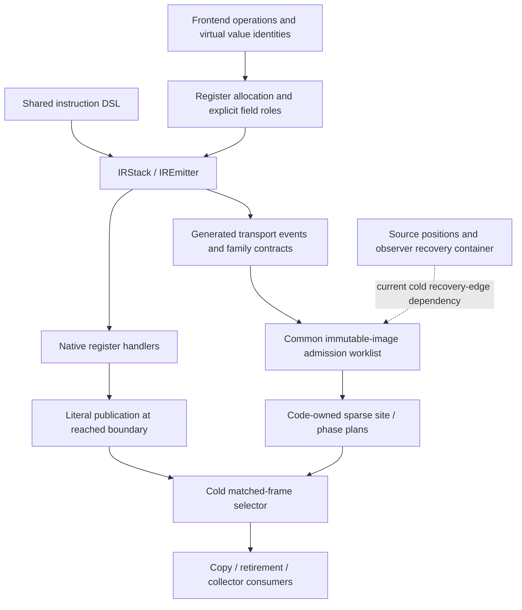

# Semantic ownership and phase plans

Status: active model55 source, with NULL homes and conservative arena scanning
still authoritative. The first phase composition through `ed08ab64c7e` has
both-role focused, native and performance evidence. Later copy/created/return
ports have focused evidence. The integrated disjoint-child/EH-prefix source
`5cc8b675e3d` builds both roles; complete qualification remains open. The next
async-exit admission bridge is `0ac9e26413c`. Explicit delegated suspension is
source-reviewed in `30a3dd63963`, composed with that integrated base in
`6063d7c6385`, and still awaits merged generation and native qualification. The
[report](report.md) owns exact results; the [ledger](implementation.md) owns
stage completion. This document describes implemented contracts and separates
remaining M4 requirements. The [target model](../../design/proposals/register-call-model55.md)
and [reader census](lifecycle-readers.md) cover the complete migration.

## One source of transport facts

The shared `IRStack`/`IREmitter` produces executable C and ownership events
from the same loads, detaches, publications, helper invocations and terminal
commits. Declared logical stack IO supplies frontend conversion; it is not the
physical register footprint after folding or allocation. Explicit field roles,
actual output moves and selected outgoing edges supply that footprint.

Ordinary dispatch does not decode the phase plan. SiteId is an immutable word
offset under the independently owned executing-code pin; it is neither a
handler address nor the function's mutable code. Phase publication is a literal
store at an actual reached boundary. Phase zero cannot reacquire authority.

Opaque frame/window accesses and unconverted helper effects lose coverage.
Audited leaf bodies remain narrow source guards while their transport is
ported. Exact body matching is not general C verification. The bitmap branch's
[temporary writer footprint bridge](bitmap-writer-capability-plan.md) must be
replaced by emitter-owned home-write/helper adapters before final selection.

## Facts and authority

Keep these properties distinct:

| Property | Meaning |
| --- | --- |
| Named binding state | Initialized nullable binding, mutable through supported local proxies; cell contents have their own boundness. Hidden constants remain readonly. |
| Initialized/readable scratch | A canonical language value, permitted NULL protocol or explicit tagged control exists at this home on every incoming path. |
| Logical owner obligation | A value must be transferred or released; inline and immortal values may require no decref. |
| Counted edge | The canonical runtime tag carries a physical count; cyclic subtraction visits each such edge once. |
| `NO_HOME` | No logical owner occupies this scratch home. It grants neither a readable value nor a physical NULL fact. |
| Physical NULL | A positively proved canonical NULL representation; distinct from stale nonowning child-header bytes. |

Must facts intersect at joins; possible owner obligations union. A MAY owner
without must initialization cannot authorize a stale read. Unknown transfers
never manufacture absence, initialization or completeness. A returning child
can leave nonowning overlay bytes: its drained homes may be logically empty
without containing NULL.

`_PyIRHomeAuthority` distinguishes NONE, shadow CANDIDATE, MUST_READABLE and an
explicit development NULL-control adapter. The 16-byte view contains the
binding count, scratch limit and borrowed selected ranges. Copy/collection must
require the authority needed for the actual action; an uncovered view is not
an empty scratch shape.

## Generated normal transport

Normal-edge facts do not certify callback, error, suspended or observer phases.
The current event interface includes:

| Actual emitted transport | Cold contract |
| --- | --- |
| Audited LEAF / read, take, publish and release events | Transport verified values and owners; an uncovered body loses completeness. |
| `NORMAL_CLEAR_INPUTS` | Successful final commit consumed actual inputs outside the retained prefix. Explicit relocated scalar fields retain their actual footprint. |
| Window-result receipt on normal clear | The emitted result adapter moved its physical output to a named binding or supported discard. Only that source becomes absent. A retained scratch result stays live; the adapter's scratch recipient must equal its actual source. |
| `CALL_DRAIN` | Actual successful CALL cleanup consumed its owning input roles; virtual NULL holes retain prior absence. The actual recipient becomes live. |
| `NORMAL_COMPLETION` | Selected edge only: FOR consumes two protocol inputs without a result; SEND consumes three and publishes A; throw completion consumes four and publishes A. The body edge is separate. |
| `UNPACK_LOCAL_DRAIN` | The reached successful helper moved all reverse-window outputs to a validated local run. A no-local-destination sentinel retains real scratch outputs. Zero outputs still consume the sequence. |
| `CREATED_COPY` | The actual terminal generator-construction transport snapshots created homes; a later activation installs its own resume recipient. |

A normal result receipt originates at `emit_final_outputs`, not an opcode-name
case. Completion events originate at the actual complete/enter helper route.
Every reached route within a handler must agree; one incompatible target
revokes that handler before intersecting canonical specializations and
instrumented twins. A matching sibling cannot hide an uncovered route.
Checked terminal observer wrappers count their actual normal successors: one
for a single-exit operation, two for a conditional branch.

Logical window extents can overstate physical reads. A scalar input folded
into an explicit IN field no longer occupies its old window tail. Under the
positive final-commit contract, the physical window read count excludes those
validated trailing scalar fields; their independent IN operands and the full
output extent still count. This preserves only prior absence at untouched
homes. The format builder checks the trailing-scalar mapping rather than
assuming every window has this shape.

Public constructor, replacement, marshal/frozen and executing-image routes
use the same admitted immutable operands and feedback-argument decoder. No
normal proof guesses argument counts from maximum slots or reads mutable
feedback state. Virtual CALL self/kwargs forms require positive all-path
absence and child-clobber permission. Method promotion publishes real self and
updated scalar transaction roles before releasing the old wrapper; later
fallback retains the committed state. No inactive self word is loaded to
rediscover that role.

## Reached phases and storage

The current `_PyIRCodePlan` uses the executing image's single plan pointer.
There is one checked allocation: a 16-byte header, four bytes per sparse return
site, 16 bytes per phase site and six bytes per interned half-open range.
Shared empty/default plans avoid per-code allocations where applicable. Size
accounting and destruction own the complete allocation. Ranges span the full
admitted domain through4094; no64-home production cutoff exists.

Cold construction uses per-block bitvectors and queued monotone transfer work.
Workspace is O(words + blocks × ceil(scratch/64)); persistent space is
O(phase sites + distinct shape ranges), with exact hash collision comparison
for interning. Sparse lookup is cold. It does not add an owner array or generic
decoder to each handler.

The first generic binary phases publish provider5, successful operand
retirement6 and restored-error7 together with their actual consuming C.
A prior phase survives only through its declared validity interval. Accepted
redirects, unsupported escaping statements, resume, copy and cleanup invalidate
before relevant mutation. A debugger reset cannot regain a provider certificate
merely by returning from its callback.

Current normal-retirement certificates cover only completely proved empty
scratch at actual normal RETURN sites. NORMAL_RETURN, ERROR_UNWIND, HEAP_CLEAR
and STAGED_FAILURE are explicit reasons; the latter three remain uncovered
where their event coverage is incomplete. Result presence is independent of
reason. A reached shadow comparison stores CHECKED/UNCOVERED/MISMATCH in the
linked record; an inspection query cannot fabricate a comparison.

CAPTURED bit11 belongs to the frame lifecycle adapter and its immutable view.
CREATED bit12 certifies the reached created-copy state; ready code, generator
ownership and actual created state must still match. The created fast copy
moves initialized bindings and never reads inactive source scratch. Explicit
[YIELD_DELEGATED](yield-delegated-proposal.md) bit13/operand/claim interfaces are
frozen for implementation, not a qualified current runtime contract.

## Handoff and root consumers

Exact calls retain overlapping argument transfer and inline return. Parent
survivors, child/clobber aliases, staged bindings, provider prefixes and detached
results must have one owning authority each. Typed function and code pins stay
independent. The reservation survives callbacks and the code pin closes last.

Unpack/binding/native adapters publish actual initialized prefixes or suffixes
before callbacks. Publishing a home precedes advancing its progress cursor;
detaching an owner precedes its close. Their outer descriptor survives iterator,
sequence, provider and surplus cleanup. Native arrays and arena windows are
distinct capabilities. Do not infer a staged child from the parent's PRE map.

Retirement links its remaining-root descriptor before the first reentrant
close, advances the cursor before the close and reloads mutable binding state
after callbacks. Live heap `tp_clear` retains its descending one-pass behavior:
a callback can install a surviving binding above the passed cursor. Private
thread/gen deallocation has a different mutation boundary. Escaped takeover
moves edge authority before later closes; associated frame objects do not
also own active/generator home edges.

The shared frame selector serves copy and collector consumers. GIL subtraction,
FT deferred-count adjustment, external root marking and generic logical
`tp_traverse` retain distinct tag policies. Native stack/register/PyMem discovery
remains separately selected; removing arena enumeration does not imply a fully
precise native collector. The bitmap rival's set count bit supplies positive
counted-edge authority, while a zero bit grants no inline/control/object read.

## Source attribution and observer recovery

Ordinary executable EH entries come from `co_exceptiontable`. The current cold
worklist also decodes the IRSM source container to seed observer recovery
triples `(handler, exc_slot, lasti)`. It does not use line or column values, but
this remains a semantic-container dependency. Optional source positions cannot
become execution authority.

Before M4, emit and admit those recovery entries separately from source-only
positions and supply worklist/runtime recovery from the code-owned semantic
representation. Position stripping must not change ownership or exception
coverage. A malformed source container cannot silently grant coverage. Remote
value readers additionally need stopped-target/read-claim authority; a running
PC sample is not permission to read homes.

## Next source packet: ordinary abrupt confinement

The root's generated census at `863b6d0cb08`, retained as
`call-normal-coverage.json`, contains 324 named contracts and 64 without an
ownership program. That count is a normal-transport inventory, not a count of
complete maps: a normal drain receipt says nothing about an intervening
callback, error, poll or suspension. Regenerate the census from source for each
composition rather than maintaining a second instruction list here.

The immediate consumer is the existing exceptional-prefix worklist. A held
call hole below GET_ANEXT's receiver is lost because the current abrupt
capability covers suspension only. The next packet must establish general
operand confinement from shared emission, without copying GET_ANEXT's C body.
It proposes the following division; names and the metadata encoding require
root freeze before implementation.

- `IRStack` records the actual homes used by load, TAKE, consume, store,
  vacate and output movement. Explicit folded fields and window positions are
  distinct. `IREmitter` records the error stack flush at `error_if`,
  `goto_error` and `error_no_pop`, including bridge cleanup and any restore.
- Helper capabilities describe their ownership interface, independently of
  callback effects: no arena writes, a declared input/output range, an
  independent child reservation, an overlapping child reservation, or a
  terminal transfer. Ordinary escaping helpers still spill, publish PC and
  reload through the existing callback machinery. They do not enter the
  manual-protocol marker set merely to obtain a capability.
- The first ordinary helper is `_PyEval_GetANext`: it receives a native object
  derived from a declared value and returns a native owned object. It receives
  no frame or home pointer. Check argument provenance and reject raw home
  pointers, aliases, address escapes, unsupported home helpers and manual
  terminals. A renamed instruction with the same checked transport qualifies;
  an opaque helper or extra alias write does not.
- Only complete actual error-exit receipts can produce the cold confinement
  capability. Its conservative floor includes every scratch operand the
  emitted input/output/error transport can write, including the window base
  and explicit recipient. The EH merge retains only incoming NO_HOME below
  that floor and the handler's clear floor. It grants no NULL, initialization,
  readable range, owner, normal drain or pending SEND tuple fact.

This adds no runtime lookup, publication store, frame field or per-code
allocation. It reuses the existing per-block full-extent vectors and abrupt
work vector. Cold metadata and helper-contract maintenance are real costs;
the source gate must report unsupported routes instead of silently treating
them as ordinary helpers. Tests must mutate a helper argument to a home
pointer, add a hidden write, remove an error receipt and add an unsupported
exceptional predecessor. Held-hole positives and live-prefix negatives must
use constructor, replace, marshal and execution-image admission.

## Closing general maps with the same transport graph

The whole-body bridges for suspension, async exit and independent child entry
are temporary admission guards. Replace them through shared primitives, not
another instruction verifier. The writer packet's checked fixed-index output
publications and builder adapters are the first such primitives; subsequent
array TAKE/write loops need one bounded index proof shared by every caller.
All generated home reads and writes must flow through that interface before
the bitmap and static-map implementations can claim equivalent coverage.

The same transport graph must then supply these consumers:

1. Normal successors and reached callback snapshots use actual input owners,
   native detached owners, output publication and close progress. Publish a
   literal family-local phase only at the callback/poll/escape boundary.
   Repeated loops use an explicit prefix/cursor record, not a new phase store
   for every element. Unsupported boundaries publish zero.
2. Child entry records whether reservation overlaps the parent's arena.
   Overlapping CALL argument homes transfer authority to the child; independent
   attribute children preserve the parent outside their declared input/result
   homes. Parent WAIT, staged bindings and native provider ranges cannot all
   claim the same edge. Post-effect misses forward the already prepared state.
3. Abrupt checkpoints retain an explicit failing site and the actual partial
   transport before bridge cleanup, traceback callbacks and error monitors.
   An outlined error processor owns that selected view and its changing clear
   cursor through handler installation. A normal final flush is not an abrupt
   checkpoint; RERAISE's changed public PC is not the failing site.
4. General RETURN retires remaining frame-owned homes through the reached
   M2 root/result/code-pin protocol. A separately proved EMPTY form keeps the
   current small path. Logical absence, physical NULL and complete readable
   shape remain different predicates.

Every canonical family, specialization, monitoring twin, redispatch and static
entry image needs positive coverage for its actual routes. An event's presence
does not close the family. Coverage reports must include each callback/error
exit and poison a permission when one route is unsupported. Instrumentation
must preserve canonical operand/protocol families through LINE and INSTRUCTION
wrappers as well as their event twins.

At a join, MAY_OWNER remains a union of obligations and readable initialization
remains a must-fact. Their union cannot authorize a home read. Before authority
switch, prove a common readable shape, normalize it through checked compiler
transport, or reject that image. If ordinary compiler output needs a nullable
shape, provide actual NULL/validity semantics for it and price the extra writes;
do not project candidate ranges into MUST_READABLE or retain NULL-control as a
permanent fallback.

## Separating semantic recovery from optional positions

Root, GC and frames have reviewed this concrete schema and API. Source
implementation and merged qualification remain pending; no serialization or
runtime source change is included yet. Keep the existing
`co_exceptiontable` reference and existing code plan. The code pin retains both
semantic and position bytes; add no code/frame pointer or side allocation.

The proposed byte grammar is:

| Stored field | Representation | Meaning |
| --- | --- | --- |
| `co_exceptiontable == b""` | Shared canonical empty sentinel | No EH ranges or semantic recovery records; no allocation/header for the common empty case |
| Nonempty `co_exceptiontable` | `IRSC`, little-endian u32 version 1, EH byte length, recovery count; then marked EH bytes and recovery rows | One semantic container, exact length `16 + eh_size + 24 * count` |
| Recovery row | Six little-endian signed32 fields `(from, to, edge, handler, exc_slot, lasti)` | Existing physical edge and recovery tuple, independent of locations |
| Stored `co_linetable` | `IRSM`, little-endian u32 version 2, physical-location byte length, position count; then locations and position rows | Optional positions only, exact length `16 + locations_size + 16 * count` |
| Position row | Four little-endian signed32 fields `(line, end_line, column, end_column)` | Dense index matches the semantic recovery row; count is either0 or the semantic count |

The empty semantic sentinel is a declared current-format case, not recognition
of old nonempty raw EH tables. Reject old nonempty unversioned EH data and
IRSM version 1 at common admission; there is no semantic fallback to line data.
Raw constructor location bytes, including empty bytes, remain optional location
input and normalize to version 2. Root should freeze the empty-sentinel choice
before implementation; an always-header alternative needs deliberate shared
empty storage rather than an allocation for every code object.

Semantic row index is the stable edge ID. Preserve duplicate rows: two elided
origins can have equal `(from,to,edge,handler,exc_slot,lasti)` but distinct ordered
observer occurrences. Do not sort, deduplicate or renumber semantic rows while
stripping columns/lines. Compiler edge traversal and within-edge lexical order
define IDs before optional locations are emitted. Remove the current
`op->loc.lineno > 0` permission gate from semantic emission; the backend origin
flag, physical edge and exception association must survive missing positions.
A dense position with no location is all `-1`; a completely stripped array has
count 0. Physical compact-PC locations can normalize to NONE entries as today.

Admit semantic geometry once: exact container length/overflow, marked sorted
nonoverlapping EH ranges, bounded word sites/actual successors, edge 0/1,
`handler == -1` with zero `exc_slot/lasti`, or a valid handler and canonical
exception/optional-lasti scratch homes. Reuse current completion/observer
retired-owner and virtual-kwargs proofs on those rows. Admit position geometry
separately: exact bytes, dense count 0-or-semantic-count, valid optional location
fields and physical-word coverage. Position changes cannot add an exceptional
predecessor, supply an owner fact or remove a failed semantic validation.

Use the existing `pycore_ir_exception.h` for `_PyIRSemanticMap` (EH slice plus
recovery slice/count), `_PyIRRecoveryEvent`, and the single bounded C container
decoder. `_PyIR_ExceptionNext` continues to decode only the admitted EH slice.
Rename the line-only view to `_PyIRPositions`; remove the old combined source
map API rather than leave a compatibility typedef/decoder. Observation may
assemble a cold `_PyIRObservationEvent` by semantic row ID plus optional
positions. That is a stack view, not another stored representation. Runtime
`Stored` helpers require admitted immutable bytes; remote readers use bounded
`Decode` and degrade malformed positions to no location without executing
unowned target memory.

The shared spelling is `_PyIRSemantic_{Decode,Stored,Event,EncodeEvent,Pack}`
for the EH/recovery container, and
`_PyIRPositions_{Decode,Stored,Event,EncodeEvent,Pack}` for positions. Semantic
decode accepts only IRSC1 or the canonical empty sentinel. Position decode
distinguishes raw optional constructor locations from normalized IRSM2 and a
malformed envelope. `_PyIRObservation_Stored(code)` returns a cold
`_PyIRObservationMap` joining these two admitted views;
`_PyIRObservation_Event(map, id, event)` supplies the six semantic fields and
either the matching four position fields or four `-1` values. The map and
event are temporary C views, never code-owned allocations. Edge constants
become `_PyIR_EDGE_FALLTHROUGH` and `_PyIR_EDGE_TAKEN`; observation wrapper
flags retain their separate meaning.

The actual producer/reader census is:

| Source | Required change |
| --- | --- |
| `Python/flowgraph.c`, `regcfg_passes.c` | Preserve explicit origin/order and EH association independently of location availability through elision/fusion |
| `Python/assemble.c` | Emit one semantic row and corresponding optional position together; pack EH plus semantic rows after both are complete; never derive semantics from packed locations |
| `Objects/codeobject.c` admission | Replace source-based semantic reads in source/observer validation, completion safety, virtual kwargs and normal/EH worklist with the semantic map; keep location normalization separate |
| `Objects/codeobject.c` public constructors/replace | Keep `_PyCode_New` the common boundary; changed geometry with inherited nonempty recovery requires matching explicit semantic data; `co_linetable=b""` alone preserves semantic bytes and reproof inputs |
| `Python/ceval.h` runtime EH lookup | Retain current marked-table search on the decoded EH slice, excluding the new header/recovery payload |
| `Python/instrumentation.c` | Port its independent EH scan; size observer arrays by stable recovery IDs; join positions only for line events, never for recovery selection/error recording |
| `Objects/frameobject.c` | Feed register analysis, source cursor/landing recovery and `f_lineno` handler recipes from semantic rows; select lines through optional positions; accepted redirects still invalidate active phases |
| `Python/legacy_tracing.c`, code line iterators | Use recovery edges plus position IDs for source-only line delivery/`co_lines`; absent positions provide no invented line |
| `Python/marshal.c`, import/frozen loader | Existing two bytes fields keep their order; code loads still reach `_PyCode_New`; regenerate frozen payloads from newly admitted code |
| `Tools/build/deepfreeze.py`, `Python/specialize.c` static InitCleanup code | Emit the new admitted bytes verbatim; audit direct static initializers and explicitly retain the canonical empty semantic sentinel |
| `Lib/dis.py` | Replace its raw entire-field varint scan with a cold `_opcode` query of the shared admitted EH decoder; expose recovery rows separately for tests/tools when required |
| `Modules/_remote_debugging/code_objects.c`, `Tools/gdb/libpython.py` | Parse position version 2 and 16-byte rows; physical location lookup does not need semantic bytes or a new target offset; reject old/malformed envelopes |
| Test serialization helpers | Port deliberate raw IRSM/EH builders, tracing edge checks and constructor/marshal corruption controls together; do not hide schema mismatches with permissive dual-format reads |

`code.replace` must distinguish optional position edits from semantic edits.
Preserving current words and semantic bytes while stripping positions is valid.
Replacing words/locals/frame geometry must revalidate matching semantic bytes;
clearing only line data cannot bypass that guard. Track an omitted
`co_exceptiontable` argument with the existing Clinic NULL-default pattern
used for `co_code`, then fill from self after the replacement guard. This
makes explicit reuse distinct from silently inheriting a recovery recipe;
explicitly supplied bytes still undergo the full common proof. An explicitly supplied empty
semantic container intentionally removes all recovery/EH, subject to ordinary
image validation; it is not synthesized from a missing line array. General to
EMPTY return normalization preserves sites/operand roles and does not rewrite
semantic IDs.

Reserve the next pyc magic (currently 64422 after the general-return change),
freeze IRSC1/IRSM2 together, and rebuild frozen/deepfreeze artifacts in the same
component. Direct marshal reads receive structural ValueError for obsolete or
malformed envelopes rather than a hidden old-IRSM interpretation. Generic
marshal field order/version need not change because both fields remain bytes.
No stored old-format or runtime dual-decoder period is proposed.

Before implementation, freeze shared header/API spellings and split readers
with GC/frames. Then make one reviewable component: format/assembler/common
admission, all readers, tool adapters and tests; root owns generation/native
qualification. Useful counterexamples are: stripping all positions retains the
same EH/recovery bytes and plan/admission outcome; removing columns retains a
source callback's selected handler; malformed recovery is rejected with both
full and empty positions; changing only a position cannot authorize a retired
owner; constructor/replace/patched marshal/frozen entry all enforce the same
semantic errors. Ordinary try/except/finalizers, async delegation, observer
branch errors and source-only callback errors with retained lines need paired
execution controls. Full position stripping may remove line callbacks that
have no line to report; it must not change the ownership/EH of remaining real
instruction/branch callbacks.

With positions present, existing 40-byte combined records become 24 semantic
bytes plus 16 position bytes, so record payload size is unchanged. A nonempty
semantic field adds a 16-byte envelope. A previously empty exception field that
now owns recovery rows also needs a nonempty bytes allocation; measure that
allocator cost rather than count headers alone. Codes with no EH/recovery keep
the shared empty bytes. No extra code/frame field, plan or ordinary-dispatch
lookup is added. Reached error lookup adds constant-time envelope slicing
before its current search; observer line handling joins the same index across
two immutable slices. Construction stays linear in payload size plus existing
semantic proof work; no per-edge plan copy or quadratic position join.

The resulting runtime work to remove is concrete: inactive-scratch copying and
scanning, per-home owner classification at retirement, and scratch clearing
done solely to make unselected homes readable. The recurring replacement costs
are reached phase stores, range/cursor iteration, binding validity checks,
code-plan bytes and preparation work. Native roots remain governed by their
selected policy. None of these removals is authorized merely by a successful
normal admission census.

## Remaining M4 gates

- Complete every admitted family's normal, callback, error, poll, suspend and
  observer recovery events, including static entry/InitCleanup images.
- Replace unknown exception/observer seeds with their actual partial-consume
  and handler-entry transfers. Publish exception/lasti roles at the real edge.
- Close all [lifecycle readers](lifecycle-readers.md), including diagnostics,
  uniqueness, debugger transfer, remote values, copy and every collector loop.
- Resolve MAY-owner/uninitialized joins through explicit normalization,
  independent validity, finite phases or admission rejection. UNKNOWN cannot
  survive as a runtime authority fallback.
- Compare initialized values, logical obligations and unique counted edges
  under callbacks, failure injection, overlap, mutation, suspension and escape.
- Switch scratch authority and remove scratch clearing/arena enumeration as
  one coherent integration. Price phase stores, plan construction/bytes,
  header/cache traffic, native spills and the complete lifecycle.

Both-role qualification, native review and direct hot6/all 29 comparisons are
required before selection. Partial normal absence or successful bootstrap
compilation does not complete M4 or establish a speedup.
