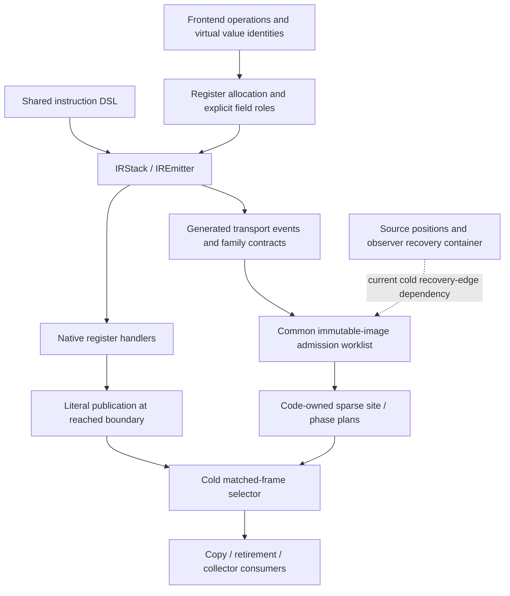

# Semantic ownership and phase plans

Status: active model55 source, with NULL homes and conservative arena scanning
still authoritative. The first phase composition through `ed08ab64c7e` has
both-role focused, native and performance evidence. Later copy/created/return
ports have focused evidence. CALL normal-transport source through
`863b6d0cb08` is not runtime-qualified: five bootstrap images and 25/26 broader
compile-only checks pass, while the full release build rejects shutil.copymode.
Disjoint implicit-child and coroutine EH-prefix proofs remain incomplete. The
[report](report.md) owns exact results; the [ledger](implementation.md) owns
stage completion. This document describes implemented contracts and separates
remaining M4 requirements. The [target model](../../design/proposals/register-call-model55.md)
and [reader census](lifecycle-readers.md) cover the complete migration.

## One source of transport facts

The shared `IRStack`/`IREmitter` produces executable C and ownership events
from the same loads, detaches, publications, helper invocations and terminal
commits. Declared logical stack IO supplies frontend conversion; it is not the
physical register footprint after folding or allocation. Explicit field roles,
actual output moves and selected outgoing edges supply that footprint.

Ordinary dispatch does not decode the phase plan. SiteId is an immutable word
offset under the independently owned executing-code pin; it is neither a
handler address nor the function's mutable code. Phase publication is a literal
store at an actual reached boundary. Phase zero cannot reacquire authority.

Opaque frame/window accesses and unconverted helper effects lose coverage.
Audited leaf bodies remain narrow source guards while their transport is
ported. Exact body matching is not general C verification. The bitmap branch's
[temporary writer footprint bridge](bitmap-writer-capability-plan.md) must be
replaced by emitter-owned home-write/helper adapters before final selection.

## Facts and authority

Keep these properties distinct:

| Property | Meaning |
| --- | --- |
| Named binding state | Initialized nullable binding, mutable through supported local proxies; cell contents have their own boundness. Hidden constants remain readonly. |
| Initialized/readable scratch | A canonical language value, permitted NULL protocol or explicit tagged control exists at this home on every incoming path. |
| Logical owner obligation | A value must be transferred or released; inline and immortal values may require no decref. |
| Counted edge | The canonical runtime tag carries a physical count; cyclic subtraction visits each such edge once. |
| `NO_HOME` | No logical owner occupies this scratch home. It grants neither a readable value nor a physical NULL fact. |
| Physical NULL | A positively proved canonical NULL representation; distinct from stale nonowning child-header bytes. |

Must facts intersect at joins; possible owner obligations union. A MAY owner
without must initialization cannot authorize a stale read. Unknown transfers
never manufacture absence, initialization or completeness. A returning child
can leave nonowning overlay bytes: its drained homes may be logically empty
without containing NULL.

`_PyIRHomeAuthority` distinguishes NONE, shadow CANDIDATE, MUST_READABLE and an
explicit development NULL-control adapter. The 16-byte view contains the
binding count, scratch limit and borrowed selected ranges. Copy/collection must
require the authority needed for the actual action; an uncovered view is not
an empty scratch shape.

## Generated normal transport

Normal-edge facts do not certify callback, error, suspended or observer phases.
The current event interface includes:

| Actual emitted transport | Cold contract |
| --- | --- |
| Audited LEAF / read, take, publish and release events | Transport verified values and owners; an uncovered body loses completeness. |
| `NORMAL_CLEAR_INPUTS` | Successful final commit consumed actual inputs outside the retained prefix. Explicit relocated scalar fields retain their actual footprint. |
| Window-result receipt on normal clear | The emitted result adapter moved its physical output to a named binding or supported discard. Only that source becomes absent. A retained scratch result stays live; the adapter's scratch recipient must equal its actual source. |
| `CALL_DRAIN` | Actual successful CALL cleanup consumed its owning input roles; virtual NULL holes retain prior absence. The actual recipient becomes live. |
| `NORMAL_COMPLETION` | Selected edge only: FOR consumes two protocol inputs without a result; SEND consumes three and publishes A; throw completion consumes four and publishes A. The body edge is separate. |
| `UNPACK_LOCAL_DRAIN` | The reached successful helper moved all reverse-window outputs to a validated local run. A no-local-destination sentinel retains real scratch outputs. Zero outputs still consume the sequence. |
| `CREATED_COPY` | The actual terminal generator-construction transport snapshots created homes; a later activation installs its own resume recipient. |

A normal result receipt originates at `emit_final_outputs`, not an opcode-name
case. Completion events originate at the actual complete/enter helper route.
Every reached route within a handler must agree; one incompatible target
revokes that handler before intersecting canonical specializations and
instrumented twins. A matching sibling cannot hide an uncovered route.
Checked terminal observer wrappers count their actual normal successors: one
for a single-exit operation, two for a conditional branch.

Logical window extents can overstate physical reads. A scalar input folded
into an explicit IN field no longer occupies its old window tail. Under the
positive final-commit contract, the physical window read count excludes those
validated trailing scalar fields; their independent IN operands and the full
output extent still count. This preserves only prior absence at untouched
homes. The format builder checks the trailing-scalar mapping rather than
assuming every window has this shape.

Public constructor, replacement, marshal/frozen and executing-image routes
use the same admitted immutable operands and feedback-argument decoder. No
normal proof guesses argument counts from maximum slots or reads mutable
feedback state. Virtual CALL self/kwargs forms require positive all-path
absence and child-clobber permission. Method promotion publishes real self and
updated scalar transaction roles before releasing the old wrapper; later
fallback retains the committed state. No inactive self word is loaded to
rediscover that role.

## Reached phases and storage

The current `_PyIRCodePlan` uses the executing image's single plan pointer.
There is one checked allocation: a 16-byte header, four bytes per sparse return
site, 16 bytes per phase site and six bytes per interned half-open range.
Shared empty/default plans avoid per-code allocations where applicable. Size
accounting and destruction own the complete allocation. Ranges span the full
admitted domain through4094; no64-home production cutoff exists.

Cold construction uses per-block bitvectors and queued monotone transfer work.
Workspace is O(words + blocks × ceil(scratch/64)); persistent space is
O(phase sites + distinct shape ranges), with exact hash collision comparison
for interning. Sparse lookup is cold. It does not add an owner array or generic
decoder to each handler.

The first generic binary phases publish provider5, successful operand
retirement6 and restored-error7 together with their actual consuming C.
A prior phase survives only through its declared validity interval. Accepted
redirects, unsupported escaping statements, resume, copy and cleanup invalidate
before relevant mutation. A debugger reset cannot regain a provider certificate
merely by returning from its callback.

Current normal-retirement certificates cover only completely proved empty
scratch at actual normal RETURN sites. NORMAL_RETURN, ERROR_UNWIND, HEAP_CLEAR
and STAGED_FAILURE are explicit reasons; the latter three remain uncovered
where their event coverage is incomplete. Result presence is independent of
reason. A reached shadow comparison stores CHECKED/UNCOVERED/MISMATCH in the
linked record; an inspection query cannot fabricate a comparison.

CAPTURED bit11 belongs to the frame lifecycle adapter and its immutable view.
CREATED bit12 certifies the reached created-copy state; ready code, generator
ownership and actual created state must still match. The created fast copy
moves initialized bindings and never reads inactive source scratch. Explicit
[YIELD_DELEGATED](yield-delegated-proposal.md) bit13/operand/claim interfaces are
frozen for implementation, not a qualified current runtime contract.

## Handoff and root consumers

Exact calls retain overlapping argument transfer and inline return. Parent
survivors, child/clobber aliases, staged bindings, provider prefixes and detached
results must have one owning authority each. Typed function and code pins stay
independent. The reservation survives callbacks and the code pin closes last.

Unpack/binding/native adapters publish actual initialized prefixes or suffixes
before callbacks. Publishing a home precedes advancing its progress cursor;
detaching an owner precedes its close. Their outer descriptor survives iterator,
sequence, provider and surplus cleanup. Native arrays and arena windows are
distinct capabilities. Do not infer a staged child from the parent's PRE map.

Retirement links its remaining-root descriptor before the first reentrant
close, advances the cursor before the close and reloads mutable binding state
after callbacks. Live heap `tp_clear` retains its descending one-pass behavior:
a callback can install a surviving binding above the passed cursor. Private
thread/gen deallocation has a different mutation boundary. Escaped takeover
moves edge authority before later closes; associated frame objects do not
also own active/generator home edges.

The shared frame selector serves copy and collector consumers. GIL subtraction,
FT deferred-count adjustment, external root marking and generic logical
`tp_traverse` retain distinct tag policies. Native stack/register/PyMem discovery
remains separately selected; removing arena enumeration does not imply a fully
precise native collector. The bitmap rival's set count bit supplies positive
counted-edge authority, while a zero bit grants no inline/control/object read.

## Source attribution and observer recovery

Ordinary executable EH entries come from `co_exceptiontable`. The current cold
worklist also decodes the IRSM source container to seed observer recovery
triples `(handler, exc_slot, lasti)`. It does not use line or column values, but
this remains a semantic-container dependency. Optional source positions cannot
become execution authority.

Before M4, emit and admit those recovery entries separately from source-only
positions and supply worklist/runtime recovery from the code-owned semantic
representation. Position stripping must not change ownership or exception
coverage. A malformed source container cannot silently grant coverage. Remote
value readers additionally need stopped-target/read-claim authority; a running
PC sample is not permission to read homes.

## Remaining M4 gates

- Complete every admitted family's normal, callback, error, poll, suspend and
  observer recovery events, including static entry/InitCleanup images.
- Replace unknown exception/observer seeds with their actual partial-consume
  and handler-entry transfers. Publish exception/lasti roles at the real edge.
- Close all [lifecycle readers](lifecycle-readers.md), including diagnostics,
  uniqueness, debugger transfer, remote values, copy and every collector loop.
- Resolve MAY-owner/uninitialized joins through explicit normalization,
  independent validity, finite phases or admission rejection. UNKNOWN cannot
  survive as a runtime authority fallback.
- Compare initialized values, logical obligations and unique counted edges
  under callbacks, failure injection, overlap, mutation, suspension and escape.
- Switch scratch authority and remove scratch clearing/arena enumeration as
  one coherent integration. Price phase stores, plan construction/bytes,
  header/cache traffic, native spills and the complete lifecycle.

Both-role qualification, native review and direct hot6/all29 comparisons are
required before selection. Partial normal absence or successful bootstrap
compilation does not complete M4 or establish a speedup.
