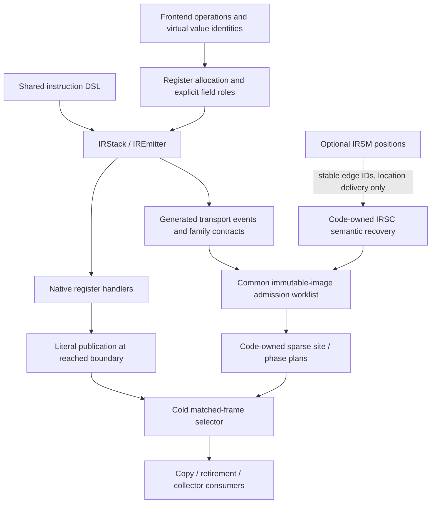

# Semantic ownership and phase plans

Status: active model55 source, with initialized NULL control still authoritative
where static readable maps are incomplete. The integrated `d045` composition
builds both roles. Its release qualification passes the semantic/code/remote
and full IR modules, including real PRE observer errors and an accepted LINE
redirect followed by callback failure. Position-independent IRSC recovery,
explicit delegated suspension, general/EMPTY returns, shared checked writers
and grouped exceptional-effect contracts are implemented. None supplies
complete lifecycle/readability coverage. The
[report](report.md) owns exact results; the [ledger](implementation.md) owns
stage completion. This document describes implemented contracts and separates
remaining M4 requirements. The [target model](../../design/proposals/register-call-model55.md)
and [reader census](lifecycle-readers.md) cover the complete migration.

## One source of transport facts

The shared `IRStack`/`IREmitter` produces executable C and ownership events
from the same loads, detaches, publications, helper invocations and terminal
commits. Declared logical stack IO supplies frontend conversion; it is not the
physical register footprint after folding or allocation. Explicit field roles,
actual output moves and selected outgoing edges supply that footprint.

Ordinary dispatch does not decode the phase plan. SiteId is an immutable word
offset under the independently owned executing-code pin; it is neither a
handler address nor the function's mutable code. Phase publication is a literal
store at an actual reached boundary. Phase zero cannot reacquire authority.

Opaque frame/window accesses and unconverted helper effects lose coverage.
Audited leaf bodies remain narrow source guards while their transport is
ported. Exact body matching is not general C verification. Shared checked
array writes, TAKE loops and builder adapters now replace the bitmap branch's
temporary writer-body bridge. Remaining raw/helper/terminal guards must move
to the same emitter-owned capabilities before final selection.

## Facts and authority

Keep these properties distinct:

| Property | Meaning |
| --- | --- |
| Named binding state | Initialized nullable binding, mutable through supported local proxies; cell contents have their own boundness. Hidden constants remain readonly. |
| Initialized/readable scratch | A canonical language value, permitted NULL protocol or explicit tagged control exists at this home on every incoming path. |
| Logical owner obligation | A value must be transferred or released; inline and immortal values may require no decref. |
| Counted edge | The canonical runtime tag carries a physical count; cyclic subtraction visits each such edge once. |
| `NO_HOME` | No logical owner occupies this scratch home. It grants neither a readable value nor a physical NULL fact. |
| Physical NULL | A positively proved canonical NULL representation; distinct from stale nonowning child-header bytes. |

Must facts intersect at joins; possible owner obligations union. A MAY owner
without must initialization cannot authorize a stale read. Unknown transfers
never manufacture absence, initialization or completeness. A returning child
can leave nonowning overlay bytes: its drained homes may be logically empty
without containing NULL.

`_PyIRHomeAuthority` distinguishes NONE, shadow CANDIDATE, MUST_READABLE and an
explicit development NULL-control adapter. The 16-byte view contains the
binding count, scratch limit and borrowed selected ranges. Copy/collection must
require the authority needed for the actual action; an uncovered view is not
an empty scratch shape.

## Generated normal transport

Normal-edge facts do not certify callback, error, suspended or observer phases.
The current event interface includes:

| Actual emitted transport | Cold contract |
| --- | --- |
| Audited LEAF / read, take, publish and release events | Transport verified values and owners; an uncovered body loses completeness. |
| `NORMAL_CLEAR_INPUTS` | Successful final commit consumed actual inputs outside the retained prefix. Explicit relocated scalar fields retain their actual footprint. |
| Window-result receipt on normal clear | The emitted result adapter moved its physical output to a named binding or supported discard. Only that source becomes absent. A retained scratch result stays live; the adapter's scratch recipient must equal its actual source. |
| `CALL_DRAIN` | Actual successful CALL cleanup consumed its owning input roles; virtual NULL holes retain prior absence. The actual recipient becomes live. |
| `NORMAL_COMPLETION` | Selected edge only: FOR consumes two protocol inputs without a result; SEND consumes three and publishes A; throw completion consumes four and publishes A. The body edge is separate. |
| `UNPACK_LOCAL_DRAIN` | The reached successful helper moved all reverse-window outputs to a validated local run. A no-local-destination sentinel retains real scratch outputs. Zero outputs still consume the sequence. |
| `CREATED_COPY` | The actual terminal generator-construction transport snapshots created homes; a later activation installs its own resume recipient. |

A normal result receipt originates at `emit_final_outputs`, not an opcode-name
case. Completion events originate at the actual complete/enter helper route.
Every reached route within a handler must agree; one incompatible target
revokes that handler before intersecting canonical specializations and
instrumented twins. A matching sibling cannot hide an uncovered route.
Checked terminal observer wrappers count their actual normal successors: one
for a single-exit operation, two for a conditional branch.

Logical window extents can overstate physical reads. A scalar input folded
into an explicit IN field no longer occupies its old window tail. Under the
positive final-commit contract, the physical window read count excludes those
validated trailing scalar fields; their independent IN operands and the full
output extent still count. This preserves only prior absence at untouched
homes. The format builder checks the trailing-scalar mapping rather than
assuming every window has this shape.

Public constructor, replacement, marshal/frozen and executing-image routes
use the same admitted immutable operands and feedback-argument decoder. No
normal proof guesses argument counts from maximum slots or reads mutable
feedback state. Virtual CALL self/kwargs forms require positive all-path
absence and child-clobber permission. Method promotion publishes real self and
updated scalar transaction roles before releasing the old wrapper; later
fallback retains the committed state. No inactive self word is loaded to
rediscover that role.

## Reached phases and storage

The current `_PyIRCodePlan` uses the executing image's single plan pointer.
There is one checked allocation: a 16-byte header, four bytes per sparse return
site, 16 bytes per phase site and six bytes per interned half-open range.
Shared empty/default plans avoid per-code allocations where applicable. Size
accounting and destruction own the complete allocation. Ranges span the full
admitted domain through4094; no64-home production cutoff exists.

Cold construction uses per-block bitvectors and queued monotone transfer work.
Workspace is O(words + blocks × ceil(scratch/64)); persistent space is
O(phase sites + distinct shape ranges), with exact hash collision comparison
for interning. Sparse lookup is cold. It does not add an owner array or generic
decoder to each handler.

The first generic binary phases publish provider5, successful operand
retirement6 and restored-error7 together with their actual consuming C.
A prior phase survives only through its declared validity interval. Accepted
redirects, unsupported escaping statements, resume, copy and cleanup invalidate
before relevant mutation. A debugger reset cannot regain a provider certificate
merely by returning from its callback.

Current normal-retirement certificates cover only completely proved empty
scratch at actual normal RETURN sites. NORMAL_RETURN, ERROR_UNWIND, HEAP_CLEAR
and STAGED_FAILURE are explicit reasons; the latter three remain uncovered
where their event coverage is incomplete. Result presence is independent of
reason. A reached shadow comparison stores CHECKED/UNCOVERED/MISMATCH in the
linked record; an inspection query cannot fabricate a comparison.

CAPTURED bit11 belongs to the frame lifecycle adapter and its immutable view.
CREATED bit12 certifies the reached created-copy state; ready code, generator
ownership and actual created state must still match. The created fast copy
moves initialized bindings and never reads inactive source scratch. Explicit
[YIELD_DELEGATED](yield-delegated-proposal.md) bit13/operand/claim interfaces are
implemented and covered by merged focused tests. Admission proves the finite
retained-receiver/outgoing pairing; literal suspension publication and matched
continuation authorize only that protocol reader. They do not certify a full
suspended home map.

## Handoff and root consumers

Exact calls retain overlapping argument transfer and inline return. Parent
survivors, child/clobber aliases, staged bindings, provider prefixes and detached
results must have one owning authority each. Typed function and code pins stay
independent. The reservation survives callbacks and the code pin closes last.

Unpack/binding/native adapters publish actual initialized prefixes or suffixes
before callbacks. Publishing a home precedes advancing its progress cursor;
detaching an owner precedes its close. Their outer descriptor survives iterator,
sequence, provider and surplus cleanup. Native arrays and arena windows are
distinct capabilities. Do not infer a staged child from the parent's PRE map.

Retirement links its remaining-root descriptor before the first reentrant
close, advances the cursor before the close and reloads mutable binding state
after callbacks. Live heap `tp_clear` retains its descending one-pass behavior:
a callback can install a surviving binding above the passed cursor. Private
thread/gen deallocation has a different mutation boundary. Escaped takeover
moves edge authority before later closes; associated frame objects do not
also own active/generator home edges.

The shared frame selector serves copy and collector consumers. GIL subtraction,
FT deferred-count adjustment, external root marking and generic logical
`tp_traverse` retain distinct tag policies. Native stack/register/PyMem discovery
remains separately selected; removing arena enumeration does not imply a fully
precise native collector. The bitmap rival's single presence plane selects
non-NULL canonical values, including inline, tagged-control and immortal
values. Consumers still classify counted edges separately. An absent bit
licenses no raw load; explicit nullable reads synthesize NULL through their
checked input interface.

## Source attribution and observer recovery

Executable EH and observer recovery are code-owned in `co_exceptiontable`.
IRSM2 `co_linetable` holds optional positions only. The retained-transfer source
component `9c297510ac3` uses IRSC2; its combined native gate remains pending. The
common worklist, runtime EH search and observer recovery use semantic rows even
when the position array is empty. A missing position cannot suppress a real
backedge trace; it supplies no replacement source-line event.

Universal admission, paired serialization, static InitCleanup, code replacement,
loaders, reader ports, Clinic declarations and regenerated frozen products are
integrated and have passed native component qualification. Remote value readers still need their
stopped-target/read claim; a running PC sample grants no home authority.

PRE LINE/INSTRUCTION error edges exist independently of body error routes and
optional position rows. The generated wrapper intersection preserves only
incoming `NO_HOME` below the actual EH floor; a missing callback, error-flush
or terminal receipt removes that preservation without removing the edge.
Runtime origin selection is independent of this proof.

Accepted LINE redirects use `Objects/frameobject.c:register_resume_plan` and
`frame_lineno_set_impl`. With no handled context, a protected destination gets
no retained scratch. Within a handled context, preservation requires matching
exception-protocol origins at source and target. Commit clears other scratch
and restores saved bindings only into locals. The FOR-pair shortcut requires an
empty decoded EH slice. Consequently, redirect-then-raise uses a normalized
target shape rather than inheriting the old origin or view. Native controls
exercise the sole scratch owner's finalizer before the callback raises, and
the destination's distinct cleanup, with full and absent optional quads.

## Ordinary abrupt absence

The root's generated `authority-census-e90/results.json` inventories normal
programs and COMPLETE exceptional-route contracts separately. Neither count
measures complete maps: a normal drain receipt says nothing about an intervening
callback, error, poll or suspension. Regenerate the census from source for each
composition rather than maintaining a second instruction list here. Grouped
SEND routes and typed common-constant/jump projections close the previously
observed coroutine prefix loss; the matching five bootstrap and 27 admission
probes pass. This is absence coverage, not full readable-map closure.

The exceptional-prefix worklist consumes shared emitted error receipts and a
typed helper-effect summary, without copying GET_ANEXT's C body. A complete
exceptional-route census distinguishes inert protected words from real error
predecessors; zero/unknown metadata remains conservative. The implemented
division is:

- `IRStack` records the actual homes used by load, TAKE, consume, store,
  vacate and output movement. Explicit folded fields and window positions are
  distinct. `IREmitter` records the error stack flush at `error_if`,
  `goto_error` and `error_no_pop`, including bridge cleanup and any restore.
- Helper capabilities describe their ownership interface, independently of
  callback effects: no arena writes, a declared input/output range, an
  independent child reservation, an overlapping child reservation, or a
  terminal transfer. Ordinary escaping helpers still spill, publish PC and
  reload through the existing callback machinery. They do not enter the
  manual-protocol marker set merely to obtain a capability.
- The first ordinary helper is `_PyEval_GetANext`: it receives a native object
  derived from a declared value and returns a native owned object. It receives
  no frame or home pointer. Check argument provenance and reject raw home
  pointers, aliases, address escapes, unsupported home helpers and manual
  terminals. A renamed instruction with the same checked transport qualifies;
  an opaque helper or extra alias write does not.
- Only complete actual error-exit receipts can produce the cold confinement
  capability. Its conservative floor includes every scratch operand the
  emitted input/output/error transport can write, including the window base
  and explicit recipient. The EH merge retains only incoming NO_HOME below
  that floor and the handler's clear floor. It grants no NULL, initialization,
  readable range, owner, normal drain or pending SEND tuple fact.

Native callbacks may change named bindings and vacate scratch through an
accepted debugger redirect. The follow-on effect is therefore
PRESERVES_SCRATCH_ABSENCE, distinct from NO_ARENA_WRITE; neither grants readable
homes. Source-recovery predecessors remain independent unknown ingress.
Adopting a redirected PC before a later error/boxing route loses coverage.

This adds no runtime lookup, publication store, frame field or per-code
allocation. It reuses the existing per-block full-extent vectors and abrupt
work vector. Cold metadata and helper-contract maintenance are real costs;
the source gate must report unsupported routes instead of silently treating
them as ordinary helpers. Tests must mutate a helper argument to a home
pointer, add a hidden write, remove an error receipt and add an unsupported
exceptional predecessor. Held-hole positives and live-prefix negatives must
use constructor, replace, marshal and execution-image admission.

## Closing general maps with the same transport graph

The whole-body bridges for suspension, async exit and independent child entry
are temporary admission guards. Replace them through shared primitives, not
another instruction verifier. The writer packet's checked fixed-index output
publications and builder adapters are the first such primitives; subsequent
array TAKE/write loops need one bounded index proof shared by every caller.
All generated home reads and writes must flow through that interface before
the bitmap and static-map implementations can claim equivalent coverage.

The same transport graph must then supply these consumers:

1. Normal successors and reached callback snapshots use actual input owners,
   native detached owners, output publication and close progress. Publish a
   literal family-local phase only at the callback/poll/escape boundary.
   Repeated loops use an explicit prefix/cursor record, not a new phase store
   for every element. Unsupported boundaries publish zero.
2. Child entry records whether reservation overlaps the parent's arena.
   Overlapping CALL argument homes transfer authority to the child; independent
   attribute children preserve the parent outside their declared input/result
   homes. Parent WAIT, staged bindings and native provider ranges cannot all
   claim the same edge. Post-effect misses forward the already prepared state.
3. Abrupt checkpoints retain an explicit failing site and the actual partial
   transport before bridge cleanup, traceback callbacks and error monitors.
   An outlined error processor owns that selected view and its changing clear
   cursor through handler installation. A normal final flush is not an abrupt
   checkpoint; RERAISE's changed public PC is not the failing site.
4. General RETURN retires remaining frame-owned homes through the reached
   M2 root/result/code-pin protocol. A separately proved EMPTY form keeps the
   current small path. Logical absence, physical NULL and complete readable
   shape remain different predicates.

Every canonical family, specialization, monitoring twin, redispatch and static
entry image needs positive coverage for its actual routes. An event's presence
does not close the family. Coverage reports must include each callback/error
exit and poison a permission when one route is unsupported. Instrumentation
must preserve canonical operand/protocol families through LINE and INSTRUCTION
wrappers as well as their event twins.

At a join, MAY_OWNER remains a union of obligations and readable initialization
remains a must-fact. Their union cannot authorize a home read. Before authority
switch, prove a common readable shape, normalize it through checked compiler
transport, or reject that image. If ordinary compiler output needs a nullable
shape, provide actual NULL/validity semantics for it and price the extra writes;
do not project candidate ranges into MUST_READABLE or retain NULL-control as a
permanent fallback.

## Separating semantic recovery from optional positions

Position-independent recovery has passed native qualification. The IRSC2
retained-transfer component is source-frozen and independently reviewed;
combined generation and native qualification remain pending. It keeps the
existing `co_exceptiontable` reference and existing code plan. The code pin
retains semantic and position bytes; no new code-object or hot-frame pointer
or separate plan allocation is added.

The implemented byte grammar is:

| Stored field | Representation | Meaning |
| --- | --- | --- |
| `co_exceptiontable == b""` | Shared canonical empty sentinel | No EH ranges or semantic recovery records; no allocation/header for the common empty case |
| Nonempty `co_exceptiontable` | `IRSC`, little-endian u32 version 2, EH byte length, recovery count, transfer count and retained-range count; then the four sections | Exact length `24 + eh_size + 16 * (recovery_count + transfer_count) + 6 * range_count` |
| Ordinary EH entry | Marked varints `(start, length, transfer)` | Protected words select the same transfer IDs as recovery rows |
| Recovery row | Four little-endian signed32 fields `(from, to, edge, transfer)` | Stable physical edge and transfer ID; `-1` explicitly means no handler |
| Transfer descriptor | Little-endian `(target32, first_range32, nranges32, exception16, lasti16)` | Explicit protocol homes; `IR_NO_DST` omits lasti |
| Retained range | Little-endian `(begin16, end16, flags8, reserved8)` | Sorted, disjoint, coalesced scratch-relative membership; flags/reserved are zero |
| Stored `co_linetable` | `IRSM`, little-endian u32 version 2, physical-location byte length, position count; then locations and position rows | Optional positions only, exact length `16 + locations_size + 16 * count` |
| Position row | Four little-endian signed32 fields `(line, end_line, column, end_column)` | Dense index matches the semantic recovery row; count is either0 or the semantic count |

The empty semantic sentinel is a declared current-format case, not recognition
of old nonempty raw EH tables. Reject old nonempty unversioned EH data and
IRSM version 1 at common admission; there is no semantic fallback to line data.
Raw constructor location bytes, including empty bytes, remain optional location
input and normalize to version 2. Codes with neither semantic kind retain the
shared empty bytes object.

Semantic row index is the stable edge ID. Preserve duplicate rows: two elided
origins can have equal `(from,to,edge,transfer)` but distinct ordered
observer occurrences. Do not sort, deduplicate or renumber semantic rows while
stripping columns/lines. Compiler edge traversal and within-edge lexical order
define IDs before optional locations are emitted. Remove the current
`op->loc.lineno > 0` permission gate from semantic emission; the backend origin
flag, physical edge and exception association must survive missing positions.
A dense position with no location is all `-1`; a completely stripped array has
count 0. Physical compact-PC locations can normalize to NONE entries as today.

Admit semantic geometry once: exact container length/overflow, marked sorted
nonoverlapping EH ranges, bounded word sites/actual successors, edge 0/1,
`transfer == -1` or a bounded transfer ID. Every descriptor has a valid target,
explicit distinct exception/optional-lasti scratch homes, and sorted coalesced
retained ranges that exclude those protocol homes. Reuse current
completion/observer retired-owner and virtual-kwargs proofs on those rows. Admit position geometry
separately: exact bytes, dense count 0-or-semantic-count, valid optional location
fields and physical-word coverage. Position changes cannot add an exceptional
predecessor, supply an owner fact or remove a failed semantic validation.

Use the existing `pycore_ir_exception.h` for `_PyIRSemanticMap` (EH slice plus
recovery, transfer and retained-range slices/counts), `_PyIRRecoveryEvent`, and
the single bounded C container decoder. `_PyIR_ExceptionNext` continues to decode only the admitted EH slice.
Rename the line-only view to `_PyIRPositions`; remove the old combined source
map API rather than leave a compatibility typedef/decoder. Observation may
assemble a cold `_PyIRObservationEvent` by semantic row ID plus optional
positions. That is a stack view, not another stored representation. Runtime
`Stored` helpers require admitted immutable bytes; remote readers use bounded
`Decode` and degrade malformed positions to no location without executing
unowned target memory.

The shared spelling is `_PyIRSemantic_{Decode,Stored,Event,EncodeEvent,Pack}`
for the EH/recovery container, and
`_PyIRPositions_{Decode,Stored,Event,EncodeEvent,Pack}` for positions. Semantic
decode accepts only IRSC2 or the canonical empty sentinel. Position decode
distinguishes raw optional constructor locations from normalized IRSM2 and a
malformed envelope. `_PyIRObservation_Stored(code)` returns a cold
`_PyIRObservationMap` joining these two admitted views;
`_PyIRObservation_Event(map, id, event)` supplies the four semantic fields and
either the matching four position fields or four `-1` values. The map and
event are temporary C views, never code-owned allocations. Edge constants
become `_PyIR_EDGE_FALLTHROUGH` and `_PyIR_EDGE_TAKEN`; observation wrapper
flags retain their separate meaning.

The actual producer/reader census is:

| Source | Required change |
| --- | --- |
| `Python/flowgraph.c`, `regcfg_passes.c` | Preserve explicit origin/order and EH association independently of location availability through elision/fusion |
| `Python/assemble.c` | Emit one semantic row and corresponding optional position together; pack EH plus semantic rows after both are complete; never derive semantics from packed locations |
| `Objects/codeobject.c` admission | Replace source-based semantic reads in source/observer validation, completion safety, virtual kwargs and normal/EH worklist with the semantic map; keep location normalization separate |
| `Objects/codeobject.c` public constructors/replace | Keep `_PyCode_New` the common boundary; changed geometry with inherited nonempty recovery requires matching explicit semantic data; `co_linetable=b""` alone preserves semantic bytes and reproof inputs |
| `Python/ceval.h` runtime EH lookup | Retain current marked-table search on the decoded EH slice, excluding the new header/recovery payload |
| `Python/instrumentation.c` | Port its independent EH scan; size observer arrays by stable recovery IDs; join positions only for line events, never for recovery selection/error recording |
| `Objects/frameobject.c` | Feed register analysis, source cursor/landing recovery and `f_lineno` handler recipes from semantic rows; select lines through optional positions; accepted redirects still invalidate active phases |
| `Python/legacy_tracing.c`, code line iterators | Use recovery edges plus position IDs for source-only line delivery/`co_lines`; absent positions provide no invented line |
| `Python/marshal.c`, import/frozen loader | Existing two bytes fields keep their order; code loads still reach `_PyCode_New`; regenerate frozen payloads from newly admitted code |
| `Tools/build/deepfreeze.py`, `Python/specialize.c` static InitCleanup code | Emit the new admitted bytes verbatim; audit direct static initializers and explicitly retain the canonical empty semantic sentinel |
| `Lib/dis.py` | Replace its raw entire-field varint scan with a cold `_opcode` query of the shared admitted EH decoder; expose recovery rows separately for tests/tools when required |
| `Modules/_remote_debugging/code_objects.c`, `Tools/gdb/libpython.py` | Parse position version 2 and 16-byte rows; physical location lookup does not need semantic bytes or a new target offset; reject old/malformed envelopes |
| Test serialization helpers | Port deliberate raw IRSM/EH builders, tracing edge checks and constructor/marshal corruption controls together; do not hide schema mismatches with permissive dual-format reads |

`code.replace` must distinguish optional position edits from semantic edits.
Preserving current words and semantic bytes while stripping positions is valid.
Replacing words/locals/frame geometry must revalidate matching semantic bytes;
clearing only line data cannot bypass that guard. Track an omitted
`co_exceptiontable` argument with the existing Clinic NULL-default pattern
used for `co_code`, then fill from self after the replacement guard. This
makes explicit reuse distinct from silently inheriting a recovery recipe;
explicitly supplied bytes still undergo the full common proof. An explicitly supplied empty
semantic container intentionally removes all recovery/EH, subject to ordinary
image validation; it is not synthesized from a missing line array. General to
EMPTY return normalization preserves sites/operand roles and does not rewrite
semantic IDs.

The retained-transfer component reserves pyc magic 64423.
IRSC2/IRSM2 and rebuilt frozen/deepfreeze artifacts must compose together.
Direct marshal reads receive structural ValueError for obsolete or malformed envelopes rather than a hidden old-IRSM interpretation. Generic
marshal field order/version need not change because both fields remain bytes.
No stored old-format or runtime dual-decoder period is proposed.

The frozen component includes format/assembler/common admission, all readers,
tool adapters and tests; root owns generation/native qualification. Its
regression controls cover: stripping all positions retains the
same EH/recovery bytes and plan/admission outcome; removing columns retains a
source callback's selected handler; malformed recovery is rejected with both
full and empty positions; changing only a position cannot authorize a retired
owner; constructor/replace/patched marshal/frozen entry all enforce the same
semantic errors. Ordinary try/except/finalizers, async delegation, observer
branch errors and source-only callback errors with retained lines need paired
execution controls. Full position stripping may remove line callbacks that
have no line to report; it must not change the ownership/EH of remaining real
instruction/branch callbacks.

With positions present, each recovery occurrence uses 16 semantic bytes plus
16 position bytes. A nonempty semantic field adds a 24-byte envelope; each
interned transfer uses 16 bytes and each retained interval uses 6 bytes. The
same existing code plan owns decoded descriptors and interns their ranges
with phase ranges. Its header grows from 16 to 20 bytes. The cold HomeView
and captured-frame descriptor grow from 16 to 32 bytes; the 112-byte hot frame
header and 40-byte transition roots remain unchanged. A previously empty
exception field that now owns recovery rows also needs a nonempty bytes allocation; measure that
allocator cost rather than count headers alone. The common empty semantic
case keeps the shared empty bytes. No extra code/frame field, plan or ordinary-dispatch
lookup is added. Reached error lookup adds constant-time envelope slicing
before its current search; observer line handling joins the same index across
two immutable slices. Construction stays linear in payload size plus existing
semantic proof work; no per-edge plan copy or quadratic position join.

The resulting runtime work to remove is concrete: inactive-scratch copying and
scanning, per-home owner classification at retirement, and scratch clearing
done solely to make unselected homes readable. The recurring replacement costs
are reached phase stores, range/cursor iteration, binding validity checks,
code-plan bytes and preparation work. Native roots remain governed by their
selected policy. None of these removals is authorized merely by a successful
normal admission census.

Retained membership is not a readable-home certificate. On a reached error,
release intersects the selected base view with retained homes plus the pending
release cursor; retained homes above that cursor remain visible. Protocol
publication then replaces the old snapshot: static handler entry remains honest
initialized CONTROL until its transformed sparse shape is certified. The
compiler records retained virtual identities before allocation and assembly
resolves their actual homes. The current allocator still uses canonical slots;
this component does not yet authorize the full stale static switch or remove
all remaining allocation constraints.

## Next grouped authority packet

This is a source proposal following the IRSC freeze, not completed M4 coverage.
The source census on `f9f5928cbfa` has 328 named handlers across 122 canonical
groups: 284 have a nonempty normal program and 18 have COMPLETE error-route metadata.
Of the 284 programs, 145 are sole normal-clear receipts, 66 sole CALL drains,
26 sole LEAF transfers, 12 sole completion receipts, five sole unpack drains,
two finite delegated protocols, one created copy, and 27 multi-event programs.
The 44 missing normal programs and the 310 non-COMPLETE error contracts are
different gaps. These are counts from the generated artifact, not a permanent
instruction list or a count of readable maps. There are 115 window handlers,
164 handlers with escaping source effects and two checked PRE observer wrappers;
these sets overlap. Regenerate after each source composition and
report changes by emitted mechanism, including specialized and instrumented
members; a present normal-clear receipt never counts as a full lifecycle.

The current worklist deliberately clears initialization/owner must coverage
on an unknown transfer even when it preserves some absence. Consequently,
extending normal-clear receipts alone cannot close static authority. The next
interface makes actual emitted transport the common source for execution
read checks, callback shapes and exceptional checkpoints:

| Existing producer | Common facts to emit | Reader that uses them |
| --- | --- | --- |
| `IRStack.load/pop`, native object projection | Actual encoded input home and nullable/control role; metadata-only passthrough emits no read | Universal definite-assignment check before an executable home read |
| `consume/taken`, checked array TAKE, final vacate | Actual owner move and physical home becoming vacant; borrowed-local TAKE remains DUP | Normal successors, error snapshots and selected owner retirement |
| `store`, checked output write, final output move | Canonical value or explicit NULL/control, actual destination and overwritten owner lifetime | Must-readable shapes and recipient overwrite validation |
| Escaping helper call | Actual pre-call flushed homes, detached native owners, audited helper home effect and actual post-call reload | Literal reached callback phase and its invalidation after redirect |
| Explicit/implicit error flush | Actual post-flush homes plus original failing word and route identity | Outlined error scope through traceback, monitoring, handler installation and M2 handoff |
| Checked child/terminal adapter | Explicit overlap/disjoint reservation, retained parent homes and selected outcome | Parent WAIT, staged construction, suspend/resume and return consumers |

Extend the current eight-byte ownership-event program; do not add a second
opcode decoder or a parallel helper table. Event references come from actual
`Storage`/`SlotLayout` locations, not logical stack depth: explicit folded IN
fields, BASE-relative windows, actual DST and native-only owners remain
separate. Array operations use the existing checked extent/loop interface.
Project existing normal-absence capabilities from the same graph explicitly;
adding a read/checkpoint event must not silently defeat a sole-event consumer.
Typed helper ownership effects extend the shared source analyzer independently
of whether the call escapes. Unknown helpers revoke the relevant route.
The first ERROR suffix uses the spare `format.flags` bit `0x8000` and a counted
header in that same interned program. The existing normal-event projection
remains unchanged. It adds no format-row field or second event allocation.
The first source-frozen slice records actual scalar input-field loads and
post-error-flush snapshots with no intervening physical home operation. Its
generated GET_ANEXT projection and native-failure routes use distinct literal
checkpoints. Integrated dc6 passed both 117/79 builds, all 5 bootstrap and 27
broader freezer probes, 18 focused cases and 233 IR/code cases per role. The
actual RAISE and retirement witnesses use selected authority 2 with clean
collection; handler-entry publication explicitly uses control authority 3.
Other transports still select initialized control until their actual operations
are replayed. This qualifies the first slice, not complete map coverage.

The qualified scalar extension replaces separate error-read records
with one topological action prefix: SAVE, VACATE, PUBLISH, canonical literals,
COPY, CALLBACK and JOIN. Checkpoints name a node in that prefix. Replay first
coalesces the actual encoded A/B/C/D aliases, then uses four physical-home facts
per node and immutable native-value snapshots. It allocates one reusable cold
workspace; it does not allocate a register vector for every action or word.
Each actual home write needs its own receipt, including each pre-join path.

Native identities come from the shared scoped `Local` provenance parser.
Non-NULL facts do not confer a count: TAKE/DUP, actual release and publication
control native ownership. Retirement and transfer expire old aliases; a new
home load must establish a new identity. Every owning native token must be
rehomed or retired before a checkpoint, apart from the explicit `value_temps`
workspace passed to the processor. Conditional TEMP_DST publication cannot
claim that a local recipient holds the temporary. Native PyObject-result
closure is checked by the same typed helper analyzer at each explicit error,
pre-uop bridge entry and instruction exit. Ambiguous native value joins,
unsupported arrays/helpers and changed-origin paths remain uncovered.
Integrated I8232 passed both 117/79 builds, all 5 bootstrap and 27 broader
freezer probes, 23 focused cases and 233 IR/code cases per role. This includes
the actual UNARY_NOT post-retirement selected snapshot and alias controls;
GET_ANEXT's earlier qualified boundary remains intact.

The source-frozen VALUE packet `00706926b6a`, with live error-stack copy repair
`5e623722ed5`, adds explicit native helper-result
ownership, canonicality and non-NULL contracts, exact token-bound NULL guards,
and a normal endpoint in the same action suffix. A valid native value is not
necessarily a canonical frame value: actual normalizing publication establishes
frame initialization; a canonical store requires prior canonicality. Native
OBJECT conversions additionally require their actual non-NULL precondition.
Normal replay retains only complete incoming shapes and identical family-wide
transport. Its 32 narrow source/emission controls pass; full generation and the native
UNARY_INVERT-to-GET_ANEXT publication witness remain integration gates. It adds
no runtime normal lookup and does not close the remaining M4 groups.

Readability is a must-fact distinct from MAY_OWNER. An actual read must have its
required initialized role on every predecessor; a nullable owner range permits
canonical NULL only where the protocol declares it. Reads of an absent home
cannot become safe because the current development arena happens to contain
NULL. Explicit NULL/index controls belong in the readable selection even when
they carry no counted edge. Named bindings retain dynamic boundness and cell
rules. Every execution read, including COPY/SWAP endpoints and diagnostics,
must consume this authority before scratch initialization can be removed.

The first vertical group is scalar native-value transport with checked input
projections, no child reservation and a complete actual error-route census.
Start with the existing typed native helper/error-no-pop path, not a copied
GET_ANEXT body. Its source ownership signature and emitted load/flush/output
operations establish the facts; renaming the operation changes no permission.
An opaque helper, extra raw write, uncovered projection guard or missing error
receipt removes coverage. Preserve ordinary spill/reload and callback effects.
The concrete consumers are admission's actual read check and the outlined
error processor's selected readable scratch drain. Tests must reach a positive
checkpoint with a nonempty surviving scratch owner, run traceback/monitor and
finalizer collection, and exercise local mutation, failure, escape and both
join orders. Unsupported routes remain explicit control while the group is
being developed; they cannot supply the final M4 switch.

The stronger audited callback effect preserves only previously initialized
canonical homes, widening known non-NULL values to canonical-or-NULL. It is
separate from scratch-absence preservation and cannot initialize an absent or
unknown home. Named-binding mutation, canonical scratch clearing during an
accepted debugger redirect, executing-frame restrictions and nested activation
storage boundaries are part of that effect's contract. A nullable source
annotation alone does not grant a read or a positive checkpoint.

For the error selector, reuse the existing 16-byte PhaseSite row. One reserved
byte becomes selector class ACTIVE=0 or ERROR=1, with the common ordered key
`(immutable site, class, uint8 id)`. Checkpoint 0 is uncovered; IDs 1..255 are
family-local and generation rejects overflow. The pure cold API is
`_PyIR_GetErrorHomeView(frame, origin, checkpoint, out)`, returning the existing
HomeAuthority without allocation, home reads or public-PC reconstruction.
`origin` belongs to the pinned executing image. Error rows come only from the
actual post-error-flush graph, never normal IO or successful CALL_DRAIN. The
emitter must enter the five-argument error processor before generic
`JUMP_TO_LABEL` bridge finishing. The processor owns the view/cursor through
bridge disposal, callbacks, suffix drain and handler-role publication; no
post-pop code/geometry lookup is permitted. Source recovery remains its own
IRSC ingress. Parent propagation requires an actual WAIT/entry transfer.
Installing exception/lasti homes changes the selected shape. Until that
handler-entry transform is certified, the processor explicitly replaces the
post-error descriptor with initialized control before the handled callback;
increasing an old sparse view's cursor is insufficient.

Follow with grouped window builders/unpack cursors, overlapping/disjoint child
handoffs, then suspension and observer recovery. Each group closes actual read,
normal, callback, error and lifecycle consumers together; no group qualifies
from an opcode name or a successful compile census. The runtime work to remove
is the full scratch suffix scan/drain and inactive-copy/GC reads for those
selected states. Costs are eight-byte generated events, interned code-plan
rows/ranges, cold proof work, reached publication stores and error-only lookup;
ordinary inline instructions gain no generic plan search or owner record.
Native inspection must price register lifetimes and stores after composition.

### Finite closure sequence

This sequence closes shared producer mechanisms and their consumers. Family
batches instantiate these mechanisms; they do not introduce permission lists.
Each batch must expose its remaining UNKNOWN rows and missing readers from the
generated source census before the next batch lands.

| Order | Producer group and dependency | Complete consumer boundary |
| --- | --- | --- |
| 1 | Common `Storage` read roles and `IRStack` load, consume, store, move and vacate receipts; scalar native-value helpers; actual error-flush suffix | Required/nullable read admission, callback invalidation, positive ERROR selection, clipped scratch drain and bindings-only M2 handoff |
| 2 | Scalar fresh/local/copy/move/SWAP/branch transports using group 1; explicit NULL normalization and tagged controls | Every scalar input and alias is readable on all paths; both normal outcomes and error/callback snapshots share those facts |
| 3 | Declared window arrays, checked index loops, builders and unpack adapters using groups 1–2; initialized prefix/suffix cursors | Native helper input ranges, failure/retry, publication and surplus retirement; selected ranges replace full-N scans |
| 4 | CALL preparation/provider/binding phases and actual child-entry transfers; overlap and disjoint reservations remain distinct | Actual parent WAIT shape, promoted self/kwargs roles, child error/return, staged failure and takeover without reconstructing from CALL success |
| 5 | Frame creation, generator construction, FOR/SEND cursor protocols, suspension and resume-recipient installation | Created/suspended copy and GC, retained finite readers, close/throw, vacancy before sent input and literal invalidation before mutation |
| 6 | Real exceptional predecessors, handler-entry exception/lasti publication and IRSC recovery; PRE/POST observer normalization | RAISE/handled/unwind/source callbacks use transformed readable shapes, with no inherited pre-redirect or old-checkpoint view |
| 7 | Common lifecycle selection and captured views, using groups 1–6; explicit retirement record/cursor authority | Copy/escape, all collector policies, heap clear/dealloc, thread/gen retirement, debugger/diagnostic/remote readers and the last code pin |
| 8 | Universal admission and source coverage gate over all groups | Every executable read and reached callback/lifecycle state has static authority or explicit admitted normalization; unsupported defaults cannot reach the stale implementation |

Group 1 is the next source slice, not a declaration that only scalar execution
will be completed. It supplies reusable machinery for the remaining seven
groups. The final switch removes scratch initialization/frontier extension,
scratch-only NULL fills, inactive-home copy/scan and full reserved-suffix
retirement together. Named binding initialization and native-buffer policies
remain explicit. Static and dynamic-presence candidates keep the same frame
ABI and Python semantics; their different proof, publication, bit-read and
materialization costs must be measured after all reader gates are closed.

Arbitrary register allocation also requires replacing the current EH
scratch-floor assumption: `_PyFrame_ClearTemporaries(first)` and exception-slot
retention still rely on definition order matching stack order. Selected error
cleanup must use actual retained and consumed home sets before that layout
constraint can be removed. A source-checked abrupt write floor alone does not
solve it. Repeated phase-zero stores are a later bounded emitter cleanup once
these publication and invalidation boundaries are complete.

## Remaining M4 gates

- Complete every admitted family's normal, callback, error, poll, suspend and
  observer recovery events, including static entry/InitCleanup images.
- Replace unknown exception/observer seeds with their actual partial-consume
  and handler-entry transfers. Publish exception/lasti roles at the real edge.
- Close all [lifecycle readers](lifecycle-readers.md), including diagnostics,
  uniqueness, debugger transfer, remote values, copy and every collector loop.
- Resolve MAY-owner/uninitialized joins through explicit normalization,
  independent validity, finite phases or admission rejection. UNKNOWN cannot
  survive as a runtime authority fallback.
- Compare initialized values, logical obligations and unique counted edges
  under callbacks, failure injection, overlap, mutation, suspension and escape.
- Switch scratch authority and remove scratch clearing/arena enumeration as
  one coherent integration. Price phase stores, plan construction/bytes,
  header/cache traffic, native spills and the complete lifecycle.

Both-role qualification, native review and direct hot6/all 29 comparisons are
required before selection. Partial normal absence or successful bootstrap
compilation does not complete M4 or establish a speedup.
