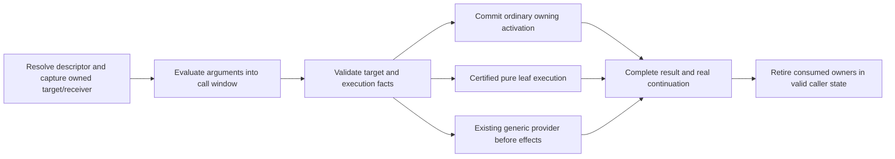

# Ordinary Python calls: grouped architecture proposal

Grouped proposal reviewed once by [Astra](astra-architecture-review.md), followed
by Sol implementation/review. Approved order: B, A, then a bounded C experiment
after its entry and completion contracts pass component review.
The user selected DeltaBlue as the next single target and explicitly moved
instruction-scheduling/CPI investigations out of the critical path. Start from
committed runtime46 `b8e7e1bee66`; preserve earlier evidence and immutable controls.

## Goal and what already works

Make common Python calls cheap as complete operations: resolve the callable,
capture receiver and arguments, bind, execute, return, retire owners and continue.
The eight-byte IR and canonical PyValue model are implemented. Exact ordinary
thread-owned calls already transfer arguments through overlapping windows and
reuse initialized storage. Normal thread teardown already clears locals rather
than sweeping every temporary. Removing another imagined argument copy or full
scratch sweep is not the structural opportunity.

The latest DeltaBlue screen is 1.63233 times upstream elapsed time. Profiles
locate ordinary exact calls, method/shape/type lookup and frame retirement.
They do not assign removable fractions of the gap. No2× claim follows from a
handler count, a sample share or the proposals below. The eventual target is
upstream parity on the unchanged workload, with incremental general improvements
accepted along the way.

The [ordinary-call audit](ordinary-call-audit.md) maps the full owner/frame path.
The [lookup audit](method-lookup-audit.md) covers method/descriptor transitions.
One observed semantic census (`baseline46-semantic-calls.json` under the new
evidence directory) counts 51,422 Python calls in one unchanged workload iteration.
Two conditional field selectors account for 25,424 calls, about 49.4%; three
classmethod functions account for 2,717, about 5.3%. These are call frequencies,
not costs or optimized-path hit counts. Instrumentation changes execution.

## One call representation and contract

Keep the existing physical owned `(callable, receiver-or-NULL, arguments...)`
window. A resolved call target consists of that captured target/receiver plus
immutable code/binding/effect facts in code/site metadata; it is not a new
heap object allocated per invocation. Distinguish four phases:

1. **Lookup/capture:** perform Python descriptor semantics at their proper time.
   Acquire the actual target and receiver before evaluating later arguments.
   A subsequent descriptor/function/global mutation cannot replace an already
   captured target. Raw descriptor metadata needs current owner/version proof.
2. **Admission/binding:** guard mutable provider, observation and default facts.
   Reuse certified immutable signature/layout facts. A miss leaves all original
   homes owning and takes the ordinary path once.
3. **Execution:** either commit one ordinary activation with in-place argument
   ownership, or execute a certified callback-free leaf operation without an
   activation. There is no fallback after ownership/effects have committed.
4. **Completion:** acquire/preserve the result, detach consumed owners and publish
   valid completed caller state before callback-capable retirement. Use one
   result/continuation contract for local, temporary and discard recipients.
   Respect any legitimate reconfiguration/redirect after retirement callbacks.

An owning code anchor remains necessary while an ordinary frame executes:
function.__code__ can change. Eliding a frame can remove that activation's anchor
work only if no selected-code pointer survives the first callback. Do not create
persistent mortal borrows or an alternative frame/value ABI to save refcounts.
Python does not guarantee CPython's incidental finalizer schedule; the runtime
still owes valid roots, public frame behavior and coherent reentry states.

## Candidate changes to review together

### A. Forward classmethods into the ordinary owned call pair

For exact Python classmethods on supported class receivers in method-form
attribute loads, return the underlying function and bound class through the
existing pair. This avoids generic descriptor dispatch, allocating a bound
method, then unwrapping it at CALL. It does not fuse lookup across argument
evaluation or create a new entry/return path.

First scope uses the builtin metaclass, existing class/MRO/version guards,
exact classmethod descriptors and exact Python function payloads. Read
`cm_callable` live: classmethod.__init__ can replace it without invalidating the
owning class version. Capture it at lookup, never reread it at CALL. Inherited
lookups bind the actual receiver class. Non-method attribute access must still
return the ordinary bound-method object. Arbitrary descriptors, custom
metaclasses, and callback-heavy instance-receiver adaptation decline initially.

This is a small complete first increment, not a proposed2× mechanism. Tests must
cover descriptor reinitialization, code/default mutation, inheritance, changes
during argument evaluation and public non-call retrieval.

### B. Canonical class values through the same lookup metadata

Class scalar loads still reach a generic path that the earlier instance-based
class-value specialization does not cover. Add a guarded canonical class-value
reader using the existing independent guarded field and class/MRO/metaclass
proof. No boxed scalar, new layout or copied raw pointer representation.
Publish/acquire before retiring its class receiver. Update producers, generated
operands and polymorphic snapshots together.

This removes repeated lookup in ordinary conditional accessors and other class-
constant code. It saves no activation by itself. Review whether A/B belong in
one coherent lookup increment or two measurable landings; account for overlapping
benefits if a later leaf plan removes those reads too.

### C. Certify and eliminate complete pure leaf activations

Make immutable final-IR/effect summaries usable by the call target. A constant
return, argument return or guarded field getter can compute its result without
constructing a frame, entering RESUME, dispatching RETURN, clearing locals and
releasing a function/code activation. Never use `_PyCode_ReturnsOnlyNone` as a
certificate: it permits arbitrary preceding effects.

The large observed selector family has a comparison/branch and two possible
field returns. Constant/single-getter recipes alone have low coverage here.
Evaluate a clean general leaf-expression/region representation that can describe
arguments, constants, guarded field/global/class reads, exact scalar comparison
and select. Match certified IR/effects, never function/class/benchmark names.
Reuse existing semantic operations and ownership facts; do not build a second
Python interpreter or accumulate one-off handwritten benchmark-shaped handlers.

First-scope constraints: no cells/freevars, exceptions/handlers, loops, calls,
allocation, Python callbacks or writes; bounded complete final-IR graph;
exact current target/code identity; all observation/PEP523/DTrace/LLTrace and
entry-work exclusions; preserve recursion and pending-work admission. A failed
guard executes the original body once, with inputs intact. Reads that can invoke
a descriptor/operator must guard a callback-free route or decline. Capture the
result before any protecting owner can retire. Code replacement, changed scalar
types, shadowing and observation must all recover to ordinary calls.

The broad review should choose between an initial tiny certificate that grows
into this general representation, a shared-IR inline region, or rejecting this
lane until an appropriately small architecture exists. Do not spend a round
implementing many tiny recipes with negligible target coverage merely because
their tests are easy. Public properties can later use the same code summary,
with separate getter mutation/lifetime proof; DeltaBlue itself uses no property.

### D. Make remaining ordinary activations leaner

Separate immutable code layout/entry/retirement facts from dynamic activation
state. Review a compact hot activation plus lazy cold observation state and
shared binding/return primitives across exact/default/property calls. Derive
fields rather than storing them only where the load/store tradeoff is sound.
Preserve selected-code/function owners, initialized reusable homes, exception
unwind, ancestor introspection and observed-frame promotion.

Compare this with C: an activation redesign benefits many calls, but can also
add branches/indirections to every handler and require a broad C port. Do not
add per-slot validity updates to every opcode or a second frame ABI. Identify
the smallest coherent boundary that removes repeated dynamic work before
choosing a representation migration.

### E. Supporting work, ranked by structural value

Make shared IR ownership/publication/reload/effect facts authoritative for
compiler certification, generated call entry and completion. First remove
duplicated proof/owner preparation at a real boundary, rather than growing a
generic effect framework for its own sake. Previously reviewed immutable
keyword checks are a small independent improvement, not the DeltaBlue strategy.
Coroutine direct-owning construction is deferred for this ordinary-call round.
Compiler flag/layout sweeps and global object-table rewrites are not active lanes.

## Landing and delegation

Use one broad Astra architecture review of this group, with a ranked structural
recommendation and risks. Sol agents handle subsequent proposal/code peer
reviews, implementation and debugging. Terra/Luna handle mechanical ports/docs
where appropriate. The coordinator alone integrates, commits, schedules shared
builds and measures. Do not call Astra for opcode or fixture changes.

Advance useful incremental checkpoints when correctness holds and the combined
evidence is mostly better. Record meaningful regressions/tradeoffs; a small
regression elsewhere is not an automatic veto. Keep immutable historical controls
and a moving development baseline distinct. DeltaBlue is primary; logging and a
small varied control set check for broad damage. Use focused tests per change,
basic performance per integration, and full suites/broad29 only at a batch boundary.
No exact CPython debug transcript or startup RSS admission gate is introduced.

The immediate proposed sequence is A/B as bounded lookup-to-call improvements,
with C/D compared and designed in parallel before implementing a larger call
model change. Astra should revise this sequence if the complete work ledger
shows a stronger structural path. Implementation starts after this grouped
review; component edits need explicit file ownership and Sol peer review.
