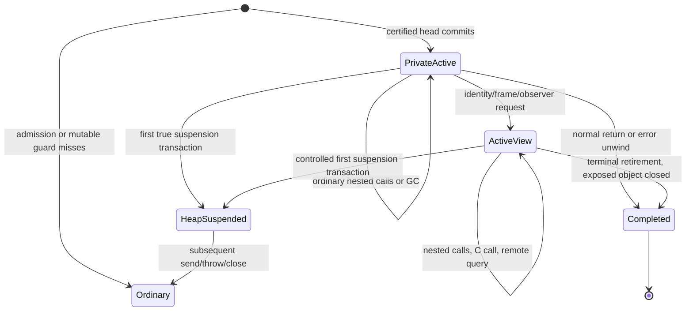

# Deferred immediate await: complete activation unit

Source-reviewed unit, 2026-11-14; root and independent Sol peer approve the architecture after the stable-address and effective-running corrections below. Implementation is authorized; no runtime qualification or admission result is claimed. Read with [round63](../../design/proposals/interpreter-parity63.md#2-defer-the-object-for-an-immediately-awaited-exact-coroutine) and [review63](review63.md). Source authority is selected57, `BASE/worktrees/call55-integrated` at `0dcba75bb3df40c32137db453b001f7e8f101de0`. Preserve the method source branch at `882309dd897327297d393265b0dd7c5c7889a502`. Implementation, if approved, starts independently from selected57; rejected creation, prepared-call and method handlers are not prerequisites.

The unit removes the coroutine object and create/return/reenter cycle when an exact native coroutine is called and immediately awaited to completion. Its ordinary body still runs. The first scope has exact positional arity, no defaults, cells/free variables, supplied self, async generators or free-threaded execution. The caller must be an existing private AWAIT activation or an embedded exact coroutine, not an ordinary THREAD/async-generator caller whose public image happens to spell SEND. Other contexts decline normally. Both zero and nonzero argument counts are supported. Ordinary nested Python calls remain ordinary calls and do not force materialization. Existing thread-call overlap remains available to those nested calls; the deferred await's own argument homes are disjoint and require one owner move.

The retained Fibonacci sites provide 971,136 monitored structural CALL/GET_AWAITABLE/None/SEND visits and zero corresponding delegated yields. These are opportunity counts, not admitted natural hits. The complete source unit must work when a different admitted coroutine really suspends or exposes its frame.

## Stable storage, separately materialized identity

**Never relocate an active frame for an observation or native call.** A real coroutine object may view its stable arena frame. Moving storage is a separate terminal operation, permitted only when the owning evaluator is about to suspend or retire that frame. This closes the raw-C-alias problem rather than hoping a GIL excludes it. A C call can retain `frame`/`base` while another thread obtains its frame: the query materializes identity and frame views but leaves both addresses intact.

Add `FRAME_OWNED_BY_AWAIT` and explicit residence/kind predicates. It means arena storage with coroutine activation semantics, not an embedded generator object. `_PyFrame_IsThreadResident` includes THREAD and AWAIT; generator identity requires an actual object. Replace enum-order tests such as `owner >= FRAME_OWNED_BY_INTERPRETER` with the corresponding positive predicate; assigning a new numeric owner is not sufficient. Keep the fixed `_PyInterpreterFrame` header at 112 bytes on the selected 64-bit GIL configuration.

Reserve an await record immediately above that header, on the arena's header side. Proposed fields are:

```c
struct _PyAwaitRecord {
    _PyErr_StackItem exc_state;             // actual owning exception state
    PyCoroObject *identity;                 // owning, initially NULL
    struct _PyAwaitRecord *previous_await;  // nonowning active-record chain
    _PyInterpreterFrame *parent;            // nonowning, reserved below us
    _PyInterpreterFrame *eval_boundary;     // this evaluator's entry sentinel
    PyObject *name, *qualname;              // owning logical-creation snapshots
    uint32_t call_index, await_index, send_index, complete_index;
    uint16_t receiver_home, input_home, complete_dst, entry_recipient;
    uint16_t saved_parent_phase;
    uint8_t state, identity_state;
};
```

This layout is 96 bytes under the proposed 64-bit GIL layout; verify with a static assertion rather than relying on that arithmetic. Semantic word indices are bounded by the existing image size and resolved against the pinned parent's current executing base, rather than retaining four PC pointers. The saved name/qualname owners preserve creation semantics if the function is mutated before observation. Transfer them into an identity when materializing; an unexposed completion releases both, so their two acquisitions/releases are charged. The combined header reservation is then 208 bytes, plus disjoint ordinary value homes. Add one active-record pointer to the thread implementation, not to every frame. No raw record byte is a PyValue slot. `saved_top` retains its existing value-top meaning; the residence-specific header extent governs pop, first-header/chunk assertions and initialized-frontier invalidation. No middle allocation is freed.

For stable identity views add one explicit nullable `active_frame` pointer to the shared generator/coroutine object header. NULL means the existing embedded frame; non-NULL means a stable active await frame. This costs one pointer per generator/coroutine/async-generator object and shifts debug offsets. It is deliberately not an overload of `base`, `f_executable`, flags or `gi_iframe`. Identity readers use `_PyGen_Frame(gen)`; retained direct embedded accesses need a reached embedded-state proof and debug assertion. Construction/copy destinations are separately named so they cannot accidentally select the view. The ordinary accessor must compile to a pointer test/select, whose cost is charged to all affected ordinary generator operations.

`_PyGen_ExceptionState(gen)` similarly selects the record's actual exception item for a view, otherwise the embedded item. The embedded item remains empty while viewing. Before identity exists, logical state lives in the record; after materialization the actual object's `gi_frame_state` is authoritative and private transitions update it. Never maintain two independently mutable copies. Every executing ancestor, including a parent waiting internally for its private child, remains FRAME_EXECUTING until a genuine external suspension. Existing send/throw/close checks reject recursive entry normally, and `cr_await` returns None for that executing ancestor, as selected `gen_getyieldfrom` requires. The private WAIT phase is a home/publication protocol, not an externally suspended generator state. Only terminal suspension commit installs FRAME_SUSPENDED_YIELD_FROM and its ordinary receiver relation.

Identity allocation reserves the object's eventual full embedded-frame capacity. It initializes name/qualname, weakrefs, state and `cr_origin=None`, then installs `active_frame` without moving homes or exception owners. Origin was disabled at logical creation; enabling origin tracking later does not retroactively create an origin. The record owns this object until terminal handoff. Object and PyFrameObject views borrow the arena frame; they do not acquire its slot owners. This is analogous to an active PyFrameObject view, but requires the explicit generator accessors above.

The new accessor is not a promise that every raw pointer obtained from an exposed object remains stable across arbitrary later callouts. The owning evaluator's existing active-frame aliases stay valid until its own terminal handoff. Other readers must either finish a callback-free read under the GIL, or retain a real PyFrameObject/coroutine object and reload its current frame after a callout/GIL release. A source census must port any reader that presently relies on permanent embedded-frame addresses. Public frame objects remain stable identities and are retargeted on terminal ownership transfer. A private C user retaining a raw borrowed view pointer across such a transfer is unsupported unless explicitly pinned; this packet adds no pinning ABI or hidden deferred arena reservation. Any existing supported reader requiring that behavior is a blocker to this layout.

## Source admission and executing-word lifetime

Use common final fixed-point use/def replay for compiler, constructor, replace and marshal images. Prove the actual CALL output is the sole input of GET_AWAITABLE, its output is SEND's receiver, the sent input is None, and the normal completion destination/edge is the existing SEND completion. No intermediate alias, extra read, branch/exception ingress, callback, observer point or incompatible owner publication is allowed. Initially accept the four actual semantic words, with geometry derived from their formats. Do not infer the relation from adjacency alone or source positions. Interior words remain ordinary entry points for ordinary object prestates.

The CALL window and eventual SEND receiver/input homes need positive readable/consumed or owner-free facts as appropriate. Overlapping homes are legal only where the common replay proves the same consumed owner, never by physical proximity. Clear every consumed CALL owner exactly once; initialize the absent SEND receiver and input cells to physical NULL with write-only stores before any scan. NO_HOME is not incoming NULL or readability. No fake coroutine, private pointer or tagged control value enters a canonical home.

One private cold pending CALL alias dispatches to the ordinary CALL body. It carries the image certificate through supported exact specialization; the active head is a distinct execution-only CALL member. Extend the existing bounded central writer to cover all four words: replacement of any covered word restores the head and each pending state's actual ordinary prefix. Nomination is never reconstructed from a live handler name. Close specialization, deopt, instruction/line wrappers, monitor disable/restore, LLTrace and execution-copy rebuilding. Keep semantic base CALL byte-sized for instrumentation and use wide IR IDs internally. Reject all private IDs through public image admission. Active source summaries remain UNKNOWN unless the actual expanded recipe proves them; no ordinary four-word owner/map certificate is exported for private state.

At a hit retain exact function-version/arity, stack-space and Python recursion checks, PEP523/value hooks, origin-depth-zero, no trace/profile/monitoring/LLTrace, and instrumentation-version freshness. Immutable function/code/entry-plan qualification belongs in cold specialization; genuinely mutable gates stay hot. Reserve extended header space including overflow/chunk growth. Before commitment, guard or allocation failure falls back/errors with original CALL homes and CALL PC intact. Reject a noninitial/altered RETURN_GENERATOR prefix. Use its actual first-send scratch/discard recipient and resume PC, not assumed slot zero; the first body entry supplies None exactly as the ordinary creation/SEND protocol would.

After nonfallible initialization, transfer function and argument owners once into disjoint child homes, install its independent code owner, constants and exception item, clear consumed parent homes, and enter after the creation prefix. No second argument snapshot or synthetic child frame is built. The parent waits internally at the real SEND semantic PC and continuation while its coroutine state remains EXECUTING. Charge the fixed decoding of the other admitted words and extended reservation; there is no per-hit descriptor lookup or global map.

## Private phase and actual roots

The parent has not published an ordinary coroutine receiver or None input. Introduce a named `AWAIT_WAIT` lifecycle phase for that interval. It selects the initialized NULL-control frame scan and suppresses ordinary SEND-prestate/shadow assertions that require a receiver object. It does not grant any stronger logical home fact. The record carries the semantic PCs/geometry and the normal body still publishes its own ordinary phases. On completion the parent resumes the original complete edge; on materialization install the real receiver and input owners and switch to the existing ordinary SEND phase before observer publication.

The thread's active-record chain is a private root source, alongside actual frame and exception roots. Frame traversal visits ordinary header/homes once; the record walk visits the owning identity and any untransferred name/qualname owners. The existing `exc_info` chain visits the record's exception owner; do not report that same owning edge twice. During retirement or partial preparation, existing transition-root receipts cover owners no longer reachable through those chains. A view object's traversal visits its own metadata only; it must not also traverse borrowed active-frame owners. Its embedded empty frame is not traversed. Once detached, existing embedded-frame traversal resumes. GC and verification never allocate, promote, take owners or call `_PyGen_GetGeneratorFromFrame` on a private record. Locals/proxy mutation still obeys the existing overwritten-local retention policy.

## Completion, exposure and first suspension



### Return and error

RETURN takes its result before retiring owners, restores `exc_info`, leaves one Python recursion level, unlinks the child, and clears/pops through the residence-specific protocol. A private completion adapter uses the saved SEND recipient/edge directly and consumes the private await relation. It shares the existing ordered canonical result publication/local displacement and redirect handling; it must not manufacture a receiver to call a helper which immediately closes it. If identity was exposed, close/clear that real object coherently and consume any actual materialized parent receiver owner. Preserve ordinary fallback completion for already detached objects.

The exact `AWAIT_WAIT` phase carries the unexposed completion receipt through retirement. `AWAIT_SEND_CHILD` is a different phase for an ordinary object-backed SEND inside a private body. If a retirement finalizer enables monitoring, the shared completion observer uses the reached coroutine receipt to report STOP_ITERATION without allocating a closed identity. Keep initialized private control authority through PRE observation; consume WAIT after the complete edge publishes its homes and before POST observation. If earlier observation already materialized the receiver and consumed WAIT, use the ordinary receiver path. Ordinary RETURN needs no new mode test or field.

For a surviving frame view, terminal retirement transfers frame ownership at the existing safe retirement boundary, using the current frame-copy/home-authority protocol. Surviving coroutine views become cleared objects with their code/name identity intact. Repair `frame_obj->f_frame` before releasing the arena reservation. Finalizer callbacks during clearing see a published retiring/result root state; they cannot find a live object pointing into reclaimed arena storage. Restore parent executable/PC after callback-capable cleanup as existing redirect protocols require.

Errors in the body use its actual instruction and handler, not CALL's error map. Unhandled errors attach the coroutine traceback frame, restore exception links/recursion and unwind through the original parent SEND/await error edge. Captured traceback frames may outlive an unmaterialized coroutine; preserve the selected frame-object ownership/capture protocol without allocating a coroutine merely for a traceback. Once retirement transfers that frame to FRAME_OBJECT ownership, its generator association follows the selected cleared-frame behavior; do not invent a closed generator association or retain a pointer to the popped record. If an identity was requested while execution was active, preserve that actual object's closed state separately.

### Observation: identity only, no relocation

Generic PyFrameObject/proxy publication can retain a stable private frame without allocating a coroutine, including traceback capture. The actual `f_generator`/PyFrame_GetGenerator getter or another coroutine-identity reader requests identity when needed. Before invoking a newly enabled observer that requires ordinary SEND relations, materialize affected identities and missing parent receiver owners. Walk records, allocate while their owners remain rooted, then install views/receivers with nonfallible pointer/owner writes. A failure before publication leaves valid private state and raises at the requesting API/event, preserving its exception contract. No arbitrary C callback or remote query can request storage relocation. PyThreadState_GetFrame retains its documented error-clearing behavior.

Observation covers `sys._getframe`, `sys._current_frames`, PyThreadState_GetFrame, f_back construction, `frame.f_generator`, PyFrame_GetGenerator, coroutine frame/code/state/await attributes, locals/proxy creation, tracing/profile/monitor start, and debugger frame mutation. A frame clear of an active private/view frame is rejected as executing. Enabling observation denies new deferred entries, but running private activations keep stable addresses and dispatch ordinary bodies with materialized relations. A native provider or Python callback alone is not an observation trigger.

### First true suspension: allocate, then terminally detach

Only an owning evaluator's terminal SEND-to-yield handoff may copy active storage. Its chain ends at that evaluator's entry sentinel, not at the oldest thread await record. A C call which invokes a nested evaluator may retain pointers to older await frames: those older frames are below that sentinel and are never relocated by the nested yield. No helper called from an arbitrary opcode may move a frame merely because it notices the mode.

At the first yielded SEND outcome, finish the current provider and its actual body-result publication, then enter an explicit promotion-capable continuation. Generic SEND leaves the yielded owner in B+2 before this boundary. For SEND_GEN, the actual child first commits its own suspension and publishes the owner to its private parent's SEND continuation; preparation runs there, after the child's native frame aliases are no longer needed. Both routes retain the real current SEND PC. Cold entry qualification must prove that this yielded continuation reaches the supported delegated YIELD before another operation or ingress. The hooks consume the existing checked SEND transport and generator-return recipes, not handler names or an assumed predecessor of YIELD.

Allocate missing coroutine identities and all destination capacity while old records/homes still own everything. Prepared identities are actual record roots; the yielded owner stays in its published home, with no new temporary array or duplicate result owner. On success, commit the needed same-evaluator private await chain: move homes/code/function/exception owners once into embedded frames, rebuild parent receivers/continuations and `previous`/`previous_item` links, retarget frame objects/profiler associations, clear view pointers, and pop old reservations strictly in stack order. All C code in this terminal continuation receives the replacement top frame and reloads its dispatch state; it may not reread old `frame`, `slots`, `window` or exception pointers. The ordinary nonraising YIELD body runs only after commit. No middle-reservation tombstone protocol is needed in this layout.

Promotion allocation can fail. Do not turn the existing YIELD intrinsic into a raising operation: its comment and close/throw compiler convention explicitly prohibit that. The new terminal preparation fails at its actual current SEND, with initialized-control cleanup rather than borrowing an ordinary YIELD error certificate. No storage has moved on failure; the yielded owner remains in its real home for the common error transition, which unwinds the still-valid private chain through real await error edges. In the SEND_GEN route the actual child is already suspended, so the preparation error belongs to its parent SEND and is never thrown into that child's YIELD. Tests must include a try/except around that await and a finally block. OOM timing/allocation-count equality is not promised, but handler, owner and exception correctness are.

## Owner and exit ledger

| State/exit | Owners and authority | Required transition |
| --- | --- | --- |
| Head miss / reservation failure | Original CALL homes; no private object | Ordinary fallback/error once at CALL |
| Private execution | Child code/function/homes; record exception and name/qualname owners; parent absent receiver physically NULL | Nested calls and GC preserve addresses; ordinary body effects remain real |
| Active identity view | Same owners plus record's actual object owner; views borrow frame | No movement; receiver publication is a separate actual owner |
| Synchronous return | One owned result rooted through retirement; actual locals may finalize | Clear/pop correct extended extent, publish original SEND result, resolve redirect |
| Body error | Raised exception + traceback/frame owners; record exception chain still valid | Existing body handler first, then await unwind; no replayed CALL |
| Identity allocation failure | Private owners unchanged, possibly prepared closed identities rooted | Roll back unpublished preparations; API/event error contract |
| Suspension preparation failure | Private owners and yielded result still explicitly rooted | Error-capable SEND transition, then ordinary unwind; never raise from YIELD |
| Suspension commit | Real objects/embedded frames acquire owners once | Retarget views, then pop only top reservations; resume via ordinary gen protocol |

## Required source and reader closure

| Source boundary | Concrete change |
| --- | --- |
| `Objects/codeobject.c`, IR format/outcome/replay readers | Four-word use/def certificate; public private-ID denial; truthful private lifecycle and error edges |
| `Tools/cases_generator/{ir_generator,analyzer,ir_error_effects,ir_metadata_generator}.py`, registry | Shared actual CALL initialization and return/yield/error recipes; reached effect/owner receipts; no joined raw C strings or helper-name ownership grants |
| `Python/{ir,specialize,instrumentation}.c` | Head nomination/revocation across all four words, pending targets, instrumentation restoration and wide role IDs |
| `pycore_interpframe_structs.h`, `pycore_interpframe.h`, `Python/pystate.c` | Explicit record, residence predicates, extended push/pop/chunk/initialized-frontier accounting and thread active-record root |
| `Python/{ceval,frame}.c`, bytecodes | Entry, exception/recursion links, private completion/error retirement, stable identity views, terminal-only chain detachment |
| `Objects/genobject.c`, `pycore_genobject.h` | Port direct iframe/exception access in send, throw, close, finalizer, clear, code/frame/await attributes, size and constructors; ordinary embedded objects remain default |
| `Objects/frameobject.c` | Stable frame/proxy views need no coroutine allocation; materialize at actual f_generator getter; clear rejection and terminal copy/capture |
| `Python/{gc,gc_trace,gc_free_threading}.c` | Real record roots, no double-counted borrowed traversal; FT execution denied but shared readers/layout remain valid |
| `pycore_debug_offsets.h`, remote frame/profiler readers, tests/CAPI/extensions | Update actual layout/representation discriminator; remote tools cannot blindly embedded-cast a view; rebuilt private users use checked accessor |

Current selected anchors: `pycore_interpframe_structs.h:20–135` (owner/header/gen layout), `pycore_interpframe.h:534–598,680–815` (incomplete/view/arena/call residence), `pycore_genobject.h:18–24` (embedded cast), `bytecodes.c:1467–1498,1599–1662,1724–1766,4353–4399,5270+` (return/send/yield/exact call/creation), `Python/ceval.c:3265–3380` (retirement), `Python/frame.c:232–375` (traverse/view/ownership copy), `Objects/genobject.c:73–109,176–295,1174–1249` (direct readers/construction), `Objects/frameobject.c:3915–3927,4017–4065,4541` (identity/traverse/clear/API), `Python/gc_trace.c:1170–1194` (frame and exception roots). A final `gi_iframe/cr_iframe/gi_exc_state/owner` census must classify every changed reader, including generated source/templates and test C APIs, before the source packet is frozen.

## Implementation order and stop gates

1. Close stable-view generator/frame accessors and arena record/root lifecycle, with ordinary embedded behavior unchanged apart from explicit representation selection. No active head yet. A retained raw iframe access or an observer path requiring mid-C relocation blocks implementation.
2. Add common image certificate, cold writer closure and exact entry/completion/error unit together. Do not enable a head whose ordinary completion, observation or exception exit is missing. Ordinary nested exact calls use thread residence; no per-call promotion check is added.
3. Add identity-only observation and first-suspension terminal transaction before executing any candidate image. This is a complete unit gate, not a later compatibility rollout.

Minimal host controls: renamed actual producer positive, lost/aliased CALL or GET_AWAITABLE value negative, changed None/entry recipient/SEND edge negative, extra read/branch/EH ingress negative, missing TAKE/current owner and source mutation negatives, private effects/error receipts and all writer/restoration mappings. Cover constructor/replace/marshal plus compiler through the same nomination.

Root runtime minimum: synchronous recursive Fibonacci-like completion and zero/many args; nested ordinary calls and native callbacks which do not observe; body/await exceptions, recursion limit and try/finally; first real yield and multi-level promotion followed by send/throw/close; allocation failures for entry, identity and chain promotion; argument/code mutation and mortal/result/local alias callbacks; GC cycles through locals/exception/identity and eventual release. Query f_frame/f_generator/cr_frame/cr_await and proxies at multiple depths, enable monitoring/profile/origin after entry, redirect a materialized frame, and request frames from another thread while a native call has released the GIL. Retain the native alias across that query and then use it safely. Assert no address movement until the terminal boundary. Traceback-retained frame identity and ordinary PyGen/PyCoro/async-generator controls are mandatory.

Native falsifiers: zero useful natural hits; an object allocated on every synchronous completion; ordinary nested calls forcing exposure; extra argument duplication; two exception owners; per-opcode mode tests; active relocation across a native continuation; generator traversal allocating; a supposedly nonraising YIELD receiving an unmodeled error; or unbounded native stack/temporary arrays. Price the 96-byte await record, disjoint argument move/clear, entry word decoding, exception link/unlink, new generator pointer/selection, observer preparation and terminal chain copy. Inspect ordinary CALL/RETURN/SEND/YIELD and generator APIs for new branches/spills as well as the admitted whole cycle. Preserve NCSR, compiler, flags and benchmark protocol. Selection needs natural admission/hit/materialization counts, actual whole-cycle instructions/cycles and the unchanged broad sentinels; structural visit counts and removed allocations alone cannot establish a winner.

## Source census and cost ledger before private entry

The source is still inactive: record/view, SEND handoff, suspension coverage and entry/completion helpers have bounded source reviews; nomination, private heads and central writer closure remain unfinished. This ledger is a source accounting obligation, not native qualification. Raw-reader snapshots are retained under `E59/deferred-await-source-host/raw-{readers-current,generators-all}.txt`; generated products still belong to selected57 until root regenerates the completed unit.

| Reader family | Current closure / remaining gate |
| --- | --- |
| Generator metadata, frame and exception getters | Select the active view or embedded representation. Active views stay EXECUTING; ordinary send/throw/close state admission rejects recursive entry. A raw frame borrowed by a native provider remains stable across that provider. |
| Embedded constructors, clear and deallocation | Initialize `active_frame=NULL`; clear/deallocation require NULL. Terminal detachment alone transfers the active owners into embedded storage. Fixed-size/sizeof offsets include the new pointer. |
| SEND entry and YIELD templates | Raw embedded frame/exception access is reached only after successful ordinary generator-state admission. An active view is EXECUTING and cannot pass that admission. Delegated YIELD requires an already detached GENERATOR frame. These retained raw accesses need explicit source assertions/fixture coverage before head enablement. |
| Frame/proxy/debugger readers | Generic frame exposure keeps the arena address. Only an identity getter allocates the object view. Active `frame.clear` rejects; internal WAIT is not suspended. Captured/retired frames use existing FRAME_OBJECT ownership. |
| GC and retirement | Frame/header/homes, record metadata and exception chain report their actual owning edges once. A CLEARED record reports the exception edge after unlink. Traversal never allocates or changes residence. |
| Remote reader and test C API | ABI 2 supplies the explicit active-frame offset and validates the pointed-to frame. EXECUTING AWAIT views have no public awaited child. Embedded-only synthetic copy fixtures remain embedded; active-view corruption and terminal handoff controls remain to be added. |

The unchanged 112-byte header gains a separate 96-byte record per private activation, plus the existing disjoint value extent. Entry zeroes that record, acquires name and qualname once each, links one exception item and one thread record, and moves the function and each argument once. It clears their original homes, the virtual self hole and three SEND control homes; aliasing may make some stores redundant, but no native elimination is claimed. The existing initializer owns code and fills constant slots. Reservation can still allocate an arena chunk. The normal unexposed path releases both metadata owners and retires the extended reservation; it does not allocate a generator object.

Ordinary source costs also count: one pointer field in every generator/coroutine/async-generator object, a thread record pointer, active-versus-embedded selections in shared getters/traversal, positive residence tests for ordinary call overlap, the AWAIT retirement branch, and conditional SEND/YIELD handoff checks. Ordinary RETURN has no new private-mode test. Generator completion adds an exact WAIT test and the shared observer receives its explicit completion flag; ordinary callers pass false. Root must inspect the compiled ordinary paths, spills and total text alongside the admitted cycle. No byte-equivalence or broad speedup is claimed from these source changes.
